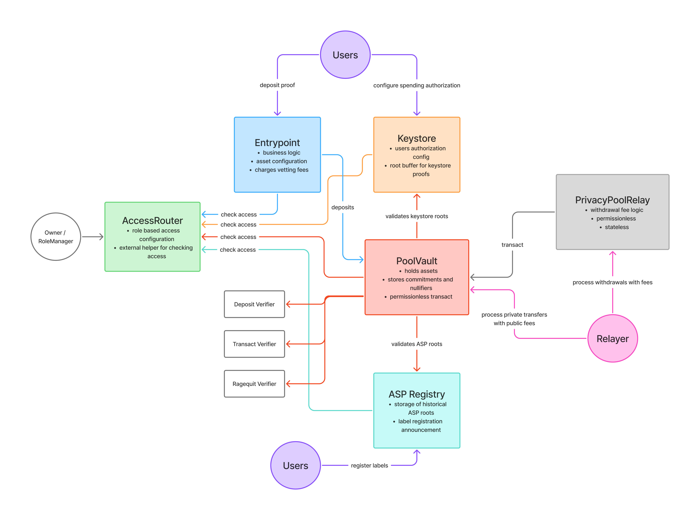
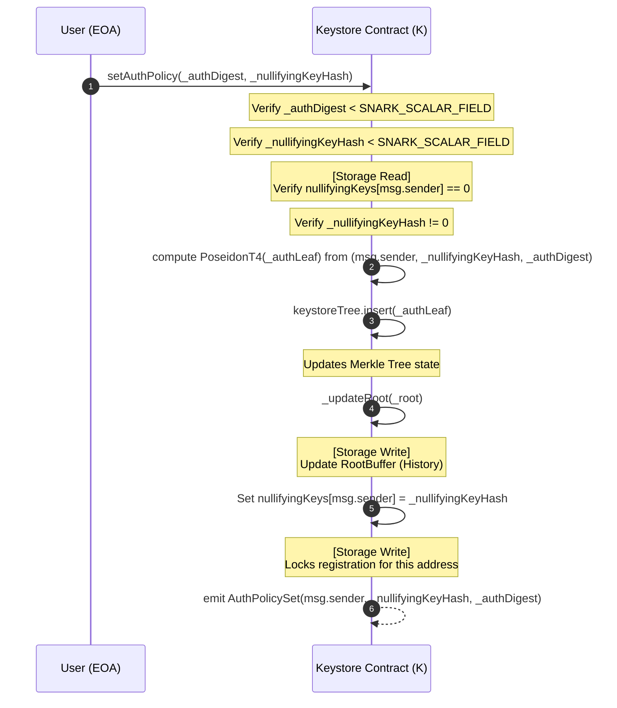
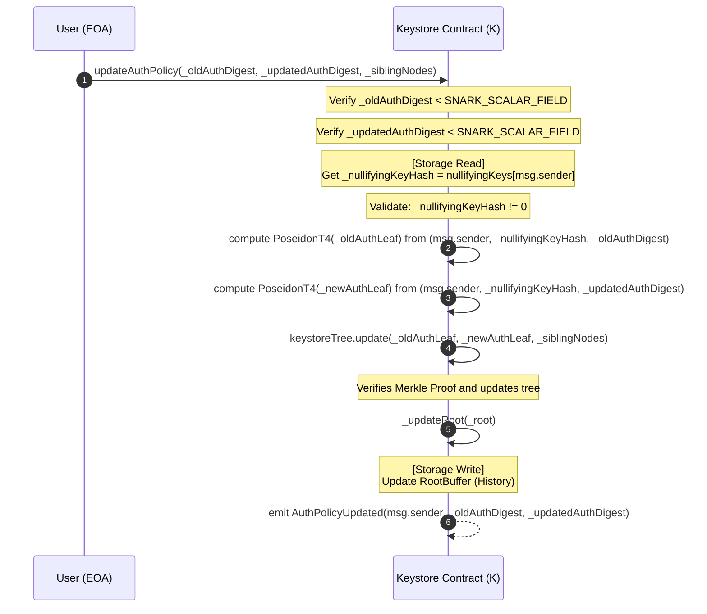
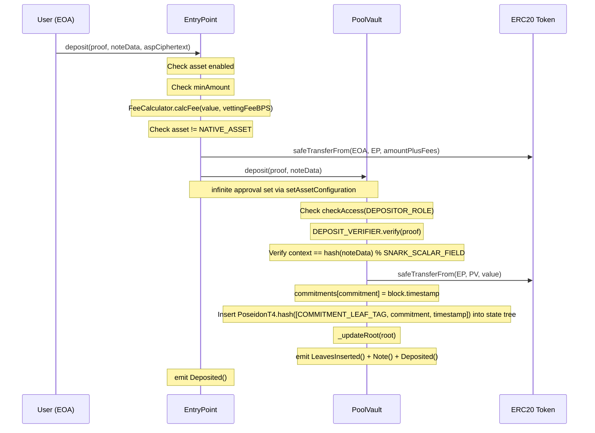
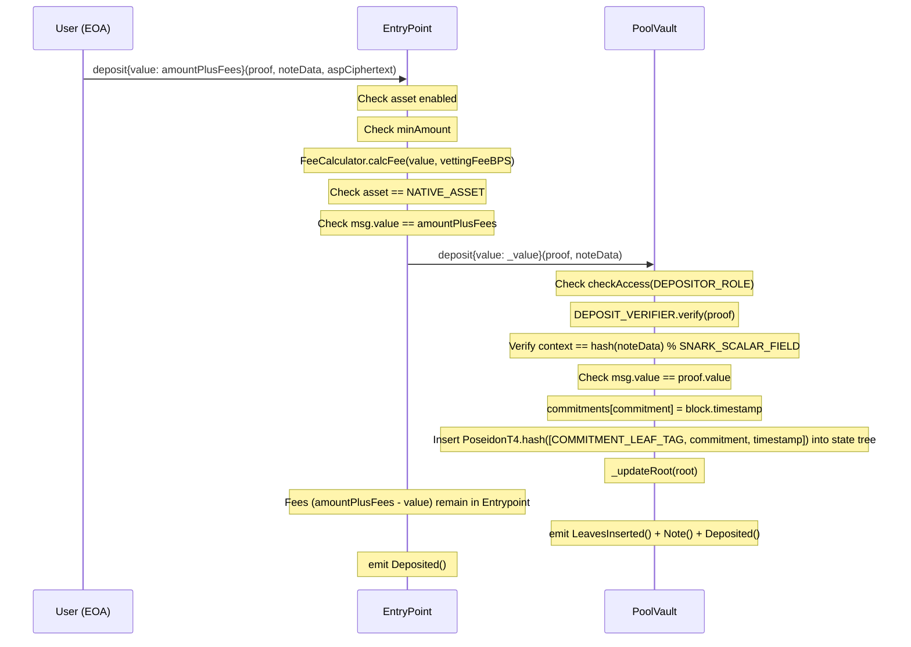
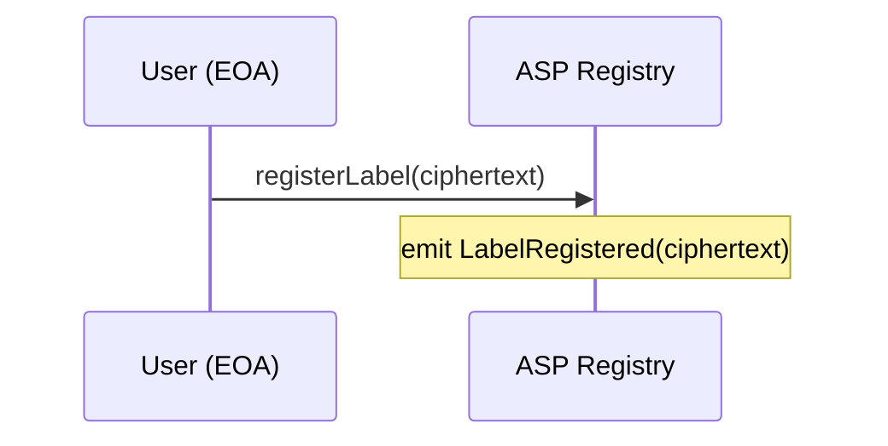
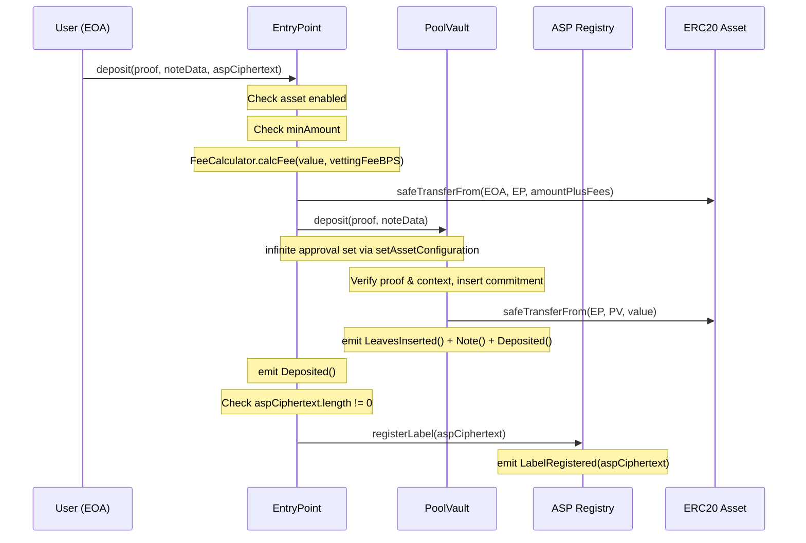
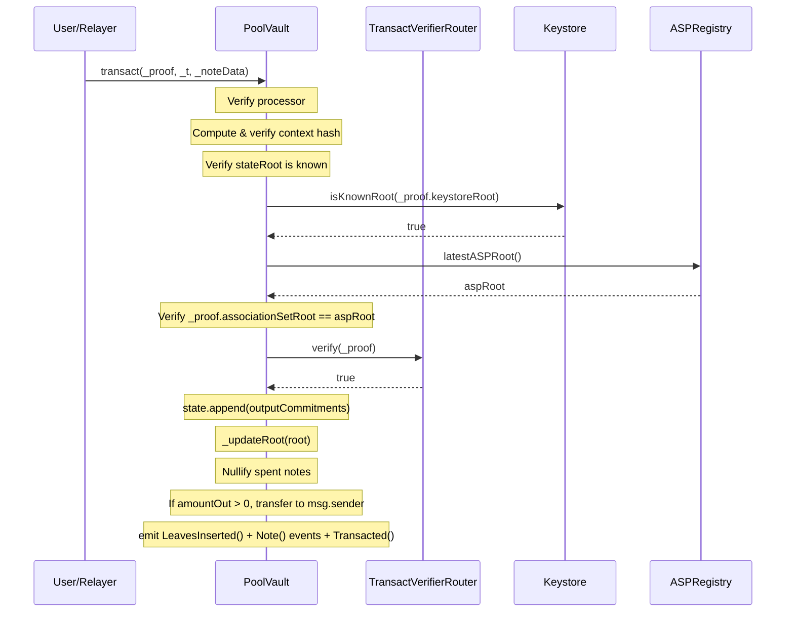
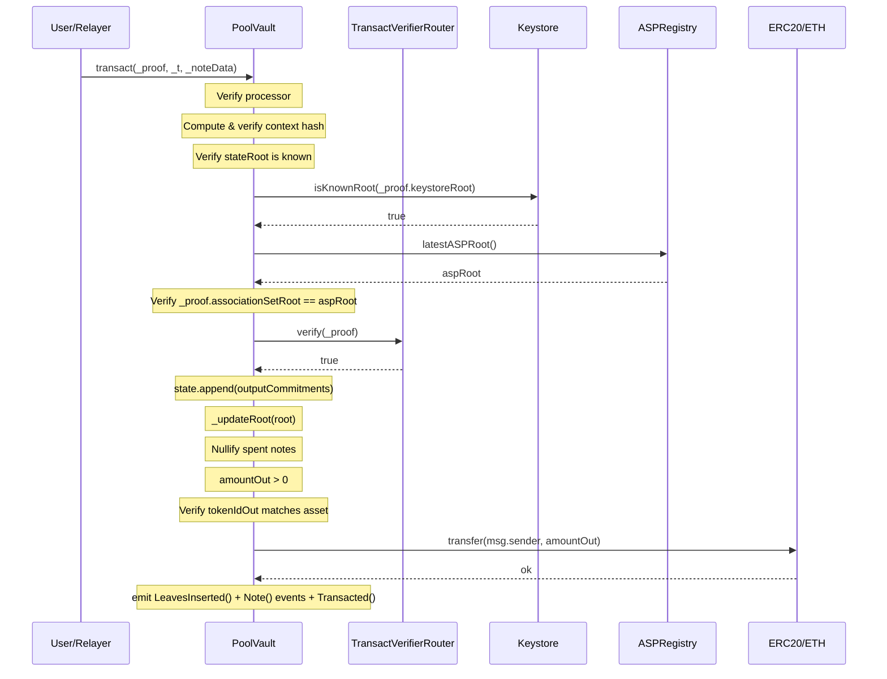

# Contracts - Tech Design

# Background

Privacy Pools V2 will be an upgradeable but modular enough on-chain protocol to enable highly complex privacy preserving operations while keeping compliance lineage tracking for the purpose of preventing unwanted actors from leveraging the system.

For the 2.0 version of the protocol, a more complex but succinct set of features will be developed, with more to come in the future as part of upgrades or smart contract extensions enabled by an abstract and flexible implementation.

# General

### Core features

- **Deposit** **→** allow users to place different assets into the protocol
- **Label registration →** allow users to privately inform an ASP about a client-side generated label for the purposes of preventing a recipient of private transfers to be able to identify the account that placed those funds into the protocol
- **Private transfer** **→** allow users to send funds as private notes to recipients, making no public information about the operation performed (complete sender and recipient privacy)
- **Withdrawal** **→** allow users to withdraw funds from the protocol while keeping the link between deposit, internal transfers and withdrawal private
- **Cold start** **→** allow users to receive private notes from senders or depositors using only a standard EVM account address, without needing to download or generate any protocol-specific software or credentials
- **Auth configuration →** allow users to configure different authorization policies according to their usage and needs, and have an easy way to rotate the authorization policy of all their commitments in a single on-chain operation (without exposing any information about their held funds)
- **Ragequit →** allow users to unconditionally exit the protocol while exposing the link between their funds and the account that deposited them into the protocol
- **Onchain announcement →** allow users to use the protocol as an on-chain announcement channel for communicating transfers and commitment secrets

<aside>
ℹ️

**Disclaimer:** As per 0xbow’s request and on the purpose of making it future proof. Privacy pools v2 is upgradeable, deviating from the immutability invariant from the first version of the protocol. This enables to add further features, authorization methods, compliance mechanisms and DeFi composability layer without having to migrate user funds or commitment state, which is the path a privacy preserving protocol should avoid at all costs preserving the anonymity set.

The proposed architecture must allow for an effective but safe path for incorporating said post-deployment improvements, and also have a way to halt (most) operations of the protocol in case of a smart contract vulnerability, to keep funds and state safe while a fix is planned and deployed.

</aside>

### Protocol actors

The main actors of the protocol are:

- **Users** → people who deposit funds into PP2 and transact privately or rageQuit.
- **Relayers** → third parties that process withdrawals and private transfers on behalf of users, charging fees for the service while preserving recipient privacy.
- **ASP** → the organization analyzing deposits and managing compliance approvals.
- **Upgrade Committee** → a multisignature wallet with the permission to upgrade the implementations for different protocol contracts → [Upgrade Mechanism](#upgrade-mechanism)
- **Emergency Council** → a different multisignature wallet with the permission to immediately pause the core protocol contract methods (except the `ragequit`) in case of an emergency.

---

# In Depth

## Smart Contracts Architecture



The initial smart contract system will be split into 6 different contracts according to their concerns, most of them upgradeable by the Upgrade Committee ideally under different upgrade policies, being the `PoolVault` and the `Keystore` the irreplaceable **core** and the rest swappable **periphery**.

The system is composed of:

1. `PoolVault` → core contract of the protocol, holding the assets and the most fundamental state storage: commitments and spent nullifiers
2. `Entrypoint` → business logic, where asset configuration lives and entrypoint for user operations
3. `Keystore` → where accounts set their authorization policies for spending notes privately, and the protocol manager can approve new authorization methods
4. `ASPRegistry` → minimal contract for the ASPs to publish roots and any compliance related information to be announced onchain
5. `PrivacyPoolRelay` → processor contract that executes withdrawals on behalf of users, splitting `amountOut` between a recipient and a fee recipient to compensate relayers for gas costs while preserving sender privacy
6. `AccessRouter` → Centralized role-based access control registry for Privacy Pools V2

---

## 1. Pool Vault

The heart of the protocol. This contract holds all deposited assets and maintains the two pieces of state that define ownership: the commitment tree and the spent nullifiers registry.

All deposits, transfers, withdrawals, and ragequits are processed here. Each operation is validated through ZK proofs that enforce strict value conservation.

<aside>
🚨

Complexity is deliberately pushed to peripheral contracts. Upgrades to `PoolVault` should only happen when value conservation circuits need to be updated.

</aside>

### Storage

PoolVault is upgradeable (UUPS), so all mutable state lives in an ERC-7201 namespaced struct. ERC-7201 places each struct at a deterministic, non-overlapping slot range, which eliminates the need for `__gap` arrays and makes the layout forward-compatible when fields are appended in future upgrades.

**`PoolVaultStorage`** (namespaced at `privacypools.storage.PoolVault`):

| Field | Type | Description |
|---|---|---|
| `aspRegistry` | `IASPRegistry` | ASP registry reference |
| `keystore` | `IKeystore` | Keystore reference |
| `ragequitVerifier` | `IRagequitVerifier` | Ragequit proof verifier |
| `depositVerifier` | `IDepositVerifier` | Deposit proof verifier |
| `maxStateTreeSize` | `uint256` | Capacity cap for the state tree (`2^stateMaxDepth`). Checked before every insertion; reverts with `PoolVault_StateTreeFull()` if exceeded. |
| `stateTree` | `LeanIMTData` | Lean Incremental Merkle Tree storing domain-tagged timestamped leaves (see below) |
| `spentNullifiers` | `mapping(uint256 => uint256)` | Nullifier hash to timestamp when spent (0 if unspent) |
| `commitments` | `mapping(uint256 => uint256)` | Commitment hash to timestamp when created (0 if unused) |

All reference fields (`aspRegistry`, `keystore`, `ragequitVerifier`, `depositVerifier`, `maxStateTreeSize`) are set during `initialize()` and replaceable by `UPGRADER_ROLE` via dedicated setters. For rotating the deposit, ragequit and transact verifiers together after a key change, see [§6](#6-transact-verifier-router).

**State tree leaves:** each leaf is domain-tagged and timestamped via `PoseidonT4.hash([TAG, value, block.timestamp])`. `COMMITMENT_LEAF_TAG` and `NULLIFIER_LEAF_TAG` are Poseidon hashes of UTF-8 domain strings defined in `Constants.sol`.

**Inherited storage** (outside the `PoolVaultStorage` struct):

- Circular root buffer (from `RootBufferUpgradeable`)
- Transact verifier registry (from `TransactVerifierRouter`), supporting multiple verifiers for different circuit sizes (NxM inputs/outputs)

### Methods

- **`deposit(ProofLibV2.DepositProof calldata _proof, NoteData calldata _noteData)`**
    - Public signals: `tokenId`, `value`, `context`, `outputCommitment`
    - Deposits funds into the pool with a ZK proof that the commitment was correctly computed from the note's private details.
    - Callable only by `DEPOSITOR_ROLE` (the Entrypoint contract)
    - Pausable
    - On ERC20 deposits, pulls the asset from the caller via `safeTransferFrom`
    - On native asset deposits, requires `msg.value == value`
    - Validates the proof `context` matches `keccak256(abi.encode(_noteData)) % SNARK_SCALAR_FIELD`
    - Records the commitment with its creation timestamp
    - Checks `maxStateTreeSize` capacity, then inserts a domain-tagged timestamped leaf `PoseidonT4.hash([COMMITMENT_LEAF_TAG, commitment, timestamp])` into the state tree and updates the root buffer
    - Emits `Note(_noteData.hint, _noteData.data)` for recipient discovery and `Deposited()` with the commitment, asset, value, and caller
- **`transact(ProofLibV2.TransactProof calldata _proof, TransactParams calldata _transactParams, NoteData[] calldata _noteData)`**
    - Public signals: `stateRoot`, `keystoreRoot`, `associationSetRoot`, `amountOut`, `tokenIdOut`, `context`, `nullifierHashes[]`, `outputCommitments[]`
    - Method used for private transfers and withdrawals. Allows spending and creating multiple notes atomically.
    - Requires `msg.sender == _transactParams.processor` (the caller must be the designated processor)
    - Pausable, non-reentrant
    - `amountOut` represents the value exiting the private system to a public address. It can be zero (pure private transfer) or greater (partial/full withdrawal).
    - Validates the proof `context` matches `keccak256(abi.encode(_transactParams, _noteData)) % SNARK_SCALAR_FIELD`
    - Verifies the state root is in the root buffer, keystore root is known, and ASP root matches the latest
    - Proof verification is routed through `TransactVerifierRouter`, which selects the correct verifier based on the number of nullifiers and output commitments
    - Records commitments and nullifiers with timestamps, building domain-tagged leaves (`PoseidonT4.hash([COMMITMENT_LEAF_TAG, ...])` for commitments, `PoseidonT4.hash([NULLIFIER_LEAF_TAG, ...])` for nullifiers) and inserting all in a single batch via `insertMany`. Checks `maxStateTreeSize` capacity before insertion.
    - Emits one `Note` event per entry in `_noteData` for recipient discovery
    - If `amountOut > 0`, transfers the withdrawn asset to the caller
    - If `amountOut == 0` (pure private transfer), requires `tokenIdOut == address(0)`; otherwise reverts with `PoolVault_TokenIdMustBeZeroOnInternalTransfer`. This forces a single canonical encoding for internal transfers and prevents calldata-level fingerprinting (the circuit's value-conservation constraint is vacuous on `tokenIdOut` when `amountOut == 0`, so the contract enforces the canonical value).
- **`ragequit(ProofLibV2.RagequitProof calldata _proof)`**
    - Public signals: `keystoreRoot`, `ownerAddress`, `value`, `tokenId`, `label`, `nullifierHash`, `commitment`
    - ASP-independent exit method. Works for any deposit regardless of approval status, and **cannot be paused**.
    - Permissionless, non-reentrant
    - Must be called by the `ownerAddress` encoded in the proof
    - Rejects zero-value ragequits (`PoolVault_ZeroValueRagequit`)
    - Verifies the commitment exists (via the `commitments` mapping), nullifier is unspent, and keystore root is known
    - Publicly exposes the `label` for the ASP to link the ragequit back to the original deposit
    - Checks `maxStateTreeSize` capacity, then inserts a domain-tagged timestamped nullifier leaf `PoseidonT4.hash([NULLIFIER_LEAF_TAG, nullifierHash, timestamp])` into the state tree (consistent with transact pattern)
    - Transfers the withdrawn asset to `msg.sender`
- **`pause()` / `unpause()`** — access gated by `PAUSER_ROLE` / `UNPAUSER_ROLE` via AccessRouter
- **`_authorizeUpgrade()`** — access gated by `UPGRADER_ROLE` via AccessRouter
    

<aside>
📌

The `processor` and `data` pattern from V1 is retained for withdraw hook extensibility. The caller must always match the `processor` address bound in the proof context, so a relayer submitting a transaction sets itself as the processor when building the proof.

</aside>

### Structs

- `NoteData { bytes32 hint; bytes data; }` — discovery data attached to an output note. `hint` is an indexed `bytes32` tag that recipients use for RPC-level log filtering (e.g. filtering `Note` events by their own identifier) without scanning all data. `data` carries the encrypted note payload. Both fields are opaque to the contract.
  - **Privacy note:** a third-party RPC provider can observe which `hint` values a client filters for, potentially linking a user to their incoming transactions.
  - Recipients can pre-compute the hints they expect and poll only for those, enabling fast discovery of warm (expected) incoming transfers without scanning all `Note` events.
- `TransactParams { address processor; bytes data; }` — routing parameters for `transact`. `processor` must equal `msg.sender` (enforced on-chain), binding the transaction to a specific caller (e.g. the relay contract that pays out a withdrawal). `data` is ABI-encoded input forwarded to the processor (e.g. `PayoutRouting` with recipient, fee recipient, and fee amount). Both fields are bound into the proof `context` to prevent proof malleability.

### Events

- `Deposited(uint256 outputCommitment, address indexed asset, uint256 depositedValue, address indexed caller)`
- `Transacted(uint256[] outputCommitments, uint256[] nullifierHashes, address indexed asset, uint256 withdrawnValue, address indexed caller)` — `asset` is `address(0)` on pure private transfers (`withdrawnValue == 0`)
- `Ragequit(address indexed ragequitter, address indexed asset, uint256 value, uint256 commitment, uint256 nullifierHash, uint256 label)`
- `Note(bytes32 indexed hint, bytes data)` — emitted once per output note (both deposit and transact flows). Recipients filter on `hint` at the RPC layer to discover notes addressed to them without scanning all event data.
- `LeavesInserted(uint256[] _newLeaves, uint256 _root, uint256 _startIndex)` — from `ITreeUpdates`, emitted on every leaf insertion (including single-leaf inserts in deposit and ragequit, which wrap the leaf in a one-element array)
- `Paused(address account)` / `Unpaused(address account)` — from OpenZeppelin `PausableUpgradeable`

### **Pseudocode**

```solidity
// SPDX-License-Identifier: BUSL-1.1
pragma solidity 0.8.32;

contract PoolVault is
    UUPSUpgradeable,
    PausableUpgradeable,
    ReentrancyGuardTransientUpgradeable,
    RootBufferUpgradeable,
    TransactVerifierRouter,
    IPoolVault
{
    using LeanIMT for LeanIMTData;
    using ProofLibV2 for ProofLibV2.DepositProof;
    using ProofLibV2 for ProofLibV2.TransactProof;
    using ProofLibV2 for ProofLibV2.RagequitProof;
    using SafeTransferLib for address;
    using ProofLibV2 for IDepositVerifier;

    // ERC-7201 namespaced storage location
    // keccak256(abi.encode(uint256(keccak256("privacypools.storage.PoolVault")) - 1)) & ~bytes32(uint256(0xff))
    bytes32 private constant POOL_VAULT_STORAGE_LOCATION =
        0x04f94a259c17773cffd4d392dc6f19667d3afc5d3a6a5212bdd6519d43e5e100;

    // PoolVaultStorage struct (defined in IPoolVault):
    //   IASPRegistry aspRegistry
    //   IKeystore keystore
    //   IRagequitVerifier ragequitVerifier
    //   IDepositVerifier depositVerifier
    //   uint256 maxStateTreeSize
    //   LeanIMTData stateTree
    //   mapping(uint256 => uint256) spentNullifiers
    //   mapping(uint256 => uint256) commitments

    constructor(IAccessControl _accessRouter) Permissioned(_accessRouter) {
        _disableInitializers();
    }

    function initialize(
        uint32 _rootHistorySize,
        VerifierConfig[] calldata _verifierConfigs,
        IASPRegistry _aspRegistry,
        IKeystore _keystore,
        IRagequitVerifier _ragequitVerifier,
        IDepositVerifier _depositVerifier,
        uint256 _maxStateTreeSize
    ) external initializer {
        __UUPSUpgradeable_init();
        __Pausable_init();
        __ReentrancyGuardTransient_init();
        __RootBufferUpgradeable_init(_rootHistorySize);
        __TransactVerifierRouter_init(_verifierConfigs);

        PoolVaultStorage storage $ = _getPoolVaultStorage();
        $.aspRegistry = _aspRegistry;
        $.keystore = _keystore;
        $.ragequitVerifier = _ragequitVerifier;
        $.depositVerifier = _depositVerifier;
        $.maxStateTreeSize = _maxStateTreeSize;
    }

    function deposit(
        ProofLibV2.DepositProof calldata _proof,
        NoteData calldata _noteData
    ) external payable whenNotPaused checkAccess(DEPOSITOR_ROLE) {
        PoolVaultStorage storage $ = _getPoolVaultStorage();
        require($.depositVerifier.verify(_proof), PoolVault_InvalidDepositProof());

        // Verify context binds proof to note data
        require(
            _proof.context() == uint256(keccak256(abi.encode(_noteData))) % SNARK_SCALAR_FIELD,
            PoolVault_ProofContextMismatch()
        );

        address _asset = _proof.tokenId();
        uint256 _value = _proof.value();
        uint256 _commitment = _proof.outputCommitment();

        if (_asset == Constants.NATIVE_ASSET) {
            require(msg.value == _value, PoolVault_InvalidValue());
        } else {
            require(msg.value == 0, PoolVault_UnexpectedETHAmount());
            _asset.safeTransferFrom(msg.sender, address(this), _value);
        }

        require(!_commitmentExists(_commitment), PoolVault_CommitmentAlreadyUsed());
        $.commitments[_commitment] = block.timestamp;

        // Domain-tagged timestamped leaf
        uint256 _leafValue = PoseidonT4.hash([Constants.COMMITMENT_LEAF_TAG, _commitment, block.timestamp]);
        require($.stateTree.size + 1 <= $.maxStateTreeSize, PoolVault_StateTreeFull());
        (uint256 _root, uint256 _index) = _insertInStateTree(_leafValue);
        _updateRoot(_root);

        uint256[] memory _leaves = new uint256[](1);
        _leaves[0] = _leafValue;
        emit LeavesInserted(_leaves, _root, _index);
        emit Note(_noteData.hint, _noteData.data);
        emit Deposited(_commitment, _asset, _value, msg.sender);
    }

    function transact(
        ProofLibV2.TransactProof calldata _proof,
        TransactParams calldata _transactParams,
        NoteData[] calldata _noteData
    ) external whenNotPaused nonReentrant {
        require(_transactParams.processor == msg.sender, PoolVault_InvalidProcessor());

        require(
            _proof.context() == uint256(keccak256(abi.encode(_transactParams, _noteData))) % SNARK_SCALAR_FIELD,
            PoolVault_ProofContextMismatch()
        );

        // Validate state root, keystore root, ASP root, and verify the transact ZK proof
        _validateAndVerify(_proof);

        uint256[] calldata _outputCommitments = _proof.outputCommitments();
        uint256[] calldata _nullifierHashes = _proof.nullifierHashes();
        uint256 _numCommitments = _outputCommitments.length;
        uint256 _numNullifiers = _nullifierHashes.length;
        uint256[] memory _leaves = new uint256[](_numCommitments + _numNullifiers);
        PoolVaultStorage storage $ = _getPoolVaultStorage();

        for (uint256 i; i < _numCommitments; ++i) {
            require(!_commitmentExists(_outputCommitments[i]), PoolVault_CommitmentAlreadyUsed());
            $.commitments[_outputCommitments[i]] = block.timestamp;
            _leaves[i] = PoseidonT4.hash([Constants.COMMITMENT_LEAF_TAG, _outputCommitments[i], block.timestamp]);
        }

        for (uint256 i; i < _numNullifiers; ++i) {
            uint256 _nullifierHash = _nullifierHashes[i];
            require(!_nullifierSpent(_nullifierHash), PoolVault_NullifierAlreadySpent());
            $.spentNullifiers[_nullifierHash] = block.timestamp;
            _leaves[_numCommitments + i] = PoseidonT4.hash([Constants.NULLIFIER_LEAF_TAG, _nullifierHash, block.timestamp]);
        }

        require($.stateTree.size + _leaves.length <= $.maxStateTreeSize, PoolVault_StateTreeFull());
        (uint256 _root, uint256 _startIndex) = _insertInStateTree(_leaves);
        _updateRoot(_root);
        emit LeavesInserted(_leaves, _root, _startIndex);

        // Handle withdrawal if amountOut > 0; otherwise require canonical tokenIdOut == 0
        address _asset;
        uint256 _withdrawnValue = _proof.amountOut();
        if (_withdrawnValue > 0) {
            _asset = _proof.tokenIdOut();
            _transferAsset(_asset, _withdrawnValue);
        } else {
            require(_proof.tokenIdOut() == address(0), PoolVault_TokenIdMustBeZeroOnInternalTransfer());
        }

        for (uint256 i; i < _noteData.length; ++i) {
            emit Note(_noteData[i].hint, _noteData[i].data);
        }
        emit Transacted(_outputCommitments, _nullifierHashes, _asset, _withdrawnValue, msg.sender);
    }

    function ragequit(ProofLibV2.RagequitProof calldata _proof) external nonReentrant {
        PoolVaultStorage storage $ = _getPoolVaultStorage();
        require(msg.sender == _proof.ownerAddress(), PoolVault_InvalidOwnerAddress());
        require(_proof.value() != 0, PoolVault_ZeroValueRagequit());
        require(_commitmentExists(_proof.commitment()), PoolVault_CommitmentNotFound());

        uint256 _nullifierHash = _proof.nullifierHash();
        require(!_nullifierSpent(_nullifierHash), PoolVault_NullifierAlreadySpent());
        require($.keystore.isKnownRoot(_proof.keystoreRoot()), PoolVault_UnknownKeystoreRoot());
        require(
            $.ragequitVerifier.verifyProof(_proof.pA, _proof.pB, _proof.pC, _proof.pubSignals),
            PoolVault_InvalidRagequitProof()
        );

        $.spentNullifiers[_nullifierHash] = block.timestamp;

        // Domain-tagged timestamped nullifier leaf
        uint256 _nullifierLeaf = PoseidonT4.hash([Constants.NULLIFIER_LEAF_TAG, _nullifierHash, block.timestamp]);
        require($.stateTree.size + 1 <= $.maxStateTreeSize, PoolVault_StateTreeFull());
        (uint256 _root, uint256 _index) = _insertInStateTree(_nullifierLeaf);
        _updateRoot(_root);

        uint256[] memory _leaves = new uint256[](1);
        _leaves[0] = _nullifierLeaf;
        emit LeavesInserted(_leaves, _root, _index);

        uint256 _value = _proof.value();
        address _asset = _proof.tokenId();
        _transferAsset(_asset, _value);

        emit Ragequit(msg.sender, _asset, _value, _proof.commitment(), _nullifierHash, _proof.label());
    }

    function pause() external checkAccess(PAUSER_ROLE) { _pause(); }
    function unpause() external checkAccess(UNPAUSER_ROLE) { _unpause(); }

    // UPGRADER_ROLE setters for mutable references
    function setAspRegistry(IASPRegistry _aspRegistry) external checkAccess(UPGRADER_ROLE) { ... }
    function setKeystore(IKeystore _keystore) external checkAccess(UPGRADER_ROLE) { ... }
    function setRagequitVerifier(IRagequitVerifier _ragequitVerifier) external checkAccess(UPGRADER_ROLE) { ... }
    function setDepositVerifier(IDepositVerifier _depositVerifier) external checkAccess(UPGRADER_ROLE) { ... }
    function setMaxStateTreeSize(uint256 _maxStateTreeSize) external checkAccess(UPGRADER_ROLE) { ... }

    // View accessors
    function aspRegistry() external view returns (IASPRegistry) { ... }
    function keystore() external view returns (IKeystore) { ... }
    function ragequitVerifier() external view returns (IRagequitVerifier) { ... }
    function depositVerifier() external view returns (IDepositVerifier) { ... }
    function maxStateTreeSize() external view returns (uint256) { ... }
    function spentNullifiers(uint256 _nullifierHash) external view returns (uint256 _spentAt) { ... }
    function commitments(uint256 _commitmentHash) external view returns (uint256 _createdAt) { ... }

    function _authorizeUpgrade(address) internal override checkAccess(UPGRADER_ROLE) {}

    function _getPoolVaultStorage() internal pure returns (PoolVaultStorage storage $) {
        assembly { $.slot := POOL_VAULT_STORAGE_LOCATION }
    }
}
```

---

## 2. Entrypoint

### Storage

State lives in ERC-7201 namespaced storage (`erc7201:privacypools.storage.Entrypoint`):

- `poolVault` — upgradeable `IPoolVault` reference. Set once in `initialize(_poolVault)` and replaceable by `UPGRADER_ROLE` via `setPoolVault` (see [PoolVault upgrade procedure](#poolvault-upgrade-procedure) below).
- `assetConfigs` — mapping `(address asset => AssetConfig config)` with view getter `assets()`.
- The ASP registry is **not** stored on the Entrypoint; it is resolved on demand via `poolVault.aspRegistry()` so the `PoolVault` remains the single source of truth (consistent with §1.1, which keeps the `PoolVault` as the irreplaceable core).
- No `__gap` — ERC-7201 layout is forward-compatible by construction.

### Methods

- `deposit(ProofLibV2.DepositProof calldata _proof, IPoolVault.NoteData calldata _noteData, bytes calldata _aspCiphertext)`
    - Method callable by users to deposit funds into Privacy Pools and pay vetting fees to the ASP
    - Checks asset configuration and pulls the deposit value plus vetting fees from the address calling
    - Forwards `_noteData` to `PoolVault.deposit` for context binding and note discovery
    - Optionally registers a label with the ASP if `_aspCiphertext` is non-empty

<aside>
⚠️

**Operational (not enforced on-chain):** When a deposit credits a note whose `ownerAddress` is not the caller (cold start / deposit-as-transfer), the contracts do **not** deliver note secrets to that owner. If off-chain or encrypted-channel delivery fails, the owner may never obtain the material needed to discover or spend; the caller **cannot** `ragequit` those funds (only the owner may), and **there is no on-chain recovery**. Treat reliable secret delivery as part of the payment. Full discussion: [Key Architectural Concepts §3.4](../key-architectural-concepts.md#34-recipient-privacy-via-obfuscated-addresses).

</aside>

- `sweep(address _asset, address _recipient)`
    - Method for `ENTRYPOINT_MANAGER_ROLE` to withdraw tokens from the Entrypoint
- `setAssetConfiguration(address _asset, AssetConfig calldata _config)`
    - Method for `ENTRYPOINT_MANAGER_ROLE` to configure different assets and their fees
    - Requires `_config.vettingFeeBPS < 10000` (strictly less than 100%), enforced via `Entrypoint_InvalidFeeBPS()`
    - When `_config.enabled == true`: grants `type(uint256).max` ERC-20 approval to the current `poolVault` so deposits don't require per-deposit approvals
    - When `_config.enabled == false`: revokes the ERC-20 approval to `poolVault` (sets it to 0)
    - No approval management is performed for the native asset (`NATIVE_ASSET`)
- `setPoolVault(IPoolVault _poolVault)`
    - Method for `UPGRADER_ROLE` to replace the `poolVault` reference. Emits `PoolVaultSet(previous, current)`.
    - Must follow the [PoolVault upgrade procedure](#poolvault-upgrade-procedure) below — the setter on its own does **not** clear the legacy vault's outstanding ERC-20 allowances.
- `assets(address _asset)` — view getter returning the `AssetConfig` for an asset
- `poolVault()` — view getter returning the current `IPoolVault` reference

### Events

- `Deposited(address indexed _asset, address indexed _depositor, uint256 _value, uint256 _fee)`
- `Swept(address indexed _asset, address indexed _recipient, uint256 _amount)`
- `AssetConfigurationSet(address indexed _asset, AssetConfig _config)`
- `PoolVaultSet(address indexed _previous, address indexed _current)`

### PoolVault upgrade procedure

> [!NOTE] Swapping out the PoolValut is a last resort, very undesirable compared to simply upgrading it, since the PoolVault address will hold funds of all supported assets.

`setPoolVault` swaps the `IPoolVault` reference that the Entrypoint forwards deposits to. The setter is intentionally minimal — operators are responsible for the surrounding state hygiene described here. The runbook on `IEntrypoint.setPoolVault` points back to this section.

**Role.** `UPGRADER_ROLE` (same role gating `_authorizeUpgrade`).

**Allowance invariant.** When an ERC-20 asset is enabled via `setAssetConfiguration({enabled: true, ...})`, the Entrypoint grants `type(uint256).max` allowance over its own ERC-20 balance to the **current** `poolVault`. After a swap, that allowance remains on the **legacy** address until explicitly revoked, so the legacy contract retains the ability to pull any ERC-20 the Entrypoint subsequently holds (e.g. accrued fees, future deposits in flight).

**Procedure.**

1. **Pre-swap — revoke legacy allowances.** For every enabled ERC-20 asset, call `setAssetConfiguration(asset, AssetConfig({enabled: false, ...}))`. This routes through `safeApproveWithRetry(address(poolVault), 0)` against the **current** (legacy) `poolVault`, dropping its allowance to zero. The native asset has no ERC-20 allowance and needs no action.
2. **Swap.** Call `setPoolVault(newPoolVault)`. Emits `PoolVaultSet(legacy, new)`.
3. **Post-swap — re-grant allowances to the new vault.** For every asset that should remain enabled, call `setAssetConfiguration(asset, AssetConfig({enabled: true, ...}))`. The approval branch now targets the **new** `poolVault`, restoring normal deposit flow.

Skipping step 1 leaves a live, unbounded allowance over the Entrypoint held by the legacy address — a drain vector for any ERC-20 balance the Entrypoint accumulates after the swap.

**State-migration caveat.** Commitments, nullifiers, and the state tree live **inside** the `PoolVault` itself. `setPoolVault` does not migrate that state — it only re-points the Entrypoint at a different vault. Per §1.1, the `PoolVault` is the irreplaceable core; preserving commitment state across a logic change is the job of a `PoolVault` proxy upgrade (UUPS), not of this setter. Use `setPoolVault` only when swapping to a vault that does not need to inherit the existing commitment set (e.g. an isolated wrapper, a fresh deployment, or a maintenance pivot where the legacy vault remains the canonical state holder).

### Pseudocode

```solidity
contract Entrypoint is IEntrypoint, UUPSUpgradeable, Permissioned {
    struct AssetConfig {
        bool enabled;
        uint256 minAmount;
        uint256 vettingFeeBPS;
        uint256 maxRelayFee;      // ← enforced by any relay method
    }

    /// @custom:storage-location erc7201:privacypools.storage.Entrypoint
    struct EntrypointStorage {
        IPoolVault poolVault;
        mapping(address asset => AssetConfig config) assetConfigs;
    }

    constructor(IAccessControl _accessRouter) Permissioned(_accessRouter) {
        _disableInitializers();
    }

    function initialize(IPoolVault _poolVault) external initializer {
        __UUPSUpgradeable_init();
        _getEntrypointStorage().poolVault = _poolVault;
    }

    function deposit(
        ProofLibV2.DepositProof calldata _proof,
        IPoolVault.NoteData calldata _noteData,
        bytes calldata _aspCiphertext
    ) external payable {
        EntrypointStorage storage $ = _getEntrypointStorage();
        address _asset = _proof.tokenId();
        uint256 _value = _proof.value();
        AssetConfig storage _config = $.assetConfigs[_asset];

        require(_config.enabled, Entrypoint_AssetNotEnabled());
        require(_value >= _config.minAmount, Entrypoint_BelowMinAmount());

        uint256 _fee = FeeCalculator.calcFee(_value, _config.vettingFeeBPS);
        uint256 _amountPlusFees = _value + _fee;

        if (_asset == Constants.NATIVE_ASSET) {
            require(msg.value == _amountPlusFees, Entrypoint_InvalidETHAmount());
            $.poolVault.deposit{value: _value}(_proof, _noteData);
        } else {
            _asset.safeTransferFrom(msg.sender, address(this), _amountPlusFees);
            $.poolVault.deposit(_proof, _noteData);
        }

        emit Deposited(_asset, msg.sender, _value, _fee);
        // ASP registry resolved on-demand from the current PoolVault — single source of truth.
        if (_aspCiphertext.length != 0) $.poolVault.aspRegistry().registerLabel(_aspCiphertext);
    }

    function setAssetConfiguration(
        address _asset,
        AssetConfig calldata _config
    ) external checkAccess(ENTRYPOINT_MANAGER_ROLE) {
        require(_config.vettingFeeBPS < FeeCalculator.MAX_FEE_BPS, Entrypoint_InvalidFeeBPS());
        EntrypointStorage storage $ = _getEntrypointStorage();
        $.assetConfigs[_asset] = _config;
        // Manage PoolVault allowance for ERC20 assets against the CURRENT poolVault.
        // On a vault swap, callers must disable each asset against the legacy vault BEFORE
        // calling setPoolVault — see "PoolVault upgrade procedure".
        if (_asset != Constants.NATIVE_ASSET) {
            if (_config.enabled) {
                _asset.safeApproveWithRetry(address($.poolVault), type(uint256).max);
            } else {
                _asset.safeApproveWithRetry(address($.poolVault), 0);
            }
        }
        emit AssetConfigurationSet(_asset, _config);
    }

    function setPoolVault(IPoolVault _poolVault) external checkAccess(UPGRADER_ROLE) {
        EntrypointStorage storage $ = _getEntrypointStorage();
        address _previous = address($.poolVault);
        $.poolVault = _poolVault;
        emit PoolVaultSet(_previous, address(_poolVault));
    }

    function sweep(
        address _asset,
        address _recipient
    ) external checkAccess(ENTRYPOINT_MANAGER_ROLE) {
        uint256 _amount;
        if (_asset == Constants.NATIVE_ASSET) {
            _amount = address(this).balance;
            _recipient.safeTransferETH(_amount);
        } else {
            _amount = IERC20(_asset).balanceOf(address(this));
            _asset.safeTransfer(_recipient, _amount);
        }
        emit Swept(_asset, _recipient, _amount);
    }

    function assets(address _asset) external view returns (AssetConfig memory _config) {
        _config = _getEntrypointStorage().assetConfigs[_asset];
    }

    function poolVault() external view returns (IPoolVault _poolVault) {
        _poolVault = _getEntrypointStorage().poolVault;
    }

    function _authorizeUpgrade(address) internal override checkAccess(UPGRADER_ROLE) {}

    function _getEntrypointStorage() internal pure returns (EntrypointStorage storage $) {
        // ERC-7201 slot for `erc7201:privacypools.storage.Entrypoint`.
        assembly { $.slot := ENTRYPOINT_STORAGE_SLOT }
    }
}
```

---

## 3. Keystore

### Storage

- `keystoreTree`: LeanIMT containing the auth policy leaves as `PoseidonT4(address, nullifyingKeyHash, authDigest)`
- Circular root buffer (inherited from `RootBufferUpgradeable`)
- `nullifyingKeys`: mapping of account address → nullifying key hash
- `viewingKeys`: mapping of account address → viewing key (`bytes32`)
- `keystoreRootLiveness`: number of seconds a superseded root remains valid after replacement (governance-tunable via `setKeystoreRootLiveness`, `UPGRADER_ROLE`)
- EIP-712 domain (`name = "PrivacyPoolsKeystore"`, `version = "1"`, from `EIP712Upgradeable`): the domain separator binds `chainId` and `verifyingContract`, used to verify relayed `setAuthPolicyWithSig` authorizations. No new mappings — relayed registration is self-limiting via the existing one-time `nullifyingKeys[_account] == 0` guard (replay after success) plus the signed `deadline` in the struct (staleness), so no nonce is stored.

### Root liveness & rotation tradeoff

Root history is liveness-gated. When the Merkle root advances (e.g., a `setAuthPolicy`, `updateAuthPolicy`, or `setViewingKey` mutates the keystore tree), the superseded root is **not** immediately rejected — it remains `isKnownRoot()`-valid for `keystoreRootLiveness` seconds (stamped as `ValidUntil` at the moment of supersession). This is necessary because users build ZK proofs against a snapshot of the root and need a window to submit the resulting transaction; making rotation atomic would race against any proof already in flight and bounce legitimate transacts/withdrawals.

The same window is the **drain-after-rotate surface**. After a user rotates the revocable key (e.g., in response to a leaked `privateRevocableKey`), the old root stays acceptable for `keystoreRootLiveness` seconds. An attacker who holds the **old** revocable key can still produce valid spend proofs against the old root inside that window. The window length is therefore a deliberate availability-vs-security tradeoff:

- **Too short** → in-flight legitimate proofs revert when the rotation lands before the user submits. Forces clients to retry with the new root, which is fine if discoverable but degrades UX.
- **Too long** → the attacker has more time to drain notes anchored to the compromised root.

Deployers should calibrate `keystoreRootLiveness` against the realistic settlement latency of the chain (block time, mempool depth, relayer rotation cadence) and the threat model of the deployment. There is no "universally correct" value; the contract is governance-tunable for this reason.

Rotation also does **not** defend against compromise of the root signature `r` (the wallet ECDSA `r` from which all three SDK keys descend). See `docs/tech-design/evm-sdk/crypto-service.md` "Threat model: signature compromise is total compromise" for the scope of what rotation can and cannot do (EVM-specific — the Stellar key-derivation scheme has its own root secret and threat-model discussion in `docs/tech-design/stellar-sdk/crypto-service.md`).

### Interface

- `setAuthPolicy(uint256 _authDigest, uint256 _nullifyingKeyHash)` — one-time auth policy registration for `msg.sender`
- `setAuthPolicyWithSig(address _account, uint256 _authDigest, uint256 _nullifyingKeyHash, uint256 _deadline, bytes calldata _signature)` — relayed one-time auth policy registration: any caller may pay gas to register `_account`, authorized by `_account`'s EIP-712 signature over `SET_AUTH_POLICY_TYPEHASH`. Verified with `SignatureChecker` (EOA or EIP-1271 wallet). Reverts `Keystore_SignatureExpired` when `block.timestamp > _deadline` (boundary inclusive) — the signed `_deadline` bounds staleness so a captured-but-unsubmitted signature cannot bind `_account` to an abandoned key arbitrarily later. Enables a fresh, unfunded recipient to be registered without funding its address. Shares the internal `_setAuthPolicy` with the direct path, so leaf math, guards, and events are identical.
- `initializeEIP712()` — `reinitializer(2)` upgrade hook that sets the EIP-712 domain on proxies deployed before relayed registration existed (fresh deploys get it from `initialize`)
- `updateAuthPolicy(uint256 _oldAuthDigest, uint256 _updatedAuthDigest, uint256[] calldata _siblingNodes)` — update existing auth policy with inclusion proof
- `setViewingKey(bytes32 _viewingKey)` — set or update the viewing key for the caller
- `nullifyingKeys(address _account) → uint256` — view getter
- `viewingKeys(address _account) → bytes32` — view getter

### Events

- `AuthPolicySet(address indexed _account, uint256 _nullifyingKeyHash, uint256 _authDigest)` — emitted by both the direct (`setAuthPolicy`) and relayed (`setAuthPolicyWithSig`) paths, always carrying the registered `_account` (never the relayer), so the relayed path is on-chain indistinguishable from self-registration
- `AuthPolicyUpdated(address indexed _account, uint256 _oldAuthDigest, uint256 _authDigest)`
- `ViewingKeySet(address indexed _account, bytes32 _oldViewingKey, bytes32 _newViewingKey)`
- `LeafInserted(uint256 leaf, uint256 root, uint256 index)` — from `ITreeUpdates`
- `LeafUpdated(uint256 leaf, uint256 root, uint256 index)` — from `ITreeUpdates`

### Pseudocode

```solidity
// SPDX-License-Identifier: BUSL-1.1
pragma solidity 0.8.32;

contract Keystore is IKeystore, RootBufferUpgradeable, UUPSUpgradeable, EIP712Upgradeable, Permissioned {
    using LeanIMT for LeanIMTData;

    bytes32 public constant SET_AUTH_POLICY_TYPEHASH =
        keccak256("SetAuthPolicy(address account,uint256 authDigest,uint256 nullifyingKeyHash,uint256 deadline)");

    LeanIMTData public keystoreTree;
    mapping(address _account => uint256 _nullifyingKeyHash) public nullifyingKeys;
    mapping(address _account => bytes32 _viewingKey) public viewingKeys;

    uint256[50] private __gap;

    constructor(IAccessControl _accessRouter) Permissioned(_accessRouter) {
        _disableInitializers();
    }

    function initialize(uint32 _rootHistorySize) external initializer {
        __UUPSUpgradeable_init();
        __RootBufferUpgradeable_init(_rootHistorySize);
        __EIP712_init("PrivacyPoolsKeystore", "1");
    }

    // reinitializer(2): sets the EIP-712 domain on proxies deployed before relayed registration existed
    function initializeEIP712() external reinitializer(2) {
        __EIP712_init("PrivacyPoolsKeystore", "1");
    }

    function setAuthPolicy(uint256 _authDigest, uint256 _nullifyingKeyHash) external {
        _setAuthPolicy(msg.sender, _authDigest, _nullifyingKeyHash);
    }

    // Relayed registration: any caller pays gas; the leaf still binds _account because its signature
    // authorizes the exact key material. SignatureChecker accepts EOA and EIP-1271 wallets. The one-time
    // `nullifyingKeys[_account] == 0` guard in `_setAuthPolicy` self-limits replay AFTER a successful
    // registration; the signed `_deadline` bounds how long a captured-but-unsubmitted signature can bind
    // _account to a possibly-abandoned key (staleness). No nonce is needed.
    function setAuthPolicyWithSig(
        address _account,
        uint256 _authDigest,
        uint256 _nullifyingKeyHash,
        uint256 _deadline,
        bytes calldata _signature
    ) external {
        require(block.timestamp <= _deadline, Keystore_SignatureExpired());
        bytes32 _digest = _hashTypedDataV4(
            keccak256(abi.encode(SET_AUTH_POLICY_TYPEHASH, _account, _authDigest, _nullifyingKeyHash, _deadline))
        );
        require(SignatureChecker.isValidSignatureNow(_account, _digest, _signature), Keystore_InvalidSignature());
        _setAuthPolicy(_account, _authDigest, _nullifyingKeyHash);
    }

    // Shared by the direct and relayed paths — every guard, the leaf, and the event are keyed on _account.
    function _setAuthPolicy(address _account, uint256 _authDigest, uint256 _nullifyingKeyHash) internal {
        require(_authDigest < SNARK_SCALAR_FIELD, Keystore_OutOfScalarField());
        require(_nullifyingKeyHash < SNARK_SCALAR_FIELD, Keystore_OutOfScalarField());
        require(nullifyingKeys[_account] == 0, Keystore_AuthPolicyAlreadySet());
        require(_nullifyingKeyHash != 0, Keystore_InvalidNullifyingKeyHash());

        uint256 _authLeaf = PoseidonT4.hash([uint256(uint160(_account)), _nullifyingKeyHash, _authDigest]);

        (uint256 _root, uint256 _index) = _insertInTree(_authLeaf);
        _updateRoot(_root);

        nullifyingKeys[_account] = _nullifyingKeyHash;

        emit LeafInserted(_authLeaf, _root, _index);
        emit AuthPolicySet(_account, _nullifyingKeyHash, _authDigest);
    }

    function updateAuthPolicy(
        uint256 _oldAuthDigest,
        uint256 _updatedAuthDigest,
        uint256[] calldata _siblingNodes
    ) external {
        require(_oldAuthDigest < SNARK_SCALAR_FIELD, Keystore_OutOfScalarField());
        require(_updatedAuthDigest < SNARK_SCALAR_FIELD, Keystore_OutOfScalarField());
        uint256 _nullifyingKeyHash = nullifyingKeys[msg.sender];
        require(_nullifyingKeyHash != 0, Keystore_AuthPolicyNotSet());

        uint256 _oldAuthLeaf = PoseidonT4.hash([uint256(uint160(msg.sender)), _nullifyingKeyHash, _oldAuthDigest]);
        uint256 _newAuthLeaf = PoseidonT4.hash([uint256(uint160(msg.sender)), _nullifyingKeyHash, _updatedAuthDigest]);
        (uint256 _root, uint256 _index) = _updateTree(_oldAuthLeaf, _newAuthLeaf, _siblingNodes);

        _updateRoot(_root);

        emit LeafUpdated(_newAuthLeaf, _root, _index);
        emit AuthPolicyUpdated(msg.sender, _oldAuthDigest, _updatedAuthDigest);
    }

    function setViewingKey(bytes32 _viewingKey) external {
        bytes32 _oldKey = viewingKeys[msg.sender];
        viewingKeys[msg.sender] = _viewingKey;
        emit ViewingKeySet(msg.sender, _oldKey, _viewingKey);
    }

    function _authorizeUpgrade(address) internal override checkAccess(UPGRADER_ROLE) {}
}
```

---

## 4. ASP Registry

### Storage

- `_associationSets`: append-only array of `AssociationSetData` structs (root + IPFS CID)
- `__gap[50]` — reserved storage space for future upgrades

### Interface

- `updateASPRoot(uint256 _aspRoot, bytes calldata _ipfsCID)` — `POSTMAN_ROLE` only, validates non-zero root and non-empty CID
- `registerLabel(bytes calldata _ciphertext)` — permissionless, emits event only
- `latestASPRoot() → uint256` — returns the most recent ASP root (reverts if empty)
- `latestIPFSCID() → bytes` — returns the IPFS CID of the latest association set (reverts if empty)
- `associationSets(uint256 _index) → AssociationSetData` — view getter for historical entries

### Events

- `ASPRootUpdated(uint256 indexed _root, bytes _ipfsCID)`
- `LabelRegistered(bytes _ciphertext)`

### Pseudocode

```solidity
// SPDX-License-Identifier: BUSL-1.1
pragma solidity 0.8.32;

contract ASPRegistry is IASPRegistry, UUPSUpgradeable, Permissioned {
    AssociationSetData[] internal _associationSets;
    uint256[50] private __gap;

    constructor(IAccessControl _accessRouter) Permissioned(_accessRouter) {
        _disableInitializers();
    }

    function initialize() external initializer {
        __UUPSUpgradeable_init();
    }

    function updateASPRoot(
        uint256 _aspRoot,
        bytes calldata _ipfsCID
    ) external checkAccess(POSTMAN_ROLE) {
        require(_aspRoot != 0, ASPRegistry_EmptyASPRoot());
        require(_ipfsCID.length != 0, ASPRegistry_EmptyIPFSCID());

        _associationSets.push(AssociationSetData({root: _aspRoot, ipfsCID: _ipfsCID}));
        emit ASPRootUpdated(_aspRoot, _ipfsCID);
    }

    function registerLabel(bytes calldata _ciphertext) external {
        emit LabelRegistered(_ciphertext);
    }

    function latestASPRoot() external view returns (uint256 root_) {
        require(_associationSets.length != 0, ASPRegistry_EmptyAssociationSet());
        return _associationSets[_associationSets.length - 1].root;
    }

    function latestIPFSCID() external view returns (bytes memory ipfsCID_) {
        require(_associationSets.length != 0, ASPRegistry_EmptyAssociationSet());
        return _associationSets[_associationSets.length - 1].ipfsCID;
    }

    function associationSets(uint256 _index) external view returns (AssociationSetData memory data_) {
        return _associationSets[_index];
    }

    function _authorizeUpgrade(address) internal override checkAccess(UPGRADER_ROLE) {}
}
```

---

## 5. Privacy Pool Relay

Stateless contract used by relayers to trustlessly process withdrawals while charging fees. The relayer pays gas and the withdrawn funds are split between the recipient and an optional fee recipient.

### Storage

- `POOL`: immutable reference to the `PoolVault` contract
- `ENTRYPOINT`: immutable reference to the `Entrypoint` contract (for reading `maxRelayFee` from asset configs)
- `ANNOUNCER`: immutable reference to the canonical ERC-5564 `Announcer` singleton (constructor arg, validated non-zero via `PrivacyPoolRelay_ZeroAnnouncer`; pins `0x55649E01B5Df198D18D95b5cc5051630cfD45564` on live chains). Used only by `relayAndAnnounce`.

### Methods

- **`relay(ProofLibV2.TransactProof calldata _proof, IPoolVault.TransactParams calldata _transactParams, IPoolVault.NoteData[] calldata _noteData)`** — `payable`
    - Decodes `PayoutRouting` from `_transactParams.data` (recipient, feeRecipient, feeAmount)
    - Validates `amountOut > 0`, `feeAmount <= maxRelayFee`, and `feeAmount <= amountOut`
    - Calls `POOL.transact(...)` then distributes funds: net amount to recipient, fee to feeRecipient (or `msg.sender` if feeRecipient is zero)
    - If `msg.value > 0`, forwards it to the recipient via `safeTransferETH` — enables atomic gas funding for ERC-20 withdrawals to cold wallets
- **`registerAndRelay(address _account, uint256 _authDigest, uint256 _nullifyingKeyHash, uint256 _deadline, bytes calldata _signature, ProofLibV2.TransactProof calldata _proof, IPoolVault.TransactParams calldata _transactParams, IPoolVault.NoteData[] calldata _noteData)`** — `payable`
    - Atomic register-then-withdraw. Step 1: resolves the keystore off the pool (`POOL.keystore()`) and calls `setAuthPolicyWithSig(_account, …, _deadline, _signature)`, registering `_account` in the exact keystore the pool verifies against (the `_deadline` is forwarded to the keystore's staleness check). Step 2: runs the same logic as `relay(...)` (shared internal path).
    - Closes the economic loop for relayed registration: the withdrawal fee repays the registration gas in one transaction. Registration executes **strictly before** `POOL.transact` (the keystore-membership check needs the freshly inserted leaf). The withdrawal `feeAmount` (bounded by the asset's `maxRelayFee`) must absorb the added registration gas, so deployments should configure `maxRelayFee` with headroom. No new roles — `setAuthPolicyWithSig` is permissionless.
    - **Predicted-root race (no on-chain mitigation):** the withdrawal proof must anchor to the keystore root that *includes* `_account`'s just-inserted leaf — a root that does not yet exist at proof time, and that any concurrent keystore write invalidates. The relayer is responsible for predicting that post-insertion root off-chain and submitting via private orderflow / bundle semantics so a stale prediction reverts on simulation rather than burning gas. See the future-ideas note `relayed-key-registration.md` §4a.
- **`relayAndAnnounce(ProofLibV2.TransactProof calldata _proof, IPoolVault.TransactParams calldata _transactParams, IPoolVault.NoteData[] calldata _noteData, Announcement calldata _announcement)`** — `payable`
    - Atomically relays a withdrawal to a stealth address, then publishes its ERC-5564 announcement in the **same transaction** by calling the pinned `ANNOUNCER`. Permissionless, like `relay`.
    - **Recipient binding (on-chain STLTH-18 guarantee):** decodes `PayoutRouting` from the same `_transactParams.data` the relay uses and requires `_announcement.stealthAddress == _payout.recipient`, reverting `PrivacyPoolRelay_AnnouncementRecipientMismatch` otherwise. The public announcement therefore provably describes the withdrawal that funds it — converting the SDK's otherwise-advisory STLTH-18 binding into an enforced guarantee.
    - **CEI ordering:** the withdrawal relays first (funds land at the stealth address via the shared internal path), then `ANNOUNCER.announce(schemeId, stealthAddress, ephemeralPubKey, metadata)` is the last external call. The contract holds no persistent state, so there is no reentrancy surface. The announcement carries no value — only the withdrawal fee quote applies.
    - New struct `Announcement { uint256 schemeId; address stealthAddress; bytes ephemeralPubKey; bytes metadata; }` (defined in `IPrivacyPoolRelay`). New errors: `PrivacyPoolRelay_ZeroAnnouncer` (constructor) and `PrivacyPoolRelay_AnnouncementRecipientMismatch`.
- `receive()` — allows the contract to receive ETH from the pool vault on withdrawal

### Events

- `Relayed(address indexed _asset, address indexed _recipient, uint256 _recipientAmount, address indexed _feeRecipient, uint256 _fee, uint256 _gasFunding)`

### Pseudocode

```solidity
// SPDX-License-Identifier: BUSL-1.1
pragma solidity 0.8.32;

contract PrivacyPoolRelay is Permissioned, IPrivacyPoolRelay {
  using ProofLibV2 for ProofLibV2.TransactProof;
  using SafeTransferLib for address;

  IPoolVault public immutable POOL;
  IEntrypoint public immutable ENTRYPOINT;

  struct PayoutRouting {
    address recipient;
    address feeRecipient;
    uint256 feeAmount;
  }

  constructor(IAccessControl _accessRouter, IPoolVault _pool, IEntrypoint _entrypoint) Permissioned(_accessRouter) {
    require(address(_pool) != address(0), PrivacyPoolRelay_ZeroPool());
    POOL = _pool;
    ENTRYPOINT = _entrypoint;
  }

  receive() external payable {}

  function relay(
    ProofLibV2.TransactProof calldata _proof,
    IPoolVault.TransactParams calldata _transactParams,
    IPoolVault.NoteData[] calldata _noteData
  ) external payable {
    uint256 _withdrawnValue = _proof.amountOut();
    require(_withdrawnValue > 0, PrivacyPoolRelay_ZeroWithdrawal());

    PayoutRouting memory _payout = abi.decode(_transactParams.data, (PayoutRouting));
    address _asset = _proof.tokenIdOut();

    uint256 _maxRelayFee = ENTRYPOINT.assets(_asset).maxRelayFee;
    require(_payout.feeAmount <= _maxRelayFee, PrivacyPoolRelay_FeeExceedsMax());
    require(_withdrawnValue >= _payout.feeAmount, PrivacyPoolRelay_FeeExceedsWithdrawal());

    address _feeRecipient = _payout.feeRecipient != address(0) ? _payout.feeRecipient : msg.sender;
    uint256 _recipientAmount = _withdrawnValue - _payout.feeAmount;

    POOL.transact(_proof, _transactParams, _noteData);

    if (_asset == Constants.NATIVE_ASSET) {
      _payout.recipient.safeTransferETH(_recipientAmount + msg.value);
      if (_payout.feeAmount != 0) {
        _feeRecipient.safeTransferETH(_payout.feeAmount);
      }
    } else {
      _asset.safeTransfer(_payout.recipient, _recipientAmount);
      if (_payout.feeAmount != 0) {
        _asset.safeTransfer(_feeRecipient, _payout.feeAmount);
      }
      if (msg.value > 0) {
        _payout.recipient.safeTransferETH(msg.value);
      }
    }

    emit Relayed(_asset, _payout.recipient, _recipientAmount, _feeRecipient, _payout.feeAmount, msg.value);
  }
}
```

### ERC-5564 Announcer

`relayAndAnnounce` publishes stealth-payment announcements through a single pinned chokepoint:

- **`IERC5564Announcer`** — the minimal interface for the canonical ERC-5564 stealth-address Announcer singleton: `announce(uint256 schemeId, address stealthAddress, bytes ephemeralPubKey, bytes metadata)` plus the `Announcement(uint256 indexed schemeId, address indexed stealthAddress, address indexed caller, bytes ephemeralPubKey, bytes metadata)` event a recipient scans to discover the payment.
- **`ERC5564Announcer`** — a minimal, standard-faithful implementation whose `announce` simply logs the event. It is deployed for local/anvil environments where the canonical singleton (`0x55649E01B5Df198D18D95b5cc5051630cfD45564`) is absent; on live chains the relay's immutable `ANNOUNCER` pins the real singleton, so `relayAndAnnounce` always emits into the standard anonymity set.

---

## 6. Transact Verifier Router

An abstract contract inherited by `PoolVault` that routes transact proof verification to the correct Groth16 verifier based on circuit configuration (NxM — number of nullifiers spent × number of commitments created).

Verifiers are registered at initialization time and can be updated by the `UPGRADER_ROLE`. Each verifier is identified by a `keccak256(abi.encode(n, m))` key and stores the verifier contract address along with its function selector.

Every verifier contract embeds its verification key, so a proving/verification key change (e.g. dev keys → trusted-setup ceremony keys) needs new verifier contracts. `script/RotateVerifiers.s.sol` is the operational path for a live PoolVault: it deploys all 27 verifiers (deposit, ragequit, transact 1x1..5x5), calls `setDepositVerifier`, `setRagequitVerifier` and `setVerifier` ×25 from an `UPGRADER_ROLE` holder, then reads back all 27 slots. `script/RedeployTransactVerifiers.s.sol` covers only the 25 transact verifiers.

<aside>
📌

Unlike the previous monolithic approach with embedded verification keys, this router pattern allows deploying and registering individual NxM Groth16 verifier contracts independently. This makes circuit upgrades surgical — only the affected NxM configuration needs to be redeployed and re-registered.

</aside>

### Storage

- ERC-7201 namespaced storage (`TransactVerifierRouterStorage`): mapping of `bytes32` key → `Verifier` (address + selector)
- 6 fixed public signals: `stateRoot`, `keystoreRoot`, `aspRoot`, `amountOut`, `tokenId`, `context` — followed by dynamic nullifier and commitment arrays

### Methods

- **`setVerifier(uint8 _nullifiersSpent, uint8 _commitmentsCreated, Verifier calldata _settings)`** — `UPGRADER_ROLE` only, registers or updates a verifier for a given NxM configuration
- **`verifiers(bytes32 _key) → Verifier`** — view getter for a registered verifier
- **`_verifyProof(...)`** — internal, looks up the verifier by NxM key, encodes the proof and public signals, and staticcalls the verifier contract
- **`__TransactVerifierRouter_init(VerifierConfig[] calldata _verifierConfigs)`** — internal initializer, bulk-registers verifiers

### Events

- `VerifierConfigured(uint256 _nullifiersSpent, uint256 _commitmentsCreated, address _verifier, bytes4 _selector)`

### Pseudocode

```solidity
abstract contract TransactVerifierRouter is ITransactVerifierRouter, Permissioned, Initializable {
    uint8 private constant _FIXED_PUBSIGNALS = 6;

    // ERC-7201 namespaced storage
    bytes32 private constant TRANSACT_VERIFIER_ROUTER_STORAGE_LOCATION = ...;

    function setVerifier(
        uint8 _nullifiersSpent,
        uint8 _commitmentsCreated,
        Verifier calldata _settings
    ) external checkAccess(UPGRADER_ROLE) {
        _setVerifier(_nullifiersSpent, _commitmentsCreated, _settings);
    }

    function _setVerifier(uint8 _nullifiersSpent, uint8 _commitmentsCreated, Verifier calldata _settings) internal {
        require(_nullifiersSpent != 0 && _commitmentsCreated != 0, TransactVerifierRouter_InvalidZeroParameter());
        bytes32 _key = _computeKey(_nullifiersSpent, _commitmentsCreated);
        _getTransactVerifierRouterStorage().verifiers[_key] = _settings;
        emit VerifierConfigured(_nullifiersSpent, _commitmentsCreated, _settings.addr, _settings.selector);
    }

    function _verifyProof(
        IGroth16Verifier.Proof memory _proof,
        uint256 _stateRoot,
        uint256 _keystoreRoot,
        uint256 _aspRoot,
        uint256 _amountOut,
        uint256 _tokenId,
        uint256 _context,
        uint256[] memory _nullifiersSpent,
        uint256[] memory _commitmentsCreated
    ) internal virtual returns (bool valid_) {
        // Look up verifier by NxM key
        bytes32 _key = _computeKey(_nullifiersSpent.length, _commitmentsCreated.length);
        Verifier memory _verifier = _getTransactVerifierRouterStorage().verifiers[_key];
        require(_verifier.addr != address(0), TransactVerifierRouter_UnsupportedCircuitConfiguration(...));

        // Encode: selector + proof + nullifiers + commitments + fixed public signals
        bytes memory _calldata = abi.encodePacked(
            _verifier.selector, _proof.pA, _proof.pB, _proof.pC,
            _nullifiersSpent, _commitmentsCreated,
            [_stateRoot, _keystoreRoot, _aspRoot, _amountOut, _tokenId, _context]
        );

        (bool _success, bytes memory _retdata) = _verifier.addr.staticcall(_calldata);
        require(_success, TransactVerifierRouter_VerifierCallReverted(_retdata));
        valid_ = abi.decode(_retdata, (bool));
    }

    function __TransactVerifierRouter_init(VerifierConfig[] calldata _verifierConfigs) internal onlyInitializing {
        for (uint256 i; i < _verifierConfigs.length; ++i) {
            _setVerifier(_verifierConfigs[i].n, _verifierConfigs[i].m, _verifierConfigs[i].verifier);
        }
    }

    function _computeKey(uint256 _n, uint256 _m) internal pure returns (bytes32) {
        return keccak256(abi.encode(_n, _m));
    }
}
```

---

## 7. Access Router

Extension of OpenZeppelin’s `AccessControl` to consolidate all protocol access configuration in a single contract. All permissioned actions from the protocol query this contract for access verification.

### Two-Tier Admin Model

Roles are split into two tiers, each with a different admin:

| Tier | Admin | Roles | Intended holder |
|------|-------|-------|-----------------|
| **Default** | `DEFAULT_ADMIN_ROLE` | `UPGRADER_ROLE`, `UNPAUSER_ROLE`, `DEPOSITOR_ROLE`, `OPS_ADMIN_ROLE` | Canon Guard (timelock) |
| **Operational** | `OPS_ADMIN_ROLE` | `PAUSER_ROLE`, `ENTRYPOINT_MANAGER_ROLE`, `POSTMAN_ROLE` | Fast-acting multisig |

This separation uses OZ's built-in `_setRoleAdmin(role, adminRole)` — no custom logic beyond constructor configuration. Which roles belong to which tier is **configurable at deployment time** via the `_opsAdminRoles` constructor parameter, so the team can decide the exact tier split without changing the contract.

The Canon Guard (timelock) retains control over who holds `OPS_ADMIN_ROLE` itself, since `OPS_ADMIN_ROLE`'s admin defaults to `DEFAULT_ADMIN_ROLE`.

The table above reflects the **default** deployment configuration. The actual split is a team decision and can be changed by adjusting the deploy config.

### Pseudocode

**IAccessRouter**

```solidity
interface IAccessRouter {
  error AccessRouter_AdminRoleEscalation(bytes32 role);
}
```

**AccessRouter**

```solidity
import {AccessControl} from '@openzeppelin/contracts/access/AccessControl.sol';
import {IAccessRouter} from 'interfaces/IAccessRouter.sol';
import {
  DEFAULT_ADMIN_ROLE,
  DEPOSITOR_ROLE,
  ENTRYPOINT_MANAGER_ROLE,
  OPS_ADMIN_ROLE,
  PAUSER_ROLE,
  POSTMAN_ROLE,
  UNPAUSER_ROLE,
  UPGRADER_ROLE
} from 'src/utils/RolesConstants.sol';

/// @title AccessRouter
/// @notice Centralized role-based access control registry for Privacy Pools V2
/// @dev Contracts query this registry to verify caller permissions.
///
///      Two-tier admin (OpenZeppelin AccessControl + per-role admins set in the constructor):
///      - DEFAULT_ADMIN_ROLE is meant for slow governance (e.g. Canon Guard behind a timelock).
///        It is the admin of OPS_ADMIN_ROLE and of every role not listed in _opsAdminRoles.
///      - OPS_ADMIN_ROLE is meant for a fast operational multisig for roles listed in _opsAdminRoles.
///
///      Hierarchy: DEFAULT_ADMIN_ROLE can grant or revoke OPS_ADMIN_ROLE; OPS_ADMIN_ROLE cannot
///      administer DEFAULT_ADMIN_ROLE. The constructor rejects _opsAdminRoles entries equal to
///      DEFAULT_ADMIN_ROLE or OPS_ADMIN_ROLE so this asymmetry cannot be misconfigured.
contract AccessRouter is AccessControl, IAccessRouter {
  constructor(
    address _defaultAdmin,
    address _opsAdmin,
    bytes32[] memory _opsAdminRoles,
    address _upgrader,
    address[] memory _pausers,
    address[] memory _unpausers,
    address _entrypointManager,
    address _depositor,
    address _postman
  ) {
    for (uint256 _i; _i < _opsAdminRoles.length; ++_i) {
      bytes32 _role = _opsAdminRoles[_i];
      require(_role != DEFAULT_ADMIN_ROLE && _role != OPS_ADMIN_ROLE, AccessRouter_AdminRoleEscalation(_role));
      _setRoleAdmin(_role, OPS_ADMIN_ROLE);
    }

    _grantRole(DEFAULT_ADMIN_ROLE, _defaultAdmin);
    _grantRole(OPS_ADMIN_ROLE, _opsAdmin);
    _grantRole(UPGRADER_ROLE, _upgrader);
    _grantRole(ENTRYPOINT_MANAGER_ROLE, _entrypointManager);
    _grantRole(DEPOSITOR_ROLE, _depositor);
    _grantRole(POSTMAN_ROLE, _postman);

    for (uint256 _i; _i < _pausers.length; ++_i) {
      _grantRole(PAUSER_ROLE, _pausers[_i]);
    }

    for (uint256 _i; _i < _unpausers.length; ++_i) {
      _grantRole(UNPAUSER_ROLE, _unpausers[_i]);
    }
  }
}

```

**RolesConstants**

File-level `bytes32` constants (not a library). Which roles are administered by `OPS_ADMIN_ROLE` vs `DEFAULT_ADMIN_ROLE` is set in the `AccessRouter` constructor via `_opsAdminRoles`; the default deploy config is described in the tier table above.

```solidity
pragma solidity 0.8.32;

/// @dev Default-tier admin role. Intended for Canon Guard (external timelock governance), not an on-chain timelock in these contracts.
bytes32 constant DEFAULT_ADMIN_ROLE = 0x00;

/// @dev Operational-tier admin. Intended for a fast multisig not subject to Canon Guard's timelock.
bytes32 constant OPS_ADMIN_ROLE = keccak256('OPS_ADMIN_ROLE');

/// @dev Tier assignment is configurable at deploy time — see Deploy.s.sol
bytes32 constant UPGRADER_ROLE = keccak256('UPGRADER_ROLE');
bytes32 constant PAUSER_ROLE = keccak256('PAUSER_ROLE');
bytes32 constant UNPAUSER_ROLE = keccak256('UNPAUSER_ROLE');
bytes32 constant ENTRYPOINT_MANAGER_ROLE = keccak256('ENTRYPOINT_MANAGER_ROLE');
bytes32 constant DEPOSITOR_ROLE = keccak256('DEPOSITOR_ROLE');
bytes32 constant POSTMAN_ROLE = keccak256('POSTMAN_ROLE');
```

**Permissioned**

```solidity
import {IAccessControl} from '@openzeppelin/contracts/access/IAccessControl.sol';
import {IPermissioned} from 'interfaces/IPermissioned.sol';

/// @title Permissioned
/// @notice Single point of implementation for checking msg.sender permissions
/// on access router
abstract contract Permissioned is IPermissioned {
  /*///////////////////////////////////////////////////////////////
                            IMMUTABLES
  ///////////////////////////////////////////////////////////////*/
  /// @notice The access control router for permission checks
  IAccessControl public immutable ACCESS_ROUTER;

  /*///////////////////////////////////////////////////////////////
                            MODIFIERS
  ///////////////////////////////////////////////////////////////*/
  /// @notice Checks if the caller has the required role
  /// @param _role The role to check
  modifier checkAccess(bytes32 _role) {
    _checkAccess(_role);
    _;
  }

  constructor(IAccessControl _accessRouter) {
    ACCESS_ROUTER = _accessRouter;
  }

  /*///////////////////////////////////////////////////////////////
                        INTERNAL FUNCTIONS
  ///////////////////////////////////////////////////////////////*/

  /// @notice Checks if the caller has the required role
  /// @param _role The role to check
  function _checkAccess(bytes32 _role) internal view {
    require(ACCESS_ROUTER.hasRole(_role, msg.sender), Permissioned_NotAuthorized());
  }
}

```

---

## 8. Libraries

### ProofLibV2

Library for parsing Groth16 proof public signals. Provides accessor functions that abstract away signal index positions for each circuit type (Deposit, Transact, Ragequit). Also includes a `verify` wrapper for the deposit verifier (`IDepositVerifier`) and a `toGroth16Proof` converter for transact proofs.

```solidity
library ProofLibV2 {
  struct DepositProof {
    uint256[2] pA;
    uint256[2][2] pB;
    uint256[2] pC;
    uint256[4] pubSignals; // [0] outputCommitment, [1] tokenId, [2] value, [3] context
  }

  struct TransactProof {
    uint256[2] pA;
    uint256[2][2] pB;
    uint256[2] pC;
    uint256[][] pubSignals; // [0] nullifierHashes[], [1] outputCommitments[],
                            // [2][0] stateRoot, [3][0] keyRegistryRoot,
                            // [4][0] associationSetRoot, [5][0] amountOut,
                            // [6][0] tokenIdOut, [7][0] context
  }

  struct RagequitProof {
    uint256[2] pA;
    uint256[2][2] pB;
    uint256[2] pC;
    uint256[7] pubSignals; // [0] nullifierHash, [1] commitment, [2] keystoreRoot,
                           // [3] ownerAddress, [4] value, [5] tokenId, [6] label
  }

  // Deposit accessors
  function outputCommitment(DepositProof memory _proof) returns (uint256)  { return _proof.pubSignals[0]; }
  function tokenId(DepositProof memory _proof) returns (address)           { return address(uint160(_proof.pubSignals[1])); }
  function value(DepositProof memory _proof) returns (uint256)             { return _proof.pubSignals[2]; }
  function context(DepositProof memory _proof) returns (uint256)           { return _proof.pubSignals[3]; }

  // Deposit verifier wrapper
  function verify(IDepositVerifier _verifier, DepositProof calldata _proof) returns (bool);

  // Transact accessors
  function nullifierHashes(TransactProof calldata _proof) returns (uint256[] calldata)    { return _proof.pubSignals[0]; }
  function outputCommitments(TransactProof calldata _proof) returns (uint256[] calldata)  { return _proof.pubSignals[1]; }
  function stateRoot(TransactProof calldata _proof) returns (uint256)                     { return _proof.pubSignals[2][0]; }
  function keyRegistryRoot(TransactProof calldata _proof) returns (uint256)               { return _proof.pubSignals[3][0]; }
  function associationSetRoot(TransactProof calldata _proof) returns (uint256)            { return _proof.pubSignals[4][0]; }
  function amountOut(TransactProof calldata _proof) returns (uint256)                     { return _proof.pubSignals[5][0]; }
  function tokenIdOut(TransactProof calldata _proof) returns (address)                    { return address(uint160(_proof.pubSignals[6][0])); }
  function context(TransactProof calldata _proof) returns (uint256)                       { return _proof.pubSignals[7][0]; }
  function toGroth16Proof(TransactProof calldata _proof) returns (IGroth16Verifier.Proof memory);

  // Ragequit accessors
  function nullifierHash(RagequitProof calldata _proof) returns (uint256)  { return _proof.pubSignals[0]; }
  function commitment(RagequitProof calldata _proof) returns (uint256)     { return _proof.pubSignals[1]; }
  function keystoreRoot(RagequitProof calldata _proof) returns (uint256)   { return _proof.pubSignals[2]; }
  function ownerAddress(RagequitProof calldata _proof) returns (address)   { return address(uint160(_proof.pubSignals[3])); }
  function value(RagequitProof calldata _proof) returns (uint256)          { return _proof.pubSignals[4]; }
  function tokenId(RagequitProof calldata _proof) returns (address)        { return address(uint160(_proof.pubSignals[5])); }
  function label(RagequitProof calldata _proof) returns (uint256)          { return _proof.pubSignals[6]; }
}
```

### RootBufferUpgradeable

```solidity
import {Initializable} from '@openzeppelin/contracts-upgradeable/proxy/utils/Initializable.sol';

/// @title RootBufferUpgradeable
/// @notice Abstract contract that manages a circular buffer of merkle roots
abstract contract RootBufferUpgradeable is IRootBuffer, Initializable {
  /*///////////////////////////////////////////////////////////////
                              STORAGE
  //////////////////////////////////////////////////////////////*/

  // keccak256(abi.encode(uint256(keccak256("privacypools.storage.RootBuffer")) - 1)) & ~bytes32(uint256(0xff))
  bytes32 private constant ROOT_BUFFER_STORAGE_LOCATION =
    0xac713a80b3fd44767a41e07502586f1b518ee209f229b08d50caf0016cc65900;

  function _getRootBufferStorage() internal pure returns (RootBufferStorage storage $) {
    assembly {
      $.slot := ROOT_BUFFER_STORAGE_LOCATION
    }
  }

  /*///////////////////////////////////////////////////////////////
                            INITIALIZER
  //////////////////////////////////////////////////////////////*/

  /// @notice Initializes the root buffer with a given history size
  /// @dev We set currentRootIndex = _size - 1 so first insert uses index [0]
  /// @param _size The number of roots to keep in history
  // solhint-disable-next-line ordering
  function __RootBufferUpgradeable_init(uint32 _size) internal onlyInitializing {
    require(_size != 0, RootBuffer_InvalidSize());

    RootBufferStorage storage $ = _getRootBufferStorage();
    $.currentRootIndex = _size - 1;
    $.rootHistorySize = _size;
  }

  /*///////////////////////////////////////////////////////////////
                          EXTERNAL FUNCTIONS
  //////////////////////////////////////////////////////////////*/

  /// @inheritdoc IRootBuffer
  function rootHistorySize() public view returns (uint32 size_) {
    return _getRootBufferStorage().rootHistorySize;
  }

  /// @inheritdoc IRootBuffer
  function currentRootIndex() public view returns (uint32 index_) {
    return _getRootBufferStorage().currentRootIndex;
  }

  /// @inheritdoc IRootBuffer
  function roots(uint256 _index) public view returns (uint256 root_) {
    return _getRootBufferStorage().roots[_index];
  }

  /// @inheritdoc IRootBuffer
  function isKnownRoot(uint256 _root) public view returns (bool isKnown_) {
    if (_root == 0) return false;

    RootBufferStorage storage $ = _getRootBufferStorage();
    uint32 _size = $.rootHistorySize;
    uint32 _index = $.currentRootIndex;

    for (uint32 _i; _i < _size; ++_i) {
      if (_root == $.roots[_index]) return true;
      _index = (_index + _size - 1) % _size;
    }
    return false;
  }

  /*///////////////////////////////////////////////////////////////
                          INTERNAL FUNCTIONS
  //////////////////////////////////////////////////////////////*/

  /// @notice Stores a new root in the circular buffer
  /// @dev Advances currentRootIndex and overwrites the oldest root when buffer is full
  /// @param _newLatestRoot The new merkle root to store
  function _updateRoot(uint256 _newLatestRoot) internal {
    RootBufferStorage storage $ = _getRootBufferStorage();
    uint32 _nextIndex = ($.currentRootIndex + 1) % $.rootHistorySize;

    // Store the root at the next index
    $.roots[_nextIndex] = _newLatestRoot;

    // Update currentRootIndex to point to the latest root
    $.currentRootIndex = _nextIndex;
  }
}

```

---

## 9. Timestamp

<aside>
🚧

The timestamp model reflects the intended design direction, but its full contract and circuit integration is not yet fully reflected across this tech design. Detailed implementation is specified below.

</aside>

To support future time-aware mechanisms (such as retroactive or time-elapsed–based rewards) without changing the privacy model of notes, the system extends **how state tree leaves are encoded**, rather than modifying commitments or nullifiers themselves.

Instead of storing only: `leaf = commitmentHash`

the state now stores: `leaf = PoseidonT4(COMMITMENT_LEAF_TAG, commitmentHash, block.timestamp)` or `leaf = PoseidonT4(NULLIFIER_LEAF_TAG, nullifierHash, block.timestamp)`

The goal of this approach is to introduce **verifiable time information at the state level** while preserving the core properties of the note model. This enables the system to later support circuits that can privately prove: when a note entered the pool, when that note was nullified and elapsed time between those events without requiring commitments to embed public time data or introducing fragile public/private signal coupling.

For detailed implementation, see [Timestamp Implementation Guide](timestamp-implementation.md).

## Protocol flows

### 1. Auth configuration

### 1.1 Key Registry

1. User calls `setAuthPolicy(_authDigest, _nullifyingKeyHash)` on Keystore
2. `Keystore` verifies `_authDigest < SNARK_SCALAR_FIELD` and `_nullifyingKeyHash < SNARK_SCALAR_FIELD`
3. `Keystore` verifies `nullifyingKeys[msg.sender] == 0`
4. `Keystore` verifies `_nullifyingKeyHash != 0`
5. `Keystore` computes `_authLeaf = PoseidonT4(uint256(uint160(msg.sender)), _nullifyingKeyHash, _authDigest)`
6. `Keystore` inserts `_authLeaf` into keystoreTree
7. `Keystore` calls `_updateRoot(_root)` to update RootBuffer
8. `Keystore` stores `nullifyingKeys[msg.sender] = _nullifyingKeyHash`
9. `Keystore` emits `LeafInserted()` and `AuthPolicySet(msg.sender, _nullifyingKeyHash, _authDigest)`



### **1.2 Key Rotation**

1. User calls `updateAuthPolicy(_oldAuthDigest, _updatedAuthDigest, _siblingNodes)` on `Keystore`
2. `Keystore` verifies `_oldAuthDigest < SNARK_SCALAR_FIELD` and `_updatedAuthDigest < SNARK_SCALAR_FIELD`
3. `Keystore` reads `_nullifyingKeyHash = nullifyingKeys[msg.sender]`
4. `Keystore` validates `_nullifyingKeyHash != 0`
5. `Keystore` computes `_oldAuthLeaf = PoseidonT4(uint256(uint160(msg.sender)), _nullifyingKeyHash, _oldAuthDigest)`
6. `Keystore` computes `_newAuthLeaf = PoseidonT4(uint256(uint160(msg.sender)), _nullifyingKeyHash, _updatedAuthDigest)`
7. `Keystore` updates tree via `keystoreTree.update(_oldAuthLeaf, _newAuthLeaf, _siblingNodes)`
8. `Keystore` calls `_updateRoot(_root)` to update `RootBuffer`
9. `Keystore` emits `LeafUpdated()` and `AuthPolicyUpdated(msg.sender, _oldAuthDigest, _updatedAuthDigest)`



## 2. Deposit

### 2.1 ERC20

1. User calls `deposit(proof, noteData, aspCiphertext)` on `Entrypoint` (pass empty `aspCiphertext` to skip label registration)
2. `Entrypoint` verifies asset is enabled
3. `Entrypoint` verifies `proof.value >= minAmount`
4. `Entrypoint` calculates fees via `FeeCalculator.calcFee(value, vettingFeeBPS)`
5. `Entrypoint` verifies `asset != NATIVE_ASSET`
6. `Entrypoint` calls `safeTransferFrom(EOA, Entrypoint, amountPlusFees)` on token
7. `Entrypoint` calls `POOL_VAULT.deposit(proof, noteData)` (infinite approval already set via `setAssetConfiguration`)
8. `PoolVault` verifies `msg.sender` has `DEPOSITOR_ROLE`
9. `PoolVault` verifies proof via `DEPOSIT_VERIFIER.verify(proof)`
10. `PoolVault` verifies `proof.context == keccak256(abi.encode(noteData)) % SNARK_SCALAR_FIELD`
11. `PoolVault` calls `safeTransferFrom(Entrypoint, PoolVault, value)` on token
12. `PoolVault` records `commitments[commitment] = block.timestamp`
13. `PoolVault` inserts domain-tagged timestamped leaf `PoseidonT4.hash([COMMITMENT_LEAF_TAG, commitment, timestamp])` into state tree
14. `PoolVault` calls `_updateRoot(root)`
15. `PoolVault` emits `LeavesInserted()`, `Note()`, and `Deposited()`
16. `Entrypoint` emits `Deposited()`



### 2.2 Native

1. User calls `deposit{value: amountPlusFees}(proof, noteData, aspCiphertext)` on `Entrypoint`
2. `Entrypoint` verifies asset is enabled
3. `Entrypoint` verifies `proof.value >= minAmount`
4. `Entrypoint` calculates fees via `FeeCalculator.calcFee(value, vettingFeeBPS)`
5. `Entrypoint` verifies `asset == NATIVE_ASSET`
6. `Entrypoint` verifies `msg.value == amountPlusFees`
7. `Entrypoint` calls `POOL_VAULT.deposit{value: _value}(proof, noteData)`
8. `PoolVault` verifies `msg.sender` has `DEPOSITOR_ROLE`
9. `PoolVault` verifies proof via `DEPOSIT_VERIFIER.verify(proof)`
10. `PoolVault` verifies `proof.context == keccak256(abi.encode(noteData)) % SNARK_SCALAR_FIELD`
11. `PoolVault` verifies `msg.value == proof.value`
12. `PoolVault` records `commitments[commitment] = block.timestamp`
13. `PoolVault` inserts domain-tagged timestamped leaf `PoseidonT4.hash([COMMITMENT_LEAF_TAG, commitment, timestamp])` into state tree
14. `PoolVault` calls `_updateRoot(root)`
15. Fees `(amountPlusFees - value)` remain in `Entrypoint`
16. `PoolVault` emits `LeavesInserted()`, `Note()`, and `Deposited()`
17. `Entrypoint` emits `Deposited()`



## 3. Label registration

### 3.1 Isolated label registration

1. User calls `registerLabel(ciphertext)` on `ASPRegistry`
2. `ASPRegistry` emits `LabelRegistered()`



### 3.2 Deposit and label registration

1. User calls `deposit(proof, noteData, aspCiphertext)` on `Entrypoint` with non-empty `aspCiphertext`
2. Same as Deposit flows above
3. After emitting `Deposited()`, `Entrypoint` checks `aspCiphertext.length != 0`
4. `Entrypoint` calls `ASP_REGISTRY.registerLabel(aspCiphertext)`
5. `ASPRegistry` emits `LabelRegistered()`



## 4. Private transfer

1. User (or Relayer) calls `transact(_proof, _transactParams, _noteData)` on `PoolVault`
2. `PoolVault` verifies `_transactParams.processor == msg.sender`
3. `PoolVault` computes context: `keccak256(abi.encode(_transactParams, _noteData)) % SNARK_SCALAR_FIELD`
4. `PoolVault` verifies `_proof.context() == context`
5. `PoolVault` verifies `isKnownRoot(_proof.stateRoot())`
6. `PoolVault` verifies `KEYSTORE.isKnownRoot(_proof.keyRegistryRoot())`
7. `PoolVault` verifies `_proof.associationSetRoot() == ASP_REGISTRY.latestASPRoot()`
8. `PoolVault` verifies proof via `TransactVerifierRouter._verifyProof(...)` (routes by NxM)
9. `PoolVault` records commitments with timestamps, inserts timestamped leaves for both commitments and nullifiers
10. `PoolVault` nullifies spent notes: `spentNullifiers[hash] = block.timestamp` for each input
11. `PoolVault` batch inserts all timestamped leaves via `_insertInStateTree(_leaves)` and calls `_updateRoot(root)`
12. If `amountOut > 0`, `PoolVault` transfers withdrawn asset to `msg.sender`
13. `PoolVault` emits `Transacted()`



## 5. Withdrawal

1. User (or Relayer) calls `transact(_proof, _transactParams, _noteData)` on `PoolVault`
2. Same verification steps as Private Transfer (processor, context, roots, proof)
3. `PoolVault` records commitments and nullifiers with timestamps, batch inserts timestamped leaves
4. `PoolVault` checks `amountOut > 0`
5. `PoolVault` transfers withdrawn asset to `msg.sender` via `_transferAsset`:
    - If `NATIVE_ASSET`: sends ETH via `safeTransferETH`
    - Else: sends tokens via `safeTransfer`
6. `PoolVault` emits `Transacted()`



---

## Invariants

### **PoolVault**

1. Nullifier uniqueness: A nullifier can only be spent once (`spentNullifiers[hash]` is write-once, stores timestamp)
2. Commitment uniqueness: A commitment hash can only be created once (`commitments[hash]` is write-once, stores timestamp)
3. Entrypoint exclusivity: Only the entrypoint (holding `DEPOSITOR_ROLE`) can call `deposit()`
4. Root validity: Every `transact()` must use a known stateRoot from the root buffer
5. ASP root freshness: Every `transact()` must use the current `latestASPRoot()`
6. Keystore root validity: Both `transact()` and `ragequit()` must use a known keystore root
7. Proof validity: All operations (`deposit`, `transact`, `ragequit`) require a valid ZK proof — no state changes occur without successful proof verification
8. Ragequit always available: `ragequit()` is not pausable - users can always exit
9. State tree consistency: All leaves are domain-tagged and timestamped as `PoseidonT4.hash([COMMITMENT_LEAF_TAG, commitment, block.timestamp])` or `PoseidonT4.hash([NULLIFIER_LEAF_TAG, nullifierHash, block.timestamp])` for commitment and nullifier leaves respectively
10. Internal-transfer canonical encoding: When `amountOut == 0`, `transact()` requires `tokenIdOut == address(0)` so all pure private transfers share an identical public encoding (no calldata-level fingerprint)

### **Keystore**

1. One registration per address: `nullifyingKeys[address]` can only be set once (no re-registration)
2. Nullifying key immutability: The `nullifyingKeyHash` cannot change in `updateAuthPolicy()`, only the `authDigest`

### **ASPRegistry**

1. ASP roots append-only: Association sets can only be appended, never modified or deleted

### **Entrypoint**

1. Minimum deposit: Every deposit must satisfy `value >= minAmount` for the asset
2. Fee collection: `amountPlusFees - value` always remains in the `Entrypoint`
3. Fee cap: `vettingFeeBPS` must be strictly less than 10000 (100%); `setAssetConfiguration` reverts with `Entrypoint_InvalidFeeBPS()` otherwise

### **PrivacyPoolRelay**

1. Fee cap: Relay fee cannot exceed the asset's `maxRelayFee` configured in the Entrypoint
2. Fee bounded by withdrawal: Relay fee cannot exceed the withdrawn value (`feeAmount <= withdrawnValue`)
3. Non-zero withdrawal: Relay only processes transactions with `amountOut > 0`
4. Gas funding: Any `msg.value` sent with `relay` is forwarded to the recipient after all other transfers
5. Announcement binding: `relayAndAnnounce` only announces when `_announcement.stealthAddress` equals the withdrawal's `PayoutRouting.recipient`, and the announce call runs strictly after the withdrawal (CEI, last external call)

### **Access Control**

1. Pause authority: Only council or committee can pause through the AccessRouter
2. Unpause authority: Only council can unpause through the AccessRouter
3. Upgrade authority: Only council can authorize upgrades through the AccessRouter
4. Two-tier admin: Roles whose **role admin** is `DEFAULT_ADMIN_ROLE` (Canon Guard / timelock) include `UPGRADER_ROLE`, `UNPAUSER_ROLE`, `DEPOSITOR_ROLE`, and `OPS_ADMIN_ROLE` itself. Roles whose role admin is `OPS_ADMIN_ROLE` (fast-acting multisig) include `PAUSER_ROLE`, `ENTRYPOINT_MANAGER_ROLE`, and `POSTMAN_ROLE`.
5. Tier escalation: `OPS_ADMIN_ROLE` itself is admin'd by `DEFAULT_ADMIN_ROLE`, so the timelock retains ultimate control

---

## Upgrade Mechanism

The following contracts are UUPS upgradeable proxies:

- `PoolVault`
- `Entrypoint`
- `Keystore`
- `ASPRegistry`

Due to the criticality of upgrading a system of this kind, `PoolVault` and `Keystore` require a timelock period between the moment an upgrade is proposed and its effective application, not only to allow for users to exit the system if they don’t agree with the upcoming upgrades, but also to have the possibility of canceling the upgrade if an issue is found in the pending implementation.

On the other hand, upgrading `ASPRegistry` and `Entrypoint` is less critical. 

The difference between both set of contracts is that the first could impact the state of commitments and which are nullified, since the nullifiers are stored in `PoolVault` and the nullifying material is sourced from the `Keystore`. A faulty upgrade to these could result in double spending already-spent notes, or deleting/losing existing notes from the state.

For v2.0, the timelock to upgrades will be handled at the multisig layer, by using [Canon Guard](https://canon-guard-docs.vercel.app/docs/), which is a Safe guard module that allows to set delay periods for different actions. This way, an action orchestrating a complex upgrade could be proposed, approved by the required threshold and put into a waiting queue before being able to execute it, with the possibility of cancelling the action.

---

# Version History

| Version | Date | Description |
| --- | --- | --- |
| 1.0 | — | Initial version. |
| 1.1 | 2026-05-13 | `PoolVault.transact`: enforce `tokenIdOut == address(0)` when `amountOut == 0` (new revert `PoolVault_TokenIdMustBeZeroOnInternalTransfer`). Closes a calldata-level fingerprinting vector on pure private transfers; circuit-side spec was already canonical (see [PR #235](https://github.com/0xbow-io/v2-monorepo/pull/235)). |
| 1.2 | 2026-05-22 | Keystore: document `keystoreRootLiveness` semantics (liveness-gated root history) and the availability-vs-security tradeoff of the superseded-root window, including the drain-after-rotate surface and its interaction with SDK-side revocable-key rotation. Cross-references the SDK crypto-service threat model. Doc-only. |
| 1.3 | 2026-06-24 | Relayed key registration (promoted from `future-ideas/relayed-key-registration.md`). Keystore: inherits `EIP712Upgradeable`; adds `SET_AUTH_POLICY_TYPEHASH`, `setAuthPolicyWithSig` (relayed, signature-authorized registration via `SignatureChecker`, EOA + EIP-1271), `initializeEIP712` reinitializer, and an internal `_setAuthPolicy` shared with the direct path; new error `Keystore_InvalidSignature`. Privacy Pool Relay: adds `registerAndRelay` (atomic register-then-withdraw, keystore resolved off the pool). Auth-policy scope only; circuits unaffected. |
| 1.4 | 2026-07-08 | Keystore: `setAuthPolicyWithSig` gains a signed `deadline` — `SET_AUTH_POLICY_TYPEHASH` now binds `uint256 deadline`, the function takes `_deadline` and reverts new error `Keystore_SignatureExpired` when `block.timestamp > _deadline` (staleness protection for captured-but-unsubmitted signatures). Privacy Pool Relay: `registerAndRelay` threads a matching `_deadline` param through to the keystore. Audit finding C-8; circuits unaffected. |
| 1.5 | 2026-07-09 | Privacy Pool Relay: adds `relayAndAnnounce` (atomic relay-to-stealth-address + ERC-5564 announce in one tx). Enforces on-chain that `_announcement.stealthAddress == PayoutRouting.recipient` (new error `PrivacyPoolRelay_AnnouncementRecipientMismatch`), making the SDK's advisory STLTH-18 binding an on-chain guarantee; announce is the last external call (CEI). New immutable `ANNOUNCER` (constructor arg, non-zero-checked via `PrivacyPoolRelay_ZeroAnnouncer`) pinning the canonical ERC-5564 singleton `0x55649E01B5Df198D18D95b5cc5051630cfD45564`. New `Announcement` struct. Adds `IERC5564Announcer` interface + minimal `ERC5564Announcer` implementation (for local/anvil where the singleton is absent). Stealth work M-1; circuits unaffected. |
| 1.6 | 2026-07-31 | Deploy: `run()` (the broadcast entrypoint) runs the `DeploymentVerifier` pre-flight config checks + post-deploy assertions, so an invalid/placeholder config reverts before shipping. Audit finding #131 (AW-M-01); circuits unaffected. |
| 1.7 | 2026-10-14 | License: the Solidity examples that carried `SPDX-License-Identifier: MIT` now carry `BUSL-1.1`, matching the core contracts' relicense from MIT to the Business Source License 1.1 (see `packages/contracts/LICENSE`; the snarkJS-generated verifiers stay GPL-3.0). No contract behavior change; circuits unaffected. |
| 1.8 | 2026-10-15 | PoolVault / ProofLibV2: the deposit and ragequit verifiers are referenced through the 0xbow interfaces `IDepositVerifier` / `IRagequitVerifier` instead of the snarkJS-generated `Groth16Verifier` types (storage fields, `initialize`, setters, getters, `ProofLibV2.verify`), so no BUSL file imports GPL verifier source. Deploy: `Deploy.s.sol` / `AllTransactVerifiers` deploy the verifiers from compiled artifacts via `vm.deployCode`, still in one broadcast and in the same CREATE order; the GPL manifest `src/verifiers/VerifierArtifacts.sol` only makes forge emit those artifacts. No ABI, selector, storage-layout or behavior change; circuits unaffected. |
| 1.9 | 2026-10-20 | Transact Verifier Router / PoolVault: documents `script/RotateVerifiers.s.sol`, which deploys all 27 verifiers and points a live PoolVault at them (`setDepositVerifier`, `setRagequitVerifier`, `setVerifier` ×25, `UPGRADER_ROLE`, read-back of every slot), as the path for rotating the verifiers after the circuit keys change, such as moving live deployments from the dev-key verifiers to the trusted-setup ceremony keys (see `packages/circuits/CEREMONY.md`). No contract change. |
