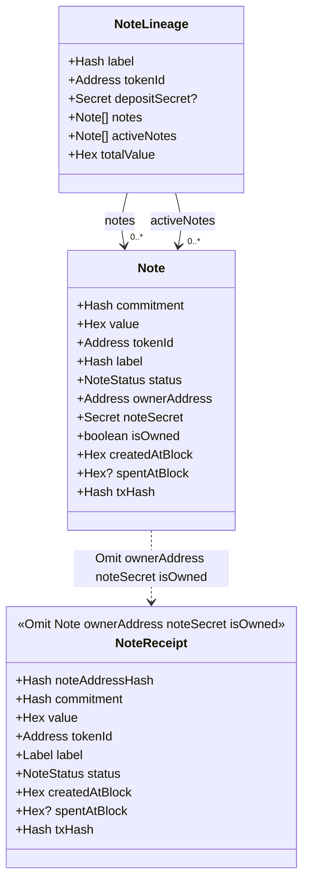
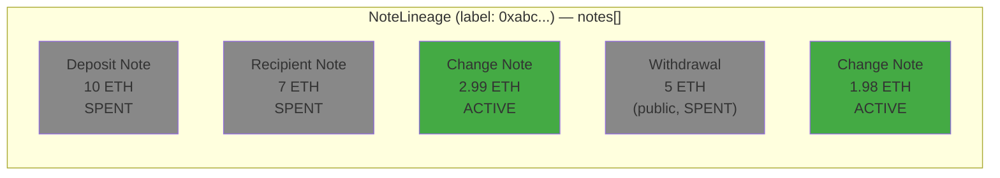
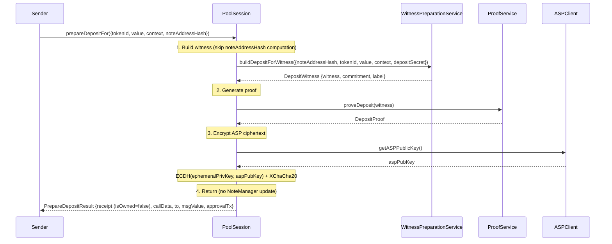
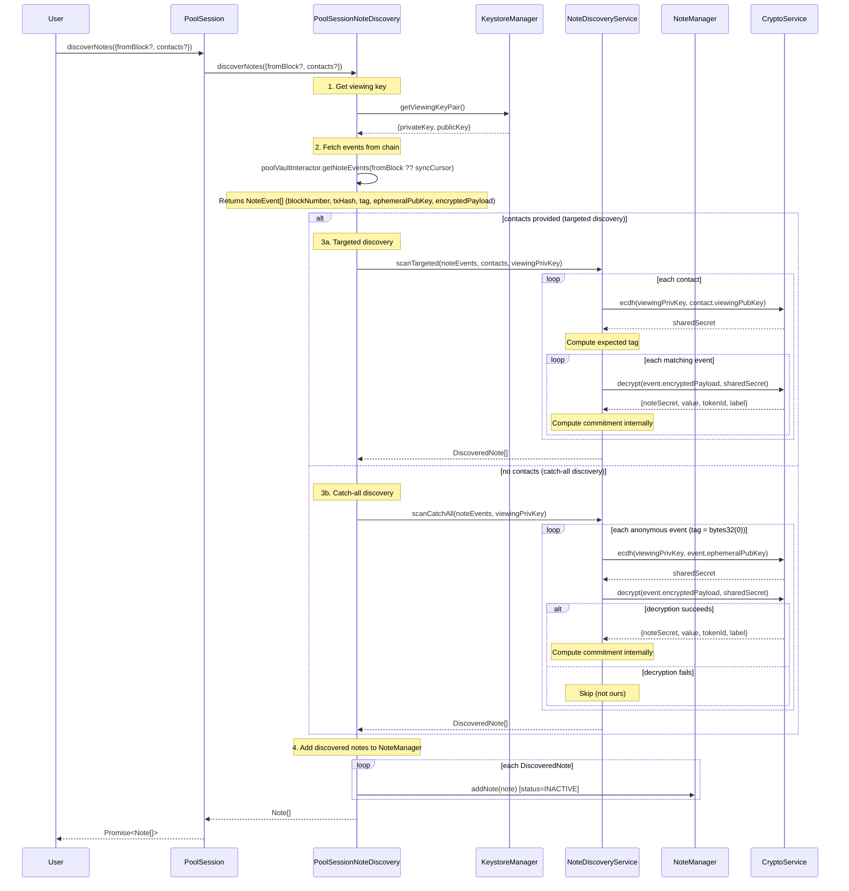

# Core SDK - Tech Design

> **Package scope.** This document covers `packages/core-sdk` — the chain-agnostic core of the SDK: `PoolSession` and its facade methods, the stateful/stateless services, and the chain-adapter interfaces concrete per-chain packages implement. Chain-specific concrete implementations are documented separately: [`evm-sdk-tech-design.md`](../evm-sdk/evm-sdk-tech-design.md) (`packages/evm-sdk` — EVM `CryptoService`, `RelayerInteractor`, `Evm*ChainAdapter`, LiFi swap integration, stealth addresses, the Aave/ERC-4626 yield venue) and [`stellar-sdk-tech-design.md`](../stellar-sdk/stellar-sdk-tech-design.md) (`packages/stellar-sdk` — `StellarCryptoService`, `StellarRelayerInteractor`, `Stellar*ChainAdapter`, the Blend v2 yield venue). The yield sessions themselves are chain-agnostic and live here (see §PoolSessionYield below). This doc — and its full Version History below — is the primary lineage carried forward from the original combined `sdk-tech-design.md` prior to the `packages/sdk` → `core-sdk`/`evm-sdk`/`stellar-sdk` split; the other two docs keep their own fresh, minimal histories and point back here.

# Background

Privacy Pools V1 SDK was designed as a low-level toolkit, providing cryptographic primitives and proof generation capabilities while leaving orchestration entirely to integrators. This design philosophy, while flexible, placed a significant burden on applications built on top of it. Integrators must orchestrate multiple SDK calls in precise sequence—generating secrets, computing commitment hashes, handling token approvals, submitting transactions, and manually managing state. The privacy-pools-website required over 600 lines of code solely for deposit handling, with similar complexity for withdrawals.

The V2 SDK takes a fundamentally different approach: the SDK should manage complexity, not expose it. More importantly, V2 is designed as a standalone product—not merely a helper library for the privacy-pools-website, but the primary interface for any application integrating with Privacy Pools. Where V1 required deep protocol knowledge, V2 presents a simple account abstraction. A single call to account.deposit(params) handles everything from secret generation through on-chain transaction to automatic label registration. The result is an SDK where integrators interact with accounts, not cryptographic primitives—where any wallet or dApp can implement complete privacy-preserving payment flows without understanding zero-knowledge proofs, merkle trees, or nullifier schemes.

# General

## Goals

1. **Single Entry Point**: Provide `PoolSession` as the sole interface for integrators, abstracting all protocol complexity behind a clean API.
2. **Prepare / Relay Split**: Each write-path operation (deposit, transfer, withdraw, ragequit, keystore registration) is split into a `prepareX(params)` call that builds the witness, generates the proof, and returns ready-to-submit calldata, and — where privacy requires a relayer — a companion `relayX(params)` call that forwards the prepared transaction through a third-party relayer. Integrators decide when and how to submit.
3. **Automatic State Management**: The SDK tracks note lifecycles and note lineages internally; integrators do not have to hash, encrypt, or index on their own. Background synchronization and long-running state are currently out of scope — see the Scope section for the milestones that cover persistent storage and discovery.
4. **New Protocol Capabilities**: Provide the primitives needed to build private internal transfers, multi-asset pools, and note discovery for stealth payments. Higher-level UX such as private payment requests is planned for Milestone 2 (see Scope).
5. **Privacy by Default**: Labels computed privately, relayers used for gas privacy, ECDH encryption for note payloads—integrators get privacy without extra effort.
6. **Fail-Safe Guarantees**: Ragequit is always available regardless of ASP status. Account state can be recovered from on-chain data. The SDK uses IPFS as a fallback data source when the ASP API is unavailable—the ASP publishes association set labels for each root to IPFS on every contract posting, ensuring the SDK can always reconstruct the association set independently. Circuit artifacts are also hosted on IPFS to guarantee availability regardless of any centralized infrastructure.
7. **Maximum Flexibility**: The SDK should be agnostic to external dependencies—any RPC provider, any wallet adapter, any storage backend. Integrators bring their own infrastructure; the SDK defines interfaces, not implementations.

## Approach

To achieve these goals, the SDK follows a layered architecture with clear separation of concerns:

- **Facade Pattern**: `PoolSession` acts as the single entry point, orchestrating complex flows by coordinating specialized services internally.
- **Dependency Injection**: All services are injected, enabling easy testing with mocks and allowing custom implementations (e.g., different storage backends).
- **Interface-Driven Design**: External dependencies (RPC, wallet, storage) are defined as interfaces. The SDK ships with default implementations but accepts any conforming adapter.
- **Event-Driven Updates**: Async operations emit events, allowing integrators to react to state changes without polling.
- **Background Synchronization**: The SDK periodically syncs with on-chain state, keeping local note data consistent with blockchain reality.

# In Depth

<aside>
💡

For a high-level understanding of the SDK, this page and the PoolSession (AccountService) page are sufficient. The remaining service pages describe internal implementation details.

</aside>

## Architecture

```mermaid
classDiagram                                                                                                                                                                                                     
      class PoolSession {                                                                                                                                                                                       
          -NoteManager noteManager                                                                                                                                                                                 
          -KeystoreManager keystoreManager                                                                                                                                                                         
          -CryptoService cryptoService                                                                                                                                                                             
          -WitnessPreparationService witnessPrep                                                                                                                                                                   
          -ProofService proofService                                                                                                                                                                               
          -ContractInteractor contractInteractor                                                                                                                                                                   
          -RelayerInteractor relayerInteractor                                                                                                                                                                     
          -ASPClient aspClient                                                                                                                                                                                     
          +isKeystoreRegistered() Promise~boolean~
          +prepareRegisterKeystore(options?) Promise~RegisterKeystoreResult~
          +prepareDeposit(params) Promise~PrepareDepositResult~
          +prepareDepositFor(params) Promise~PrepareDepositResult~
          +prepareTransfer(params) Promise~PrepareTransferResult~
          +prepareColdStartTransfer(params) Promise~PrepareTransferResult~
          +executeTransfer(opts) Promise~TransferResult~
          +relayTransfer(params) Promise~TransferResult~
          +prepareWithdraw(params) Promise~PrepareWithdrawResult~
          +relayWithdraw(params) Promise~Hash~
          +relayWithdrawAndSwap(params) Promise~TxReceipt~
          +relayReshield(params) Promise~TxReceipt~
          +prepareSwapAndDeposit(params) Promise~PrepareSwapAndDepositResult~
          +executeSwapAndDeposit(result) Promise~TxReceipt~
          +swapAndDeposit(params) Promise~TxReceipt~
          +getSwapStatus(params) Promise~SwapStatusResult~
          +prepareRageQuit(params) Promise~PrepareRageQuitResult~
          +discoverNotes(params?) Promise~Note[]~
          +exportAccount() Promise~AccountExport~
          +importAccount(data) Promise~void~
      }                                                                                                                                                                                                            
                                                                                                                                                                                                                   
      class NoteManager {                                                                                                                                                                                          
          -Map~Hash_NoteLineage~ lineages                                                                                                                                                                          
          +addNote(note) void                                                                                                                                                                
          +updateNoteStatus(commitment, status) void                                                                                                                                                                   
          +getNotes(filters?) Note[]                                                                                                                                                                               
          +getNote(commitment) Note                                                                                                                                                                                    
          +getNoteLineage(label) NoteLineage                                                                                                                                                                       
          +getAllLineages() NoteLineage[]                                                                                                                                                                          
          +computeAggregates(lineage) void                                                                                                                                                                         
          +sync(poolAddress, fromBlock?) Promise~SyncResult~                                                                                                                                                       
          +discoverTargeted(contacts, viewingPrivKey) Promise~DiscoveredNote[]~                                                                                                                                    
          +discoverCatchAll(viewingPrivKey) Promise~DiscoveredNote[]~                                                                                                                                              
          +exportState() NoteManagerExport                                                                                                                                                                         
          +importState(data) void                                                                                                                                                                                  
      }                                                                                                                                                                                                            
                                                                                                                                                                                                                   
      class NoteDiscoveryService {                                                                                                                                                                                 
          -DataService dataService                                                                                                                                                                                 
          -CryptoService cryptoService
          -NoteComputationService noteComputationService                                                                                                                                                           
          +scanTargeted(events, contacts, viewingPrivKey) DiscoveredNote[]                                                                                                                                         
          +scanCatchAll(events, viewingPrivKey) DiscoveredNote[]                                                                                                                                                   
      }                                                                                                                                                                                                            
                                                                                                                                                                                                                   
      class DataService {                                                                                                                                                                                          
          +getDepositEvents(poolAddress, fromBlock?) Promise~DepositEvent[]~                                                                                                                                       
          +getTransactEvents(poolAddress, fromBlock?) Promise~TransactEvent[]~                                                                                                                                     
          +getRagequitEvents(poolAddress, fromBlock?) Promise~RagequitEvent[]~                                                                                                                                     
          +getLabelRegisteredEvents(registry, fromBlock?) Promise~LabelRegisteredEvent[]~                                                                                                                          
          +getBlockNumber() Promise~bigint~                                                                                                                                                                        
          +waitForTransaction(txHash) Promise~TxReceipt~                                                                                                                                                           
      }                                                                                                                                                                                                            
                                                                                                                                                                                                                   
      class KeystoreManager {                                                                                                                                                                                      
          -Secret privateNullifyingKey                                                                                                                                                                             
          -Secret privateRevocableKey                                                                                                                                                                              
          -bigint revocableKeyIndex                                                                                                                                                                                
          -KeyPair viewingKeyPair                                                                                                                                                                                  
          -Set~number~ registeredChains                                                                                                                                                                            
          +fromSignature(config, deps) KeystoreManager                                                                                                                                                                             
          +getPrivateNullifyingKey() Secret                                                                                                                                                                        
          +getPrivateRevocableKey() Secret                                                                                                                                                                         
          +getRevocableKeyIndex() bigint                                                                                                                                                                           
          +getViewingKeyPair() KeyPair                                                                                                                                                                             
          +applyRotation(newIndex, newKey) void                                                                                                                                                                    
          +getAuthDigest() Hash                                                                                                                                                                                    
          +isRegistered(chainId) boolean                                                                                                                                                                           
          +markRegistered(chainId) void                                                                                                                                                                            
      }                                                                                                                                                                                                            
                                                                                                                                                                                                                   
      class HashService {
          +poseidon(inputs) Hash
      }                                                                                                                                                                                                            
                                                                                                                                                                                                                   
      class MerkleService {                                                                                                                                                                                        
          -HashService hashService                                                                                                                                                                                 
          +generateMerkleProof(leaves, leaf) MerkleProof                                                                                                                                                           
          +verifyMerkleProof(proof, root) boolean                                                                                                                                                                  
      }                                                                                                                                                                                                            
                                                                                                                                                                                                                   
      class CryptoService {
          +ecdh(privateKey, publicKey) Secret
          +encrypt(data, sharedSecret) Hex
          +decrypt(ciphertext, sharedSecret) Uint8Array
          +generateSecret() Secret
          +deriveKeysFromSignature(config) DerivedKeyMaterial
      }                                                                                                                                                                                                            
                                                                                                                                                                                                                   
      class NoteComputationService {
          -HashService hashService
          -CryptoService cryptoService
          +computeNoteAddressHash(ownerAddressField, noteSecret) Hash
          +computePrecommitment(noteAddressHash, tokenIdField, value) Hash
          +computeLabel(precommitment, depositSecret) Hash
          +computeFullCommitment(params) Hash
          +computeAuthDigest(privateRevocableKey) Hash
          +encodeNotePayload(payload) Uint8Array
          +decodeNotePayload(data) NotePayload
          +generateNoteData(payload, recipientViewingPubKey) NoteData
      }

      class WitnessPreparationService {                                                                                                                                                                            
          -NoteComputationService noteComputationService
          -HashService hashService
          -MerkleService merkleService                                                                                                                                                                             
          +buildDepositWitness(inputs) DepositWitness                                                                                                                                                              
          +buildTransactWitness(inputs) TransactWitness                                                                                                                                                            
          +buildRagequitWitness(inputs) RagequitWitness                                                                                                                                                            
      }                                                                                                                                                                                                            
                                                                                                                                                                                                                   
      class ProofService {                                                                                                                                                                                         
          +proveDeposit(witness) Promise~DepositProof~                                                                                                                                                             
          +proveTransact(witness, nInputs, mOutputs) Promise~TransactProof~                                                                                                                                                           
          +proveRagequit(witness) Promise~RagequitProof~
          +verifyDeposit(proof) Promise~boolean~                                                                                                                                                                   
          +verifyTransact(proof, nInputs, mOutputs) Promise~boolean~                                                                                                                                                                  
          +verifyRagequit(proof) Promise~boolean~                                                                                                                                                                  
          +loadCircuit(circuitName) Promise~void~                                                                                                                                                                  
      }                                                                                                                                                                                                            
                                                                                                                                                                                                                   
      class ContractInteractor {
          +deposit(proof, noteData, aspCiphertext) Promise~TxReceipt~
          +registerLabel(ciphertext) Promise~TxReceipt~
          +transact(proof, transactParams, noteData) Promise~TxReceipt~
          +ragequit(proof) Promise~TxReceipt~
          +setAuthPolicy(authDigest, nullifyingKeyHash) Promise~TxReceipt~
          +setViewingKey(viewingKey) Promise~TxReceipt~
          +updateAuthPolicy(oldDigest, newDigest, siblingNodes) Promise~TxReceipt~
          +getStateRoot(poolAddress) Promise~Hash~
          +getStateLeaves() Promise~Hash[]~
          +getKeystoreLeaves() Promise~Hash[]~
          +approveERC20(token, spender, amount) Promise~TxReceipt~
      }                                                                                                                                                                                                            
                                                                                                                                                                                                                   
      class RelayerInteractor {                                                                                                                                                                                    
          +getRelayers(chainId) Promise~RelayerInfo[]~                                                                                                                                                             
          +requestQuote(relayerUrl, params) Promise~Quote~                                                                                                                                                         
          +relay(relayerUrl, proof, transact, ciphertext) Promise~TxHash~                                                                                                                                          
      }                                                                                                                                                                                                            
                                                                                                                                                                                                                   
      class ASPClient {                                                                                                                                                                                            
          +getAssociationSetRoot(chainId) Promise~Hash~                                                                                                                                                            
          +getAssociationSetLeaves(chainId) Promise~Hash[]~                                                                                                                                                        
          +getMerkleProof(chainId, labelHash) Promise~MerkleProof~                                                                                                                                                 
          +getLabelStatus(label) Promise~LabelStatus~                                                                                                                                                              
          +getASPPublicKey() Promise~PublicKey~                                                                                                                                                                    
          +encryptForASP(payload) Promise~Hex~                                                                                                                                                                     
      }                                                                                                                                                                                                            
                                                                                                                                                                                                                   
      class IWalletAdapter {                                                                                                                                                                                       
          <<interface>>                                                                                                                                                                                            
          +sendTransaction(tx) Promise~TxReceipt~                                                                                                                                                                  
          +signMessage(message) Promise~Hex~                                                                                                                                                                       
          +getAddress() Promise~Address~                                                                                                                                                                           
      }                                                                                                                                                                                                            
                                                                                                                                                                                                                   
      class IRPCProvider {                                                                                                                                                                                         
          <<interface>>                                                                                                                                                                                            
          +call(params) Promise~any~                                                                                                                                                                               
          +getLogs(filter) Promise~Log[]~                                                                                                                                                                          
          +getBlockNumber() Promise~bigint~                                                                                                                                                                        
      }                                                                                                                                                                                                            
                                                                                                                                                                                                                   
      class IRelayerAdapter {                                                                                                                                                                                      
          <<interface>>                                                                                                                                                                                            
          +post(url, data) Promise~any~                                                                                                                                                                            
          +get(url) Promise~any~                                                                                                                                                                                   
      }                                                                                                                                                                                                            
                                                                                                                                                                                                                   
      class IASPAdapter {                                                                                                                                                                                          
          <<interface>>                                                                                                                                                                                            
          +fetchAssociationSet(chainId) Promise~any~                                                                                                                                                               
          +fetchLabelStatus(label) Promise~any~                                                                                                                                                                    
      }                                                                                                                                                                                                            
                                                                                                                                                                                                                   
      class ICircuitArtifacts {                                                                                                                                                                                    
          <<interface>>                                                                                                                                                                                            
          +getWasm(circuitName) Promise~Uint8Array~                                                                                                                                                                
          +getProvingKey(circuitName) Promise~Uint8Array~                                                                                                                                                          
          +getVerificationKey(circuitName) Promise~Uint8Array~                                                                                                                                                     
      }                                                                                                                                                                                                            
                                                                                                                                                                                                                   
      PoolSession --> NoteManager                                                                                                                                                                               
      PoolSession --> KeystoreManager                                                                                                                                                                           
      PoolSession --> CryptoService                                                                                                                                                                             
      PoolSession --> WitnessPreparationService                                                                                                                                                                 
      PoolSession --> ProofService                                                                                                                                                                              
      PoolSession --> ContractInteractor                                                                                                                                                                        
      PoolSession --> RelayerInteractor                                                                                                                                                                         
      PoolSession --> ASPClient                                                                                                                                                                                 
                                                                                                                                                                                                                   
      PoolSession --> PoolSessionNoteDiscovery
      PoolSessionNoteDiscovery --> NoteDiscoveryService
      PoolSessionNoteDiscovery --> NoteManager
      NoteDiscoveryService --> CryptoService
      NoteDiscoveryService --> NoteComputationService                                                                                                                                                                       
                                                                                                                                                                                                                   
      WitnessPreparationService --> NoteComputationService
      WitnessPreparationService --> HashService
      WitnessPreparationService --> MerkleService                                                                                                                                                                  
      NoteComputationService --> HashService
      NoteComputationService --> CryptoService
      MerkleService --> HashService                                                                                                                                                                                
                                                                                                                                                                                                                   
      ContractInteractor ..> IWalletAdapter                                                                                                                                                                        
      ContractInteractor ..> IRPCProvider                                                                                                                                                                          
      DataService ..> IRPCProvider                                                                                                                                                                                 
      RelayerInteractor ..> IRelayerAdapter                                                                                                                                                                        
      ASPClient ..> IASPAdapter                                                                                                                                                                                    
      ProofService ..> ICircuitArtifacts
```

### TLDR

```markdown
  PoolSession (9 deps)                                                                                                                                                                                          
  ├── PoolSessionNoteDiscovery (note discovery delegate)
  │   ├── NoteDiscoveryService (scanTargeted, scanCatchAll)
  │   │   ├── CryptoService (ecdh, encrypt, decrypt)
  │   │   └── NoteComputationService (commitment computation, binary NotePayload decoding)
  │   └── NoteManager (stateful: notes)
  ├── NoteManager (stateful: notes)                                                                                                                                                               
  ├── KeystoreManager (stateful: keys)                                                                                                                                                                             
  ├── CryptoService (ecdh, encrypt, decrypt, generateSecret, deriveKeys)                                                                                                                                                           
  ├── WitnessPreparationService (protocol hash chains)                                                                                                                                                             
  │   ├── NoteComputationService (shared poseidon hash chains, NotePayload codec, NoteData generation)
  │   │   ├── HashService (poseidon)
  │   │   └── CryptoService (ephemeral keys, ECDH, encrypt)
  │   ├── HashService (private hash helpers: commitment, nullifier, keystoreLeaf, timestampedLeaf, labelHash)
  │   ├── CryptoService (generateSecret)                                                                                                                                                                   
  │   └── MerkleService                                                                                                                                                                                            
  │       └── HashService (shared)                                                                                                                                                                                 
  ├── ProofService → ICircuitArtifacts                                                                                                                                                                             
  ├── ContractInteractor → IWalletAdapter, IRPCProvider                                                                                                                                                            
  ├── RelayerInteractor → IRelayerAdapter                                                                                                                                                                          
  └── ASPClient → IASPAdapter                                                                                                                                                                                      
                               
```

## Service Overview

The system is composed by:

### PoolSession

Orchestrator and single entry point for integrators. Coordinates all flows by calling the appropriate services in sequence. Holds no protocol logic — it doesn't know how to compute a commitment or build a merkle proof. It knows **what** to call and **in what order**.

[PoolSession](pool-session.md)

### PoolSessionSwap

Sub-session delegate that orchestrates the withdraw-and-swap flow. Mirrors the `PoolSessionWithdraw` pattern: receives a `TransactOrchestrator` for proof building, a `RelayerInteractor` for relayer submission, and a required `IEntrypointInteractor` for RPC-backed pre-flight checks. Before validating a LiFi quote's `transactionTo`/`approvalAddress` against the on-chain `approvedRouters` allowlist, it also reads the target `RelaySwaps.ROUTING_TYPEHASH()` and compares it against the SDK's own `RELAY_SWAP_ROUTING_TYPEHASH`, throwing `RelaySwapsLayoutMismatch` pre-proof on a mismatch (RC-32 — catches a deployed `RelaySwaps` decoding an older `SwapRouting` shape than this SDK build encodes, cached per address). Validation is two-tier: at quote time (`prepareSwapQuote`) it bounds the relayer fee against the Entrypoint's `maxRelayFee` (`RelayFeeExceedsMax`), enforces the shared LiFi budget/dust bound (`assertLifiBudget` — tolerating the relayer's per-call fee drift within `WITHDRAW_SWAP_FEE_BUFFER_BPS`, rather than requiring the committed fee to exactly equal the preliminary one), and cross-checks the LiFi quote's echoed route against the request before the calldata is proof-bound (`SwapQuoteMismatch`); at both quote and relay time it decodes the relayer-signed `SwapRouting` tuple once (shared `decodeRelaySwapRouting()` util) and validates it field-by-field (recipient, fallbackAddress, outputToken, dustRecipient, feeAmount, minOutputAmount, nativeGas, swapTarget, approvalAddress) plus `amountSent` consistency (committed `amountSent` equals the gross withdrawal at quote time and `amount + feeAmount` at relay time), the quote's `feeCommitment.asset` matching the withdrawn `tokenId` (relay time), and byte-equality of the embedded `swapCalldata` against the caller's calldata before building the ZK proof. Uses `RELAY_SWAP_ROUTING_ABI` for ABI-encoding the `SwapRouting` struct (which embeds the full `swapCalldata`) and submits via `RelayerInteractor.relaySwap` at `POST /relay-swap`. The calldata is bound directly by the proof context (no separate on-chain hash check), preventing relayer tampering with swap routing. Not directly instantiated by integrators — wired through `PoolSessionFactory` and exposed on `PoolSession.relayWithdrawAndSwap()`.

### PoolSessionReshield

Sub-session delegate that orchestrates the reshield (withdraw + swap + deposit) flow. Composes with `TransactOrchestrator` for the withdrawal proof and `RelayerInteractor` for relayer submission. The deposit is embedded in the LiFi swap calldata via `getContractCallsQuote()` — LiFi executes the swap and then calls `Entrypoint.deposit()` as a post-swap contract call. No separate deposit proof generation is needed at the SDK level. Uses `RELAY_SWAP_ROUTING_ABI` for ABI-encoding the `SwapRouting` struct (embedding the full `swapCalldata`), validates the committed calldata byte-equals the caller's, and submits via `RelayerInteractor.relaySwap` (same endpoint as withdraw-and-swap). In the same pre-proof step that checks the LiFi quote's addresses against `approvedRouters`, it also reads `RelaySwaps.ROUTING_TYPEHASH()` and compares it against `RELAY_SWAP_ROUTING_TYPEHASH`, throwing `RelaySwapsLayoutMismatch` before proving on a mismatch (RC-32). The deposit proof embedded in the LiFi calldata IS the slippage protection — `Entrypoint.deposit()` reverts if the swap output is insufficient. Runs two-tier pre-flight validation via a required `IEntrypointInteractor`: at quote time it verifies the output asset is enabled (`AssetNotSupported`), the note value clears the minimum (`DepositBelowMinimum`), the fee respects `maxRelayFee` (`RelayFeeExceedsMax`), the LiFi route echo matches the request (`SwapQuoteMismatch`), reads `vettingFeeBPS` on-chain (no longer caller-supplied), and — before any network call — asserts `depositResult.to` is the session Entrypoint (`DepositTargetMismatch`); at relay time it re-decodes the signed routing offline and asserts `feeCommitment.asset` matches the withdrawn `tokenId` (mirrors the plain-withdraw asset rule), the zero-recipient sentinel, zero `minOutputAmount`/`nativeGas`, `outputToken`, `dustRecipient`, and tuple `feeAmount`. Not directly instantiated by integrators — wired conditionally through `PoolSessionFactory` and exposed on `PoolSession.relayReshield()`.

### PoolSessionSwapDeposit

Sub-session delegate that orchestrates the swap-and-deposit flow. Composes with `IPoolSessionDeposit` to generate the deposit proof first (locking the exact deposit amount), then obtains a LiFi `getContractCallsQuote` that wraps the swap + deposit into a single atomic transaction. The input token is approved to LiFi's `approvalAddress` (not the entrypoint). `amountType` is always "to" (fixed output) since the deposit proof locks the exact amount. Not directly instantiated by integrators — wired conditionally through `PoolSessionFactory` and exposed on `PoolSession` via `prepareSwapAndDeposit()`, `executeSwapAndDeposit()`, and `swapAndDeposit()`.

Like `PoolSessionSwap` and `PoolSessionReshield`, it reads the relevant `RelaySwaps.ROUTING_TYPEHASH()` and compares it against `RELAY_SWAP_ROUTING_TYPEHASH` before validating LiFi's addresses against `approvedRouters`, throwing `RelaySwapsLayoutMismatch` pre-proof on a mismatch (RC-32).

Supports an optional cross-chain mode via a `sourceChain` attachment (`{ chainId, walletInteractor, rpcInteractor, relaySwapsAddress }` — factory config `swapDepositSourceChain`, builder config `sourceChain`): the input token, its approval, and the LiFi transaction execute on the source chain (signed by the source wallet, allowlisted — and routing-layout-checked — against the **source chain's** `RelaySwaps`), while LiFi's destination executor performs the Entrypoint deposit on the pool chain. `executeSwapAndDeposit` returns the source-chain receipt and skips local note persistence in this mode (no destination commitment exists yet); delivery confirmation is caller-side via `getSwapStatus`. See [pool-session.md](pool-session.md) §prepareSwapAndDeposit for the full contract.

Swap-executor screening (2026-10-02): LiFi's `Executor` is allowlisted but runs arbitrary calls for anyone, so the only executor transaction accepted is the session-composed same-chain native deposit, fully decoded; every other route runs `assertNoSwapExecutor` (`ISwapChainAdapter.isSwapExecutor` / `isSwapExecutorCall`, `UnexpectedTransactionTarget`), and the approval spender is never an executor. `PoolSessionReshield`, `PoolSessionReshieldCrosschain` and `PoolSessionWithdrawAndSwap` run the same util at prepare and on the decoded routing at relay time.

### PoolSessionYield (Deposit / Withdraw / Earned)

Chain-agnostic yield sessions (moved from evm-sdk on 2026-10-01): `PoolSessionYieldDeposit` (`IPoolSessionYieldDeposit` — `sharesForUnderlying`, `sizeSharesForBudget`, `prepareYieldDeposit`), `PoolSessionYieldWithdraw` (`IPoolSessionYieldWithdraw` — `prepareYieldWithdraw`, `prepareYieldWithdrawRelay`) and `PoolSessionYieldEarned`, generic over `TTx`/`TAddress`/`TProof`/`TLog` with EVM defaults. A yield deposit/withdraw is a **standard** share-token deposit / transact proof re-targeted at a router that wraps/unwraps the underlying; the sessions build that proof and delegate everything chain-specific to three seams:

- `IYieldTokenInteractor` — `exchangeRate`, `previewDeposit`, `previewRedeem` (sizing and note valuation);
- `IYieldRouterInteractor` — `quote` (→ `YieldQuote { underlyingNeeded, total }`), `quoteWithdraw`, `supplyBufferUnits` (EVM: the zap's constant 2; Stellar: Blend `floor(b_rate) + 1` read from the adapter);
- `IYieldRouterCodec` — `encodeDepositExactShares`, `planDepositFunding`, `encodeWithdrawToUnderlying`: lift the proof and arguments out of the built standard transaction and re-encode them at the router (EVM: ABI calldata + ERC-20 approvals; Stellar: Soroban XDR, no funding transactions).

### PoolSessionReshieldTransfer / PoolSessionReshieldTransferCrosschain

Chain-agnostic sessions (`packages/core-sdk`, 2026-10-02) that compose `PoolSessionReshield` / `PoolSessionReshieldCrosschain` so the redeposit lands for a third-party recipient instead of the withdrawer — mirroring Internal Transfer's recipient resolution. Thin wrappers: `estimate*`/`prepare*Quote`/`relay*` delegate verbatim (already recipient-agnostic); only the deposit-building step is new, routing a yield share through `YieldSwapDepositTarget.prepareSwapDeposit`'s optional `recipient` parameter (`PoolSessionYieldDeposit.prepareYieldDepositFor` underneath), and a plain pool asset (same-chain, with a `depositDelegate`) through `depositDelegate.prepareDepositFor` with the estimate's `noteValue`, not through any `YieldSwapDepositTarget` or the yield router. Output is a configured yield share or, same-chain with a `depositDelegate`, a plain pool asset (cross-chain stays yield-share only). Wired through `PoolSessionFactory`'s `ChainSessionExtensions` alongside `reshield`/`reshieldCrosschain`, exposed on `PoolSession` as `estimateReshieldTransferAmount`/`prepareReshieldTransferDeposit`/`prepareReshieldTransferQuote`/`relayReshieldTransfer` and their `*Crosschain` counterparts. Full API: [pool-session.md](pool-session.md) §Reshield and Transfer; flow + security model: [withdraw-and-swap.md](withdraw-and-swap.md) §Reshield and Transfer.

Types (`types/YieldSessions.ts`): `YieldDeploymentConfig<TAddress>` (`router`, `shareToken`, `shareDecimals`, `underlying`, `underlyingDecimals`, `underlyingSymbol`), `YieldQuote`, `YieldDepositParams`, `PreparedYieldDeposit<TTx, TAddress>`, `BudgetSizedYieldDeposit`, `YieldWithdrawParams`, `PreparedYieldWithdraw`, `YieldWithdrawRelayParams`, `PreparedYieldWithdrawRelay`. Helpers `defaultMaxUnderlyingIn`, `ppmHeadroom`, `inferVettingFeeBps`, `noteTimestamp`; constants `YIELD_BPS_DENOMINATOR`, `WITHDRAW_SLIPPAGE_BPS`, `YIELD_PPM_DENOMINATOR`, `DEPOSIT_RATE_HEADROOM_PPM` (`constant/Yield.ts`). The relayed-withdraw theft guard decodes the relayer's routing with the chain's `payoutRoutingCodec.decode` and runs `assertDecodedPayoutRoutingMatchesQuote`. Chains attach the sessions through `buildChainExtensions`; `ChainSessionBuildContext.buildDeposit({ entrypointInteractor })` lets an extension build a second deposit session over a differently-encoding entrypoint (Stellar's unsimulated share-token deposit). Implementations: [evm-sdk/yield-sessions.md](../evm-sdk/yield-sessions.md), [stellar-sdk/yield-sessions.md](../stellar-sdk/yield-sessions.md).

### ISwapProvider (Base Interface)

Base interface for all swap providers. Defines `getSwapStatus(params: SwapStatusRequest): Promise<SwapStatusResult>` for tracking swap transaction execution. Both `ISwapQuoteProvider` and `ISwapAndDepositQuoteProvider` extend `ISwapProvider`, so any provider that can quote swaps can also track their status. `IPoolSession` extends `ISwapProvider` directly, exposing `getSwapStatus()` on the PoolSession facade (delegates to the configured `swapAndDepositQuoteProvider`).

### LiFiSwapQuoteProvider

Standalone service implementing `ISwapQuoteProvider` and `ISwapAndDepositQuoteProvider` (both extend `ISwapProvider`). Wraps the `@lifi/sdk` `getQuote()` and `getContractCallsQuote()` functions with SDK-native types (`SwapQuoteRequest` / `SwapQuoteResult`, `SwapAndDepositQuoteRequest` / `SwapAndDepositQuoteResult`). Also implements `getSwapStatus()` by polling `GET {apiUrl}/status?txHash=...&fromChain=...&toChain=...&bridge=...` on the LiFi REST API (not via `@lifi/sdk`); maps LiFi's `INVALID` status to `NOT_FOUND`. Used by integrators to obtain LiFi swap calldata before calling `relayWithdrawAndSwap()`, and internally by `PoolSessionSwapDeposit` for swap-and-deposit quotes. Configuration accepts an optional `apiUrl` (defaults to `https://li.quest/v1`). Instantiated by the integrator and wired through `PoolSessionFactory` via the `swapQuoteProvider` / `swapAndDepositQuoteProvider` config fields, or through `PoolSessionBuilder` via the `withSwapQuoteProvider()` / `withSwapAndDepositQuoteProvider()` fluent overrides.

### NoteDiscoveryService

Handles discovery of incoming notes from known contacts (targeted) and anonymous senders (catch-all). Given a list of `NoteEvents` fetched by its orchestrator, computes ECDH shared secrets and attempts payload decryption to identify notes belonging to the user. Returns discovered notes to the orchestrator for storage.

> **Implementation status:** The plaintext `NoteData` payload format is implemented via `NoteComputationService.generateNoteData` / `decodeNotePayload`, but the Deposit / Transfer / Withdraw orchestrators currently publish a placeholder `EMPTY_NOTE_DATA` on-chain rather than the encrypted payload. Until this placeholder is replaced with the real output of `generateNoteData`, `scanCatchAll` has nothing to decrypt in production. Tracked by Milestone 1 (Note Discovery).

[NoteDiscoveryService](note-discovery-service.md)

### NoteManager

Stateful service that owns all note data. Stores lineages as flat note lists, tracks note statuses through their lifecycle (INACTIVE → PENDING → ACTIVE → SPENT/EXITED), and computes balance aggregates. Single source of truth for what notes exist and their current state. It also owns the sync cursor used by discovery (`getSyncCursor` / `setSyncCursor`). NoteManager itself does not fetch on-chain events or scan — that orchestration lives in `PoolSessionNoteDiscovery`, which calls `NoteDiscoveryService` for scanning and NoteManager for state tracking.

[NoteManager](note-manager.md)

### DataService

Fetches and parses blockchain events. Reads Deposit, Transact, Ragequit, and LabelRegistered events from on-chain contracts. Pure data fetching — no business logic.

[DataService](data-service.md)

### KeystoreManager

Stateful service that owns cryptographic keys. Derives keys from a wallet signature, stores the nullifying key (immutable), revocable key (rotatable), and viewing key pair. Tracks which chains have completed keystore registration. Computes the authorizerDigest used in the key registry leaf.

[KeystoreManager](keystore-manager.md)

### CryptoService

Stateless primitives for key exchange and symmetric encryption. Provides ECDH for computing shared secrets, AES encrypt/decrypt for note payloads, and HKDF-SHA256 key derivation from wallet signatures. Has no knowledge about protocol — doesn't know what a commitment or label is.

A second implementation, `StellarCryptoService`, now exists for Stellar/Soroban integrators (secp256k1 in place of X25519, rootSecret derived from a raw ed25519 signature) — both extend a shared `AbstractCryptoService` base. It is not currently wired into `PoolSession`'s dependency graph above, which still injects the EVM `CryptoService` shown in the class diagram; see [crypto-service.md](crypto-service.md) for the shared `AbstractCryptoService` contract, [../evm-sdk/crypto-service.md](../evm-sdk/crypto-service.md) for the EVM implementation, and [../stellar-sdk/crypto-service.md](../stellar-sdk/crypto-service.md) for `StellarCryptoService` details.

[CryptoService](crypto-service.md)

### HashService

Stateless primitive for Poseidon hashing and random secret generation. The lowest-level building block used for commitment chains and Merkle tree construction.

[HashService](hash-service.md)

### MerkleService

Stateless service for Merkle tree operations. Builds and verifies Merkle proofs for state tree, ASP tree, and keystore tree.

[MerkleService](merkle-service.md)

### WitnessPreparationService

Stateless service that builds complete witness objects for each circuit type (deposit, transact, ragequit), ready to be fed into ProofService. Delegates shared hash chain computations (noteAddressHash, precommitment, label, fullCommitment, authDigest) to NoteComputationService. Owns private hash helpers for computations used only during witness building (commitment, nullifier, keystoreLeaf, timestampedLeaf, labelHash) via a direct HashService dependency. Responsible for structuring the witness and generating merkle proofs via MerkleService.

[WitnessPreparationService](witness-preparation-service.md)

### NoteComputationService

Stateless service centralizing the shared Poseidon hash chain computations (noteAddressHash, precommitment, label, fullCommitment, authDigest), the RLP-based NotePayload codec (`encodeNotePayload` / `decodeNotePayload`), and the `generateNoteData` method that encodes, encrypts, and wraps a NotePayload into the on-chain `NoteData` tuple. Depends on both HashService (Poseidon) and CryptoService (ephemeral keys, ECDH, encryption). Hash computations used by only a single consumer (commitment, nullifier, keystoreLeaf, timestampedLeaf, labelHash) are private helpers on that consumer (WitnessPreparationService or PoolSessionKeystore) rather than exposed here. Injected into WitnessPreparationService, PoolSessionDeposit, PoolSessionTransact, PoolSessionKeystore, and NoteDiscoveryService.

[NoteComputationService](note-computation-service.md)

### ProofService

Stateless prover wrapper. Receives a ready witness, runs the appropriate circuit, returns a proof. Has zero knowledge of how witnesses are constructed — it just executes the prover and returns the cryptographic proof object. Circuit artifacts reach the prover through the injected `ICircuitArtifacts` interface; the SDK ships two default implementations — `LocalCircuitArtifacts` (filesystem, Node runtimes) and `IpfsCircuitArtifacts` (multi-gateway IPFS with ordered fallback, browser / serverless runtimes, backed by `DEFAULT_CIRCUIT_MANIFEST` and an `ICacheStore` for persistent caching that defaults to the SDK's `InMemoryCacheStore`).

[ProofService](proof-service.md)

### ContractInteractor

Stateless service for all on-chain interactions. Submits transactions (deposit, transact, ragequit, `setAuthPolicy`, `setViewingKey`, `updateAuthPolicy`) and reads contract state (tree roots, tree leaves, allowances). Translates SDK-level calls into smart contract function calls.

One exception to "stateless": `getKeystoreLeaves()` (served by the `KeystoreInteractor` sub-component) and `getStateLeaves()` (served by the `PoolVaultInteractor` sub-component) each cache their fetched leaves in-memory per instance and delta-fetch only new blocks on subsequent calls, rather than re-running a full `getLogs` scan from the contract's `deploymentBlock` on every call — see [contract-interactor.md](contract-interactor.md) for the caching/delta-fetch details, which are identical for both. `PoolSessionBuilder` triggers a non-blocking warm-up of both caches right after building their respective interactors, and `TransactOrchestrator.warmMerkleCaches()` lets a caller explicitly await both — in parallel via `Promise.all` — before a time-sensitive step (e.g. requesting a relayer fee commitment with a short expiration window) rather than paying for a slow first scan later, inside `prepareTransact()`, after that commitment's clock has already started. That explicit await is now wired into six of the seven flows that request a committed quote: `PoolSessionReshieldCrosschain.prepareReshieldCrosschainQuote()` (see [pool-session.md](pool-session.md) §Cross-Chain Reshield), and — as of 1.12.6 — same-chain reshield, withdraw-and-swap, withdraw, transfer, and batch-withdraw (the last via a new `IBatchWithdrawOrchestrator.warmMerkleCaches()` passthrough, since `PoolSessionBatchWithdraw` calls through `BatchWithdrawOrchestrator` rather than `TransactOrchestrator` directly). Only `PoolSessionYieldWithdraw` still relies solely on the background warm-ups at session build time — it has no internal method that requests a committed relayer quote, since the signed fee commitment is obtained by the caller outside the SDK and passed in as `params.signedFeeCommitment`.

Both caches are still per-process, so a fresh session pays the first scan again. A storage-agnostic seed/export mechanism now lets a caller persist and restore them: `PoolSessionBuilder` config accepts optional `keystoreLeafCacheSeed` / `stateLeafCacheSeed` to pre-populate the caches at construction, and `PoolSession.exportKeystoreLeafCache()` / `exportStateLeafCache()` read the current snapshot back out — see [contract-interactor.md](contract-interactor.md) and [pool-session.md](pool-session.md) for details.

[ContractInteractor](contract-interactor.md)

### RelayerInteractor

Stateless service for relayer communication. Requests fee quotes, submits proofs for relay, and waits for transaction confirmation. Used for transfers, withdrawals, withdraw-and-swaps (via `relaySwap` at `POST /relay-swap`), reshields, and label registration to avoid linking the ownerAddress to the transaction.

[RelayerInteractor](relayer-interactor.md)

### ASPClient

Stateless service for ASP data fetching. Retrieves association set roots, leaves, merkle proofs, label statuses, and the ASP's public key. Pure data access — encryption for the ASP is handled at the orchestration level.

[ASPClient](asp-client.md)

### Points

Client-side Points v1 accrual. `computePoints` evaluates each note's points from the parameters the ASP publishes per epoch (rate tree, rate scale, cliff, cohort schedule), and `HttpPointsDataProvider` (`IPointsDataProvider`) reads the ASP's public points API, recomputing every served leaf set's root before returning it. No request carries a commitment, nullifier, label or address. The module is standalone and is not wired into `PoolSession`.

[Points](points.md)

## Data Structures



### Note

A Note represents a single UTXO inside the shielded pool. It is the fundamental unit of value in the protocol. Every deposit creates a note, every transfer consumes notes and creates new ones, and every withdrawal or ragequit spend a note by publishing its nullifier. A note is identified by its commitment hash—a Poseidon hash chain that binds the owner, value, token, and label together without revealing any of them on-chain.

| Field | Type | Description |
| --- | --- | --- |
| `commitment` | `Hash` | The commitment hash: Poseidon(precommitment, label). Unique identifier; on-chain it is wrapped into a timestamped, type-tagged leaf before insertion into the unified `stateTree`. |
| `value` | `Hex` | The amount of tokens this note holds, in the token's smallest unit. |
| `tokenId` | `Address` | Token identifier. 0xEeee...EEeE for native ETH, ERC-20 contract address for tokens. |
| `label` | `Hash` | Poseidon(precommitment, depositSecret). Ties this note to its deposit lineage and ASP association set entry. All notes descended from the same deposit share the same label. |
| `status` | `NoteStatus` | Current lifecycle status: INACTIVE (committed but label not registered), PENDING (label registration submitted), ACTIVE (spendable), SPENT (nullifier published), EXITED (ragequit withdrawal). |
| `ownerAddress` | `Address` | The Ethereum address that owns this note. Baked into the commitment via noteAddressHash. |
| `noteSecret` | `Secret` | Random secret used in noteAddressHash = Poseidon(ownerAddress, noteSecret). Required to spend this note. |
| `isOwned` | `boolean` | Whether this note belongs to the current account. |
| `createdAtBlock` | `Hex` | Block number in which this note's commitment was inserted on-chain. Stored as hex string for serialization. |
| `spentAtBlock` | `Hex?` | Block number in which this note's nullifier was published. Null if not yet spent. Stored as hex string for serialization. |
| `txHash` | `Hash` | Hash of the transaction that created this note on-chain. |

### NoteLineage

A NoteLineage represents the complete history of a single deposit through all its subsequent transfers. It holds a flat list of all notes that share the same label. All notes in a lineage share the same label because the label is derived from the deposit and inherited by all descendant notes.

| Field | Type | Description |
| --- | --- | --- |
| `label` | `Hash` | The label shared by all notes in this lineage. Derived from the original deposit. |
| `tokenId` | `Address` | Token identifier for all notes in this lineage. |
| `depositSecret` | `Secret?` | The secret that produced this lineage's label. Present only when the current wallet originated this lineage via deposit; `undefined` on lineages received via transfer, payment request, or note discovery. |
| `notes` | `Note[]` | All notes in this lineage, ordered by creation. Includes deposit note, transfer outputs, change notes, etc. |
| `activeNotes` | `Note[]` | All notes in the lineage with ACTIVE status. |
| `totalValue` | `Hex` | Sum of all ACTIVE note values. The remaining spendable balance from the original deposit. Stored as hex string for serialization. |

**Example: Lineage After Deposit → Transfer → Partial Withdrawal**



In this example:

- **Deposit**: 10 ETH deposited, creating the first note in the lineage.
- **Transfer**: Deposit note spent, creating a 7 ETH recipient note and a 2.99 ETH change note (0.01 ETH fee).
- **Withdrawal**: Recipient note spent to withdraw 5 ETH publicly, creating a 1.98 ETH change note (0.02 ETH fee).
- **Active notes**: Change Note 1 (2.99 ETH) + Change Note 2 (1.98 ETH) = **4.97 ETH** totalValue.
- All notes share label `0xabc...` from the original deposit. The lineage stores them as a flat list.

## Flows

### Deposit

- Deposit
    
    Deposit funds into the shielded pool. Creates a note but does NOT make it spendable until label registration.
    
    **SDK Steps:**
    
    1. Generate secrets (`noteSecret`, `depositSecret`)
    2. Compute `noteAddressHash = Poseidon(ownerAddress, noteSecret)`
    3. Compute `precommitment = Poseidon(noteAddressHash, tokenId, value)`
    4. Compute `label = Poseidon(precommitment, depositSecret)`
    5. Compute `commitment = Poseidon(precommitment, label)`
    6. Generate `deposit` ZK proof (public: tokenId, value, ownerAddress, commitment)
    7. Encrypt note details with ASP public viewing key to generate `cipherText`
    8. Handle token approval (ERC-20) if needed
    9. Call `deposit(token, amount, proof, cipherText)` on contract
    10. Track note as PENDING in NoteManager

```mermaid
sequenceDiagram                                                                                                                                                                                                  
      participant User                                                                                                                                                                                             
      participant AS as PoolSession                                                                                                                                                                             
      participant KM as KeystoreManager                                                                                                                                                                            
      participant WPS as WitnessPreparationService                                                                                                                                                                 
      participant PS as ProofService                                                                                                                                                                               
      participant CI as ContractInteractor                                                                                                                                                                         
      participant CS as CryptoService                                                                                                                                                                              
      participant ASP as ASPClient                                                                                                                                                                                 
      participant NM as NoteManager                                                                                                                                                                                
      participant RI as RelayerInteractor                                                                                                                                                                          
                                                                                                                                                                                                                   
      User->>AS: deposit(params)                                                                                                                                                                                   
                                                                                                                                                                                                                   
      Note over AS: 1. Get keys                                                                                                                                                                                    
      AS->>KM: getPrivateNullifyingKey()                                                                                                                                                                           
      KM-->>AS: privateNullifyingKey                                                                                                                                                                               
                                                                                                                                                                                                                   
      Note over AS: 2. Build witness                                                                                                                                                                               
      AS->>WPS: buildDepositWitness(ownerAddress, tokenId, value)                                                                                                                                                  
      Note over WPS: internally calls NoteComputationService (poseidon hash chains)<br/>and CryptoService (generateSecret)<br/>for noteSecret and depositSecret                                                                                       
      WPS-->>AS: DepositWitness {witness, commitment, label, noteSecret, depositSecret}                                                                                                                            
                                                                                                                                                                                                                   
      Note over AS: 3. Generate proof                                                                                                                                                                              
      AS->>PS: proveDeposit(witness)                                                                                                                                                                               
      PS-->>AS: DepositProof                                                                                                                                                                                       
                                                                                                                                                                                                                   
      Note over AS: 4. Handle token approval                                                                                                                                                                       
      AS->>CI: approveERC20(token, poolAddress, amount)                                                                                                                                                            
      CI-->>AS: TxReceipt                                                                                                                                                                                                                                                                                                                                                                                                                                                                                                                                                                           
                                                                                                                                                                                                                                                                                                                                                                                                                                                                                                                                                                                                                 
      Note over AS: 5. Encrypt payload for ASP                                                                                                                                                                    
      AS->>ASP: getASPPublicKey()                                                                                                                                                                                  
      ASP-->>AS: aspPubKey                                                                                                                                                                                         
      AS->>CS: ecdh(ephemeralPrivKey, aspPubKey)                                                                                                                                                                   
      CS-->>AS: sharedSecret                                                                                                                                                                                       
      AS->>CS: encrypt({label, depositCommitment}, sharedSecret)                                                                                                                               
      CS-->>AS: ciphertext
      
      Note over AS: 6. Submit deposit on-chain                                                                                                                                                                     
      AS->>CI: deposit(token, amount, proof, cipherText)                                                                                                                                                                       
      CI-->>AS: TxReceipt                                                                                                                                                                                          
                                                                                                                                                                                                                   
      Note over AS: 7. Track note as PENDING                                                                                                                                                                      
      AS->>NM: addNote(note)                                                                                                                                                                                                                                                                                                                                                                                                                                                                                                                                                                                                                                                                                                                                                                                               
                                                                                                                                                                                                                   
      AS-->>User: PrepareDepositResult {receipt: DepositReceipt, callData, to, msgValue, approvalTx}
```



### DepositFor (Cold Start)

Deposit funds on behalf of a recipient who may not have interacted with the protocol. The sender provides a pre-computed `noteAddressHash` instead of the SDK computing it from `ownerAddress + noteSecret`.

**SDK Steps:**

1. Sender generates `noteSecret` for the recipient
2. Sender computes `noteAddressHash = Poseidon(recipientAddress, noteSecret)`
3. Sender calls `prepareDepositFor({ tokenId, value, context, noteAddressHash })`
4. SDK generates `depositSecret`, builds witness using `buildDepositForWitness` (skips noteAddressHash computation)
5. SDK generates ZK proof, encrypts ASP ciphertext, encodes calldata
6. Sender submits deposit on-chain
7. Note is NOT added to sender's NoteManager (`receipt.isOwned = false`)
8. Sender shares `{ noteSecret, commitment, label, value, tokenId }` with recipient out-of-band
9. Recipient registers keystore (if first time), imports note, and can spend via `prepareWithdraw`



## Transfer

- Internal Transfer
    
    Private transfer within the pool using unified `transact` circuit. Observers see only that a ZK proof was verified and nullifiers were spent—not amounts, sender, recipient, the link or the spent commitment between inputs and outputs.
    
    The transfer flow is split into preparation (`prepareTransfer` / `prepareColdStartTransfer`) and submission (`executeTransfer` for self-submit, `relayTransfer` for relayer submission). Preparation resolves the recipient into one of three kinds — captured by the `ResolvedTransferRecipient` discriminated union — which determines whether (and how) encrypted recipient `noteData` is published on-chain:
    
    - **`blind`** — caller passed only a pre-computed `recipientNoteAddressHash`. No recipient `noteData` is announced. The recipient must already know the secrets out-of-band.
    - **`outOfBand`** — caller passed `recipientDiscoveryData: { evmAddress }` but the on-chain keystore returned `0x0` (recipient hasn't registered a viewing key). Unless the caller opts in with `allowOutOfBandFallback: true`, the SDK refuses with `RecipientViewingKeyUnregistered` — it never downgrades silently, because discarding the note secrets would strand the funds. With the opt-in it falls back: no on-chain announcement; the recipient note secrets are returned in the result (`recipientNotes`) for off-chain delivery. RPC errors (as opposed to "not registered") are propagated, not swallowed.
    - **`discoverable`** — caller passed `recipientDiscoveryData` for a recipient that has a registered viewing key (or supplied the `publicViewingKey` directly). Encrypted `noteData` is published on-chain so the recipient can discover the note via `discoverNotes()`.
    
    `blind` and `outOfBand` produce identical on-chain footprints (no recipient `Note` event). Only `discoverable` triggers ECDH + payload encryption for the recipient note.
    
    **SDK Steps (`prepareTransfer`):**
    
    1. Validate keystore is registered on this chain
    2. Select input notes to spend (validate ACTIVE status)
    3. Resolve the recipient into a `ResolvedTransferRecipient` (`blind` | `outOfBand` | `discoverable`); when `recipientDiscoveryData.evmAddress` is provided, look up the recipient's viewing key in the on-chain keystore — on `0x0`, throw `RecipientViewingKeyUnregistered`, or fall back to `outOfBand` only when `allowOutOfBandFallback` is set
    4. Fetch merkle proofs: `stateRoot`, `keyRegistryRoot`, `associationSetRoot`
    5. Construct output commitments (recipient note + change note); compute nullifiers: `nullifier = Poseidon(commitment, privateNullifyingKey)`
    6. When the resolved recipient carries `publicViewingKey` (the **discoverable** variant): encrypt the recipient note payload (ECDH against the recipient's viewing key); otherwise emit only the change note's payload
    7. Generate `transact` ZK proof with:
        - Public: `roots`, `nullifiers`, `outputCommitments`, `amountOut`, `context`
        - Private: note secrets, key proofs, merkle siblings
    8. Return `PrepareTransferResult { executeOptions, relayOptions }` — caller picks `executeTransfer` (self-submit) or `relayTransfer` (forward to a relayer); both consume the same `ResolvedTransferRecipient` so on-chain semantics are identical
    9. On submission, update the sender's NoteManager: inputs → SPENT and add the change note. Recipient notes are never written to the sender's NoteManager: for **outOfBand** they're returned via `recipientNotes` for off-chain delivery; for **discoverable** the recipient finds them via `discoverNotes()`
- Cold Start Transfer (`prepareColdStartTransfer`)

    Explicit "skip the keystore lookup" convenience for sending to an EVM address known not to have registered a viewing key. Equivalent to `prepareTransfer` with `recipientDiscoveryData: { evmAddress, allowOutOfBandFallback: true }` except it never queries the keystore and always produces `outOfBand` semantics (no on-chain announcement; `noteSecretsMap` returned for off-chain delivery).

    **SDK Steps:**

    1. Sender calls `prepareColdStartTransfer({ ..., recipientEvmAddress })`
    2. SDK generates a `noteSecret` for the recipient note and computes `noteAddressHash = Poseidon(recipientEvmAddress, noteSecret)` — no keystore lookup
    3. SDK builds + proves the transact witness with the resolved `outOfBand` recipient (no recipient payload encryption, only the sender's change-note payload is published)
    4. Sender executes via `executeTransfer` or relays via `relayTransfer`
    5. Sender transmits `{ noteSecret, commitment, label, value, tokenId }` to recipient via **secure off-chain channel**
    6. Recipient performs one-time key registration (`prepareRegisterKeystore`) if needed
    7. Recipient imports the note into their NoteManager (with `noteSecret`, `ownerAddress`, status ACTIVE)
    8. Recipient can now spend via `prepareWithdraw` or `prepareTransfer`

```mermaid
sequenceDiagram                                                                                                                                                                                                  
      participant User                                                                                                                                                                                             
      participant AS as PoolSession                                                                                                                                                                             
      participant KM as KeystoreManager                                                                                                                                                                            
      participant WPS as WitnessPreparationService                                                                                                                                                                 
      participant PS as ProofService                                                                                                                                                                               
      participant CI as ContractInteractor                                                                                                                                                                         
      participant CS as CryptoService                                                                                                                                                                              
      participant ASP as ASPClient                                                                                                                                                                                 
      participant NM as NoteManager                                                                                                                                                                                
      participant RI as RelayerInteractor                                                                                                                                                                          
                                                                                                                                                                                                                                                                                                                                                                                                                         
                                                                                                                                                                                                                   
      User->>AS: prepareTransfer(params)                                                                                                                                                                                  
                                                                                                                                                                                                                   
      Note over AS: 1. Validate source notes                                                                                                                                                                        
      AS->>NM: getNote(commitment)                                                                                                                                                                                     
      NM-->>AS: Note (validate ACTIVE, sufficient balance)                                                                                                                                                         
                                                                                                                                                                                                                   
      Note over AS: 2. Resolve recipient (blind | outOfBand | discoverable)
      alt recipientDiscoveryData.evmAddress provided
          AS->>CI: getViewingKey(evmAddress)
          alt viewingKey == 0x0 (not registered)
              Note over AS: Fallback to kind="outOfBand"<br/>(no on-chain announcement)
          else viewingKey present
              Note over AS: kind="discoverable"
          end
      else recipientDiscoveryData.publicViewingKey provided
          Note over AS: kind="discoverable"
      else recipientNoteAddressHash provided
          Note over AS: kind="blind"
      end
                                                                                                                                                                                                                   
      Note over AS: 3. Get keys                                                                                                                                                                                    
      AS->>KM: getPrivateNullifyingKey()                                                                                                                                                                           
      AS->>KM: getPrivateRevocableKey()                                                                                                                                                                            
      KM-->>AS: keys                                                                                                                                                                                               
                                                                                                                                                                                                                   
      Note over AS: 4. Fetch tree data                                                                                                                                                                             
      AS->>CI: getCommitmentTreeLeaves(poolAddress)                                                                                                                                                                
      CI-->>AS: stateLeaves                                                                                                                                                                                        
      AS->>CI: getKeystoreLeaves()                                                                                                                                                                                 
      CI-->>AS: keystoreLeaves                                                                                                                                                                                     
      AS->>ASP: getAssociationSetLeaves(chainId)                                                                                                                                                                   
      ASP-->>AS: aspLeaves                                                                                                                                                                                         
                                                                                                                                                                                                                   
      Note over AS: 5. Build witness                                                                                                                                                                               
      AS->>WPS: buildTransactWitness(inputNotes, outputParams, keys, stateLeaves, aspLeaves, keystoreLeaves)                                                                                                       
      Note over WPS: internally:<br/>NoteComputationService: compute nullifiers, output commitments<br/>MerkleService: state proof, ASP proof, keystore proof                                                                 
      WPS-->>AS: TransactWitness {witness, outputCommitments, nullifiers}                                                                                                                                          
                                                                                                                                                                                                                   
      Note over AS: 6. Generate proof                                                                                                                                                                              
      AS->>PS: proveTransact(witness, nInputs, mOutputs)                                                                                                                                                                              
      PS-->>AS: TransactProof                                                                                                                                                                                      
                                                                                                                                                                                                                   
      Note over AS: 7. Encrypt payloads
      alt recipient.publicViewingKey set (discoverable)
          AS->>CS: ecdh(ephemeralPrivKey, recipient.publicViewingKey)
          CS-->>AS: sharedSecret
          AS->>CS: encrypt({noteSecret, value, tokenId, label}, sharedSecret)
          CS-->>AS: recipientCiphertext
      end
      Note over AS: change-note payload always encrypted for self-discovery
                                                                                                                                                                                                                   
      AS-->>User: PrepareTransferResult {executeOptions, relayOptions[]}
                                                                                                                                                                                                                   
      Note over User,AS: ── Submit ──
      alt user picks executeTransfer
          User->>AS: executeTransfer(executeOptions)
          AS->>CI: transact(proof, transactParams, noteData)
          CI-->>AS: TxReceipt
      else user picks relayTransfer
          User->>AS: relayTransfer(relayOptions[i])
          Note over AS: Rebuild witness with selectedQuote fee context, re-prove
          AS->>RI: relayTransfer(relayerInfo, {signedFeeCommitment, proof, noteData, inputNullifierNumber, outputCommitmentNumber})
          RI-->>AS: TxHash
          Note over AS: Confirms via RPCInteractor.waitForTransactionReceipt(txHash)
      end
                                                                                                                                                                                                                   
      Note over AS: 8. Update note states                                                                                                                                                                          
      AS->>NM: updateNoteStatus(inputCommitmentHash, SPENT)                                                                                                                                                                
      AS->>NM: addNote(changeNote)
      Note over AS,NM: Recipient note is never persisted on the sender side —<br/>returned to the caller for off-chain delivery (non-blind)<br/>or discovered by the recipient via discoverNotes() (discoverable).
                                                                                                                                                                                                                   
      AS-->>User: TransferResult {txReceipt, recipientNotes?}  
```



## Withdrawal

- Withdrawal
    
    Public withdrawal using same `transact` circuit. Change is returned as private notes.
    
    **SDK Steps:**
    
    1. Select input notes to spend (validate ACTIVE status)
    2. Fetch merkle proofs for all three trees
    3. Construct change note commitment (if partial withdrawal)
    4. Compute nullifiers for input notes
    5. Generate `transact` ZK proof with:
        - Public: `roots`, `nullifiers`, `outputCommitments`, `amountOut`, `tokenIdOut`, `context`
        - Private: note secrets, key proofs, merkle siblings
    6. Encrypt change note payload for self-discovery
    7. Submit to relayer
    8. Relayer calls `transact(proof, transactParams, noteData[])` on contract
    9. Contract transfers `amountOut` to `recipientAddress`, fee to relayer
    10. Update NoteManager: inputs → SPENT, add change note

```mermaid
sequenceDiagram                                                                                                                                                                                                  
      participant User                                                                                                                                                                                             
      participant AS as PoolSession                                                                                                                                                                             
      participant KM as KeystoreManager                                                                                                                                                                            
      participant WPS as WitnessPreparationService                                                                                                                                                                 
      participant PS as ProofService                                                                                                                                                                               
      participant CI as ContractInteractor                                                                                                                                                                         
      participant CS as CryptoService                                                                                                                                                                              
      participant ASP as ASPClient                                                                                                                                                                                 
      participant NM as NoteManager                                                                                                                                                                                
      participant RI as RelayerInteractor                                                                                                                                                                          
                                                                                                                                                                                                                                                                                                                                                                                                                           
                                                                                                                                                                                                                   
      User->>AS: withdraw(params)                                                                                                                                                                                  
                                                                                                                                                                                                                   
      Note over AS: 1. Validate source note                                                                                                                                                                        
      AS->>NM: getNote(commitment)                                                                                                                                                                                     
      NM-->>AS: Note (validate ACTIVE, sufficient balance)                                                                                                                                                         
                                                                                                                                                                                                                   
      Note over AS: 2. Get keys                                                                                                                                                                                    
      AS->>KM: getPrivateNullifyingKey()                                                                                                                                                                           
      AS->>KM: getPrivateRevocableKey()                                                                                                                                                                            
      KM-->>AS: keys                                                                                                                                                                                               
                                                                                                                                                                                                                   
      Note over AS: 3. Fetch tree data                                                                                                                                                                             
      AS->>CI: getCommitmentTreeLeaves(poolAddress)                                                                                                                                                                
      CI-->>AS: stateLeaves                                                                                                                                                                                        
      AS->>CI: getKeystoreLeaves()                                                                                                                                                                                 
      CI-->>AS: keystoreLeaves                                                                                                                                                                                     
      AS->>ASP: getAssociationSetLeaves(chainId)                                                                                                                                                                   
      ASP-->>AS: aspLeaves                                                                                                                                                                                         
                                                                                                                                                                                                                   
      Note over AS: 4. Build witness                                                                                                                                                                               
      AS->>WPS: buildTransactWitness(inputNotes, outputParams, keys, stateLeaves, aspLeaves, keystoreLeaves)                                                                                                       
      Note over WPS: Same circuit as transfer but:<br/>amountOut > 0, recipientAddress set,<br/>change note only (no recipient note)                                                                               
      WPS-->>AS: TransactWitness {witness, outputCommitments, nullifiers}                                                                                                                                          
                                                                                                                                                                                                                   
      Note over AS: 5. Generate proof                                                                                                                                                                              
      AS->>PS: proveTransact(witness, nInputs, mOutputs)                                                                                                                                                                              
      PS-->>AS: TransactProof                                                                                                                                                                                      
                                                                                                                                                                                                                   
      Note over AS: 6. Encrypt change note for self-discovery                                                                                                                                                      
      AS->>KM: getViewingKeyPair()                                                                                                                                                                                 
      KM-->>AS: viewingKeyPair                                                                                                                                                                                     
      AS->>CS: ecdh(ephemeralPrivKey, viewingKeyPair.public)                                                                                                                                                       
      CS-->>AS: sharedSecret                                                                                                                                                                                       
      AS->>CS: encrypt({noteSecret, value, tokenId, label}, sharedSecret)                                                                                                                                          
      CS-->>AS: ciphertext                                                                                                                                                                                         
                                                                                                                                                                                                                   
      Note over AS: 7. Submit via relayer                                                                                                                                                                          
      AS->>RI: requestQuote(relayerUrl, quoteParams)                                                                                                                                                               
      RI-->>AS: Quote                                                                                                                                                                                              
      AS->>RI: relay(relayerUrl, proof, transact, ciphertext)                                                                                                                                                      
      RI-->>AS: TxHash                                                                                                                                                                                             
      Note over AS: Confirms via RPCInteractor.waitForTransactionReceipt(txHash)
                                                                                                                                                                                                                   
      Note over AS: 8. Update note states                                                                                                                                                                          
      AS->>NM: updateNoteStatus(inputCommitmentHash, SPENT)                                                                                                                                                                
      AS->>NM: addNote(changeNote)                                                                                                                                                             
                                                                                                                                                                                                                   
      AS-->>User: WithdrawResult {changeNote, amountOut, recipientAddress, txHash} 
```



## Withdraw-and-Swap

- Withdraw-and-Swap

    Atomic withdrawal + DEX swap using the same `transact` circuit. The withdrawn amount exits the pool to the `RelaySwaps` processor (instead of `PrivacyPoolRelay`), which executes a DEX swap via LiFi calldata and sends the output tokens to the recipient. Change is returned as private notes.

    The flow is relayer-only — there is no self-submit path, since the `RelaySwaps` processor requires LiFi swap calldata that must be included by the relayer. The caller obtains swap calldata externally (e.g., via `LiFiSwapQuoteProvider`) and passes it to `relayWithdrawAndSwap`.

    **Security model:** Swap calldata is proof-bound directly. The full `bytes swapCalldata` is embedded in the `SwapRouting` struct, which is ABI-encoded into `transactParams.data` and bound into the ZK proof context — so changing any calldata byte invalidates the proof. There is no separate on-chain hash check; `RelaySwaps.execute()` simply forwards `routing.swapCalldata` to `swapTarget`. The relayer therefore cannot tamper with swap routing, slippage, or recipient. For swap-only flows, LiFi's `_minAmountOut` is locked by the proof.

    **SDK Steps:**

    1. Caller obtains a swap fee quote from the relayer via `settleSwapRelayerQuotes()`
    2. Caller obtains LiFi swap calldata via `LiFiSwapQuoteProvider.getSwapQuote()` (or any `ISwapQuoteProvider`)
    3. Caller calls `relayWithdrawAndSwap(params)` with the selected relayer quote and swap calldata
    4. SDK validates (decoding the relayer-signed routing once via `decodeRelaySwapRouting()`): (a) the quote's `feeCommitment.asset` matches the withdrawn `tokenId` (`InvalidTransactParams` otherwise — a quote for a different asset cannot be bound into the proof, mirroring the plain-withdraw asset rule), (b) `SwapRouting.recipient` matches `recipientAddress` (or the `address(0)` sentinel for cross-chain), (c) `amountSent == amount + feeAmount`, (d) every remaining routing field — `fallbackAddress` (defaults to `recipientAddress`), `outputToken`, `dustRecipient` (optional param; defaults to `recipientAddress` same-chain / relayer address cross-chain), tuple `feeAmount`, a non-zero `feeRecipient` when `feeAmount > 0` (mirrors the on-chain `RelaySwaps_ZeroFeeRecipient` revert), `minOutputAmount`, byte-equality of the embedded `swapCalldata` against the caller's calldata, and — when the caller passes the optional `swapTarget` / `approvalAddress` expecteds (echoed on `PreparedSwapQuote`) — the routing's swap target and approval address; cross-chain additionally: caller `minOutputAmount == 0` and routing `nativeGas == 0`. At quote time (`prepareSwapQuote`) the SDK additionally bounds the fee against the Entrypoint's `maxRelayFee` (`RelayFeeExceedsMax`), asserts the committed `feeCommitment.amountSent` equals the requested gross withdrawal `amount`, and cross-checks the LiFi quote's echoed route against the request before the calldata is proof-bound (`SwapQuoteMismatch`)
    5. The relayer-committed `SwapRouting` (from the committed quote) embeds the full `swapCalldata` — no hashing
    6. SDK builds transact witness with the relayer's processor address and fee context via `TransactOrchestrator.prepareTransact`, using `RELAY_SWAP_ROUTING_ABI` (when explicit `transactParams` are provided, `prepareTransact`'s `recipientAddress` param is ignored — routing comes entirely from `transactParams.data`)
    7. SDK validates that the committed `swapCalldata` byte-equals the caller's calldata
    8. SDK generates ZK proof (same `transact` circuit as withdrawal, but processor = `RelaySwaps` and data = `SwapRouting` tuple with the full `swapCalldata`)
    9. SDK submits to relayer via `RelayerInteractor.relaySwap` at `POST /relay-swap`
    10. Relayer calls `RelaySwaps.execute(proof, transactParams, noteData[])` on contract (calldata rides inside `transactParams.data`)
    11. Contract decodes `swapCalldata` from the proof-bound routing, pulls tokens via `POOL.transact()`, pays relay fee, forwards to LiFi
    12. LiFi executes the swap and sends output tokens to recipient
    13. SDK waits for receipt, updates NoteManager: inputs -> SPENT, adds change note

    The `SwapRouting` tuple (encoded as `transactParams.data`) contains 11 fields: `swapTarget`, `approvalAddress`, `outputToken`, `recipient`, `feeRecipient`, `fallbackAddress`, `dustRecipient`, `feeAmount`, `minOutputAmount`, `nativeGas`, `swapCalldata`. This is distinct from the standard `PayoutRouting` used by `PrivacyPoolRelay`. The `fallbackAddress` is committed in the proof context and used by the SDK to set LiFi's `toFallbackAddress` — the destination-chain address receiving the bridged token if the destination swap fails; it is never read on-chain (proof-binding + SDK assertion only). The embedded `swapCalldata` binds the exact LiFi calldata to the proof, preventing the relayer from substituting different swap parameters.

    **Cross-chain support:** `prepareSwapQuote()` and `relayWithdrawAndSwap()` accept an optional `toChainId`. When it differs from the relayer's chain, the SDK requires an explicit `fallbackAddress`, forbids `nativeGas`, sets the routing `recipient` to `address(0)` (the "no source-chain recipient" sentinel — the real recipient goes only into the proof-bound LiFi calldata as `toAddress`), sets the on-chain `minOutputAmount` to `0` (slippage protection is enforced by LiFi's destination executor via the proof-bound calldata), and defaults `dustRecipient` to the relayer address. `PreparedSwapQuote` exposes the informational `destinationMinOutputAmount` (LiFi `toAmountMin`) alongside the on-chain-enforced `minOutputAmount` (`0x0` cross-chain).

## Swap-and-Deposit

- Swap-and-Deposit

    Atomic swap + deposit: swaps token X into token Y via LiFi, then deposits token Y into the privacy pool in a single transaction. The deposit proof is generated first (locking the exact deposit amount), then LiFi wraps the swap + deposit into one atomic call via `getContractCallsQuote`.

    The flow is wallet-submitted (no relayer) since the depositor's address is already revealed.

    **SDK Steps:**

    1. Caller calls `prepareSwapAndDeposit(params)` with `fromToken`, `toToken` (pool token), and `depositAmount`
    2. SDK delegates to `IPoolSessionDeposit.prepareDeposit` to generate the deposit proof and calldata for the exact `depositAmount`
    3. SDK calls `ISwapAndDepositQuoteProvider.getSwapAndDepositQuote` with `amountType: "to"` (fixed output), passing the deposit calldata as a contract call
    4. LiFi returns a quote wrapping the swap + deposit into a single transaction, with `approvalAddress` for the input token
    5. SDK returns `PrepareSwapAndDepositResult` with the LiFi transaction data, approval info, and the deposit receipt
    6. Caller submits the transaction (or calls `executeSwapAndDeposit` / `swapAndDeposit`)
    7. On-chain: LiFi swaps token X → token Y, then calls the entrypoint's `deposit` with the proof
    8. Note is tracked in NoteManager (same pattern as regular deposit)

    Key design decisions:
    - `amountType` is always `"to"` (fixed output) because the deposit proof locks the exact amount — the swap must produce exactly that amount
    - Input token is approved to LiFi's `approvalAddress`, NOT the entrypoint
    - Note persistence follows the same pattern as regular deposit
    - Same-chain by default; cross-chain only via a configured `sourceChain` attachment — `prepareSwapAndDeposit` throws `InvalidSwapAndDepositParams` when `fromChainId` matches neither the pool `chainId` nor `swapDepositSourceChain.chainId` (see §PoolSessionSwapDeposit)
    - LiFi's swap executor is never an approval spender, and an executor transaction is accepted only as the session-composed same-chain native deposit, fully decoded (`assertNoSwapExecutor` elsewhere → `UnexpectedTransactionTarget`)

## Withdraw-Swap-Deposit (Reshield)

- Withdraw-Swap-Deposit (Reshield)

    Atomic withdraw + swap + deposit: withdraws shielded Token A from the pool via the `RelaySwaps` processor's `execute()` function, swaps A→B via LiFi, and deposits Token B back into the pool. Funds never leave the privacy system — the deposit is embedded in the LiFi swap calldata via `getContractCallsQuote()`, which instructs LiFi to call `Entrypoint.deposit()` as a post-swap contract call.

    The flow is relayer-only and uses the same `RelaySwaps.execute()` entry point as withdraw-and-swap. The key difference is that for reshield, `SwapRouting.recipient = address(0)` — the contract's canonical "no source-chain recipient" sentinel (shared with cross-chain withdraw-and-swap) — and the LiFi calldata includes the deposit as a contract call. The SDK sends `recipient: EMPTY_ADDRESS` (zero address) in all relayer reshield quote requests; `dustRecipient` still defaults to the relayer address.

    **Security model:** Swap calldata (including the embedded deposit proof) is proof-bound directly — the full `bytes swapCalldata` is committed inside the `SwapRouting` struct via the proof context, so the relayer cannot tamper with swap routing, deposit proof, or slippage. There is no separate on-chain hash check. The deposit proof embedded in the LiFi calldata IS the slippage protection — `Entrypoint.deposit()` reverts if the swap output is insufficient to cover the deposit amount plus vetting fee.

    **Contract-level flow (`RelaySwaps.execute()`):**

    1. Decodes `swapCalldata` from the proof-bound `SwapRouting` (already committed by the proof)
    2. Validates `msg.value == nativeGas` and fee against `maxRelayFee`; when `recipient == address(0)` additionally requires `nativeGas == 0` (reverts with `RelaySwaps_NativeGasWithoutRecipient()`) and `minOutputAmount == 0` (reverts with `RelaySwaps_MinOutputWithoutRecipient()`)
    3. Calls `POOL.transact()` to pull withdrawn tokens
    4. Pays relay fee in input token to `feeRecipient`
    5. Executes swap via `SWAP_TARGET` with LiFi calldata (which includes `contractCalls` for deposit)
    6. LiFi swaps A→B, then calls `Entrypoint.deposit()` with the embedded proof
    7. Sweeps any dust (balance deltas only) to `dustRecipient`

    The `SwapRouting` tuple (encoded as `transactParams.data`) contains the same 11 fields as withdraw-and-swap: `swapTarget`, `approvalAddress`, `outputToken`, `recipient`, `feeRecipient`, `fallbackAddress`, `dustRecipient`, `feeAmount`, `minOutputAmount`, `nativeGas`, `swapCalldata`. For reshield, `recipient = address(0)`, `nativeGas = 0`, and `minOutputAmount = 0` — enforced on-chain: `execute()` reverts with `RelaySwaps_NativeGasWithoutRecipient()` if `nativeGas != 0` (a nonzero value would otherwise fall through to the dust sweep instead of reaching a recipient) and with `RelaySwaps_MinOutputWithoutRecipient()` if `minOutputAmount != 0` (the balance-delta check cannot run without a source-chain recipient; a nonzero value was previously silently ignored). The relayer mirrors this invariant at quote time (schema validation) and relay time (decoded routing check), and the SDK asserts it before proof generation. `recipient == address(0)` means delivery verification is delegated to the layer that can see it: same-chain swap → contract balance-delta check; reshield → `Entrypoint.deposit()` revert; cross-chain → LiFi destination executor `minAmountOut` in the proof-bound calldata.

    **depositAmount derivation:**

    ```
    swapInput = withdrawalAmount - relayFee
    LiFi quote(fromAmount: swapInput) → minAmountOut
    depositAmount = floor(minAmountOut * 10000 / (10000 + vettingFeeBPS))
    vettingFee = depositAmount * vettingFeeBPS / 10000
    surplus = actualSwapOutput - depositAmount - vettingFee → feeRecipient
    ```

    Key design decisions:
    - Unified processor: reshield and withdraw-and-swap use the same `RelaySwaps.execute()` entry point
    - Deposit embedded in LiFi calldata via `getContractCallsQuote()` — no separate deposit proof generation at SDK level
    - Proof-bound calldata: the full `swapCalldata` embedded in `SwapRouting` prevents relayer tampering with deposit proof, swap routing, or slippage
    - Deposit proof IS slippage protection: `Entrypoint.deposit()` reverts if swap output insufficient
    - Swap failure = full EVM revert — no fallback mechanism needed, atomicity guarantees no partial state

    **SDK + Relayer flow (implemented):**

    1. Caller obtains a reshield quote from the relayer
    2. Caller computes `depositAmount` and obtains LiFi swap calldata with embedded deposit via `getContractCallsQuote()`
    3. Caller calls `PoolSession.relayReshield(params)` with `ReshieldParams`
    4. SDK validates the relayer commitment offline (single decode of the signed routing): `feeCommitment.asset === tokenId` (mirrors the plain-withdraw asset rule), `amountSent === amount + feeAmount`, embedded `swapCalldata` byte-equals the caller's calldata, zero-recipient sentinel, `minOutputAmount == 0`, `nativeGas == 0`, `outputToken` match, `dustRecipient` match (optional `ReshieldParams.dustRecipient`, defaults to the relayer address), tuple `feeAmount === quote.feeAmount`, a non-zero `feeRecipient` when `feeAmount > 0` (mirrors the on-chain `RelaySwaps_ZeroFeeRecipient` revert), and — when the caller passes the optional `swapTarget` / `approvalAddress` expecteds (echoed on `PreparedReshieldQuote`) — the routing's swap target and approval address. The quote-time methods (`estimateReshieldAmount` / `prepareReshieldQuote`, and `prepareReshieldCrosschainQuote` identically) additionally run RPC-backed pre-flight against the Entrypoint: output asset enabled, note value ≥ minimum, on-chain `vettingFeeBPS` (caller param removed), fee vs `maxRelayFee`, deposit target = session Entrypoint, LiFi route echo cross-check, and — anchored to the caller-supplied `amount`, not anything the relayer controls — assert the committed `feeCommitment.amountSent` equals the requested gross withdrawal (`InvalidTransactParams` otherwise; defense-in-depth alongside the relay-time `amountSent == amount + feeAmount` re-check, mirroring `prepareSwapQuote`'s equivalent guard)
    5. The relayer-committed `SwapRouting` embeds the full `swapCalldata` — no hashing
    6. SDK calls `TransactOrchestrator.prepareTransact()` to build the withdrawal proof using `RELAY_SWAP_ROUTING_ABI` (processor = relayer's RelaySwaps address)
    7. SDK validates that the committed `swapCalldata` byte-equals the caller's calldata
    8. SDK submits to relayer via `RelayerInteractor.relaySwap()` at `POST /relay-swap` (same endpoint as withdraw-and-swap)
    9. Relayer calls `RelaySwaps.execute(proof, transactParams, noteData[])` on contract (calldata rides inside `transactParams.data`)
    10. Contract verifies calldata hash, pulls tokens, pays fee, forwards to LiFi with embedded deposit
    11. SDK waits for receipt, persists note updates (spent notes + change pending notes)

## Ragequit

- Ragequit
    
    Emergency exit bypassing ASP. **Does NOT check associationSet.** Always available as the ultimate failsafe for fund recovery.
    
    **SDK Steps:**
    
    1. Validate note exists and is not EXITED or SPENT
    2. Fetch merkle proof for key registry leaf
    3. Generate `ragequit` ZK proof with:
        - Public: `keyRegistryRoot`, `nullifierHash`, `withdrawalAmount`, `recipientAddress`
        - Private: note secrets, owner keys, merkle proofs
        - **Critical**: `recipientAddress` MUST equal `ownerAddress` (forced by circuit to prevent theft)
    4. Call `ragequit(proof)` DIRECTLY on contract (not via relayer)
    5. Contract verifies proof, transfers funds to `ownerAddress`
    6. Update note as EXITED in NoteManager
    
    **Trade-off:** Reveals the link between the note and owner on-chain. The `labelHash` may be emitted, connecting the note to its deposit.

```mermaid
 sequenceDiagram                                                                                                                                                                                                  
      participant User                                                                                                                                                                                             
      participant AS as PoolSession                                                                                                                                                                             
      participant KM as KeystoreManager                                                                                                                                                                            
      participant WPS as WitnessPreparationService                                                                                                                                                                 
      participant PS as ProofService                                                                                                                                                                               
      participant CI as ContractInteractor                                                                                                                                                                         
      participant NM as NoteManager                                                                                                                                                                                
                                                                                                                                                                                                                                                                                                                                                                                                                                                                                                                                                                                                                                             
      User->>AS: rageQuit(params)                                                                                                                                                                                  
                                                                                                                                                                                                                   
      Note over AS: 1. Validate note                                                                                                                                                                               
      AS->>NM: getNote(commitment)                                                                                                                                                                                     
      NM-->>AS: Note (validate not EXITED)                                                                                                                                                                         
                                                                                                                                                                                                                   
      Note over AS: 2. Verify keystore registration                                                                                                                                                                
      AS->>KM: isRegistered(chainId)                                                                                                                                                                               
      KM-->>AS: true                                                                                                                                                                                               
                                                                                                                                                                                                                   
      Note over AS: 3. Get keys                                                                                                                                                                                    
      AS->>KM: getPrivateNullifyingKey()                                                                                                                                                                           
      AS->>KM: getPrivateRevocableKey()                                                                                                                                                                            
      KM-->>AS: keys                                                                                                                                                                                               
                                                                                                                                                                                                                   
      Note over AS: 4. Fetch tree data                                                                                                                                                                             
      AS->>CI: getCommitmentTreeLeaves(poolAddress)                                                                                                                                                                
      CI-->>AS: stateLeaves                                                                                                                                                                                        
      AS->>CI: getKeystoreLeaves()                                                                                                                                                                                 
      CI-->>AS: keystoreLeaves                                                                                                                                                                                     
                                                                                                                                                                                                                   
      Note over AS: 5. Build witness                                                                                                                                                                               
      AS->>WPS: buildRagequitWitness(note, keys, stateLeaves, keystoreLeaves)                                                                                                                                      
      Note over WPS: internally:<br/>HashService: compute nullifier<br/>MerkleService: state proof, keystore proof<br/>NO ASP proof needed                                                                         
      WPS-->>AS: RagequitWitness {witness, nullifierHash}                                                                                                                                                          
                                                                                                                                                                                                                   
      Note over AS: 6. Generate proof                                                                                                                                                                              
      AS->>PS: proveRagequit(witness)                                                                                                                                                                              
      PS-->>AS: RagequitProof                                                                                                                                                                                      
                                                                                                                                                                                                                   
      Note over AS: 7. Submit DIRECTLY on-chain (not via relayer)                                                                                                                                                  
      AS->>CI: ragequit(proof, asset)                                                                                                                                                                              
      CI-->>AS: TxReceipt                                                                                                                                                                                          
                                                                                                                                                                                                                   
      Note over AS: 8. Update note state                                                                                                                                                                           
      AS->>NM: updateNoteStatus(commitment, EXITED)                                                                                                                                                                    
                                                                                                                                                                                                                   
      AS-->>User: RageQuitResult {value, txHash}                                                                                                                                                                   
      Note over User: WARNING: label revealed on-chain
```
    



## Note Discovery

- Note Discovery
    
    Universal fallback for unknown senders. Expensive O(N) scan where N is number of anonymous transfers.
    
    **SDK Steps:**
    
    1. Fetch ALL Transact events with `tag = bytes32(0)` since last sync
    2. For each event:
        - Extract `ephemeralPubKey` from event
        - Compute `sharedSecret = ECDH(myViewingPrivKey, ephemeralPubKey)`
        - Attempt to decrypt `encryptedPayload` with shared secret
        - If decryption succeeds (valid structure), note is discovered
    3. Verify discovered commitments exist on-chain
    4. Add valid notes to NoteManager
    
    **Note:** Computationally expensive—use sparingly or during explicit sync operations.
    



## Key Registration

- Key Registration
    
    One-time setup required before spending any notes. Links ownerAddress to SNARK-friendly keys.
    
    **SDK Steps:**
    
    1. Derive keys from wallet signature:
        - `privateNullifyingKey` (for nullifiers, immutable)
        - `privateRevocableKey` (for spending auth, rotatable)
        - `viewingPrivateKey` (for note discovery)
    2. Compute hashes: `H(privateNullifyingKey)`, `H(privateRevocableKey)`
    3. Compute `authorizerDigest = Poseidon(revocableKeyHash, authorizerAddress=0)`
    4. Compute `leaf = Poseidon(addressHash, nullifyingKeyHash, authorizerDigest)`
    5. Derive `viewingPublicKey = viewingPrivateKey * G`
    6. Call `Keystore.setAuthPolicy(authorizerDigest, nullifyingKeyHash)`
    7. Call `Keystore.setViewingKey(viewingPublicKey)`
    8. Mark chain as registered in KeystoreManager (`executeRegisterKeystore` does this itself, only if not already marked, so resuming a partial registration in the same session succeeds; `KeystoreManager.markRegistered` throws `AlreadyRegistered` on a second mark)
- Key Rotation
    
    Rotate compromised `privateRevocableKey` without moving funds. Authenticated via `msg.sender`.
    
    **SDK Steps:**
    
    1. Generate new `privateRevocableKey`
    2. Compute old and new `authorizerDigest` values
    3. Fetch merkle proof (`siblingNodes`) for current (old) key leaf from contract
    4. Call `Keystore.updateAuthPolicy(oldAuthDigest, updatedAuthDigest, siblingNodes)` via ownerAddress wallet
    5. Contract verifies old leaf, updates tree with new leaf
    6. Update KeystoreManager with new revocable key

```mermaid
sequenceDiagram                                                                                                                                                                                                  
      participant User                                                                                                                                                                                             
      participant AS as PoolSession                                                                                                                                                                             
      participant KM as KeystoreManager                                                                                                                                                                            
      participant WPS as WitnessPreparationService                                                                                                                                                                 
      participant CI as ContractInteractor                                                                                                                                                                         
                                                                                                                                                                                               
                                                                                                                                                                                                                   
      User->>AS: prepareRegisterKeystore(options?)                                                                                                                                                                          
                                                                                                                                                                                                                   
      Note over AS: 1. Derive keys from wallet signature + address                                                                                                                                                
      AS->>KM: fromSignature({signature, signerAddress})                                                                                                                                                           
      Note over KM: 2-stage HKDF → appSecret →<br/>privateNullifyingKey<br/>privateRevocableKey<br/>viewingPrivateKey                                                                                              
      KM-->>AS: KeystoreManager                                                                                                                                                                                               
                                                                                                                                                                                                                   
      Note over AS: 2. Get key material                                                                                                                                                                            
      AS->>KM: getPrivateNullifyingKey()                                                                                                                                                                           
      KM-->>AS: privateNullifyingKey                                                                                                                                                                               
      AS->>KM: getViewingKeyPair()                                                                                                                                                                                 
      KM-->>AS: {private, public: viewingPubKey}                                                                                                                                                                   
      AS->>KM: getAuthDigest()                                                                                                                                                                                     
      KM-->>AS: authDigest                                                                                                                                                                                         
                                                                                                                                                                                                                   
      Note over AS: 3. Compute nullifying key hash                                                                                                                                                                 
      AS->>WPS: computeNullifier(privateNullifyingKey, ...)                                                                                                                                                        
      WPS-->>AS: nullifyingKeyHash                                                                                                                                                                                 
                                                                                                                                                                                                                   
      Note over AS: 4. Encode `setAuthPolicy` calldata                                                                                                                                                             
      AS->>CI: setAuthPolicy(authDigest, nullifyingKeyHash) [encode]                                                                                                                                                         
      CI-->>AS: setAuthPolicyCallData                                                                                                                                                                                          
                                                                                                                                                                                                                   
      Note over AS: 5. Encode `setViewingKey` calldata                                                                                                                                                               
      AS->>CI: setViewingKey(viewingPubKey) [encode]                                                                                                                                                                   
      CI-->>AS: setViewingKeyCallData                                                                                                                                                                                          
                                                                                                                                                                                                                   
      Note over AS: 6. Return prepared calldata — executeRegisterKeystore submits (both calldatas verified first) + marks registered if not already; own-signer callers call markRegistered                                                                                                                                                                          
                                                                                                                                                                                                                   
      AS-->>User: RegisterKeystoreResult {setAuthPolicyCallData, setViewingKeyCallData, ...}
```

---

# Scope

This scope defines **two core milestones**.

Milestone 1 establishes the **foundational SDK architecture and end-to-end protocol interaction flows** required for **EthCC readiness**, enabling a testnet playground for contracts and providing integrators with complete, functional E2E flows.

Milestone 2 focuses on **infrastructure, key management, and advanced privacy UX**, improving developer experience, reliability, and production readiness.

EthCC delivery corresponds to **testnet technical readiness**, not production launch.

## Milestone 1: Core SDK & Protocol Flows

**Duration:** ~7 weeks

**Team:** 1 TL + 1 Off-chain Developer

| Item | Description |
| --- | --- |
| SDK Modular Architecture | Define architecture, interfaces, and module boundaries |
| Prepare Deposit | Build method to generate calldata for deposits |
| Withdraw | Implement withdrawal execution via relayer |
| Prepare Rage Quit | Build calldata preparation for rage quit |
| Internal Transfer | Implement internal transfer flow using recipient address |
| Note Discovery | Implement event-based note recovery logic |
| Note Import | Add note ingestion to bypass full discovery |
| Note Export | Add note serialization for portability |
| Integration & Unit Testing | Integration tests (circuits + contracts) and unit tests per feature |
| Documentation | Complete technical documentation |

**Outcome:** Fully functional SDK capable of executing all core protocol flows on testnet.

## Milestone 2: Infrastructure & Advanced Privacy

**Duration:** ~4 weeks

**Team:** 1 TL + 1 Off-chain Developer

| Item | Description |
| --- | --- |
| Persistent Storage | Integrate storage service (e.g., local storage) for SDK state and notes |
| Cold Start Transfer | Enable transfers to non–Privacy Pools users |
| Wallet Keys Usage | Derive Privacy Pools keys from wallet keys |
| Send TXs | Integrate transaction broadcasting service |
| IPFS Fallback | Add IPFS fallback to reduce relay dependency |

---

**Version History**

| Version | Change |
| --- | --- |
| 1.12.19 | 2026-10-07 — New Service Overview entry §Points linking the new [points.md](points.md) spec (v1.0): client-side Points v1 accrual (`computePoints`) and the ASP points data provider (`HttpPointsDataProvider`), PR #474. |
| 1.12.18 | 2026-10-05 — Swap-and-deposit for a recipient (DEV-489): `SwapAndDepositParams.recipient` (a `DepositForRecipient`) makes the embedded deposit a `prepareDepositFor` proof (or a `prepareYieldDepositFor` router deposit), same-chain and cross-chain, including the same-chain native Executor path; the note is unowned. Blind `noteData` may be a synchronous `NoteDataBuilder`. See [pool-session.md](pool-session.md) v1.29.0. |
| 1.12.17 | 2026-10-02 — New Service Overview entry §PoolSessionReshieldTransfer / PoolSessionReshieldTransferCrosschain: chain-agnostic sessions composing `PoolSessionReshield` / `PoolSessionReshieldCrosschain` so the redeposit lands for a third-party recipient, via `YieldSwapDepositTarget.prepareSwapDeposit`'s new optional `recipient` parameter. Related: [pool-session.md](pool-session.md) v1.28.0, [withdraw-and-swap.md](withdraw-and-swap.md) v1.12.1, [../evm-sdk/yield-sessions.md](../evm-sdk/yield-sessions.md) v1.3. |
| 1.12.16 | 2026-10-02 — Security fix: swap-executor screening (details in [pool-session.md](pool-session.md) v1.27.1). New `ISwapChainAdapter.isSwapExecutorCall` / `isSwapExecutor` and util `assertNoSwapExecutor`; §PoolSessionSwapDeposit and the swap-and-deposit key design decisions note executor rejection. Also corrected the stale "same-chain only" swap-and-deposit decision (cross-chain via `sourceChain` exists since 1.12.8). |
| 1.12.15 | 2026-10-01 — Yield made chain-agnostic: new Service Overview entry §PoolSessionYield documenting core's `PoolSessionYieldDeposit` / `Withdraw` / `Earned`, the `IYieldTokenInteractor` / `IYieldRouterInteractor` / `IYieldRouterCodec` seams, the `YieldSessions` types, helpers and constants moved from evm-sdk, and `ChainSessionBuildContext.buildDeposit`. Package-scope note updated (EVM = Aave venue, Stellar = Blend v2 venue). Related core changes are specified in [pool-session.md](pool-session.md) v1.27.0, [batch-withdraw.md](batch-withdraw.md) v0.6.0, [keystore-manager.md](keystore-manager.md) v1.6.0 and [contract-interactor.md](contract-interactor.md) v1.2.0. |
| 1.12.14 | 2026-09-24 — Doc-only correction of the cold-start transfer description (transfer flow kinds, `prepareTransfer` step 3, `prepareColdStartTransfer`): an unregistered `evmAddress` recipient throws `RecipientViewingKeyUnregistered` unless `allowOutOfBandFallback: true` opts into `outOfBand`; it never falls back silently. No code change. |
| 1.12.13 | 2026-09-24 — Same-session partial-registration resume + validate-before-sign (both EXTENSION; details in [pool-session.md](pool-session.md) v1.25.4). `PoolSessionKeystore.executeRegisterKeystore` no longer throws `AlreadyRegistered` after a successful resume: it calls `KeystoreManager.markRegistered` only when `!isRegistered(chainId)` (`markRegistered` itself is unchanged and still rejects a second mark). `executeRegisterKeystore` now verifies both `keystoreCalldata` (`setAuthPolicy`) and `viewingKeyCalldata` (`setViewingKey`) before submitting the first, and `PoolSessionDeposit.executeDeposit` verifies `depositTx` before submitting any ERC-20 approval (`UnexpectedTransactionTarget`, nothing submitted); `executeSwapAndDeposit` already did this. Registration flow step 8 and the sequence-diagram step 6 reworded accordingly. |
| 1.12.12 | 2026-09-24 — Fail-fast keystore-registration precheck (EXTENSION; reuses the existing `KeystoreNotRegistered`). New `assertKeystoreRegistered` (`utils/KeystoreRegistration.ts`) reads `Keystore.getNullifyingKeyHash(owner)` (zero = not registered) and throws `KeystoreNotRegistered`, or `RegistrationCheckFailed` when the read fails; `PoolSessionKeystore.isKeystoreRegistered` shares the read. `TransactOrchestrator.prepareTransact` (the single pipeline behind withdraw, relayed withdraw, transfer / cold-start transfer, payment-request fulfilment, batch withdraw, withdraw-and-swap, reshield, cross-chain reshield) checks the session owner after input-note validation and before any merkle leaves are fetched; it is skipped when `pendingKeystoreRegistration` is set (register-and-withdraw proves against the predicted post-registration root). `PoolSessionRagequit.prepareRageQuit` checks the note owner (`note.ownerAddress`), since the ragequit keystore leaf is built from it. A registered owner whose (wrong/rotated) keys still miss the tree keeps failing as `WitnessPreparationFailed` wrapping `LeafNotFound`. Interface `@throws` for the affected methods now also list `PoolSessionKeystoreBaseError` (not a `PoolSessionTransactBaseError` / `PoolSessionRagequitBaseError`). See [pool-session.md](pool-session.md) v1.25.3. |
| 1.12.11 | 2026-09-08 — Doc-only sync for the Stellar-readiness Phase 2 landing: `StellarCryptoService` now exists (see [crypto-service.md](crypto-service.md) v1.4.8 §"Stellar support"), extending the same `AbstractCryptoService` base as the EVM `CryptoService`. Service Overview's `CryptoService` entry notes the second implementation and clarifies it is not yet wired into `PoolSession`'s dependency graph — the architecture class diagram is otherwise unchanged, since `PoolSession` still injects only the EVM `CryptoService`. |
| 1.12.10 | 2026-09-08 — Doc-only sync for the Stellar-readiness Phase 0/1 seam (no behavior change for EVM). Architecture class diagram: `NoteComputationService.computeNoteAddressHash` / `computePrecommitment` param names updated to `ownerAddressField` / `tokenIdField`, matching `INoteComputationService`'s widened `Hex` (already field-converted) parameter types — see [note-computation-service.md](note-computation-service.md) v1.3.0. `PoolSessionConfig` and `PoolSessionFactory.create` gained an unrelated, purely additive generic overload for future non-EVM chains (optional injectable codecs, all EVM-defaulted); no existing type or call signature in this doc changed, so no further edit made here. |
| 1.12.10 | 2026-09-17 — Security fix (RC-32): `PoolSessionSwap`, `PoolSessionReshield`, and `PoolSessionSwapDeposit` (including its cross-chain `sourceChain` path) now read the target `RelaySwaps.ROUTING_TYPEHASH()` and compare it against a new `RELAY_SWAP_ROUTING_TYPEHASH` constant in the same pre-proof step that already checks LiFi addresses against `approvedRouters`, throwing new error `RelaySwapsLayoutMismatch` before any proof generation on a mismatch. Closes a gap where `SwapRouting` — decoded from opaque bytes inside `execute()`, never part of any external function's ABI — could silently drift between what a RelaySwaps deployment decodes and what this SDK build encodes, wasting a proof on a call that panics mid-decode. Contract gains `RelaySwaps.ROUTING_TYPEHASH()` (`external pure`); see [withdraw-and-swap.md](./withdraw-and-swap.md). No SwapRouting field-list change. |
| 1.12.9 | 2026-08-26 — Security fix (audit finding #221): the reshield quote-time validation description now includes the `feeCommitment.amountSent === gross amount` assertion, previously missing from this doc even though `prepareSwapQuote`'s equivalent guard was documented (§865, `prepareSwapQuote` line). Both `prepareReshieldQuote` (§944) and `prepareReshieldCrosschainQuote` now anchor `amountSent` to the caller-supplied `amount` rather than relying solely on the relay-time `amountSent == amount + feeAmount` check, which is tautological on its own since that `amount` is itself derived as `amountSent - feeAmount`. No API-shape change. |
| 1.12.8 | 2026-08-18 — Cross-chain swap-and-deposit: `PoolSessionSwapDeposit` gains an optional `sourceChain` attachment (source-chain wallet/RPC/RelaySwaps allowlist); `prepareSwapAndDeposit` accepts `fromChainId = sourceChain.chainId`, new optional `fallbackAddress` param (default `ownerAddress`); `executeSwapAndDeposit` signs on the source chain and returns the source-chain receipt without local note persistence. Builder config `sourceChain`, factory config `swapDepositSourceChain`. Same-chain behavior unchanged. See [pool-session.md](pool-session.md) v1.16.0. |
| 1.12.7 | 2026-08-14 — Storage-agnostic leaf-cache seed/export for `KeystoreInteractor`/`PoolVaultInteractor`: new `LeafCacheSeed` type (`{ toBlock: bigint; leaves: Hash[] }`), optional `seed` constructor dependency, and `exportLeafCache()` on both interactors (see [contract-interactor.md](contract-interactor.md)). `PoolSessionBuilderBaseConfig` gains `keystoreLeafCacheSeed` / `stateLeafCacheSeed`; `PoolSession` gains facade methods `exportKeystoreLeafCache()` / `exportStateLeafCache()` (see [pool-session.md](pool-session.md)). Additive, no API-shape change to existing methods. |
| 1.12.6 | 2026-08-14 — Rolled the explicit pre-commitment `warmMerkleCaches()` await out from cross-chain reshield to five more flows: `PoolSessionReshield.prepareReshieldQuote()`, `PoolSessionWithdrawAndSwap.prepareSwapQuote()`, `PoolSessionWithdraw.prepareWithdraw()`, `PoolSessionTransfer.prepareTransfer()` / `prepareColdStartTransfer()`, and `PoolSessionBatchWithdraw.prepareBatchWithdraw()`. New `IBatchWithdrawOrchestrator.warmMerkleCaches()` passthrough method, implemented by `BatchWithdrawOrchestrator` delegating to `ITransactOrchestrator.warmMerkleCaches()` — additive, non-breaking. `PoolSessionYieldWithdraw` remains an open gap (no internal committed-quote call site). No API-shape change for the other four flows. |
| 1.12.5 | 2026-08-13 — `PoolVaultInteractor.getStateLeaves()` now uses the identical in-memory cache + delta-fetch pattern as `KeystoreInteractor.getKeystoreLeaves()` (`cachedLeaves`/`cachedToBlock`/`inFlightFetch`); `PoolSessionBuilder` fires a matching background warm-up right after constructing the `PoolVaultInteractor`. `ITransactOrchestrator.warmKeystoreCache()` renamed to `warmMerkleCaches()` and broadened to await both the keystore and state-tree leaf caches in parallel via `Promise.all`; still wired into `PoolSessionReshieldCrosschain.prepareReshieldCrosschainQuote()` only so far. classDiagram's stale `getStateTreeLeaves(poolAddress, fromIndex?)` entry corrected to the current no-param `getStateLeaves()` signature. No PoolSession-facade API-shape change. |
| 1.12.4 | 2026-08-13 — `ContractInteractor.getKeystoreLeaves()` (`KeystoreInteractor`) now caches leaves in-memory per instance and delta-fetches from the last-cached block instead of a full `deploymentBlock`→head `getLogs` scan on every call; concurrent calls share one in-flight fetch. `PoolSessionBuilder` fires a non-blocking warm-up call right after constructing the interactor. New `ITransactOrchestrator.warmKeystoreCache()` awaits the cache being populated; wired into `PoolSessionReshieldCrosschain.prepareReshieldCrosschainQuote()` only so far (see [pool-session.md](pool-session.md) §Cross-Chain Reshield) — root-caused from a mainnet `FeeCommitmentExpired` failure where the uncached scan ran after the relayer's fee commitment clock had already started. No PoolSession-facade API-shape change. |
| 1.12.3 | 2026-07-14 — Restored a further batch of audit guards dropped in the same merge (SDK). `relayWithdrawAndSwap` / `relayReshield` now reject a fee commitment whose `feeCommitment.asset` differs from the withdrawn `tokenId` (`InvalidTransactParams`) before proving, mirroring the plain-withdraw asset rule. `prepareSwapQuote` now rejects a committed `feeCommitment.amountSent` that differs from the requested gross withdrawal `amount` (defense-in-depth alongside the relay-path `amountSent == amount + feeAmount` check). `prepareSwapAndDeposit` again fails fast with `InvalidSwapAndDepositParams` when `fromChainId` differs from the pool `chainId` (cross-chain swap-and-deposit unsupported; same-chain only) — see [withdraw-and-swap.md](./withdraw-and-swap.md). No API-shape change. |
| 1.12.2 | 2026-07-14 — Restored audit guards dropped in a merge. Contract (`RelaySwaps`): `renounceOwnership()` overridden to revert `RelaySwaps_RenounceDisabled` (so the owner-managed router allowlist cannot be permanently frozen, which would leave no way to remove a compromised router — see [withdraw-and-swap.md](./withdraw-and-swap.md)); the step-9 fee payout reverts `RelaySwaps_ZeroFeeRecipient` when `feeAmount > 0` and `feeRecipient == address(0)`. SDK: the field-by-field `SwapRouting` validation (prepare + relay, both swap sub-sessions) now also rejects a zero `feeRecipient` when `feeAmount > 0` (`InvalidTransactParams`), failing fast before the proof; `executeSwapAndDeposit` re-validates the prepared `approvalTx` (target/selector/spender) with `UnexpectedTransactionTarget`; `relayReshield` / `relayWithdrawAndSwap` re-assert the fee commitment is unexpired before `prepareTransact`. |
| 1.12.1 | 2026-07-08 — Relay-time swapTarget/approvalAddress validation: optional `swapTarget` / `approvalAddress` expecteds on `ReshieldParams` / `ExecuteWithdrawAndSwapRelayerParams` (echo the prepared-quote fields), asserted against the signed routing at relay time when provided. `PreparedSwapQuote` / `PreparedReshieldQuote` gain the effective `dustRecipient` echo so prepared quotes with an explicit dust recipient stay self-contained through prepare→relay. |
| 1.12.0 | 2026-07-07 — SDK pre-flight validation (two tiers: RPC-backed at prepare time via required `entrypointInteractor` on `PoolSessionReshieldConfig` / `PoolSessionWithdrawAndSwapConfig`; offline defense-in-depth at relay time). New errors: `AssetNotSupported`, `DepositBelowMinimum`, `RelayFeeExceedsMax`, `SwapQuoteMismatch`, `DepositTargetMismatch`. `EstimateReshieldParams.vettingFeeBPS` removed (read on-chain). New optional `dustRecipient` on `ReshieldParams` / `ExecuteWithdrawAndSwapRelayerParams`. LiFi quote results gain route echo fields (`fromTokenAddress` / `toTokenAddress` / `fromChainId` / `toChainId`) cross-checked before the calldata is proof-bound. New shared `decodeRelaySwapRouting()` util (`src/utils/RelaySwapRouting.ts`); routing tuple now validated field-by-field. `PreparedSwapQuote` / `PreparedReshieldQuote` gain `swapTarget` + `approvalAddress`. |
| 1.11.0 | 2026-07-07 — `recipient == address(0)` generalized to canonical "no source-chain recipient" sentinel (reshield AND cross-chain withdraw-and-swap). Error renamed: `RelaySwaps_NativeGasForReshield` → `RelaySwaps_NativeGasWithoutRecipient`; new guard `RelaySwaps_MinOutputWithoutRecipient` (zero recipient now requires `minOutputAmount == 0`, previously silently ignored); invariant mirrored by relayer quote/relay-time validation and SDK assertions. Cross-chain withdraw-and-swap: optional `toChainId` on `PrepareSwapQuoteParams` / `ExecuteWithdrawAndSwapRelayerParams`, required `fallbackAddress`, forbidden `nativeGas`, on-chain `minOutputAmount = 0` with new informational `PreparedSwapQuote.destinationMinOutputAmount`, `dustRecipient` defaults to relayer address. Reshield quote requests now send `recipient: EMPTY_ADDRESS` instead of the relayer-address placeholder. `SwapRouting` documented with all 11 fields (adds `swapTarget`, `approvalAddress`, `dustRecipient`); dust sweeps to `dustRecipient`. `PoolSessionBuilder` gains `withSwapQuoteProvider()` / `withSwapAndDepositQuoteProvider()` fluent overrides, passed through to `PoolSessionFactory`. |
| 1.10.0 | 2026-07-07 — `SwapRouting` embeds the full `bytes swapCalldata` (11 fields) instead of `bytes32 swapCalldataHash`. Calldata is proof-bound directly via the `transactParams.data` context hash; the on-chain `keccak256` check and the separate `execute()` calldata argument are removed. SDK replaces the hash comparison with a byte-equality check (`assertSwapCalldataMatches`). `SwapQuoteParams.swapCalldata` replaces `swapCalldataHash` (required for committed quotes); `SwapRelayParams` no longer carries a separate `swapCalldata`. |
| 1.9.1 | 2026-07-07 — `RelaySwaps.execute()`: reshield mode (`recipient == address(0)`) now requires `nativeGas == 0`, reverting with new error `RelaySwaps_NativeGasForReshield()` (prevents nativeGas silently falling through to the dust sweep). |
| 1.9.0 | 2026-07-04 — `RelaySwaps` contract: unified processor with single `execute()`, proof-bound calldata via `swapCalldataHash` in `SwapRouting` struct (now 8 fields). `PoolSessionWithdrawAndSwap`: uses `RELAY_SWAP_ROUTING_ABI`, validates `swapCalldataHash`, submits via `relaySwap()` (`POST /relay-swap`). `PoolSessionReshield` rewritten: dropped `depositDelegate` and separate deposit proof; deposit embedded in LiFi calldata via `getContractCallsQuote()`. Uses same `RELAY_SWAP_ROUTING_ABI` and `relaySwap()` endpoint. `ReshieldParams`: removed `depositAmount`, `depositChainId`. New `RelayerInteractor.relaySwap()`. `SwapQuoteParams` gains `swapCalldataHash`. Relayer config gains `relay_swaps_contract`. |
| 1.8.0 | 2026-07-01 — Added `ISwapProvider` base interface with `getSwapStatus()` for swap transaction status tracking. `ISwapQuoteProvider` and `ISwapAndDepositQuoteProvider` now extend `ISwapProvider`. `IPoolSession` extends `ISwapProvider`, exposing `getSwapStatus()` on the PoolSession facade. `LiFiSwapQuoteProvider` implements status polling via LiFi REST API (`GET /status`), maps `INVALID` to `NOT_FOUND`. New types: `SwapStatus`, `SwapSubstatus`, `SwapStatusRequest`, `SwapStatusResult`, `SwapTransactionInfo`. New error: `SwapStatusFailed`. `SwapQuoteResult` gains optional `tool` field. `LiFiSwapQuoteProviderConfig` gains optional `apiUrl`. |
| 1.7.0 | 2026-06-30 — Added `fallbackAddress` (optional `Hex`, defaults to `recipient`) to withdraw-and-swap flow. `SwapQuoteParams` gains `fallbackAddress` for relayer quotes. SDK validates decoded `SwapRouting.fallbackAddress` matches caller's expected value. LiFi quote provider passes it as `toFallbackAddress`. Only affects withdraw+swap (cross-chain bridge failure refunds); swap+deposit and reshield are same-chain only. |
| 1.6.0 | 2026-06-30 — Reshield SDK + relayer implementation: `PoolSessionReshield` sub-session delegate with `relayReshield()` on PoolSession facade. Deposit embedded in LiFi swap calldata via `getContractCallsQuote()`. New types: `ReshieldParams`, `PoolSessionReshieldConfig`. |
| 1.4.0 | 2026-06-22 — Added `PoolSessionSwapDeposit` sub-session. PoolSession class diagram: added `prepareSwapAndDeposit`, `executeSwapAndDeposit`, `swapAndDeposit`. Service Overview: added PoolSessionSwapDeposit entry, updated LiFiSwapQuoteProvider to note `ISwapAndDepositQuoteProvider`. Flows: added Swap-and-Deposit flow. |
| 1.3.0 | 2026-06-19 — Added `PoolSessionWithdrawAndSwap` sub-session and `LiFiSwapQuoteProvider` service. PoolSession class diagram: added `relayWithdrawAndSwap`. Service Overview: added PoolSessionWithdrawAndSwap, LiFiSwapQuoteProvider entries. Flows: added Withdraw-and-Swap flow. |
| 1.2.0 | 2026-05-12 — KeystoreManager class diagram: removed `rotateRevocableKey(config, deps)`. HKDF re-derivation now lives only in `CryptoService.deriveKeysFromSignature`; KeystoreManager exposes only `applyRotation(newIndex, newKey)` as a state-mutation primitive. Rotation orchestration moved to `PoolSessionKeystore.{prepare,execute}RotateRevocableKey`. |
| 1.1.0 | 2026-04-28 — KeystoreManager class diagram updated: `revocableKeyIndex` field, new `getRevocableKeyIndex()` / `applyRotation()` methods, `rotateRevocableKey` now takes `(config, deps)` and is deterministic (HKDF-derived rather than random). |
| 1.0.0 | Initial spec. |
| Private Payment Request | Implement payment requests using ephemeral keys to preserve recipient privacy |

**Outcome:** Production-capable SDK with persistent state, improved key handling, and advanced privacy flows.

---

# Version History

| Version | Date | Description |
| --- | --- | --- |
| 1.14 | 2026-10-06 | Reshield and Transfer (same-chain) now also serves a plain (non-yield-share) pool asset as the output, via an optional `depositDelegate` and `noteValue` on the deposit params; see [pool-session.md](pool-session.md) §Reshield and Transfer. EXTENSION. |
| 1.13 | 2026-09-16 | Doc split: renamed `sdk-tech-design.md` → `core-sdk-tech-design.md` as part of the `packages/sdk` → `core-sdk`/`evm-sdk`/`stellar-sdk` package split. This file (and this Version History table) is the primary lineage, unchanged in substance; EVM-specific and Stellar-specific concrete-implementation content now has its own short overview docs — see [evm-sdk-tech-design.md](../evm-sdk/evm-sdk-tech-design.md) and [stellar-sdk-tech-design.md](../stellar-sdk/stellar-sdk-tech-design.md), which point back here for full history. No behavior change. |
| 1.0 | — | Initial version. |
| 1.11 | 2026-07-11 | Withdraw-and-swap fee-drift tolerance. `getSwapQuote` is overloaded on the literal `commit`: a `commit: false` request returns the new `UncommittedQuote` (fee estimate — `txCost`/`gasPrice`/`feeAmount`, no `feeCommitment`; validated against `UncommittedQuoteSchema`), a `commit: true` request returns `SwapRelayerQuote` with the signed commitment. `prepareSwapQuote` replaces the exact prelim==committed fee-equality guard with a fee over-estimate buffer (`WITHDRAW_SWAP_FEE_BUFFER_BPS = 30 bps` of the gross) plus the shared `assertLifiBudget` (budget + `SWAP_DUST_TOLERANCE_BPS = 300 bps` dust bounds, extracted from `PoolSessionReshield` into `utils/LiFiBudget.ts`). New `PreparedSwapQuote.dustAmount`; cross-chain the buffer surplus is swept to the relayer by default as bounded dust (outside the `maxRelayFee` cap — see `deviations.md` INTL and `withdraw-and-swap.md`). |
| 1.10 | 2026-07-07 | SDK pre-flight validation: RPC-backed checks at prepare time (`entrypointInteractor` now required by both swap sub-session configs) + offline routing re-validation at relay time. New errors `AssetNotSupported` / `DepositBelowMinimum` / `RelayFeeExceedsMax` / `SwapQuoteMismatch` / `DepositTargetMismatch`. `vettingFeeBPS` param removed from `EstimateReshieldParams` (read on-chain). Optional `dustRecipient` on `ReshieldParams` / `ExecuteWithdrawAndSwapRelayerParams`. LiFi route echo fields on quote results, cross-checked before hashing. Shared `decodeRelaySwapRouting()` util; full field-by-field `SwapRouting` validation. `swapTarget` / `approvalAddress` echoes on prepared quote types. |
| 1.9 | 2026-07-07 | Zero-recipient sentinel generalized (reshield + cross-chain): error renamed `RelaySwaps_NativeGasForReshield` → `RelaySwaps_NativeGasWithoutRecipient`; new `RelaySwaps_MinOutputWithoutRecipient` guard (`minOutputAmount` must be 0 with zero recipient). Cross-chain withdraw-and-swap: `toChainId` param, required `fallbackAddress` (LiFi `toFallbackAddress`), forbidden `nativeGas`, on-chain `minOutputAmount = 0`, `PreparedSwapQuote.destinationMinOutputAmount` (informational), `dustRecipient` defaults to relayer. Reshield quotes send `recipient: EMPTY_ADDRESS`. `PoolSessionBuilder.withSwapQuoteProvider()` / `withSwapAndDepositQuoteProvider()` added. |
| 1.8.1 | 2026-07-07 | `RelaySwaps.execute()`: reshield mode (`recipient == address(0)`) now requires `nativeGas == 0`, reverting with new error `RelaySwaps_NativeGasForReshield()`. |
| 1.8 | 2026-07-04 | `RelaySwaps` unified processor: single `execute()` with proof-bound `swapCalldataHash`. Both withdraw-and-swap and reshield use `RELAY_SWAP_ROUTING_ABI` and `RelayerInteractor.relaySwap()` (`POST /relay-swap`). Reshield rewritten: deposit embedded in LiFi calldata via `getContractCallsQuote()`, no separate deposit proof. `ReshieldParams` simplified (removed `depositAmount`, `depositChainId`). `SwapRouting` gains `swapCalldataHash` (8 fields). |
| 1.7 | 2026-07-01 | Swap status tracking: `ISwapProvider` base interface with `getSwapStatus()`. `ISwapQuoteProvider` / `ISwapAndDepositQuoteProvider` extend it. `IPoolSession` extends `ISwapProvider`. `LiFiSwapQuoteProvider` polls LiFi `/status` endpoint. New types: `SwapStatus`, `SwapSubstatus`, `SwapStatusRequest`, `SwapStatusResult`, `SwapTransactionInfo`. New error: `SwapStatusFailed`. `SwapQuoteResult.tool` and `LiFiSwapQuoteProviderConfig.apiUrl` added. |
| 1.6 | 2026-06-30 | Added `fallbackAddress` to withdraw-and-swap flow: optional field on `SwapQuoteParams` and `ExecuteWithdrawAndSwapRelayerParams`, validated against decoded `SwapRouting` tuple. Passed to LiFi as `toFallbackAddress` for cross-chain bridge failure refunds. Defaults to `recipient`. |
| 1.5 | 2026-06-30 | Reshield SDK + relayer: `PoolSessionReshield` delegate, `relayReshield()` on facade. Deposit embedded in LiFi calldata via `getContractCallsQuote()`. |
| 1.3 | 2026-06-22 | Swap-and-deposit support: new `PoolSessionSwapDeposit` sub-session, `ISwapAndDepositQuoteProvider` interface, `prepareSwapAndDeposit()` / `executeSwapAndDeposit()` / `swapAndDeposit()` on PoolSession facade, `getSwapAndDepositQuote()` on `LiFiSwapQuoteProvider`. New types: `SwapAndDepositParams`, `PrepareSwapAndDepositResult`, `SwapAndDepositQuoteRequest`, `SwapAndDepositQuoteResult`. |
| 1.2 | 2026-06-19 | Withdraw-and-swap support: new `PoolSessionWithdrawAndSwap` sub-session, `LiFiSwapQuoteProvider` service, `ISwapQuoteProvider` interface, `relayWithdrawAndSwap()` on PoolSession facade, `getSwapQuote()` / `relaySwap()` on RelayerInteractor, `RELAY_SWAP_ROUTING_ABI` constant, `settleSwapRelayerQuotes()` utility. New dependency: `@lifi/sdk`. |
| 1.1 | 2026-05-04 | Discoverable transfers with auto-fallback to out-of-band; reshape transfer types around `ResolvedTransferRecipient` and split `PrepareTransferResult` into `executeOptions` + `relayOptions`. |
| 1.2 | 2026-06-04 | Removed `waitForRelayedTx` from RelayerInteractor (endpoint never existed on the relayer); relay flows confirm via `RPCInteractor.waitForTransactionReceipt` on the returned hash. |
| 1.3 | 2026-07-02 | Added Aave-yield (ppUSDC) SDK surface (EXTENSION): `PPYieldTokenInteractor`, `PPRouterInteractor`, `PoolSessionYieldDeposit`, `PoolSessionYieldWithdraw`, and the direct aUSDC `encodeRedeem` exit. Specified in `yield-sessions.md`. Relayed withdraw path and `PoolSessionFactory` wiring deferred. |
