# Withdraw-and-Swap Fee Flow

How fees are calculated, committed, and enforced across the SDK, relayer, and RelaySwaps contract.

> **Package scope.** `PoolSessionWithdrawAndSwap`, `PoolSessionReshield`, `PoolSessionReshieldCrosschain`, and `PoolSessionSwapDeposit` — the session types this doc covers — were genericized during the `packages/sdk` → `core-sdk`/`evm-sdk`/`stellar-sdk` split and now live in `packages/core-sdk`. They are wired to the chain-agnostic `ISwapChainAdapter<TTx, TAddress>` interface (also `packages/core-sdk`); its only concrete implementation today is `EvmSwapChainAdapter` (`packages/evm-sdk`, using viem — router-allowlist reads, ERC-20 approval encode/decode). The DEX-quoting side (`LiFiSwapQuoteProvider`) is also `packages/evm-sdk`-only — see [lifi-swap-quote-provider.md](../evm-sdk/lifi-swap-quote-provider.md).

## Two Fee Types

| Fee | Charged by | When | Purpose |
|-----|-----------|------|---------|
| **Relayer fee** | Relayer | Withdrawal / swap | Covers gas cost + relayer margin. Deducted from withdrawn amount before swap. Capped on-chain by `Entrypoint.assets(token).maxRelayFee`. On the swap path, the optional `extraGas` boolean flag opts into an ETH gas top-up for the recipient; the relayer — never the client — computes the amount (exactly `extraGasFundAmount` = 600 000 gas × current gas price — fixed, not client-chosen, no additional ceiling), converts it to token units via the oracle, and **folds it into `feeAmount`** — the user pre-pays the top-up and the relayer is reimbursed |
| **Vetting fee** | Entrypoint contract | Deposit only | Protocol compliance fee (`vettingFeeBPS`). Only relevant for reshield (swap + deposit). Embedded in LiFi `contractCalls` deposit calldata |

## Withdraw-and-Swap Flow

```mermaid
sequenceDiagram
    participant User as User (Website + SDK)
    participant Relayer
    participant LiFi as LiFi API
    participant Contract as RelaySwaps Contract
    participant Pool as PoolVault
    participant EP as Entrypoint

    Note over User: User picks: withdrawAmount, outputToken, recipient

    %% Step 1: Preliminary fee quote
    rect rgb(40, 40, 60)
    Note over User,Relayer: Step 1 — Get relayer fee estimate
    User->>Relayer: getSwapQuote(asset, amount, outputToken, commit: false)
    Relayer->>EP: assets(token).maxRelayFee
    EP-->>Relayer: maxRelayFee
    Note over Relayer: Compute fee:<br/>gasCost * gasPrice → convert to token units<br/>+ BPS markup or flat fee<br/>cap at maxRelayFee
    Relayer-->>User: feeAmount (e.g. 2.5 USDC)
    end

    %% Step 2: LiFi quote
    rect rgb(40, 60, 40)
    Note over User,LiFi: Step 2 — Get swap quote for net amount
    Note over User: netSwapAmount = withdrawAmount - feeAmount
    User->>LiFi: getSwapQuote(USDC → USDT, amount: netSwapAmount,<br/>fromAddress: RelaySwaps, toAddress: recipient)
    LiFi-->>User: transactionData (calldata), toAmountMin
    end

    %% Step 3: Prepare calldata
    rect rgb(60, 40, 40)
    Note over User: Step 3 — Prepare LiFi calldata
    Note over User: The full transactionData is used as-is<br/>and will be proof-bound (no hashing)
    end

    %% Step 4: Committed relayer quote
    rect rgb(40, 40, 60)
    Note over User,Relayer: Step 4 — Get committed relayer quote (with calldata)
    User->>Relayer: getSwapQuote(asset, amount, outputToken,<br/>swapCalldata, swapTarget, commit: true)
    Note over Relayer: ABI-encode RelaySwapRouting:<br/>{swapTarget, approvalAddress, outputToken, recipient,<br/>feeRecipient, fallbackAddress, dustRecipient, feeAmount,<br/>minOutputAmount, nativeGas, swapCalldata}
    Note over Relayer: Sign commitment with expiration
    Relayer-->>User: feeCommitment { data, amountSent, expiration, signature }
    end

    %% Step 5: SDK validates
    rect rgb(60, 60, 40)
    Note over User: Step 5 — SDK validates relayer response
    Note over User: Decode feeCommitment.data ONCE, verify every field:<br/>• recipient, fallbackAddress, outputToken<br/>• dustRecipient, feeAmount, minOutputAmount<br/>• nativeGas, swapTarget, approvalAddress<br/>• embedded swapCalldata == caller's swapCalldata<br/>• amountSent == amount + feeAmount<br/>• fee within Entrypoint maxRelayFee<br/>• chain ID matches pool
    end

    %% Step 6: ZK proof
    rect rgb(60, 40, 60)
    Note over User: Step 6 — Generate ZK withdrawal proof (~30-60s)
    Note over User: Proof public signals commit to:<br/>• amountOut = amountSent (total from pool)<br/>• context = keccak256(processor + routing data)<br/>→ routing data contains the full swapCalldata<br/>→ proof locks in exact LiFi calldata
    end

    %% Step 7: Submit to relayer
    rect rgb(40, 40, 60)
    Note over User,Contract: Step 7 — Submit via relayer
    User->>Relayer: relaySwap(signedCommitment, proof, noteData)
    Relayer->>Contract: execute(proof, transactParams, noteData)
    end

    %% Step 8: On-chain execution
    rect rgb(40, 60, 60)
    Note over Contract,Pool: Step 8 — On-chain execution
    Contract->>Contract: Decode swapCalldata from routing (already proof-bound)
    Contract->>Contract: Verify feeAmount <= maxRelayFee (via Entrypoint)
    Contract->>Pool: transact(proof, transactParams, noteData)
    Pool->>Pool: Verify ZK proof (nullifiers, commitments, context hash)
    Pool->>Contract: Transfer withdrawn tokens
    Contract->>Relayer: Pay feeAmount in input token
    Contract->>LiFi: Forward (amount - fee) with swapCalldata
    LiFi->>User: Output tokens to recipient
    Contract->>Contract: Sweep dust to dustRecipient
    end
```



> **Note on the Step 1 `assets(token).maxRelayFee` read:** the relayer serves this from a 60s in-memory TTL cache (`ASSET_CONFIG_TTL_MS`, `src/sdk/evm.contract.service.ts`) rather than hitting the Entrypoint on every quote. This is safe because the value is only a quote-time input: at relay time the RelaySwaps contract re-reads `maxRelayFee` from the Entrypoint on-chain (Step 8's `feeAmount <= maxRelayFee` check), so a stale cache can at worst produce a quote the chain rejects — never an overcharged relay.

## Reshield Flow (Swap + Deposit Back to Pool)

Same flow as above, with two differences:

1. **Step 2** uses `getContractCallsQuote()` instead of `getSwapQuote()` — LiFi calldata embeds a post-swap call to `Entrypoint.deposit()` with the deposit proof; when `outputToken` is a yield share it embeds `PPRouter.depositExactShares()` (native mode: `depositExactSharesNative()`) instead, the swap buys the wrapper's funding token, and `toApprovalAddress` is the router (see [yield-sessions.md](yield-sessions.md) §Landing as a share)
2. **Vetting fee** is computed by the SDK from the on-chain `vettingFeeBPS` (read via `getAssetConfig(outputToken)` — the only value `Entrypoint.deposit()` accepts; no longer caller-supplied) and included in the deposit amount that LiFi must deliver. `Entrypoint.deposit()` charges `vettingFeeBPS` on the deposited value

The contract uses the same `execute()`, same proof, same hash binding for both modes. `recipient == address(0)` is the canonical sentinel for **"no source-chain recipient"** — it covers both reshield (output re-deposits into the pool via LiFi `contractCalls`) and cross-chain withdraw-and-swap (output is delivered on the destination chain by LiFi; see the cross-chain section below). In this mode the contract enforces:

- `nativeGas` must be `0` — `execute()` reverts with `RelaySwaps_NativeGasWithoutRecipient()` otherwise. There is no source-chain recipient to forward gas to; without this check, a nonzero `nativeGas` would silently fall through to the dust sweep and land on `dustRecipient`.
- `minOutputAmount` must be `0` — `execute()` reverts with `RelaySwaps_MinOutputWithoutRecipient()` otherwise. The recipient balance-delta check cannot run without a source-chain recipient, so a nonzero value would previously be silently ignored; now it reverts loudly. Output delivery is verified by the layer that can see it instead (reshield: `Entrypoint.deposit()` reverts if the swap output is insufficient; cross-chain: LiFi's destination executor enforces `minAmountOut` from the proof-bound calldata).

The same invariant is validated off-chain in depth: the relayer rejects zero-recipient quote requests that set `extraGas` or a nonzero `minOutputAmount` at quote time (`zEvmSwapQuoteRequest` schema) and re-checks the decoded routing's `nativeGas`/`minOutputAmount` at relay time (defense against stale/older commitments), and the SDK asserts it before proof generation.

**Yield-share source note (2026-09-10).** As in the cross-chain section below, a `ppUSDC`/`ppUSDT` note reshielded through `PoolSessionReshield` (session built with `yieldWrappers`) is redeemed into its underlying by `RelaySwaps.executeUnwrapped(…, zap)` right after `POOL.transact`. `estimateReshieldAmount` / `prepareReshieldQuote` quote the LiFi contractCalls leg on the **underlying** (sized from `previewRedeem(net shares)`) and check `assertLifiBudget` / `dustAmount` in underlying units, while the relayer fee, `amountSent`/`netAmount`, and the proof-bound note stay **share-denominated**. The estimate and prepared quote carry `swapInputToken` (= the underlying). `relayReshield` is unchanged — the relayer supplies the zap from its boot-derived `YieldZapRegistry`.

```mermaid
sequenceDiagram
    participant User as User (Website + SDK)
    participant LiFi as LiFi API
    participant Contract as RelaySwaps Contract
    participant Pool as PoolVault
    participant EP as Entrypoint

    Note over User: Reshield: same steps 1-8 as above, except:

    rect rgb(60, 40, 60)
    Note over User: Generate deposit proof FIRST (~30-60s)<br/>Commits to: depositAmount, outputToken, pool
    User->>LiFi: getContractCallsQuote(<br/>swap USDC→USDT,<br/>contractCalls: [Entrypoint.deposit(depositProof)]<br/>)
    LiFi-->>User: transactionData (swap + deposit embedded)
    Note over User: Hash this calldata → same flow as withdraw-and-swap
    end

    rect rgb(40, 60, 60)
    Note over Contract,EP: On-chain: LiFi swaps, then calls deposit
    Contract->>LiFi: Forward tokens with swapCalldata
    LiFi->>LiFi: Swap USDC → USDT
    LiFi->>EP: deposit(depositProof, noteData) with USDT
    EP->>EP: Charge vettingFee (BPS on deposit value)
    EP->>Pool: Deposit net amount into pool
    end
```



## Cross-Chain Withdraw-and-Swap

`prepareSwapQuote()` and `relayWithdrawAndSwap()` accept an optional `toChainId`. When it differs from the relayer's chain, the swap is cross-chain: LiFi bridges on the source chain and delivers the output token to the recipient on the destination chain. The SDK then builds the routing differently:

| Aspect | Same-chain | Cross-chain |
|---|---|---|
| `SwapRouting.recipient` | Recipient address | `address(0)` sentinel — the real recipient lives only in the proof-bound LiFi calldata (`toAddress`) |
| `SwapRouting.minOutputAmount` | LiFi `toAmountMin`, enforced on-chain | `0` — the source chain cannot verify destination output |
| Slippage enforcement | Recipient balance-delta check in `execute()` | LiFi's destination executor enforces `minAmountOut` from the proof-bound calldata |
| `fallbackAddress` | Optional, defaults to recipient | **Required** (SDK throws `InvalidTransactParams` when missing or the empty-address sentinel) — destination-chain address that receives the bridged token if the destination swap fails (maps to LiFi's `toFallbackAddress`) |
| `extraGas` | Optional boolean opt-in — the relayer computes and caps the top-up amount (committed as routing `nativeGas`) | **Forbidden** (SDK throws) — no source-chain recipient to forward it to |
| `dustRecipient` default | Recipient address | Relayer address — `recipientAddress` is a destination-chain address, invalid as a source-chain dust target; matches the reshield precedent and avoids a source-chain privacy linkage to the user |

`PreparedSwapQuote` carries both values: `minOutputAmount` is the on-chain-enforced amount (`0x0` cross-chain) and `destinationMinOutputAmount` (LiFi's `toAmountMin`) is informational — the value the destination executor enforces. Before proof generation, `relayWithdrawAndSwap` asserts (cross-chain): routing `recipient == address(0)`, caller `minOutputAmount == 0`, and routing `nativeGas == 0`.

**Gross vs net `amount`.** `prepareSwapQuote` / `prepareReshieldQuote` take the **gross** withdrawal as `amount` (the amount pulled from the pool; the relayer echoes it as `amountSent` and the swap consumes `amount − fee`). `relayWithdrawAndSwap` / `relayReshield` take the **net** amount (`gross − fee`) — the value spent into the proof, where `amountOut = amountSent = gross`. To bridge the two, `PreparedSwapQuote` / `PreparedReshieldQuote` expose `netAmount` (`= amountSent − feeAmount`); forward it verbatim as the relay call's `amount`. The offline invariant `amountSent == amount + feeAmount` holds because that `amount` is the net value.

### Verification Model

`recipient == address(0)` means "delivery verification is delegated to the layer that can see it":

| Mode | Who verifies output delivery |
|---|---|
| Same-chain swap | `RelaySwaps.execute()` recipient balance-delta check |
| Reshield | `Entrypoint.deposit()` reverts if swap output < noteValue + vettingFee (deposit is inside the proof-bound calldata); for a share output `PPRouter.depositExactShares` reverts with `PPRouter_SlippageExceeded` if the router's pull exceeds the cap (= the delivered budget). Cross-chain, the destination call's budget is LiFi's route guarantee (`toAmountMin`, encoded as the call's `fromAmount` — measured 2026-09-24), never the requested `totalDepositCost`; the SDK gates on it before signing (`DestinationDepositUnaffordable`) |
| Cross-chain | LiFi's destination executor enforces `minAmountOut` in the proof-bound calldata |

### Cross-Chain Failure Taxonomy

| Leg | Nature | Failure | Outcome |
|---|---|---|---|
| **Leg 0 — source tx** | Atomic | LiFi calldata reverts | Whole tx reverts; funds never leave the pool. Partial input consumption leaves dust → swept to `dustRecipient` (source chain) |
| **Leg 1 — bridge in flight** | Async | Bridge fails/refunds | Bridge-dependent. Some bridges refund on the **source** chain to the depositor — which is the `RelaySwaps` contract — where funds are currently stuck (the dust sweep is delta-only; no rescue path). **Known limitation**; an admin rescue/sweep function is planned in a separate PR |
| **Leg 2 — destination** | Async | Destination swap fails | LiFi's executor sends the bridged token to `toFallbackAddress` on the **destination** chain. This is what `routing.fallbackAddress` maps to — the field is never read on-chain (proof-binding + SDK assertion only) |

## Cross-Chain Reshield

`PoolSessionReshieldCrosschain` (`estimateReshieldCrosschainAmount` / `prepareReshieldCrosschainQuote` / `relayReshieldCrosschain` — see [pool-session.md](pool-session.md) §Cross-Chain Reshield for the full API) extends same-chain reshield's atomic withdraw+swap+deposit to a real `toChainId`.

**Destination chain is identified by `(toChainId, toChainType)`, not `toChainId` alone (2026-10-02).** Now that more than one chain type exists (EVM, Stellar, …), a bare numeric chain ID is ambiguous — an EVM chain and a chain of another type can be assigned the same numeric ID (see `docs/tech-design/relayer/stuck-nonce-reconciliation.md`'s "same numeric id, chain type has to be part of the key" convention, which this mirrors). `PoolSessionReshieldCrosschainConfig.destinationChainType` (required, paired with `destinationChainId`) and the matching `toChainType` on `EstimateReshieldCrosschainParams` / `PrepareReshieldCrosschainQuoteParams` / `ReshieldCrosschainParams` / `PreparedReshieldCrosschainQuote` must all agree with the configured destination (`assertDestinationChainMatches` now checks both, throwing `DestinationChainNotSupported` on either mismatch). The wire-level `RelaySwapDustRescue` the relayer receives (`SwapQuoteParams.dustRescue`) carries the matching `destinationChainType` for the same reason. `createEvmPoolSession` defaults `destinationChainType` to `"evm"` when omitted, since every corridor it builds today is EVM-to-EVM over LiFi — non-EVM callers (or a future EVM→Stellar corridor) must supply it explicitly. This is purely an off-chain/SDK↔relayer-wire concern: the on-chain `SwapRouting.dustRescue` struct (`chainId`, `tokenId`, `isCanonical`, `spendingPubKey`, `viewingPubKey`) is unchanged — it was never chain-type-aware and does not need to be, since the relayer resolves `destinationChainType` off-chain before ever building that struct. Mechanically it reuses this document's reshield flow (LiFi `getContractCallsQuote` embeds `Entrypoint.deposit()` as a post-swap contract call) with `toChainId` set to a different chain than the withdrawal — the relayer's `relay-swap` endpoint needs no changes for this, since it already executes whatever proof-bound `RelaySwaps.execute()` call it's given without any server-side awareness of `toChainId`.

The Leg 2 failure taxonomy above applies unchanged, with the destination contract call being `Entrypoint.deposit()` instead of a plain transfer: if the deposit call reverts (insufficient swap output — the same slippage guarantee same-chain reshield relies on), LiFi's executor falls back to sending the raw bridged tokens to `fallbackAddress` on the destination chain rather than a shielded note. There is still no protocol-owned destination verifier (`docs/tech-design/future-ideas/cross-chain-destination-verifier.md`) — cross-chain reshield accepts the same LiFi-destination-executor trust extension already accepted for cross-chain withdraw-and-swap, just applied to a contract call this document had not previously described crossing chains.

**Destination budget is LiFi's guarantee, on every route (2026-09-24).** LiFi ignores the `contractCalls[].fromAmount` the SDK requests and encodes the route's guaranteed delivery (`toAmountMin`, or the bridge minimum without a destination swap) as the destination `SwapData.fromAmount` — measured 2026-09-24 on mainnet → Optimism / Base / Arbitrum / BSC over Across and Stargate. `prepareReshieldCrosschainQuote` therefore reads that budget off the built calldata (`decodeLiFiDestinationCallAmount`, falling back to the quote's `destinationCallAmount`, then to the Stargate `minAmountLD` decoder) and throws `DestinationDepositUnaffordable` before the committed quote when `totalDepositCost` exceeds it — previously a Stargate/B2-only check. `estimateReshieldCrosschainAmount` probes the same route up front (placeholder calldata) and sizes under the guarantee minus 100 bps so the gate rarely trips. A plain native-coin destination deposit is refused outright (`NativeDestinationDepositUnsupported`): the Executor sends the guarantee as `msg.value`, `Entrypoint.deposit{value}` demands an exact match, and the mismatch sent three BSC deposits to `fallbackAddress` on 2026-09-22/23. Details in [pool-session.md](pool-session.md) §Cross-Chain Reshield.

**Destination must accept bridge calls (2026-10-14).** Every cross-chain reshield ends in a destination contract call, which a bridge can only run on a chain where LI.FI's receiver contracts (`ReceiverAcrossV3` / `ReceiverStargateV2`) are deployed; anywhere else the bridged funds land at `fallbackAddress`. Each relayer publishes this per chain as `destinationCallsSupported` on `/v1/details` (config `destination_calls_supported`, default `false` — fail-closed; see [relayer-interactor.md](../evm-sdk/relayer-interactor.md) §RelayerChainDetails). Verified on-chain 2026-10-14: receivers present on Mainnet, BSC, Optimism, Base and Arbitrum; absent on Citrea (no LI.FI diamond) and Robinhood (diamond registers no receivers). `estimateReshieldCrosschainAmount` and `prepareReshieldCrosschainQuote` read the destination chain's value (seeded `relayerChainDetails`, else the same relayer's destination-chain `/v1/details`, 5-minute cache) right after the destination-chain match check and throw `DestinationCallsUnsupported` on an explicit `false`, before any quote; an absent or unreadable value is allowed with a warning. Source-side flows (withdraw-and-swap to a plain recipient, same-chain or cross-chain; a reshield **from** such a chain) do not need receivers and ignore it. See [pool-session.md](pool-session.md) §Cross-Chain Reshield.

**Destination call gas (2026-10-13).** The embedded destination call (`Entrypoint.deposit()` or `PPRouter.depositExactShares()`) is quoted with one flat LiFi `toContractGasLimit` of 2,000,000 (`CROSS_CHAIN_DESTINATION_GAS_LIMIT`; was 800,000, which ran out of gas on prod Ethereum → BNB Chain reshields into a yield share, ~1.1M needed). Cross-chain swap-and-deposit uses the same figure; same-chain reshield keeps 800,000. StargateV2 / LayerZero hands the call exactly that gas; Across does not (the filler sets the fill gas and LiFi's `ReceiverAcrossV3` forwards the remainder inside a try/catch that recovers to `fallbackAddress`), so on Across it only prices the route and a fill into a yield share can still fall back. On a Mainnet destination the LayerZero fee — and so the B2 `swapValue` checked against `max_swap_value_wei` below — scales with this budget. See [pool-session.md](pool-session.md) §Cross-Chain Reshield.

**B2 `swapValue` vs the relayer cap (2026-10-08).** On a Mainnet-destination reshield the B2 gas swap mints the LayerZero fee in-contract; the SDK requests `swapValue = transactionValue × 1.2` (headroom), in the **source chain's** native wei. The relayer refuses any quote whose `swapValue` exceeds its per-chain `max_swap_value_wei` (HTTP 400). The cap applies in each chain's own native unit; its former default of 0.005 was calibrated in ETH for Optimism → Ethereum, so BSC → Ethereum (fee ~0.006 BNB, ×1.2 headroom) tripped it in production. The default is now 0.08 native (≈ $50 on BSC); ETH-native chains where that is too loose are tightened per chain with `MAX_SWAP_VALUE_WEI_EVM_<id>` (prod: Mainnet 0.02 ETH). The relayer now publishes the cap on `/v1/details` (`maxSwapValueWei`, see [relayer-interactor.md](../evm-sdk/relayer-interactor.md) §RelayerChainDetails), and both `estimateReshieldCrosschainAmount` and `prepareReshieldCrosschainQuote` check it right after computing `swapValue` — before the gas-swap LiFi quote and before proving — throwing `SwapValueExceedsRelayerCap`. The caps are cached per relayer (`chainId` + signer address) for 5 minutes, so an estimate → prepare pair reads `/v1/details` at most once and a raised cap is picked up within minutes; details the caller already holds can seed the cache via `relayerChainDetails` on the session config (EVM: `PoolSessionBuilder.withRelayerDetails`), avoiding the fetch entirely. If `/v1/details` cannot be read or the relayer does not publish the cap, the SDK logs a warning and leaves enforcement to the relayer; a failed read is not cached and is retried on the next sizing. See [pool-session.md](pool-session.md) §Cross-Chain Reshield.

**Native input: fund the bridge's fee from the budget, not the whole amount (2026-10-09).** For a native-coin (ETH/BNB) input, `RelaySwaps`' native branch already forwards `netSwapAmount` as `msg.value` to the swap/bridge call on its own; a route needing more — a native bridge fee stacked on top, e.g. StargateV2's LayerZero fee, where the quote's `transactionValue` is `fromAmount + fee` — used to be refused outright (`InvalidTransactParams`, "This route needs … wei of native msg.value"; see [lifi-swap-quote-provider.md](../evm-sdk/lifi-swap-quote-provider.md) §Bridge allowlist). A real BNB → Ethereum reshield hit this in production (2026-10-09): the fee was ~18% of the budget, and lowering the requested amount never helped, since `netSwapAmount` and the quoted fee scale together. `prepareReshieldCrosschainQuote` now re-quotes once instead: when `transactionValue > netSwapAmount`, it shrinks `fromAmount` by `1.02 × fee` plus 2 bps of the budget (headroom for fee drift between the two quotes) and re-requests `netFromAmount` at that reduced figure, re-validating the new quote the same way as the first. The deposit calldata is unchanged, so if the smaller bridged amount no longer covers it, the existing `DestinationDepositUnaffordable` gate above refuses with a refit note value, exactly as after an ERC-20 B2 re-quote. The refusal above still stands verbatim if the re-quoted route still doesn't fit (the fee grew between quotes) or the fee would consume the whole amount. `estimateReshieldCrosschainAmount` probes the same reduced route so the estimated note never promises more than `prepare` will actually bridge. `assertLifiBudget`'s dust check now compares against `transactionValue`, not `fromAmount` alone, for a native route — the fee is consumed by the route, not leftover dust swept to `dustRecipient` — otherwise a legitimate ~18% fee would have falsely tripped the 300 bps dust cap. ERC-20 input is unchanged (still funded via B2, above); `PoolSessionReshieldTransferCrosschain` gets this for free (it delegates to `PoolSessionReshieldCrosschain`). See [pool-session.md](pool-session.md) §Cross-Chain Reshield.

**Yield-share source note (2026-09-10).** When the spent note is a `ppUSDC`/`ppUSDT` share (the session is built with `yieldWrappers`), `RelaySwaps.executeUnwrapped(…, zap)` redeems the shares into their underlying immediately after `POOL.transact`, before Leg 1 — see `docs/tech-design/future-ideas/relayswaps-yield-unwrap.md`. The SDK therefore quotes the LiFi contractCalls leg (and, for a Mainnet destination, the B2 gas swap) on the **underlying**, sized from `previewRedeem(net shares)`, while the relayer fee and the proof-bound note stay **share-denominated** (`amountSent`/`netAmount` in shares, `feeCommitment.asset` = the share). `isCrossAsset` compares the underlying against `outputToken` — a `ppUSDC → USDC` reshield is a same-asset bridge once unwrapped. The prepared quote carries `swapInputToken` (= the underlying); `netSwapAmount`/`dustAmount` are in that unit. `relayReshieldCrosschain` is unchanged: the relayer picks the `zap` for `executeUnwrapped` from its own boot-derived allowlist (`YieldZapRegistry`), so no new field crosses the wire.

### Stealth Dust Rescue (destination-chain leftover)

Optionally, `prepareReshieldCrosschainQuote` / `relayReshieldCrosschain` accept a `dustRescue: { recipientIdentifier }` opt-in: above the relayer's own worth-it threshold (gas + proving cost), the destination-chain leftover is rescued into a shielded note owned by a fresh ERC-5564 stealth address instead of being kept by the relayer as ordinary dust.

Unlike every fee/routing field elsewhere in this document, **`dustRescue` carries no amount and no proof** — the client cannot know the leftover in advance (it would otherwise just size the withdrawal to avoid leaving any). The relayer alone observes the actual swept amount and generates the rescue deposit's witness + proof itself, via the isolated `packages/relayer/dust-rescue-prover` module (kept separate from the relayer's main request/response app because proving is CPU/memory-heavy — unlike everything else in this document, which is client-proven and relayer-executed). This is the first relayer-initiated (not client-request-triggered) on-chain action in this codebase. The *opt-in request itself* — `destinationChainId`/`tokenId`/`recipientIdentifier` — **is** proof-bound (RC-10, 2026-09-16): it's encoded into `SwapRouting.dustRescue` at quote time and inherits that struct's context binding, the same as every other routing field, so a relayer can no longer attach or alter it after the fact. What remains unanchored is the *later rescue deposit itself*, generated off-chain after the fact with no client-supplied proof constraining it — see [pool-session.md](pool-session.md) §Stealth Dust Rescue for the accepted trust extension and its detection-only mitigation. The recipient learns the rescued note's payload via the same ECDH shared secret the stealth derivation already computes (`deriveStealthSharedSecret`/`recoverStealthSharedSecret`), encrypted and packed into a single, ordinary `Entrypoint.deposit(...)` call's own `noteData.data` — no distinct selector or event, camouflaged as an indistinguishable deposit; see pool-session.md for the resolved design.

**Submission (RESOLVED, 2026-08-17).** The standalone `packages/relayer/dust-rescue-service` now detects when a rescue clears its worth-it threshold, calls the prover, and submits the resulting deposit with its own signer — closing what was previously the one open, purely mechanical gap (the relayer's `DustRescueOrchestratorService`, request-scoped, could not itself hold a chain-write client). See `docs/tech-design/relayer/dust-rescue-service.md` for the full design; not yet deployed to a live GCP project.

## Reshield and Transfer

`PoolSessionReshieldTransfer` (same-chain) and `PoolSessionReshieldTransferCrosschain` (cross-chain) extend reshield so the redeposit lands on behalf of a **third-party recipient** instead of the withdrawer — mirroring Internal Transfer's recipient-resolution model (`evmAddress` / viewing-key, discoverable-or-out-of-band delivery). Both are chain-agnostic, generic classes living in `packages/core-sdk` (see [pool-session.md](pool-session.md) §Reshield and Transfer for the full API and recipient-identification shape).

**Composition, not reimplementation.** Each session wraps the existing `IPoolSessionReshield` / `IPoolSessionReshieldCrosschain` delegate for `estimate*`/`prepare*Quote`/`relay*` — those steps are already fully recipient-agnostic, since the deposit's `noteAddressHash` is chosen client-side before proof generation and the whole LiFi payload (deposit call included) is proof-bound. Only the deposit-building step (`prepareReshieldTransferDeposit` / `prepareReshieldTransferCrosschainDeposit`) is new: it resolves the recipient's identity, then, for a configured yield share, calls `target.prepareSwapDeposit(budget, headroomPpm, recipient)` on the `YieldSwapDepositTarget` — the same generic interface plain reshield's yield-share output already uses, now extended with an optional `recipient` parameter (`YieldDepositForRecipient<TAddress>`). A plain pool asset (same-chain, with a `depositDelegate`) does not go through a `YieldSwapDepositTarget` at all: it is built with `depositDelegate.prepareDepositFor({ ...recipient, tokenId, value: noteValue })`. The cross-chain variant is yield-share only and always uses the target. Each chain SDK's own target adapter (evm-sdk's `toYieldSwapDepositTarget`) threads the recipient through to its concrete `prepareYieldDepositFor`.

**Yield share or plain output (same-chain).** A configured yield share (`PPRouter.depositExactShares`/`depositExactSharesNative` on EVM) is deposited through its `YieldSwapDepositTarget`. When the session also has a `depositDelegate` (`createEvmPoolSession` passes the session's own `deposit` delegate), a pool asset that is **not** a configured share is deposited as a plain pool note for the recipient through `IPoolSessionDeposit.prepareDepositFor` — the same recipient forms and viewing-key resolution as a plain deposit-for, and the same call `PoolSessionSwapDeposit` already makes for a swap-and-deposit to another address. A configured share wins when both could serve the output. The plain deposit is for exactly `ReshieldEstimate.noteValue` (the vetting fee rides on top and is already inside `totalDepositCost`, which `prepareReshieldQuote` re-checks), so `PrepareReshieldTransferDepositParams.noteValue` is required for a plain output. The cross-chain session stays yield-share only: `destinationYieldDepositTargets` is required there. **Plain pool rule:** an asset that has a configured yield share on the chain is never deposited into a plain pool. A plain `outputToken` equal to the `fundingToken` (underlying, or the native sentinel for a native-mode share) of any configured `yieldDepositTargets` entry throws `InvalidTransactParams` (pass the share instead) before any estimate, quote or deposit work. `prepareReshieldTransferQuote` applies the same check to `outputToken` and the deposit result's `tokenId`, so a hand-built plain deposit for a share's underlying cannot be quoted either. Plain outputs are only for assets with no configured share (e.g. BNB, FDUSD on BSC, where the only share wraps USDT).

**Dust recovery to the originator.** Both sessions accept the same `dustRescue: { recipientIdentifier }` opt-in plain/cross-chain reshield already has — with one semantic difference worth calling out explicitly: here `recipientIdentifier` identifies **the originator** (the withdrawer who pays for and initiates the operation), not the deposit recipient. This is the first feature in this family where "who paid for the operation" and "who receives the deposit" can be different people.

**Self-persistence guard.** `ReshieldTransferParams` / `ReshieldTransferCrosschainParams` omit `depositNote` from their type entirely (`Omit<ReshieldParams, "depositNote">`) rather than accepting and ignoring it — a type-safe caller cannot construct a `depositNote` to pass, so there is no way to accidentally attempt to persist a note the session doesn't own. `prepareReshieldTransferQuote` / `prepareReshieldTransferCrosschainQuote` additionally throw `InvalidTransactParams` if `depositResult.pendingNote.isOwned` is `true` — a self-owned deposit result means the caller built it via a self-deposit path instead of `prepareReshieldTransferDeposit`, which would silently reshield to the caller's own session instead of transferring to the intended recipient.

No contract or circuit change: the deposit proof already supports an arbitrary client-chosen `noteAddressHash`, exactly what `prepareDepositFor` already exercises in production (dust-rescue). No relayer change: `relaySwap` is recipient-shape-agnostic, executing whatever proof-bound `RelaySwaps.execute()` call it is given.

## What Gets Proof-Bound

The ZK proof commits to a `context` hash:

```
context = keccak256(abi.encode(
    { processor: RELAY_SWAPS_ADDRESS, data: ABI-encoded SwapRouting },
    noteData[]
))
```

The `SwapRouting` struct inside `data` contains:

```solidity
struct SwapRouting {
    address swapTarget;        // proof-bound DEX aggregator / Diamond address
    address approvalAddress;   // token approval target (may differ from swapTarget)
    address outputToken;
    address recipient;         // address(0) = no source-chain recipient (reshield / cross-chain)
    address feeRecipient;      // must be nonzero when feeAmount > 0 (else on-chain RelaySwaps_ZeroFeeRecipient)
    address fallbackAddress;   // destination-chain fallback (LiFi toFallbackAddress); never read on-chain
    address dustRecipient;     // source-chain address receiving swept dust
    uint256 feeAmount;
    uint256 minOutputAmount;   // must be 0 when recipient == address(0)
    uint256 nativeGas;         // must be 0 when recipient == address(0)
    bytes swapCalldata;        // ← the full LiFi calldata, proof-bound as-is
}
```

Since the full `swapCalldata` is inside the routing struct, and the routing struct is inside the proof's context hash, **changing any byte of the LiFi calldata invalidates the ZK proof**. The relayer cannot tamper with swap routing, slippage, recipient, or (for reshield) the deposit proof. There is no separate on-chain hash check — the contract simply forwards `routing.swapCalldata` to `swapTarget`.

**Router allowlist (defense-in-depth).** `RelaySwaps` enforces that **both** `swapTarget` **and** `approvalAddress` are in the on-chain `approvedRouters` allowlist (`RelaySwaps_InvalidSwapTarget` / `RelaySwaps_InvalidApprovalAddress`). `approvalAddress` receives the ERC20 approval (scoped to `_swapAmount`, reset to `0` in the same tx), so allowlisting it — not just `swapTarget` — closes the H3 gap where a subverted quote could route the approval to an un-vetted address. The owner approves the vetted DEX aggregator / LiFi Diamond and, for LiFi v4, its separate ERC20Proxy. This sits behind the primary guarantees (proof-bound calldata + SDK validation of `swapTarget`/`approvalAddress` against the LiFi quote), so forwarding arbitrary calldata to a vetted router is safe by construction — on-chain parsing of aggregator calldata is neither feasible nor needed.

**Swap-executor screening (2026-10-02).** The exception is LiFi's `Executor`, which is on `approvedRouters` (the same-chain native swap-and-deposit composes a call to it) but runs arbitrary calls for anyone: a transaction targeting it can move funds anywhere while merely embedding the expected bytes, and an allowance granted to it can be spent by anyone. Every session therefore runs the core-sdk util `assertNoSwapExecutor` (`ISwapChainAdapter.isSwapExecutor` — known `LIFI_SWAP_EXECUTORS` on any chain, or a contract answering `erc20Proxy()` non-zero; `isSwapExecutorCall` — `swapAndExecute` / `swapAndCompleteBridgeTokens` selector) → `UnexpectedTransactionTarget`. Withdraw-and-swap, reshield and cross-chain reshield (incl. the B2 gas-swap quote and `gasSwapCalldata`) run it at prepare on the LiFi quote and at relay time on the decoded signed routing. Swap-and-deposit accepts only its own composed same-chain native deposit as an executor transaction, fully decoded (see [pool-session.md](pool-session.md) §prepareSwapAndDeposit); the approval spender is never an executor.

**Routing layout self-check (RC-32).** `SwapRouting` is decoded from opaque bytes inside `execute()` — it is never part of any external function's ABI — so a client and a specific deployed `RelaySwaps` can silently disagree on the struct's field list/types/order until a proof is wasted mid-decode. `RelaySwaps.ROUTING_TYPEHASH()` (`external pure`, `keccak256` of the struct's EIP-712-style encodeType string) exists for exactly this: in the same pre-proof step that already checks the LiFi quote's `swapTarget`/`approvalAddress` against `approvedRouters`, `PoolSessionSwap`, `PoolSessionReshield`, and `PoolSessionSwapDeposit` (including its cross-chain `sourceChain` path) now also read the relevant chain's `ROUTING_TYPEHASH()` and compare it against a new SDK constant, `RELAY_SWAP_ROUTING_TYPEHASH`, throwing `RelaySwapsLayoutMismatch` before any proof generation starts on a mismatch. The relayer runs the same check at boot (`RoutingLayoutBootValidator`, refusing to start against a mismatched chain) rather than per-request. `RoutingLayout.t.sol` (`packages/swaps/contracts/test/`) keeps `ROUTING_TYPEHASH()`'s literal string honest against the struct's actual compiled shape (read from solc's AST) at build time, so the struct can't drift again without also updating the hash.

**Owner lifecycle.** The allowlist is owner-managed — `approveRouter` / `removeRouter` are `onlyOwner`, and ownership can be handed over via `changeOwnership`. `renounceOwnership()` is overridden to revert with `RelaySwaps_RenounceDisabled`, so ownership can never be dropped: renouncing would permanently freeze the allowlist, leaving no way to remove a compromised router.

## On-Chain minOutputAmount Enforcement

For same-chain withdraw-and-swap (recipient != `address(0)`), the `RelaySwaps` contract enforces `minOutputAmount` via a recipient balance delta check:

1. **Before pool withdrawal**: Snapshot recipient's output token balance
2. **After swap execution**: Check `recipientBalanceAfter - recipientBalanceBefore >= minOutputAmount`
3. **Revert** with `RelaySwaps_InsufficientOutput()` if insufficient

When `recipient == address(0)` (reshield or cross-chain), this check cannot run — the contract requires `minOutputAmount == 0`, reverting with `RelaySwaps_MinOutputWithoutRecipient()` otherwise (and `nativeGas == 0`, reverting with `RelaySwaps_NativeGasWithoutRecipient()`). Output verification happens elsewhere: for reshield, LiFi → `Entrypoint.deposit()` reverts if the swap output is insufficient to cover `noteValue + vettingFee`; for cross-chain, LiFi's destination executor enforces `minAmountOut` from the proof-bound calldata.

## SDK Slippage Defaults

The `LiFiSwapQuoteProvider` applies smart defaults when `slippage` is not explicitly set:

| Swap type | Default | Rationale |
|---|---|---|
| Same-chain | 0.5% (`0.005`) | DEX-only, low variance |
| Cross-chain | 3% (`0.03`) | Bridge + DEX, higher variance |

LiFi uses slippage to compute `toAmountMin`. For same-chain swaps this value becomes `minOutputAmount` in the proof-bound `SwapRouting` struct. For cross-chain swaps the on-chain `minOutputAmount` is `0` and `toAmountMin` is surfaced as the informational `destinationMinOutputAmount` — it is enforced by LiFi's destination executor via the proof-bound calldata.

See [lifi-swap-quote-provider.md](../evm-sdk/lifi-swap-quote-provider.md) for full configuration details.

## SDK Convenience Helpers

The multi-step quoting flow (steps 1-4 above) is orchestrated by SDK helper methods:

| Method | Flow | Orchestrates |
|---|---|---|
| `prepareSwapQuote()` | Withdraw-and-swap (same-chain or cross-chain via `toChainId`) | Steps 1-4 in one call → returns `PreparedSwapQuote` |
| `estimateReshieldAmount()` | Reshield step 1 | Steps 1-2 + deposit estimation → returns `ReshieldEstimate` |
| `prepareReshieldQuote()` | Reshield step 2 | LiFi contractCalls quote + relayer commit → returns `PreparedReshieldQuote` |

See [pool-session.md](pool-session.md) for full method documentation and usage examples.

## SDK Pre-Flight Validation

Bad parameters used to surface only as on-chain reverts — after a 30-60 s proof generation. The SDK now validates in two tiers so failures happen before proving, and — for reshield specifically — so the deposit-revert-inside-LiFi path (audit Finding A blast radius) is never reachable:

| Tier | Where | Backing |
|---|---|---|
| **Prepare-time (RPC-backed)** | `prepareSwapQuote()`, `estimateReshieldAmount()`, `prepareReshieldQuote()` | Reads Entrypoint state via `IEntrypointInteractor.getAssetConfig()` (asset enabled, `minAmount`, `vettingFeeBPS`, `maxRelayFee`) and cross-checks the LiFi quote's echoed route against the request |
| **Relay-time (offline, defense-in-depth)** | `relayWithdrawAndSwap()`, `relayReshield()` | These methods accept hand-built params, so they re-decode the relayer-signed routing and re-assert it without any network call |

To support this, `PoolSessionWithdrawAndSwapConfig` and `PoolSessionReshieldConfig` now **require** `entrypointInteractor: IEntrypointInteractor` (threaded automatically by `PoolSessionFactory`).

Both swap sessions decode the relayer-signed `SwapRouting` blob **once per call** via the shared `decodeRelaySwapRouting()` util (`src/utils/RelaySwapRouting.ts`, replacing five copy-pasted decode blocks) and run field asserts on the decoded 11-field tuple. The tuple is now validated **field-by-field** — not just `swapCalldataHash` / `recipient` / `fallbackAddress` / `minOutputAmount` as before, but also `outputToken`, `dustRecipient`, `feeAmount`, `nativeGas` (checked against the boolean `extraGas` flag: `0` when the flag is off, nonzero when on — the amount itself is relayer-chosen, and its cost is bounded by the fee checks since it is folded into `feeAmount`), `swapTarget`, and `approvalAddress` (the last two checked against the LiFi quote's `transactionTo` / `approvalAddress` when a quote is in scope). A routing with `feeAmount > 0` but a zero `feeRecipient` is also rejected (`InvalidTransactParams`) — this mirrors the on-chain `RelaySwaps_ZeroFeeRecipient` revert (step 9 of `execute()`) that would otherwise burn the fee, so the SDK fails fast before the ~30-60 s proof rather than after an on-chain revert.

### Validation errors

All extend `PoolSessionTransactBaseError` (`src/errors/PoolSessionTransact.ts`):

| Error | Thrown when |
|---|---|
| `AssetNotSupported(asset)` | Swap output token is not enabled on the Entrypoint — the reshield deposit would revert |
| `DepositBelowMinimum(value, minAmount)` | Reshield note value is below the Entrypoint's minimum deposit amount |
| `RelayFeeExceedsMax(feeAmount, maxRelayFee)` | Relayer-quoted fee exceeds the Entrypoint `maxRelayFee` for the input asset. Checked only when `maxRelayFee > 0`; there is deliberately no SDK percentage cap for assets without a configured `maxRelayFee`. A fee ≥ the withdrawal amount always throws `InvalidTransactParams` |
| `SwapQuoteMismatch(field, expected, actual)` | The LiFi quote routed different tokens/chains than requested. Quote results echo `fromTokenAddress` / `toTokenAddress` / `fromChainId` / `toChainId` (what LiFi actually routed) and the sessions cross-check them against the request **before** hashing the calldata |
| `DepositTargetMismatch(actual, expected)` | Reshield `depositResult.to` is not the session's Entrypoint — asserted first in `prepareReshieldQuote()`, before any network call, because the deposit target is proof-bound via the calldata hash and unrecoverable if wrong |
| `RelaySwapsLayoutMismatch(relaySwapsAddress, expected, actual, chainId)` | (RC-32) The target `RelaySwaps.ROUTING_TYPEHASH()` disagrees with this SDK build's `RELAY_SWAP_ROUTING_TYPEHASH` — thrown pre-proof, in the same check that validates `approvedRouters`, by `PoolSessionSwap`, `PoolSessionReshield`, and `PoolSessionSwapDeposit` |
| `UnexpectedTransactionTarget(reason)` | The quote or signed routing targets, approves or calls a swap executor (`assertNoSwapExecutor`), or a swap-and-deposit executor transaction is not the decoded composed native deposit |
| `InvalidTransactParams(reason)` | Any decoded routing field diverging from expectations, fee consuming the whole amount, stale `totalDepositCost`, undecodable routing blob, or other parameter inconsistencies |
| `DestinationDepositUnaffordable(totalDepositCost, destBudget, affordableNoteValue)` | Cross-chain reshield / cross-chain swap-and-deposit: the destination call budget LiFi encoded (`decodeLiFiDestinationCallAmount` → `destinationCallAmount` → Stargate `minAmountLD`) is below `totalDepositCost` — the deposit would fail on arrival and the bridged tokens go to `fallbackAddress`. Thrown on **every** route since 2026-09-24 (Stargate/B2 only before). `affordableNoteValue` is sized from `destBudget × (1 − 100 bps)` so a rebuilt deposit + re-prepare does not trip again |
| `DestinationCallsUnsupported(toChainId, toChainType)` | Cross-chain reshield (incl. reshield-and-transfer / cross-chain yield deposit through the same session): the destination chain's relayer details report `destinationCallsSupported: false` — no LI.FI receiver contract there, so no bridge can run the deposit call and the funds would land at `fallbackAddress`. Thrown before any quote. Allowed (warning only) when the field is absent or the details cannot be read |
| `SwapValueExceedsRelayerCap(swapValue, maxSwapValueWei)` | Mainnet-destination cross-chain reshield (B2): the requested `swapValue` (LayerZero fee × 1.2 headroom) exceeds the relayer's published `max_swap_value_wei` — the relayer would 400 the quote. Both fields are `bigint` in the **source chain's native wei**, carried as plain fields rather than note-denominated `ErrorAmounts`. Skipped (relayer still enforces) when the relayer does not publish the cap |
| `NativeDestinationDepositUnsupported(outputToken, depositMsgValue)` | Cross-chain reshield / cross-chain swap-and-deposit into the native coin via plain `Entrypoint.deposit{value}` — thrown before any network call. LiFi's Executor sends the route guarantee as `msg.value`, the Entrypoint requires `msg.value == amount` exactly, so the call can never succeed. Native-mode yield router (`depositExactSharesNative`, `msg.value` is a cap) is exempt |

Not in the table above: the witness-building step (`TransactOrchestrator.prepareTransact`, used by `relayWithdrawAndSwap`, `relayReshield` and `relayReshieldCrosschain`) first runs the keystore-registration precheck, so `KeystoreNotRegistered` (or `RegistrationCheckFailed` when the read fails) can surface when the session owner has no on-chain keystore registration. These extend `PoolSessionKeystoreBaseError`, **not** `PoolSessionTransactBaseError`. See [pool-session.md](pool-session.md#keystore-registration-precheck).

### Per-method checks

- **`estimateReshieldAmount`** (RPC-backed): output token enabled; `vettingFeeBPS` read on-chain via `getAssetConfig(outputToken)` (the caller-supplied param was removed — the on-chain value is the only one `Entrypoint.deposit` accepts); relayer fee bounds; computed `noteValue ≥ minAmount`; LiFi echo cross-check.
- **`prepareReshieldQuote`** (RPC-backed): FIRST — before any network call — `depositResult.to === entrypointInteractor.getAddress()`; output token enabled; `pendingNote.tokenId === outputToken`; note value ≥ minimum; `totalDepositCost === noteValue + on-chain vetting fee` (stale-estimate guard); fee bounds on the preliminary and committed quotes; LiFi echo cross-check; committed `feeCommitment.amountSent === gross amount` (defense-in-depth; the relay path re-checks `amountSent === amount + feeAmount` on the net amount); committed routing tuple fully validated (zero-`recipient` sentinel, `minOutputAmount == 0`, `nativeGas == 0`, `outputToken`, `dustRecipient`, `feeAmount`, `swapTarget === lifiQuote.transactionTo`, `approvalAddress === lifiQuote.approvalAddress`). `prepareReshieldCrosschainQuote` performs the same check (same shape as `prepareReshieldQuote`), plus: before any quote, the destination chain must not publish `destinationCallsSupported: false` (`DestinationCallsUnsupported`; 2026-10-14); and (2026-09-24): `NativeDestinationDepositUnsupported` before any network call for a plain native-coin `Entrypoint.deposit{value}`; and, after the contractCalls quote, `totalDepositCost ≤` the destination call budget LiFi encoded (`DestinationDepositUnaffordable` otherwise, on every route); for a Mainnet destination (B2), before the gas-swap quote, `swapValue ≤` the relayer's published `max_swap_value_wei` (`SwapValueExceedsRelayerCap`; 2026-10-08). Cross-chain `prepareSwapAndDeposit` runs the same two checks.
- **`estimateReshieldCrosschainAmount`** (RPC-backed): before any quote, the destination chain must not publish `destinationCallsSupported: false` (`DestinationCallsUnsupported`); then as `estimateReshieldAmount` against the destination Entrypoint; sizes at 98% of the plain quote's `toAmountMin` and, when a `swapAndDepositQuoteProvider` is configured, probes the contractCalls route and sizes under its encoded guarantee minus 100 bps; for a Mainnet destination, the B2 `swapValue` is checked against the relayer's published `max_swap_value_wei` (`SwapValueExceedsRelayerCap`) (see [pool-session.md](pool-session.md) §Cross-Chain Reshield).
- **`prepareSwapQuote`** (RPC-backed): fee bounds on preliminary and committed quotes (maxRelayFee + fee-consumes-amount guard); committed `feeCommitment.amountSent === gross amount` (defense-in-depth; the relay path re-checks `amountSent === amount + feeAmount` on the net amount); LiFi echo cross-check before hashing; committed routing tuple fully validated (`recipient` / `fallbackAddress` / `outputToken` / `dustRecipient` / `feeAmount` / `minOutputAmount` / `nativeGas` / `swapTarget` / `approvalAddress`).
- **`relayWithdrawAndSwap` / `relayReshield`** (offline): `feeCommitment.asset === tokenId` (mirrors the plain-withdraw asset rule — a quote obtained for a different asset cannot be bound into the proof); single decode of the signed routing; `swapCalldataHash === keccak256(swapCalldata)`; `amountSent === amount + feeAmount`; consolidated routing assert covering all fields including `outputToken`, `dustRecipient` (new optional param — defaults: `recipientAddress` same-chain / relayer address cross-chain and reshield), tuple `feeAmount === quote.feeAmount`, and — on `relayWithdrawAndSwap` — routing `nativeGas` against the optional `extraGas` echo param (flag off/omitted → must be `0`; flag on → must be nonzero; always `0` for reshield and cross-chain).

Known limitations (documented elsewhere): leg-1 bridge refunds can strand funds on `RelaySwaps` (admin rescue/sweep planned in a separate PR); no SDK percentage fee cap for assets without a configured `maxRelayFee` (deliberate).

## Security Properties

| Threat | Protection |
|--------|-----------|
| Relayer changes swap calldata | Embedded `swapCalldata` is in the proof context → proof verification fails; SDK also byte-compares it pre-proof |
| Relayer changes recipient | Context hash mismatch → proof verification fails |
| Relayer inflates fee | `feeAmount > maxRelayFee` → on-chain revert. Also caught SDK-side before proof generation: `RelayFeeExceedsMax` when the asset's `maxRelayFee` is set, `InvalidTransactParams` when the fee consumes the whole amount, and the decoded routing's `feeAmount` must equal the quoted fee |
| Relayer commits a quote for a different asset than the withdrawn token | `relayWithdrawAndSwap` / `relayReshield` assert `feeCommitment.asset == tokenId` before proving (`InvalidTransactParams`), so a commitment whose asset differs from the proof's `tokenIdOut` cannot be bound in — mirrors the plain-withdraw asset rule |
| Relayer alters the gross pool outflow in the commitment | `prepareSwapQuote`, `prepareReshieldQuote`, and `prepareReshieldCrosschainQuote` each assert the committed `feeCommitment.amountSent == gross amount` (`InvalidTransactParams`); the relay path (`relayWithdrawAndSwap` / `relayReshield` / `relayReshieldCrosschain`) independently re-checks `amountSent == amount + feeAmount` on the net amount |
| Relayer delays submission | LiFi calldata goes stale → swap reverts. Commitment has SDK-side expiration check |
| LiFi tool's calldata embeds a deadline shorter than proof generation (~30-60s) + relayer round-trip (e.g. the `fly` tool) — a guaranteed on-chain `ExpiredTransaction()` revert regardless of relayer promptness, since the deadline is baked into the proof-bound calldata and cannot be refreshed after the fact | Not automatically enforced — callers exclude known-bad tools via `SwapQuoteProvider.getSwapQuote({ denyExchanges: [...] })`, or, when going through the convenience method, via `prepareSwapQuote({ denyExchanges: [...] })` directly (`PrepareSwapQuoteParams.denyExchanges`, forwarded internally to the provider's `getSwapQuote()` — no need to drop to the provider interface) — confirmed via direct on-chain reproduction against `fly` (see [lifi-swap-quote-provider.md](../evm-sdk/lifi-swap-quote-provider.md)) |
| Relayer removes deposit (reshield) | Deposit call is inside LiFi calldata → hash mismatch → revert |
| Bad slippage (same-chain withdraw-and-swap) | `minOutputAmount` enforced on-chain via recipient balance delta check |
| Bad slippage (reshield) | `Entrypoint.deposit()` reverts if swap output < noteValue + vettingFee |
| Bad slippage (cross-chain) | Enforced by LiFi's destination executor via `minAmountOut` in the proof-bound calldata — NOT by the on-chain balance check (on-chain `minOutputAmount` is `0`). Failure sends the bridged token to `toFallbackAddress` on the destination chain |
| Relayer tampers with minOutputAmount | `minOutputAmount` is inside proof-bound `SwapRouting` struct — SDK validates it matches LiFi's `toAmountMin` (same-chain) or `0` (cross-chain) before proof generation |
| Nonzero `nativeGas` with zero recipient (would fall through to dust sweep → `dustRecipient`) | `execute()` requires `nativeGas == 0` when `recipient == address(0)` — reverts with `RelaySwaps_NativeGasWithoutRecipient()`. Also rejected off-chain: the relayer refuses `extraGas` on zero-recipient quote requests (schema), re-checks the decoded routing at relay time, and the SDK asserts it |
| Unbounded `nativeGas` drains the relayer wallet | The client cannot choose an amount at all — the request field is the boolean `extraGas` opt-in; the relayer computes the top-up as exactly the fixed `extraGasFundAmount` (600 000 gas) × current gas price and folds its token value into `feeAmount`, so the user pre-pays it. The exposure is bounded by that fixed relayer-computed amount, the `amount < feeAmount` guard, and the asset's on-chain `maxRelayFee` ceiling — a large gas spike makes the quote fail `maxRelayFee` rather than being clamped. There is no separate native-gas ceiling and no relay-time re-cap (the former `max_native_gas_wei` clamp, dating from when the client supplied the amount, was removed 2026-10-08) |
| Unbounded B2 `swapValue` (client-supplied LayerZero fee RelaySwaps mints in-contract on a Mainnet-destination reshield) drains the relayer wallet | The relayer refuses any quote with `swapValue` above its per-chain `max_swap_value_wei` (source chain's native wei; env override `MAX_SWAP_VALUE_WEI_EVM_<id>`) at quote and relay time. The cap is published on `/v1/details` (`maxSwapValueWei`) so the SDK refuses an oversized `swapValue` before proving (`SwapValueExceedsRelayerCap`) instead of meeting the 400 |
| Nonzero `minOutputAmount` with zero recipient (previously silently ignored — false sense of protection) | `execute()` requires `minOutputAmount == 0` when `recipient == address(0)` — reverts with `RelaySwaps_MinOutputWithoutRecipient()`. Also rejected by relayer quote/relay-time validation and SDK assertion |
| LiFi API routes different tokens/chains than requested | SDK cross-checks the quote's echoed `fromTokenAddress`/`toTokenAddress`/`fromChainId`/`toChainId` against the request before hashing → `SwapQuoteMismatch` |
| Relayer tampers with routing fields the calldata hash does not cover | SDK decodes the signed routing once and validates every tuple field (recipient, fallbackAddress, outputToken, dustRecipient, feeAmount, minOutputAmount, nativeGas, swapTarget, approvalAddress) at prepare time AND relay time |
| Quote routes through LiFi's allowlisted `Executor` (arbitrary calls: embedded deposit bytes prove nothing; its allowance is spendable by anyone) | `assertNoSwapExecutor` at prepare and relay time → `UnexpectedTransactionTarget`; swap-and-deposit accepts only its composed native deposit, fully decoded |
| Cross-chain reshield to a chain where no bridge can run the destination deposit call (no LI.FI receivers) — funds always end at `fallbackAddress` | Relayer publishes `destinationCallsSupported` per chain (fail-closed default `false`); the SDK refuses an explicit `false` before any quote (`DestinationCallsUnsupported`). Advisory: an older relayer or unreadable details is allowed |
| Reshield deposit targets a non-pool contract | `prepareReshieldQuote()` asserts `depositResult.to` equals the session Entrypoint before any network call → `DepositTargetMismatch` |
| Relayer commits a routing with a zero `feeRecipient` while `feeAmount > 0` (fee is burned on-chain) | SDK rejects the signed routing (`InvalidTransactParams`) at prepare and relay time before proof generation; the contract also reverts `RelaySwaps_ZeroFeeRecipient` at the step-9 fee payout |
| A specific `RelaySwaps` deployment decodes a different `SwapRouting` shape than this SDK build encodes (RC-32) — `SwapRouting` is never part of any external function's ABI, so nothing else would catch the drift ahead of a proof | SDK reads `RelaySwaps.ROUTING_TYPEHASH()` and compares it against `RELAY_SWAP_ROUTING_TYPEHASH` before proving (`RelaySwapsLayoutMismatch`); the relayer refuses to boot against a chain where this mismatches (`RoutingLayoutBootValidator`) |

---

**Version History**

| Version | Change |
| --- | --- |
| 1.18.0 | 2026-10-14 — §Cross-Chain Reshield new "Destination must accept bridge calls" paragraph; §Validation errors new `DestinationCallsUnsupported(toChainId, toChainType)`; §Per-method checks and §Security Properties updated. `estimateReshieldCrosschainAmount` / `prepareReshieldCrosschainQuote` refuse a destination whose relayer publishes `destinationCallsSupported: false` (new relayer per-chain config `destination_calls_supported`, default `false`, override `DESTINATION_CALLS_SUPPORTED_EVM_<id>`; prod `true` on Mainnet/BSC/Optimism/Base/Arbitrum, `false` on Citrea/Robinhood). Absent/unreadable = allowed. Source-side flows unaffected. No contract or circuit change. |
| 1.17.0 | 2026-10-13 — §Cross-Chain Reshield: destination call gas is now a flat 2,000,000 `toContractGasLimit` (was 800,000) for every cross-chain destination deposit (reshield and swap-and-deposit), with the Across caveat (filler-chosen gas, budget only prices the route) and the Mainnet LayerZero-fee cost. Same-chain unchanged. |
| 1.16.0 | 2026-10-09 — Reshield and Transfer: the same-chain session now also serves a **plain** (non-yield-share) pool asset as the output, built with the session's `deposit` delegate's `prepareDepositFor` (EXTENSION; the "yield-share output only" restriction rested on the recipient machinery existing only on the yield path, which stopped being true with swap-and-deposit-to-another-address). New optional `PoolSessionReshieldTransferConfig.depositDelegate` and `PrepareReshieldTransferDepositParams.noteValue` (required for a plain output). Cross-chain unchanged. Plain pool rule: a plain output that is the underlying of a configured share throws `InvalidTransactParams` (pass the share). No contract, circuit or relayer change: RelaySwaps and the relayer never inspect the proof-bound deposit leg. |
| 1.15.0 | 2026-10-09 — §Cross-Chain Reshield new "Native input: fund the bridge's fee from the budget, not the whole amount" paragraph: `prepareReshieldCrosschainQuote` no longer refuses a native-input route outright when its quoted `transactionValue` (`fromAmount + bridge fee`) exceeds `netSwapAmount` — it re-quotes once with `fromAmount` shrunk to fund the fee (`1.02×fee` headroom + 2 bps of the budget) and only refuses if that still doesn't fit or the fee would consume the whole amount. `estimateReshieldCrosschainAmount` sizes off the same reduced probe; `assertLifiBudget`'s dust check now compares against `transactionValue` (not `fromAmount` alone) for a native route, so the fee is counted as consumed rather than dust. Prompted by a prod BNB → Ethereum reshield refused at a ~18% native bridge fee. ERC-20 input unchanged (B2, above). |
| 1.14.1 | 2026-10-08 — Relayer `max_swap_value_wei` default raised from 0.005 to 0.08 native (source chain); "B2 `swapValue` vs the relayer cap" paragraph updated (incident kept, current default and per-chain env tightening noted). |
| 1.14.0 | 2026-10-08 — Relayer `max_native_gas_wei` removed: the swap `extraGas` top-up is exactly `extraGasFundAmount` × gas price, unclamped, folded into `feeAmount`, bounded by the `amount < feeAmount` guard and on-chain `maxRelayFee`; no relay-time re-cap; `/v1/details` no longer publishes `maxNativeGasWei`. Fee table Relayer fee row and Security Properties `nativeGas` drain row updated. |
| 1.13.1 | 2026-10-08 — §Cross-Chain Reshield "B2 `swapValue` vs the relayer cap": relayer caps are cached per relayer for 5 minutes (failed reads not cached) and can be seeded from `relayerChainDetails` / `PoolSessionBuilder.withRelayerDetails`, instead of a `/v1/details` read on every sizing. |
| 1.13.0 | 2026-10-08 — B2 `swapValue` cap pre-flight: §Cross-Chain Reshield new "B2 `swapValue` vs the relayer cap" paragraph; new `SwapValueExceedsRelayerCap` error; per-method checks for `estimateReshieldCrosschainAmount` / `prepareReshieldCrosschainQuote`; Security Properties gains a `swapValue` row and notes `max_native_gas_wei` is now published. Relayer publishes `maxNativeGasWei` / `maxSwapValueWei` on `/v1/details`; enforcement unchanged. Prompted by a prod BSC → Ethereum reshield refused at 0.00735 BNB > 0.005 cap. |
| 1.12.1 | 2026-10-02 — New "Reshield and Transfer" section: `PoolSessionReshieldTransfer` / `PoolSessionReshieldTransferCrosschain`, chain-agnostic sessions in `packages/core-sdk` that redeposit on behalf of a third-party recipient, composing the existing reshield delegates and `YieldSwapDepositTarget.prepareSwapDeposit`'s new optional `recipient` parameter. §Cross-Chain Reshield: destination chain is now identified by `(toChainId, toChainType)` — `PoolSessionReshieldCrosschainConfig.destinationChainType` (required) and the matching `toChainType` on every estimate/prepare/relay params type and the wire-level `RelaySwapDustRescue`, closing a chain-id-collision gap introduced by the existence of more than one chain type. No contract change; `createEvmPoolSession` defaults `destinationChainType` to `"evm"`. |
| 1.12.0 | 2026-10-02 — Security fix: new §Swap-executor screening paragraph (LiFi `Executor` is allowlisted but runs arbitrary calls; `assertNoSwapExecutor` at prepare and relay time, swap-and-deposit accepts only its decoded composed native deposit), `UnexpectedTransactionTarget` validation-error row, Security Properties row. Cross-chain withdraw-and-swap `fallbackAddress` may not be the empty-address sentinel. |
| 1.11.0 | 2026-09-24 — Cross-chain destination budget = LiFi's route guarantee: LiFi encodes `toAmountMin` (never the requested `contractCalls[].fromAmount`) as the destination call's `fromAmount` on every chain/bridge (measured 2026-09-24). §Verification Model Reshield row, §Cross-Chain Reshield paragraph, §Validation errors (`DestinationDepositUnaffordable` now on all routes with a 100 bps refit margin; new `NativeDestinationDepositUnsupported`), §Per-method checks. SDK-only; no contract or relayer change. Merge note: the LiFi calldata decoder lives in evm-sdk (`utils/LiFiDestinationCall.ts`) and core-sdk reaches it through the new chain-agnostic `ISwapChainAdapter.getDestinationCallAmount(transactionData, depositCallData)`. |
| 1.10.2 | 2026-09-24 — Doc-only. Validation errors: note that `KeystoreNotRegistered` / `RegistrationCheckFailed` (`PoolSessionKeystoreBaseError`, not `PoolSessionTransactBaseError`) can surface from the witness-building step of `relayWithdrawAndSwap` / `relayReshield` / `relayReshieldCrosschain` (fail-fast precheck; see pool-session.md v1.25.3). |
| 1.10.1 | 2026-09-23 — Merge of `origin/v2.0` into `feat/stellar`. The RC-32 routing-layout self-check (1.9.3) is exposed chain-agnostically as `ISwapChainAdapter.assertRoutingLayoutMatches(relaySwapsAddress, chainId)` (EVM: `EvmSwapChainAdapter`, cached per address) and called from `PoolSessionReshield`, `PoolSessionReshieldCrosschain` and `PoolSessionSwapDeposit`; the RC-10 dust-rescue routing check and 1.2x B2 headroom are ported into `PoolSessionReshieldCrosschain`. The 1.10.0 yield-share output is carried over in the split's chain-agnostic form: core-sdk sessions take `YieldSwapDepositTarget` (`yieldDepositTargets` / `destinationYieldDepositTargets`), which evm-sdk builds from `session.yields` entries via `toYieldSwapDepositTarget`; `prepareYieldSwapDeposit` / `assertYieldDepositMatches` / `yieldDepositFundingToken` / `yieldDepositTargetFor` remain evm-sdk exports operating on `YieldDepositTarget`, and `CROSS_CHAIN_DEPOSIT_RATE_HEADROOM_PPM` moved to core-sdk. `ISwapChainAdapter.buildTokenApprovalTx` became `buildTokenApprovalTxs` (zero-reset planning, vuln-mining #28), so `PrepareSwapAndDepositResult` carries `approvalTxs` and `depositMsgValue`. |
| 1.10.0 | 2026-09-18 — Yield-share **output** for reshield / cross-chain reshield (`outputToken` = ppUSDC/ppUSDT/ppETH): the embedded LiFi contract call is `PPRouter.depositExactShares` / `depositExactSharesNative` on the share's configured router, funded by the underlying (or native coin) the swap buys; cross-chain reshield routes the native sentinel as the on-chain `outputToken` (RelaySwaps never balance-reads a destination-only address) and registers the funding token as the dust-rescue `tokenId`. Details and sizing in [yield-sessions.md](yield-sessions.md) §Landing as a share; API in [pool-session.md](pool-session.md) 1.25.0. No contract or relayer change. |
| 1.9.3 | 2026-09-17 — Security fix (RC-32): new "Routing layout self-check" paragraph, `RelaySwapsLayoutMismatch` validation error, and Security Properties row. `RelaySwaps` gains `ROUTING_TYPEHASH()`, a self-describing hash of `SwapRouting`'s field list/types/order (`SwapRouting` is decoded from opaque bytes inside `execute()`, never part of any external function's ABI, so five of six live deployments had silently drifted onto an older shape than the SDK/relayer encode). `PoolSessionSwap`, `PoolSessionReshield`, and `PoolSessionSwapDeposit` (including cross-chain) now read it and compare against a new `RELAY_SWAP_ROUTING_TYPEHASH` SDK constant in the same pre-proof step as the existing `approvedRouters` check; the relayer runs the equivalent check at boot (`RoutingLayoutBootValidator`). Purely additive/detective — no change to `SwapRouting`'s actual fields, no redeploy required by this change itself. |
| 1.9.2 | 2026-09-16 — Security fix (RC-10 / vuln-mining #10): §Stealth Dust Rescue. The `dustRescue` opt-in itself (`destinationChainId`/`tokenId`/`recipientIdentifier`) is now proof-bound via `SwapRouting.dustRescue`, closing the previous "no client-supplied anchor" gap for the *request* — the relayer can no longer attach or alter it after quote time. The later rescue deposit remains relayer-discretionary (unchanged). Requires a `RelaySwaps.sol` redeploy; no circuit change. |
| 1.9.1 | 2026-09-10 — §Reshield Flow: same-chain `PoolSessionReshield` gains the same yield-share-source handling as the cross-chain path (LiFi quoted on the underlying via `previewRedeem`, fee/proof share-denominated, `swapInputToken` on the estimate + prepared quote). No wire change. |
| 1.9.0 | 2026-09-10 — §Cross-Chain Reshield: new "Yield-share source note" paragraph. A `ppUSDC`/`ppUSDT` note can now be reshielded cross-chain: `RelaySwaps.executeUnwrapped(…, zap)` redeems the shares into their underlying before Leg 1, so the SDK sizes the LiFi contractCalls leg (and B2 gas swap) in the underlying via `previewRedeem` while the relayer fee and proof stay share-denominated; the prepared quote gains `swapInputToken`. Relayer picks the zap from its boot-derived `YieldZapRegistry` — no wire change. See `docs/tech-design/future-ideas/relayswaps-yield-unwrap.md`. |
| 1.9.2 | 2026-09-16 — Doc-only. Moved to `docs/tech-design/core-sdk/` following the `packages/sdk` → `core-sdk`/`evm-sdk`/`stellar-sdk` package split; added a "Package scope" note that the swap/reshield session types documented here were genericized into `packages/core-sdk` and are wired via the chain-agnostic `ISwapChainAdapter`, whose only implementation is `packages/evm-sdk`'s `EvmSwapChainAdapter`. The yield-share-source handling below (1.9.0/1.9.1) was carried forward onto this split: `YieldSwapWrapper` is generic over the chain's address type, and its zap-allowlist check goes through the new `ISwapChainAdapter.isApprovedZap` (mirroring `isApprovedRouter`) instead of a raw RPC call, keeping `core-sdk` itself free of any EVM ABI. No externally observable behavior change. |
| 1.9.1 | 2026-09-10 — §Reshield Flow: same-chain `PoolSessionReshield` gains the same yield-share-source handling as the cross-chain path (the swap is quoted on the underlying via `previewRedeem`, fee/proof share-denominated, `swapInputToken` on the estimate + prepared quote). No wire change. |
| 1.9.0 | 2026-09-10 — §Cross-Chain Reshield: new "Yield-share source note" paragraph. A `ppUSDC`/`ppUSDT` note can now be reshielded cross-chain: `RelaySwaps.executeUnwrapped(…, zap)` redeems the shares into their underlying before Leg 1, so the SDK sizes the contractCalls leg (and B2 gas swap) in the underlying via `previewRedeem` while the relayer fee and proof stay share-denominated; the prepared quote gains `swapInputToken`. Relayer picks the zap from its boot-derived `YieldZapRegistry` — no wire change. See `docs/tech-design/future-ideas/relayswaps-yield-unwrap.md`. |
| 1.8.0 | 2026-08-22 — Doc-only. Noted under the withdraw-and-swap sequence diagram that the relayer serves the Step 1 `Entrypoint.assets(token).maxRelayFee` read from a 60s TTL cache (`ASSET_CONFIG_TTL_MS`); the on-chain `maxRelayFee` check at relay time is unaffected. Part of the relayer RPC-latency hardening (bounded transports, quote deadline — see `packages/relayer/relayer/README.md`). |
| 1.7.1 | 2026-08-26 — Security fix (audit finding #221): `prepareReshieldQuote` / `prepareReshieldCrosschainQuote` now assert the committed `feeCommitment.amountSent` equals the caller's requested gross withdrawal `amount`, mirroring the guard `prepareSwapQuote` already had. Previously reshield's only check was the relay-time `amountSent == amount + feeAmount`, which is tautological (`amount` there is derived as `amountSent - feeAmount`) and could never catch a relayer inflating `amountSent`. §SDK Pre-Flight Validation's per-method checks and the Security Properties "Relayer alters the gross pool outflow" row updated to reflect the new guard on both reshield methods. No API-shape change. |
| 1.7.0 | 2026-08-17 — Doc-only. §Stealth Dust Rescue: submission wiring is RESOLVED via the new standalone `packages/relayer/dust-rescue-service` (see `docs/tech-design/relayer/dust-rescue-service.md`), no longer the "one open, purely mechanical gap." No SDK/relayer wire-contract change. |
| 1.6.0 | 2026-08-13 — Security Properties: the `fly`-tool deadline mitigation row now also notes that `prepareSwapQuote()` exposes `denyExchanges` directly via `PrepareSwapQuoteParams.denyExchanges` (see [pool-session.md](pool-session.md) v1.19.0), so callers of the higher-level convenience method no longer need to drop to `SwapQuoteProvider.getSwapQuote()` to exclude known-bad tools. |
| 1.5.0 | 2026-08-13 — Security Properties: new row documenting the `fly`-tool deadline failure mode — some LiFi tools embed a calldata deadline shorter than proof generation + relayer round-trip, causing a guaranteed `ExpiredTransaction()` revert independent of relayer promptness; mitigated by the SDK's new `getSwapQuote({ denyExchanges: [...] })` opt-out (see [lifi-swap-quote-provider.md](../evm-sdk/lifi-swap-quote-provider.md)). |
| 1.4.0 | 2026-08-10/11 — "Camouflaged dust-rescue delivery": **supersedes 1.3.0's `RelaySwaps.rescueDust`/`DustRescued` design**, reverted for publicly tagging rescue deposits (contradicted the anonymity requirement). Delivery now packs the encrypted note payload into a plain `Entrypoint.deposit(...)` call's own `noteData.data` via new stealth-module exports `encodeStealthDepositPayload`/`scanDepositNoteData` — no distinct selector or event. `deriveStealthSharedSecret`/`recoverStealthSharedSecret` (1.3.0) unchanged. See §Stealth Dust Rescue above and `agents/deviations.md` INTL-09. |
| 1.3.0 | 2026-08-07 — **Superseded by 1.4.0, kept for history.** Stealth dust-rescue secret delivery resolved via a new `RelaySwaps.rescueDust(...)` contract function (deposits + emits `DustRescued(schemeId, stealthAddress, ephemeralPubKey, metadata, encryptedNoteSecret)` atomically) and new stealth-module exports `deriveStealthSharedSecret`/`recoverStealthSharedSecret`. See §Stealth Dust Rescue above and `agents/deviations.md` INTL-09. |
| 1.2.0 | 2026-08-07 — New "Cross-Chain Reshield" section: `PoolSessionReshieldCrosschain` extends reshield to a real `toChainId`, accepting the same LiFi-destination-executor trust extension already documented for cross-chain withdraw-and-swap. New "Stealth Dust Rescue" subsection: optional `dustRescue` opt-in on the destination-chain leftover, relayer-generated (not client-authorized) proof via the new isolated `packages/relayer/dust-rescue-prover` module — the first relayer-initiated on-chain action in this codebase, with a documented trust extension and an open secret-delivery gap (see [pool-session.md](pool-session.md) for the full API and threat discussion). No change to same-chain reshield or existing cross-chain withdraw-and-swap behavior. |
| 1.1.0 | 2026-07-28 — Swap-path gas top-up is a boolean opt-in: request field `extraGas` (boolean, default `false`) replaces the client-supplied `nativeGas` amount, aligning with the withdrawal path. The relayer computes the top-up (`extraGasFundAmount` = 600 000 gas × gas price), clamps it at `max_native_gas_wei`, oracle-converts it, and folds it into `feeAmount`; the resolved amount is committed as the routing's `nativeGas` (on-chain layer unchanged; relay-time re-cap kept as defense-in-depth). SDK `relayWithdrawAndSwap` now always validates routing `nativeGas` against the `extraGas` echo flag (off → `0`, on → nonzero). |
| 1.0.0 | Initial spec. |
