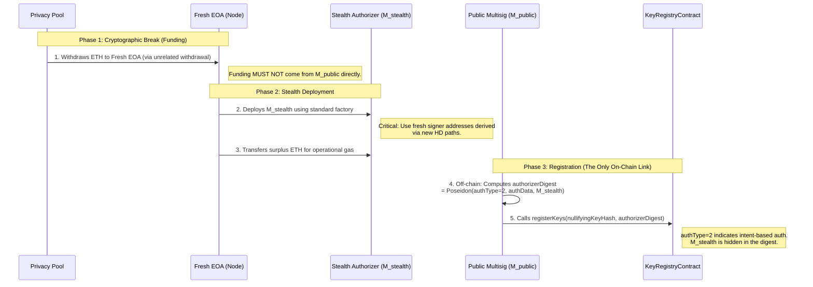
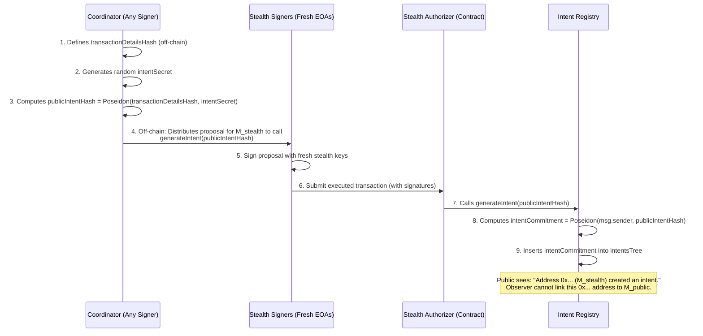
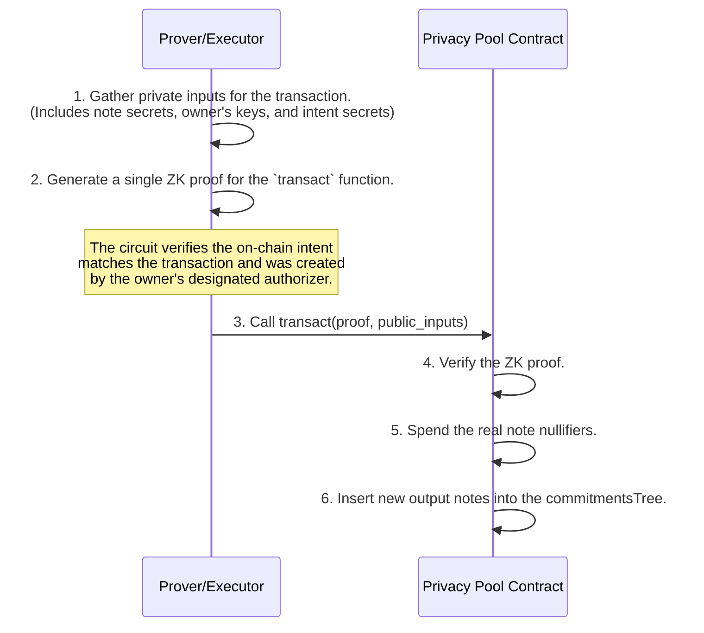

# Multisig support

This page describes a planned extension to support smart contracts (e.g., Gnosis Safes, DAOs) as note owners. It is not part of v2.0.

A ZK-native protocol can only verify ownership by checking for knowledge of a private key. However, smart contracts like multisigs cannot hold private keys. This creates a fundamental dilemma: how can a contract "authorize" a private transaction? The **intent-based system** solves this.

## 1. Intent-Based as a Dedicated Auth Type

Intent-based authorization would be implemented as `authType = 2`, with a dedicated circuit that combines:

1. **Direct Key verification:** The prover demonstrates knowledge of the `privateNullifyingKey` (same as `authType = 0`)
2. **Intent verification:** The circuit additionally proves that a valid intent exists on-chain, created by the registered `authorizerAddress`

**Why a separate circuit?** Circuits are fixed-size at compile time. If intent verification were conditional within the Direct Key circuit, every single-signer user would pay the proving cost of intent Merkle proofs they don't use. By making intent-based authorization a separate `authType`, only multisig users bear this cost.

**The `authorizerAddress` field:** For `authType = 0` and `authType = 1`, this field is set to `0` (unused). For `authType = 2`, it specifies the stealth multisig contract authorized to post intents.

## 2. The Intent Data Structure

The core of the intent-based authorization model is the **intent**, a public on-chain commitment to a future private transaction:

1. **`transactionDetailsHash`**: A cryptographic commitment to all immutable, economically significant aspects of a transaction (input notes, output details, etc.). This hash is computed off-chain and ensures that the executor of the intent cannot alter the transaction's outcome.
2. **`intentSecret`**: A fresh, random, private value generated by the authorizer. This is a private input to the ZK circuit and **must not** be shared with the relayer. It obfuscates the `transactionDetailsHash`.
3. **`publicIntentHash`**: A public commitment that combines the transaction details with the obfuscating secret: `publicIntentHash = Poseidon(transactionDetailsHash, intentSecret)`.
4. **`intentCommitment`**: The final leaf inserted into the `intentsTree`. It binds the public hash to the on-chain authorizer: `intentCommitment = Poseidon(authorizerAddress, publicIntentHash)`.

## 3. On-Chain Data Structures

- **`intentsTree`:** A fully on-chain Merkle tree containing `intentCommitment` hashes. This serves as the public ledger of authorized transactions for multisigs and other contract-based accounts.

## 4. Decoupling Owner and Authorizer for Privacy

The protocol deliberately separates the `ownerAddress` (which holds the funds) from the `authorizerAddress` (which creates intents). This separation is a critical privacy feature. It allows a primary entity (e.g., a well-known multisig) to hold funds as the `owner` while delegating the public act of creating intents to a separate, anonymous "stealth" address. This breaks the on-chain link between the owner's identity and their transaction activity. See Section D.7 for operational hygiene requirements.

## 5. Circuit Design

The intent-based circuit (`authType = 2`) is a dedicated verifier, not a modification to the base `transact` circuit. It performs all the checks of the Direct Key circuit plus intent verification:

- **Public Inputs**: All standard `transact` inputs, plus `intentsTreeRoot`.
- **Private Inputs**: All standard inputs, plus `authorizerAddress`, `intentSecret`, `publicIntentHash`, and the Merkle proof for the `intentCommitment`.
- **Verification Logic**:
    1. Verify knowledge of `privateNullifyingKey` via hash preimage (same as `authType = 0`)
    2. Reconstruct `intentCommitment = Poseidon(authorizerAddress, publicIntentHash)`
    3. Prove `intentCommitment` exists in `intentsTreeRoot`
    4. Verify `authorizerAddress` matches the value registered in the user's `authorizerDigest`

<aside>
🔒

**Security Property: Implicit Authorization via Transaction Binding**
The security of the intent system relies on cryptographic binding: the on-chain intent commits to a transactionDetailsHash, which is a commitment to the specific input notes. The circuit separately proves that the prover possesses the private keys for the ownerAddress of those exact same input notes. An attacker cannot use a valid, unspent intent for a different transaction.

</aside>

## 6. User Flows

**Flow: Multisig Setup (Stealth Authorizer)**

**Flow: Intent Creation (via Stealth Authorizer)**

**Flow: Intent-Based Transfer Execution**

## 7. Stealth Authorizer Hygiene

To strictly maintain the privacy of the intent architecture, the link between the `ownerAddress` (e.g., a public multisig) and its `authorizerAddress` (the Stealth Authorizer) must be operationally unlinkable. While the protocol cryptographically hides this link via the `authorizerDigest` (which salts the address with a private high-entropy key), operational side-channels can reveal it.

A rigorous "Stealth Authorizer Hygiene" protocol is required to prevent side-channel deanonymization:

1. **Funding via Cryptographic Break:** The Stealth Authorizer ($M_{stealth}$) must be funded by a fresh EOA that was itself funded via a privacy pool withdrawal. It must **never** receive ETH directly from the public entity ($M_{public}$) or any associated address.
2. **Deployment Hygiene:** $M_{stealth}$ should use standard factories and configurations. Unique parameter choices (e.g., a specific 7-of-9 threshold) must be avoided to prevent fingerprinting. Standard thresholds (e.g., 2/3, 3/5) are recommended.
3. **Signer Isolation:** The signers of $M_{stealth}$ must be fresh addresses, derived via a dedicated HD path, and strictly isolated from the signers of $M_{public}$. These signers should also be funded via privacy pool withdrawals if they require gas (though meta-transactions via the funded $M_{stealth}$ are preferred).
4. **Entropy Injection:** To defeat timing and traffic analysis, users should employ "decoy" multisigs and "chaff" operations (dummy intents), raising the noise floor for observers.
5. **Temporal Decorrelation:** Avoid deploying $M_{stealth}$ immediately before or after a significant public governance event. Pre-deployment (weeks in advance) is the best practice.

## 8. Alternative Approaches: In-Circuit Threshold Signatures

The intent-based approach is not the only way to support multisigs. The extensible `authType` mechanism allows for future alternatives:

**FROST on BabyJubJub:** Threshold Schnorr signatures (FROST) would allow M-of-N signers to produce a single aggregate signature verified in-circuit. This eliminates the on-chain intent step entirely. Research like [ROAST](https://eprint.iacr.org/2022/550) extends FROST with asynchronous robustness, addressing liveness concerns.

**Why intent-based comes first:**

- **Battle-tested primitives:** Intent-based authorization uses existing, audited infrastructure (Gnosis Safe, standard EVM signatures). FROST on BabyJubJub requires custom implementations.
- **Hardware wallet support:** BabyJubJub signing isn't natively supported by Ledger/Trezor today. Experimental projects like FROSTGUN require sideloading custom firmware.
- **No coordination overhead:** Intents are posted asynchronously. FROST requires synchronous multi-round signing ceremonies.

<aside>
🤝

Coexistence, not competition: These approaches aren't mutually exclusive. As BabyJubJub gains hardware wallet support and threshold signature tooling matures, FROST-based multisig could be added as a new authType. Intent-based authorization provides a ready-today solution built on proven components; in-circuit threshold signatures offer a future path to eliminating on-chain authorization entirely.

</aside>

<aside>
🔒

Key isolation requirement: When BJJ-based authorization is implemented (whether single-signer or FROST threshold), the BJJ private key must never be passed as a circuit input. The circuit verifies a signature against the registered public key; the nullifying key is provided separately. For hardware wallets, the nullifying key can be derived from a deterministic BJJ signature using signature-based secret derivation (extracting entropy from the RFC 6979 r component)—see the Security Note in Section 3.5.

</aside>