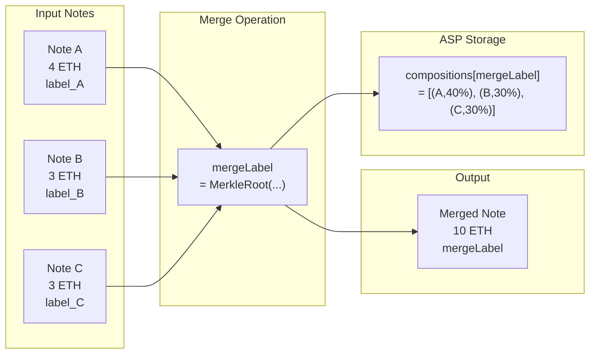
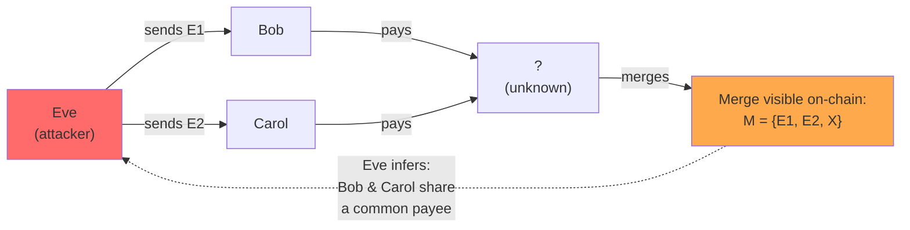
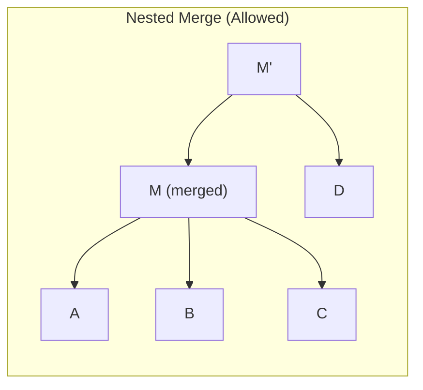
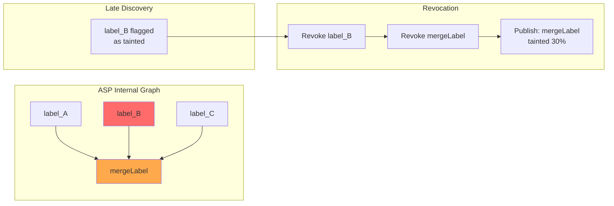
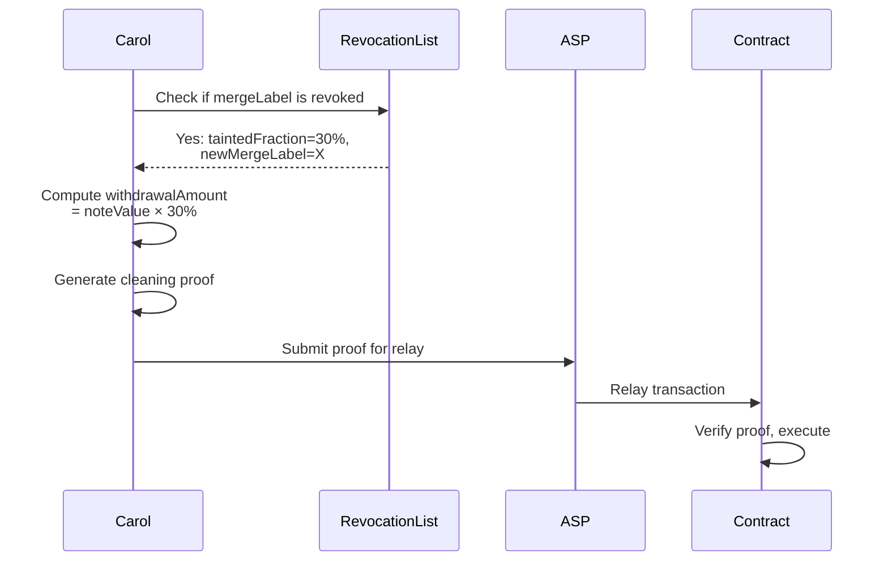
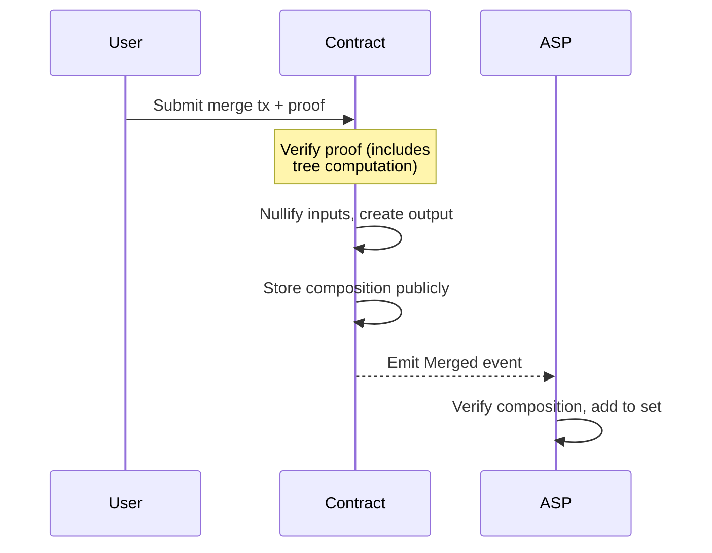

# Note merging idea draft

## The Problem: Death by a Thousand Labels

Privacy Pool v2's lineage tracking is elegant: every deposit creates a unique `label`, and that label follows the funds forever. When Alice deposits 10 ETH, her deposit gets `label_A`. When she sends 3 ETH to Bob, Bob's note still carries `label_A`. If Alice's deposit is later flagged as suspicious, the ASP can surgically revoke just `label_A`—affecting only Alice and her recipients, not the entire pool.

This is great for taint containment. But there's a catch.

Imagine Bob is a freelancer. Over a month, he receives payments from 20 different clients. Each payment comes from a different deposit, so Bob now holds 20 notes with 20 different labels. When Bob wants to pay his rent (let's say 5 ETH), he has a problem: the protocol won't let him combine notes with different labels in a single transaction.

Bob's options are painful:

- Pay rent using 5 separate transactions (one per label that contributes)
- Manage a complex multi-output transaction that tracks each label independently
- Give up and withdraw everything publicly, losing privacy

As the pool grows, this "label fragmentation" becomes unsustainable. Users accumulate dust across dozens of labels. Wallets become unmanageable. The protocol's usability collapses under its own compliance guarantees.

We need a way for Bob to **merge** his 20 notes into one—without breaking taint containment.

---

## Prior Art: Mike's Encrypted Tracing

Mike Zajac proposed an [elegant solution](https://ethresear.ch/t/tracing-bad-funds-through-shielded-pools/23624) using homomorphic encryption. The idea: every note carries encrypted metadata about which deposits contributed to it, and what fraction of value each deposit represents. The encryption keys are held by an MPC committee. Under normal circumstances, nobody can decrypt this metadata—the note owner doesn't even know which deposits flowed into their funds.

But if a deposit is later blacklisted, the MPC committee reveals that deposit's decryption key. Suddenly, every note owner in the system can check: "Does my note contain value from this bad deposit?" If yes, they learn exactly how much—say, 5% of their note's value—and can "decontaminate" by extracting just that tainted portion.

It's clever. It preserves privacy until something goes wrong, then surgically reveals only what's needed. But it requires:

- MPC-generated keypairs for every deposit (coordination overhead)
- Paillier encryption for fraction tracking (expensive in circuits)
- A "reset" mechanism when encrypted lists grow too large (ugly UX)
- Trust that the MPC committee won't collude

We want something simpler.

---

## Our Approach: Labels That Encode Their Own Lineage

Here's the core insight: **a merged label looks identical to an atomic label from the outside, but internally encodes the full lineage of its origins**.

When Bob merges notes from labels A, B, and C, the result is a new 32-byte label M. To the rest of the protocol—transfers, ASP checks, commitment trees—M is just another label. It flows through the system exactly like an atomic label would. No special handling required.

But M is not just a random identifier. It's a Merkle root that commits to the composition: "I am 40% label A, 30% label B, 30% label C." This structure is invisible during normal operation, but it can be *opened* later to generate proofs:

- **Inclusion proof:** "Label A contributed 40% of this merged note's value"
- **Exclusion proof:** "Label X is not part of this merged note"

This is what enables surgical cleaning. When label B gets flagged, the holder of M can prove: "B contributed exactly 30%, here's my Merkle proof." They extract that 30% publicly and keep the rest private.

The labels themselves are pseudonymous (derived from `depositSecret`), so the composition reveals no real-world identity information. And since merging is **opt-in**, users who need maximum privacy simply don't merge.

**The design principle:** Create a new label type that is indistinguishable from atomic labels in normal use, but encodes origin information that can be selectively revealed when needed.

---

## How It Works: The Big Picture

Let's walk through the mechanism step by step.



### Step 1: Bob Decides to Merge

Bob has three notes:

- 4 ETH with `label_A`
- 3 ETH with `label_B`
- 3 ETH with `label_C`

He wants to combine them into a single 10 ETH note. He initiates a **merge transaction**.

### Step 2: Computing the Merged Label

The merge creates a single output note. But what should the new note's label be?

We define it as a **Merkle root** of the contributing labels and their value fractions:

```
leaf_A = Poseidon(label_A, 400_000)   // 40% = 4 ETH / 10 ETH
leaf_B = Poseidon(label_B, 300_000)   // 30% = 3 ETH / 10 ETH
leaf_C = Poseidon(label_C, 300_000)   // 30% = 3 ETH / 10 ETH

mergeLabel = MerkleRoot([leaf_A, leaf_B, leaf_C])
```

The fractions are stored as fixed-point integers (6 decimal places, so 1.0 = 1,000,000). They must sum to exactly 1,000,000.

**The key property:** `mergeLabel` is a 32-byte value, just like any atomic label. From the protocol's perspective—ASP registration, transfers, commitment trees—it's indistinguishable. No special handling required. But unlike a random identifier, it *commits* to its origins. Anyone with the composition data can:

1. **Verify the commitment:** Recompute the Merkle root and confirm it matches `mergeLabel`
2. **Prove inclusion:** Show that a specific atomic label is part of this merge, with its exact fraction
3. **Prove exclusion:** Show that a specific atomic label is *not* part of this merge (via Merkle non-membership)

This is the "self-describing label" pattern: the label itself encodes everything needed to reason about its lineage.

**Who computes this tree?** The ASP does, off-chain. The user sends the composition to the ASP, the ASP verifies it matches the claimed `mergeLabel`, and only then relays the transaction. The ZK circuit doesn't need to compute the Merkle tree—it just takes `mergeLabel` as an input and trusts that the ASP verified correctness before relaying.

This keeps circuits simple. (An alternative "self-sovereign" approach computes the tree in-circuit—we discuss this in the appendix.)

### Step 3: Storing the Composition

The composition data—which labels contribute to `mergeLabel` and at what fractions—is held privately by the ASP. The user sends it encrypted; the ASP stores the mapping internally.

Nothing about `mergeLabel` is visible on-chain. The output commitment is a hash that includes `mergeLabel`, but observers can't extract it without knowing the note's secret. External observers see only that *some* transaction happened—they don't learn the label, the composition, the value, or the owner.

**Why private storage?** Public composition would enable **mutual interaction analysis**:



If compositions were public, Eve could see "labels E1, E2, and X were merged into M." She'd learn that her two recipients (Bob and Carol) have a mutual relationship—they both paid the same person. Private storage prevents this.

**The trade-off:** Users depend on ASP cooperation for cleaning. If the ASP refuses to provide composition data, the user can't prove which fraction is tainted. This is acceptable because the ASP is already trusted to relay merges—trusting it for cleaning data is no additional assumption.

(For users who want full sovereignty, a self-sovereign architecture with public composition is possible—see the appendix.)

**The opt-in nature:** Users who need maximum privacy simply don't merge. Keep your notes separate. Accept the UX friction in exchange for stronger privacy. Merging is a convenience feature, not a requirement.

### Step 4: ASP Registration

The merge follows the same pattern as `registerLabel` in the base protocol. The user generates a ZK proof showing ownership and value conservation, then submits it to the ASP with an encrypted payload containing the composition.

The circuit emits a blinded `mergeCommitment = Poseidon(mergeLabel, mergeSecret)` as a public signal—hiding the actual label from on-chain observers while binding it cryptographically. The ASP decrypts the payload, verifies the composition matches the claimed `mergeLabel`, and checks the `mergeCommitment` against the public signal.

Key difference from a normal `transact`: the circuit doesn't check ASP inclusion for each input label. The ASP does that off-chain before relaying. This keeps the circuit simple.

Once verified, the ASP:

1. Records relationships in its internal graph: A→M, B→M, C→M
2. Relays the transaction to the contract
3. Adds `mergeLabel` to its association set

No latency gap—the merge is spendable immediately after on-chain confirmation.

The ASP's internal graph of `atomic_label → mergeLabel` edges is crucial for late discovery, as we'll see.

### Step 5: Spending the Merged Note

Bob's merged note works exactly like any other note. When he wants to send 5 ETH to Carol:

- He proves his note exists in the commitment tree
- He proves `mergeLabel` is in the ASP's association set
- He creates output notes (one for Carol, one for change) that inherit `mergeLabel`
- The circuit enforces value conservation

Carol receives a note. She doesn't need to know or care that it's "merged"—to her, it's just a note with a label.

---

## Nested Merges and Flattening

What happens when Carol merges a note that already carries a merged label?

Suppose Carol received a note with `mergeLabel = M` (itself composed of A, B, C) and wants to merge it with another note carrying `label_D`. The new merged label will simply treat M as one of the leaves:



`M' = MerkleRoot(M, D)` where M itself is a Merkle root.

**Why allow nesting?** The user doesn't need to know—or care—what's inside M. They just see a label and a note. The merge circuit treats M like any other label. This dramatically simplifies the user experience: merging is always a simple operation, regardless of whether inputs are atomic or previously merged.

**Where does flattening happen?** In cleaning. When contamination is discovered, the ASP recursively expands nested compositions to compute the true atomic breakdown. If M contains 40% A, 30% B, 30% C—and M' is 50% M + 50% D—then M' is effectively 20% A, 15% B, 15% C, 50% D.

The ASP maintains the full nested structure internally and can compute this expansion on demand. Users never need to perform this computation themselves.

**The key insight:** Nesting is an internal optimization that the ASP handles. Users interact with flat abstractions (just labels), and the ASP does the bookkeeping.

### Why a Merkle Root?

Why not just hash all the labels together with a single Poseidon call?

```
// Option A: Single hash
mergeLabel = Poseidon(label_A, frac_A, label_B, frac_B, label_C, frac_C, ...)

// Option B: Merkle tree (what we use)
leaf_i = Poseidon(label_i, fraction_i)
mergeLabel = MerkleRoot([leaf_A, leaf_B, leaf_C, ...])
```

With ASP-relayed architecture, the circuit never reconstructs this tree—the ASP computes it off-chain. So circuit complexity isn't the driving reason anymore.

**The real reasons are:**

1. **Self-sovereign fallback**: If we ever need the self-sovereign architecture (appendix), the Merkle structure enables bounded-complexity in-circuit computation.
2. **Consistency**: The rest of the protocol uses Merkle trees (commitment trees, association sets). Using the same structure for compositions keeps the mental model uniform.
3. **Future flexibility**: Merkle trees support efficient membership proofs. If we ever want users to prove "label X is part of my merged note" without revealing the full composition, the structure is ready.

That said, for pure ASP-relayed operation, a simple hash chain or even `Poseidon(sorted_labels...)` would work. The Merkle structure is a conservative choice that keeps options open.

---

## When Things Go Wrong: Late Discovery

Here's where the design earns its keep.

Six months after Bob's merge, the ASP discovers that `label_B` originated from a sanctioned wallet. It needs to revoke all notes containing value from this deposit.

### The Revocation Cascade



The ASP:

1. Revokes `label_B` from its association set
2. Queries its graph: "Which merged labels contain B?" → finds `mergeLabel`
3. Revokes `mergeLabel` from its association set
4. Publishes: `Contaminated(mergeLabel, taintedFraction, newMergeLabel)`

**Why publish the fraction?** Users need to know how much is tainted to compute their withdrawal amount. Without this, they'd have to ask the ASP—defeating the point of public data.

**What gets revealed:**

- `mergeLabel` exists and is contaminated
- What percentage is tainted
- The clean label they'll receive after cleaning

**What stays private:**

- The full composition (which atomic labels are inside)
- Who holds notes with this label
- The actual ETH amounts (only the holder knows their note's value)

Anyone holding a note with `mergeLabel` can no longer spend it through normal channels. Carol, who received Bob's note months ago, is affected—even though she did nothing wrong.

### Carol's Options

Carol has two paths forward:

**Option 1: Full Ragequit.** She proves she owns the note and withdraws the entire 10 ETH publicly. This works but destroys her privacy—the withdrawal is linked to her identity.

**Option 2: Partial Clean.** She extracts only the contaminated portion (30% = 3 ETH) publicly, and creates a new clean merged note with the remaining value.

Let's walk through option 2.

---

## The Cleaning Operation

Cleaning is straightforward because the ASP publishes everything users need.



### Step 1: Check the Revocation List

Carol discovers her `mergeLabel` is revoked—either by checking the public revocation list or when a spend attempt fails. The revocation notice includes:

- `taintedFraction`: 30% (= 300_000)
- `newMergeLabel`: The clean label she'll receive

No interaction with the ASP needed for discovery.

### Step 2: Compute Withdrawal Amount

Carol knows her note's value (10 ETH) and the tainted fraction (30%):

```
withdrawalAmount = 10 ETH × 0.30 = 3 ETH
```

### Step 3: Generate and Submit Proof

She generates a cleaning proof asserting:

- She owns the contaminated note
- The tainted fraction is 300_000 (30%)
- The withdrawal amount is 3 ETH
- The output uses `newMergeLabel`

The ASP relays the transaction. The contract:

1. Verifies the proof
2. Nullifies Carol's original note
3. Transfers 3 ETH to Carol's address (the tainted portion)
4. Inserts the new clean note into the commitment tree

### The Clean Output: Always Flat

Critically, `newMergeLabel` is a **flat** composition of atomic labels:

```
newMergeLabel = MerkleRoot([
  Poseidon(label_A, 235_294),   // 20/85 ≈ 23.5%
  Poseidon(label_C, 176_471),   // 15/85 ≈ 17.6%
  Poseidon(label_D, 588_235)    // 50/85 ≈ 58.8%
])
```

Even though the input was nested, the output is flat. This means:

- Future cleaning of `newMergeLabel` requires no recursion
- The nesting complexity is "burned off" during cleaning

**Why does this work?** Because the ASP did the recursive expansion. Carol didn't need to know the nested structure—she just claimed a tainted percentage and the ASP verified it. The heavy lifting happens off-chain.

### Privacy of the Tainted Percentage

The tainted percentage Carol claims in her proof is visible to the ASP (and potentially on-chain if embedded in public signals). This reveals *how much* of her note was contaminated.

This is equivalent to the privacy loss from a ragequit: if Carol withdrew 1.5 ETH publicly, observers would see that amount. The percentage leak is the same information in relative form.

Users who need to hide even this information should ragequit their entire balance instead—accepting full privacy loss for their withdrawal in exchange for not revealing the contaminated fraction.

### What If the ASP Lies?

The circuit doesn't verify that `taintedFraction` is correct—it only verifies Carol is using the values the ASP published. We're trusting the ASP to be honest.

If the ASP lies:

- **Understates**: User keeps a note that's still partially tainted. ASP would need to revoke again later.
- **Overstates**: User withdraws more than necessary, losing clean value they shouldn't have.

**The escape hatch:** If you don't trust the ASP's claimed fraction, ragequit instead. Withdraw everything publicly, then verify the ASP's composition claims against reality. This is the same trust model as the rest of the protocol—ASP controls convenience, not custody.

---

## The Ragequit Fallback

What if the ASP goes offline, refuses to cooperate, or censors you?

**For merged notes you already hold:** You can ragequit (full withdrawal) using the existing ragequit circuit. You prove ownership and withdraw publicly—losing privacy but preserving access to your funds.

**For merges you want to perform:** You can't merge without ASP cooperation—but you can still transact with your individual notes normally. Merging is a convenience feature; its unavailability doesn't lock your funds.

**For cleaning:** A self-sovereign cleaning circuit is possible as a fallback (see appendix). It's more expensive—the circuit must recompute the Merkle tree—but it doesn't require ASP cooperation.

The key guarantee: **funds are never locked**. The ASP can deny convenience features (merging, efficient cleaning), but it cannot steal or freeze your assets.

---

## Transfer UX

Remember Bob sending to Carol? Let's compare transfer experiences:

**Mike's encrypted approach:**

- Bob must send Carol: note secrets + encrypted deposit metadata
- Carol receives a blob she can't decrypt
- If contamination happens, Carol needs the MPC committee to reveal keys
- Complex coordination, trust assumptions everywhere

**Our design:**

- Bob sends Carol: `{mergeLabel, noteSecret, value, tokenId}`
- That's it. Same as an atomic note.
- If cleaning is needed, Carol requests composition from ASP
- No encrypted blobs, no MPC committees

The merged note transfers exactly like any other note. Carol doesn't need to know or care that her note is "merged" unless contamination forces a cleaning operation.

---

## Alternative Composition Storage

The main design stores compositions privately with the ASP. But what if you don't want to trust the ASP for data availability? There are alternatives—each with significant trade-offs.

### The Core Problem: In-Circuit Tree Computation

All non-ASP approaches share a fundamental challenge: **the user must prove composition correctness inside the circuit**.

When you merge, you need to prove `mergeLabel = MerkleRoot(composition)`. When you clean, you need to prove the new composition is the old one minus the tainted label, with renormalized fractions. Both require computing Merkle trees in-circuit.

For a composition with M labels:

- Computing all M leaf hashes: M × Poseidon calls
- Building the Merkle tree: (M-1) more Poseidon calls
- Total: ~2M Poseidon hashes in the circuit

A Poseidon hash is roughly 200-300 constraints. For M=16 labels, that's ~6,000-10,000 constraints just for tree computation—on top of ownership proofs, value checks, and everything else.

This doesn't sound terrible until you consider that **cleaning requires doing this twice** (verify old composition, compute new composition) and that nesting makes things worse. If you allow nested merges, cleaning a deeply nested label requires recursively expanding and recomputing—circuit size explodes.

### Public On-Chain Registry

Store compositions publicly when merging:

```solidity
mapping(bytes32 => bytes) public compositions;
```

This enables trustless cleaning—users read composition data from chain and prove correctness in-circuit. No ASP needed for data availability.

The cost: composition is public, enabling mutual interaction analysis. And you pay the full circuit complexity for tree computation. Nesting must be forbidden (mandatory flattening) to bound circuit size.

This is the self-sovereign architecture in the appendix.

### Transfer Payload

Pass composition with each transfer. Recipients verify by recomputing the Merkle root themselves.

The problems compound: payloads grow (~36 bytes per label), data loss means you can't clean, and nested compositions require passing entire trees recursively. A deeply nested merge could have kilobytes of composition data.

### Owner-Encrypted On-Chain

Emit encrypted composition with each merge, encrypted to the owner's viewing key. Owner can always recover from chain.

Better than public (composition stays private), but there's a problem: **transfers break data availability**. The original owner encrypted to their key. When they transfer the note, the new owner can't decrypt the composition. If the new owner ever needs to clean, they'd have to ask the original owner—who may be uncooperative or unreachable.

You could re-encrypt on each transfer, but that adds coordination overhead and leaks that a transfer happened (encrypted blob changes). It also requires the sender to provide composition data they might not have (if they received the note via transfer themselves).

And you still pay the full in-circuit tree computation cost for cleaning.

### Why ASP Storage Wins

The ASP approach sidesteps all of this. The circuit never computes Merkle trees—the ASP does all tree computation off-chain, at zero circuit cost. The circuit just proves ownership and value conservation; the ASP decides whether to relay based on its own verification.

This is why nesting works in the ASP model: the ASP handles recursive expansion. The circuit stays O(1) regardless of composition size or nesting depth. The user doesn't even need to know what's inside their merged label.

---

## Security Properties

Let's verify we haven't broken anything important.

### Taint Containment: Preserved

A tainted atomic label affects only its fraction of a merged note. If Carol's 10 ETH note contains 30% tainted value, she loses 3 ETH to cleaning—not the full 10 ETH. The clean 7 ETH remains private and spendable.

### No Fund Washing

The ASP's graph ensures revocation propagates. When `label_B` is revoked, every merged label containing B is also revoked. Users can't "launder" tainted funds by merging them with clean funds—the taint follows.

### Griefing Resistance

Only the owner can merge their notes. An attacker can't force-merge their tainted funds into your clean note—the merge circuit requires proving ownership of all inputs.

### User Sovereignty

Users can always ragequit—withdrawing their full balance publicly—even if the ASP refuses to cooperate. The ASP controls convenience (merging, efficient cleaning), not custody. Worst case: you lose privacy, but you never lose funds.

For cleaning specifically, a self-sovereign circuit (see appendix) can be implemented as a fallback if ASP cooperation cannot be relied upon.

---

## Circuit Details

This section provides the full circuit specifications for both the merge and cleaning operations.

### The Merge Circuit

**Public Inputs:**

- `commitmentRoot` (note existence)
- `keyRegistryRoot` (ownership verification)
- `nullifierHashes[]` (one per input note)
- `outputCommitment` (the new merged note)
- `mergeCommitment` (blinded: `Poseidon(mergeLabel, mergeSecret)`)
- `encryptedPayloadHash` (binds to ASP payload)

**Private Inputs:**

- Input notes: `{noteSecret, value, label, tokenId, ownerAddress}[]`
- Owner keys (`privateNullifyingKey`, `privateRevocableKey`)
- Merkle proofs for each input note in `commitmentRoot`
- `mergeLabel` (the claimed merged label—ASP verifies correctness)
- `mergeSecret` (random blinding factor)

**Core Assertions:**

1. All input notes exist in `commitmentRoot`
2. All input notes owned by the prover (key registry verification)
3. All inputs share the same `tokenId`
4. `outputValue = sum(inputValues)`
5. `mergeCommitment = Poseidon(mergeLabel, mergeSecret)`
6. `outputCommitment` correctly constructed with `mergeLabel`
7. `encryptedPayloadHash` binds to the payload data

Note: The circuit does **not** verify ASP inclusion for input labels—the ASP checks this off-chain. It also does **not** verify that `mergeLabel` is correctly computed from the composition—that's also the ASP's job. The circuit only ensures the claimed `mergeLabel` is used consistently.

### The Cleaning Circuit

The cleaning circuit is executed after the user reads the tainted fraction and clean label from the public revocation list.

**Public Inputs:**

- `commitmentRoot`, `keyRegistryRoot`
- `nullifierHash` (input merged note)
- `taintedFraction` (the claimed tainted percentage, e.g., 150_000 for 15%)
- `withdrawalAmount` (= noteValue × taintedFraction / 1_000_000)
- `recipientAddress` (forced to owner)
- `outputCommitment` (new clean note)
- `cleanCommitment` (blinded: `Poseidon(newMergeLabel, cleanSecret)`)
- `aspAttestationHash` (binds to ASP signature)

**Private Inputs:**

- Full merged note secrets (including value)
- Owner keys
- `newMergeLabel` (ASP-provided clean composition—always flat)
- `cleanSecret` (random blinding factor)
- ASP attestation data

**Core Assertions:**

1. Input note exists, owned by prover
2. `withdrawalAmount = noteValue × taintedFraction / 1_000_000`
3. `recipientAddress = ownerAddress` (forced withdrawal to owner)
4. `cleanCommitment = Poseidon(newMergeLabel, cleanSecret)`
5. `outputCommitment` correctly constructed with `newMergeLabel`
6. ASP attestation is valid (signature verification)
7. Output note value = input value - withdrawalAmount

**What the circuit does NOT verify:**

- That `taintedFraction` is actually correct (ASP verified this in Phase 1)
- That `newMergeLabel` is correctly computed (ASP computed this)
- Any Merkle tree recomputation

The circuit trusts the ASP's attestation. This keeps complexity O(1)—just signature verification—regardless of how deeply nested the original label was.

---

## Circuit Complexity

With ASP-relayed architecture, circuits stay simple:

- **Merge circuit:** O(N) constraints for N input notes—just ownership proofs and value conservation. No tree computation. Inputs can be atomic or merged labels—the circuit doesn't care.
- **Cleaning circuit:** O(1) for signature verification. The ASP handles recursive expansion of nested labels off-chain; the circuit just verifies the attestation.
- **Single circuit variant** works regardless of nesting depth or composition size.

**Why nesting doesn't hurt complexity:** The user never needs to know—or prove anything about—the internal structure of a merged label. The ASP maintains the composition graph and does all the recursive expansion when needed for cleaning. The circuit only sees flat abstractions: "I own this note with this label."

(The self-sovereign alternative in the appendix has higher complexity—O(N × M) for merge, O(M) for cleaning—but achieves full trustlessness. It also requires flattening during merge to bound complexity.)

---

## Open Questions

A few things we haven't fully resolved:

**Maximum merge size.** More labels = more composition data for ASP storage. What's the sweet spot? Probably 16-32 atomic labels is reasonable.

**Batch cleaning.** If multiple labels in a composition are revoked simultaneously, can we clean them all in one transaction? Would need a more flexible circuit.

**Integration with label forking.** The existing `forkLabel` mechanism lets you split a label for privacy. Can you fork a merged label? Probably yes, but the details need work.

**Self-sovereign fallback scope.** Should the self-sovereign cleaning circuit (appendix) be mandatory or optional? It adds implementation complexity but provides a censorship-resistant escape hatch.

---

## Summary

Note merging solves the dust fragmentation problem in Privacy Pool v2. Users can consolidate notes from different labels into a single merged note, dramatically improving UX.

**The core design pattern:** A merged label is indistinguishable from an atomic label during normal operation—same 32 bytes, same protocol handling, same transfer UX. But it's a Merkle root that commits to its origins. This hidden structure can be *opened* later to enable surgical cleaning without revealing anything else about the note.

**Nesting is allowed:** Merged labels can be merged again, creating arbitrarily deep nesting. Users don't need to know—or care—what's inside a label. The ASP maintains the composition graph and handles recursive expansion when needed.

**The architecture:** ASP-relayed merging keeps circuits simple. The ASP verifies compositions off-chain and relays transactions. Users trust the ASP for merge and cleaning operations—but not for fund custody. Funds can always be ragequit if the ASP misbehaves.

**Simple cleaning:** When contamination is discovered, the ASP publishes the tainted fraction and clean label. Users check the public revocation list, compute their withdrawal amount, and submit a cleaning proof. No interactive discovery phase needed—all data is public.

**The privacy trade-off:** Compositions are stored privately by the ASP, preventing mutual interaction analysis. Users who need maximum privacy don't merge. Merging is opt-in convenience, not a requirement.

It's less sophisticated than encrypted tracing—but it's simpler and achieves the core goals.

---

## Appendix: Self-Sovereign Architecture

For users who don't want to trust ASPs for merge operations, an alternative architecture computes everything in-circuit.

**Key difference from ASP-relayed:** Self-sovereign architecture requires **mandatory flattening** during merge. Because the user (not the ASP) must be able to clean their own notes, and because the cleaning circuit must recompute Merkle trees, we can't allow unbounded nesting. Every merge flattens to atomic labels.

### Why Flattening Is Essential

This isn't a design preference—it's a fundamental constraint of ZK circuits.

**ZK circuits have fixed size at compile time.** When you write a circuit, you must specify exactly how many constraints it will have. You can't say "loop until done" or "expand this tree recursively"—the circuit must know in advance how many operations to perform.

With nesting allowed, a merged label could contain:

- 3 atomic labels (simple case)
- A merged label containing 5 labels, one of which contains 8 more (nested)
- Arbitrarily deep trees with unbounded total size

There's no way to write a single circuit that handles all these cases. You'd need to either:

1. Compile different circuits for each possible nesting depth (impractical)
2. Pad to some maximum depth (wasteful and still bounded)
3. Use recursive SNARKs to verify sub-proofs (expensive and complex)

**Flattening solves this.** By requiring that every merge produces a flat list of atomic labels, we guarantee the composition has bounded, predictable structure. A circuit for M=16 labels works for any merge, regardless of how many previous merges the inputs went through.

The ASP-relayed architecture avoids this because the ASP handles tree expansion off-chain—outside the circuit. The circuit never touches the composition structure at all.

### How It Differs

Instead of the ASP verifying compositions off-chain, the ZK circuit computes `mergeLabel = MerkleRoot(...)` directly. Users submit merge transactions themselves, without relayer involvement.



**Circuit responsibilities:**

- Prove ownership of all input notes
- Compute all leaf hashes: `Poseidon(label_i, fraction_i)`
- Compute full Merkle tree to derive `mergeLabel`
- Verify value conservation
- Construct output commitment

### Composition Storage

With self-sovereign merging, compositions must be stored publicly on-chain:

```solidity
mapping(bytes32 => bytes) public compositions;
```

This enables trustless cleaning—users can read composition data and clean without ASP cooperation.

The trade-off: public compositions enable mutual interaction analysis (see the Eve attack diagram in Step 3).

### Cleaning Circuit

The self-sovereign cleaning circuit recomputes the Merkle tree in-circuit:

**Public Inputs:**

- commitmentRoot, keyRegistryRoot
- nullifierHash (input merged note)
- taintedLabel (the revoked atomic label)
- withdrawalAmount
- recipientAddress (forced to owner)
- outputCommitment (new clean note)
- newMergeLabel (recomputed Merkle root)
- newCompositionHash

**Core Assertions:**

1. Input note exists, owned by prover
2. Original composition matches mergeLabel (reconstruct tree)
3. Tainted leaf exists at claimed index
4. withdrawalAmount correctly computed
5. New composition = original minus tainted, renormalized
6. newMergeLabel = MerkleRoot of new composition
7. Output commitment uses newMergeLabel

### Trade-offs

| Aspect | ASP-Relayed | Self-Sovereign |
| --- | --- | --- |
| Nesting | Allowed (arbitrary depth) | Mandatory flattening |
| Circuit complexity | O(N) merge, O(1) clean | O(N × M) merge, O(M) clean |
| Proving time | Lower | Higher |
| Gas cost | Lower | Higher |
| ASP dependency | Required for merge & clean | Post-merge only |
| Composition visibility | Private | Public |
| Censorship resistance | Medium | High |

### When to Use

**Self-sovereign makes sense when:**

- Censorship resistance is paramount
- Users distrust ASP liveness/availability
- The performance overhead is acceptable
- Users accept the privacy cost of public compositions

**A hybrid approach** could implement both: most users take the fast ASP-relayed path; power users who distrust ASPs pay the performance cost for self-sovereignty.