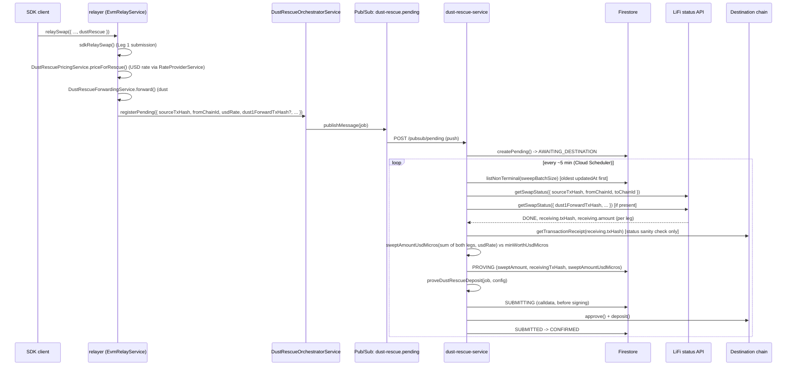
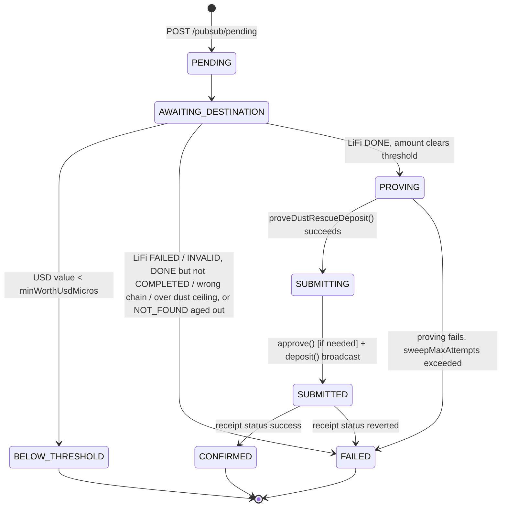

# Dust Rescue Service

Detection, proving, and on-chain submission for cross-chain reshield's optional stealth
"dust rescue" leg (see [pool-session.md](../sdk/pool-session.md) §Stealth Dust Rescue and
[withdraw-and-swap.md](../sdk/withdraw-and-swap.md) §Stealth Dust Rescue for the SDK/client
side of this feature; `agents/deviations.md` INTL-09 for the full design history).

## Overview

A cross-chain reshield rarely lands on an exact deposit amount — the destination-chain
leftover ("dust") is either swept to the relayer's ordinary `dustRecipient`, or, if a
caller opts in via `dustRescue: { recipientIdentifier }`, rescued into a real shielded
note owned by a stealth address only the recipient can recognize. The relayer alone
observes the actual swept amount (the client cannot know it in advance) and generates
the rescue deposit's proof itself — see `packages/relayer/dust-rescue-prover`'s package
description for why that's a deliberately separate, keyless proving module.

That module computes a ready-to-submit `Entrypoint.deposit(...)` call but does not
submit it. `dust-rescue-service` (`packages/relayer/dust-rescue-service`) is the
standalone GCP Cloud Run service that closes that gap: it detects when a rescue is
ready, invokes the prover, and submits the resulting transaction with its own signer.

**Why a separate service, not a chain-write client inside the relayer.** The relayer's
existing chain-write client, `EVMChainService`, is deliberately request-scoped (per-chain
context is request-bound — see `packages/relayer/CLAUDE.md`'s Pre-Flight Checklist), but
a pending rescue has to survive across every unrelated request that arrives between Leg-1
submission and the dust actually clearing a worth-it threshold. A singleton can't inject a
request-scoped client. Rather than fight that mismatch inside the relayer, this design
moves detection + proving + submission into its own service — at which point the
relayer no longer needs to hold any cross-request state either.



## Package layout

Sibling to `packages/relayer/dust-rescue-prover` and `packages/relayer/relayer`. NestJS
app (matches every other HTTP service in this monorepo), depending on
`@privacy-pools-v2/dust-rescue-prover` as a library and `@privacy-pools-v2/sdk` for
`LiFiSwapQuoteProvider`.

```
packages/relayer/dust-rescue-service/
├── src/
│   ├── config/            DustRescueConfigService — own config, independent of RelayerConfig
│   ├── jobs/               IDustRescueJobStore + FirestoreDustRescueJobStore
│   ├── detection/          DetectionService (LiFi status + receiving.amount)
│   ├── chain-write/        ChainWriteService (approve + deposit, fresh nonce per call)
│   ├── sweep/               SweepService (the state-machine driver) + SweepController
│   └── pubsub/              PubSubController (POST /pubsub/pending)
├── scripts/derive-keys.ts  offline key derivation, NOT deployed (see Key Custody)
├── Dockerfile
└── dust-rescue-service.config.example.json
```

## Config

Independent of the relayer's `RelayerConfig`/`ChainConfigWrapper` — this is a separately
deployed service with its own concerns, not a per-request-scoped chain config the relayer
also needs. Loaded from `CONFIG_PATH` (same convention as `RelayerConfig`), validated with
zod (`src/config/config.schemas.ts`).

| Field | Scope | Description |
|---|---|---|
| `chains[].chainId` | per-chain | Destination chain this service can rescue into. |
| `chains[].rpcUrl` | per-chain | JSON-RPC endpoint for that chain. |
| `chains[].aspUrl` | per-chain | ASP endpoint the prover needs for compliance ciphertext. |
| `chains[].circuitArtifactsDir` | per-chain | Filesystem path to the deposit circuit's artifacts, baked into the image at build time (see Deploy). |
| `chains[].deployment` | per-chain, optional | Explicit `{poolAddress, entrypointAddress, keystoreAddress, aspRegistryAddress}` override; falls back to `@privacy-pools-v2/sdk`'s `DEPLOYMENTS[chainId]` when omitted, exactly like `dust-rescue-prover`'s own `resolveDeployment()`. |
| `chains[].minWorthUsdMicros` | per-chain | Static, manually-refreshed worth-it floor in micro-USD (1e-6 USD). Chain-level, not per-`tokenId` — the dominant cost term (gas) is chain-specific, and the relayer already prices the swept asset in USD at registration time. No dynamic/live-gas-price computation for v1; informed offline by `packages/swaps/scripts/dust-rescue-cost-matrix.ts`. |
| `pubsubTopic` | global | Defaults to `dust-rescue.pending`. |
| `firestoreCollection` | global | Defaults to `dustRescueJobs`. |
| `sweepMaxAttempts` | global | Bounded retries per job before it's marked `FAILED`. Defaults to 5. |
| `sweepBatchSize` | global | Caps how many non-terminal jobs one `/sweep` pass examines, oldest-`updatedAt`-first. Defaults to 30 (finding #10, Problem A). Requires a Firestore composite index on `state (in) + updatedAt (asc)` — see the package README's Deploy section. |
| `notFoundAgeOutHours` | global | How long a leg may sit at genuine LiFi `NOT_FOUND` before the job gives up and retires `FAILED`. Defaults to 6 hours (finding #10, Problem C). Does not apply to `INVALID`, which is terminal immediately, or to `PENDING`, which waits indefinitely. |

The signer private key is **never in the config file** — read once at startup from
`DUST_RESCUE_SIGNER_PRIVATE_KEY` (Secret Manager-mounted env var), mirroring the relayer's
own "secret via env, public shape via file" split
(`SIGNER_PRIVATE_KEY_EVM_${chainId}` in `evm-chain-config.ts`, namespaced by chain type),
just without the per-chain suffix since there is exactly one signer for every destination
chain. Missing it is a
startup-time fatal error.

**Relayer-side config, for comparison:** the relayer's per-chain
`dust_rescue_asp_url`/`dust_rescue_circuit_artifacts_dir` fields (formerly used by
`DustRescueOrchestratorService.attemptRescue()`) were removed once proving/submission
moved here — they are not duplicated between the two services. The relayer instead
carries `dust_rescue_recipient_address` (public) per destination chain — since the
key-custody unification below, this is simply this service's own signer address — which
is what a caller should pass as `dustRecipient` on the quote request when opting into
`dustRescue` (see "Relayer-side changes" below — this needs no `quoteSwap` code change,
since `dustRecipient` is already client-supplied wire data the relayer just signs
through).

## Job lifecycle

Firestore collection `dustRescueJobs` (name configurable), **document ID =
`sourceTxHash`** — gives idempotent upsert against Pub/Sub's at-least-once push delivery
for free, no separate dedup table.



`PENDING`/`AWAITING_DESTINATION` exist as two distinct states mainly to distinguish
"received but not yet durably written" from "written, waiting on LiFi," which matters
for at-least-once Pub/Sub delivery semantics — `POST /pubsub/pending` writes both in
sequence. `PROVING`'s result (`depositCalldata`/`depositTarget`/`depositMsgValue`/
`approvalTx`) is recorded in Firestore **before** any signing happens, so a crash between
"built the call" and "confirmed it landed" cannot cause a double-submit on retry. The job's
own `sweptAmount` field is passed into `proveDustRescueDeposit(job, config)` opaquely — the
note it actually builds is sized at `sweptAmount` netted of the destination Entrypoint's live
vetting fee, not `sweptAmount` itself (finding #8; see `dust-rescue-prover`'s own README and
`docs/tech-design/sdk/pool-session.md` §Stealth Dust Rescue for the formula), so the wallet
never comes up short by the fee on submission.

**Issue #222 (dust #1 unification):** a job optionally carries `dust1ForwardTxHash` —
set at creation when the relayer forwarded source-chain swap-input dust to this job's
destination (see "Dust #1 forwarding" below). When present, `AWAITING_DESTINATION` won't
advance to `PROVING`/`BELOW_THRESHOLD` until *both* legs resolve (not just the always-present
one keyed by `sourceTxHash`) — `PROVING` captures `sweptAmount` as a fixed snapshot with no
mechanism to add more to an already-built deposit, so a still-pending dust #1 leg holds the
job in `AWAITING_DESTINATION` for another sweep rather than risk leaving it out.

`SweepService.run()` (invoked by `POST /sweep`, on a Cloud Scheduler interval — 5 minutes
by default) lists up to `sweepBatchSize` non-terminal jobs, **oldest-`updatedAt` first**,
and advances each **exactly one state** (finding #10, Problem A). Jobs are processed
**sequentially, never `Promise.all`** — every rescue signs with the single signer key
shared across every destination chain, so parallelizing would race nonces globally, not
just per-address. Nonces are fetched fresh via
`publicClient.getTransactionCount({ blockTag: "pending" })` immediately before each write
— no `nonceManager`, since this process is scale-to-zero and doesn't stay warm across
invocations.

**Round-robin fairness (finding #10, Problem A).** Before this fix, `listNonTerminal()`
was unordered and unbounded — a timed-out pass always dropped the same jobs (the ones
furthest along, since Firestore's default order tends to reflect insertion). Ordering by
`updatedAt` ascending only gives fairness if *every* examination of a job bumps that
timestamp, so every `WAIT` branch (`handleAwaitingDestination`'s WAIT outcome,
`handleSubmitted`'s "not mined yet" branch) now calls a new `jobStore.touch()` — a bare
`updatedAt` bump, no state change — even though nothing else about the job changed.
Without this, a job that never resolves would keep the *oldest* `updatedAt` forever and
permanently monopolize the front of the queue, which is worse than the original bug in
one respect. `touch()` is deliberately distinct from `update()` so a no-op examination
can't be confused with a state-carrying write in logs or tests. The underlying Firestore
query changed from `where("state", "not-in", TERMINAL_STATES)` to
`where("state", "in", NON_TERMINAL_STATES).orderBy("updatedAt", "asc")` — `not-in` cannot
compose with `.orderBy()` on a different field per Firestore's own inequality-filter
rules, but the explicit-complement `in` filter can. This needs a Firestore composite
index (`state` + `updatedAt`) that doesn't exist by default — see the package README's
Deploy section for the one-time `gcloud firestore indexes composite create` step.

**Chain type (2026-10-02).** The SDK-level `dustRescue` request now carries `destinationChainType`
alongside `destinationChainId` (see `docs/tech-design/core-sdk/withdraw-and-swap.md` §Cross-Chain
Reshield) — a bare numeric chain ID became ambiguous once more than one chain type existed. This
service is unaffected: it is LiFi/bridge-based end to end, and LiFi only ever bridges between EVM
chains, so every job this service ever sees is implicitly `destinationChainType === "evm"`. No
code change here.

## Detection

`DetectionService` polls `LiFiSwapQuoteProvider.getSwapStatus({ txHash: sourceTxHash,
fromChainId, toChainId: destinationChainId })` (`@privacy-pools-v2/sdk`, no
reimplementation) rather than watching the rescue address's balance — balance-polling
can't disambiguate two pending jobs for the same `(destinationChainId, tokenId)` landing
at the same address. Once LiFi reports `DONE`, the swept amount is read straight off
LiFi's own `receiving.amount` field (`SwapTransactionInfo.amount`) — no on-chain log
decoding, and, critically, **asset-agnostic**: the same field works identically whether
the destination leg moved an ERC-20 or native ETH, closing what was originally a
native-asset detection gap without adding a special case for it. A single extra RPC call
(`getTransactionReceipt` on `receiving.txHash`, checking only `receipt.status`) guards
against LiFi reporting `DONE` for a transaction that actually reverted on-chain — cheap
and, being a bare status check, also asset-agnostic.

**`DONE` alone is not "delivered as requested" (1.10.0, minr #2).** LiFi's `DONE` carries a
substatus: `COMPLETED` for a clean delivery, `PARTIAL` when the destination contract call
failed or a different token was delivered (the Executor then drops the *whole bridged
principal* at the fallback — our shared rescue wallet), `REFUNDED` when the funds went back
on the source chain. `checkLeg` therefore requires `substatus` to be absent or `COMPLETED`
and `receiving.chainId` (when reported) to equal the job's destination chain; anything else
resolves `FAILED` with a `DONE/<substatus>` reason and a `PRINCIPAL_MAY_BE_STRANDED` error
log, never `READY`. A `TransactionReceiptNotFoundError` on the (correct-chain) receipt lookup
is treated as RPC lag → `WAIT`, not a crash. Independently of what LiFi reports, the relayer
publishes `maxDustAmount` with each job (`DustRescueOrchestratorService`, `amountOut × 10%`,
`DUST_RESCUE_MAX_DUST_BPS`); `SweepService` fails a job whose `sweptAmount` exceeds it before
pricing, since destination dust is a slippage-band leftover and anything larger is the
principal itself. Both checks exist because a principal-sized "dust" deposit would be built
from the shared wallet's balance — i.e. other jobs' funds — and, for a wrong-token `PARTIAL`,
against a token the wallet never received. Jobs registered before the field existed carry no
ceiling and rely on the substatus check alone.

This was a deliberate revision from an earlier ERC-20-only design that parsed
`Transfer(address,address,uint256)` logs directly (see
`dust_collection_service_detailed_design.org` §4a for the full before/after).

**`INVALID` vs. genuine `NOT_FOUND`, and retryable status-API failures (finding #10,
Problem C).** LiFi's own status API distinguishes an unrecognized/expired transfer
(`INVALID`) from a hash it simply hasn't indexed yet (`NOT_FOUND`) — the SDK previously
folded both into `NOT_FOUND`, which meant genuine junk (an `INVALID` transfer) could sit
in `AWAITING_DESTINATION` forever instead of retiring. `checkLeg` now treats `INVALID` as
immediately `FAILED` (no age grace period — it's LiFi's own terminal verdict), while
*genuine* `NOT_FOUND` ages out on `job.createdAt` against the configurable
`notFoundAgeOutHours` (default 6 hours): once a leg has been `NOT_FOUND` longer than that,
the job retires `FAILED` with "gave up waiting for the bridge to recognize this transfer."
`PENDING` still waits indefinitely — it's LiFi actively tracking a known transfer, not a
question of whether the hash was ever recognized. Separately, `getSwapStatus()` throwing
a `SwapStatusFailed` no longer always bubbles into `recordFailure` (consuming a real
attempt): if the error is `retryable` (429/404/5xx, or a network-level failure), `checkLeg`
returns `WAIT` instead, so a transient upstream fault doesn't cost the job an attempt.

**Two legs, never balance-based (issue #222).** When a job carries `dust1ForwardTxHash`,
`DetectionService.check()` polls a *second* `getSwapStatus` call for that tx (same
`fromChainId`/`toChainId` as the main leg) and sums `receiving.amount` from whichever
leg(s) report `DONE`. Both dust #1 (source-chain swap-input dust, forwarded by the relayer)
and dust #2 land at the same unified wallet address on the destination chain post-key-custody-unification
(see "Key custody" below) — reading that address's *balance* would reintroduce exactly the
concurrent-job ambiguity this section opened with. Keeping both legs keyed by their own
specific tx hash avoids it entirely: there's never a question of which job an inbound
transfer belongs to, because nothing is ever attributed by balance. If dust #1's leg
reports `FAILED`, that's not fatal to the job — it simply contributes nothing and dust #2
alone still rescues fine. See `dust_unification_feasibility_and_plan.org` for the full
design history, including why an earlier per-operation-stealth-address proposal for dust #1
didn't work (`deriveStealthAddress()` mints a fresh address every call — it's the deposit's
note-recipient identity, not a stable pre-fundable on-chain address).

## Pricing (the worth-it gate)

The threshold comparison is USD-denominated, not wei-denominated, and — like
detection — doesn't call any external pricing API from within this package. Instead, the
**relayer** prices the dust asset once, at Leg-1 registration time
(`DustRescuePricingService.priceForRescue()`, called from `EvmRelayService.relaySwap()`
when `request.dustRescue` is present), using its own already-trusted `RateProviderService`
against a reference USD stablecoin per destination chain
(`rate_provider/reference_stablecoin.ts`). The result — `{ source,
microUsdPerWholeTokenX1e18, tokenDecimals }` — travels with the job through Pub/Sub into
`DustRescueJob.usdRate`, present from creation.

Provider differences are resolved before pricing ever sees a quote, not here: both wired
providers return `Quote.num`/`Quote.den` in one shared convention (whole-output-token per
whole-input-token, scaled by 1e18 — see "Curve and CowSwap needed generalizing" below),
with any normalization done at the source in each provider's `quote_obtention`. So
`microUsdPerWholeTokenX1e18()` (`rate_provider/usd_pricing.ts`) is a single
provider-agnostic formula, `(num * 1e6) / den`, taking just the `Quote` — no per-provider
branching, no decimals parameters.

`dust-rescue-service` never calls `RateProviderService` and carries no rate-provider
dependency at all — once `sweptAmount` (wei) is known, `SweepService` does one pure
arithmetic step (`sweptAmountUsdMicros()`, `sweep/usd-worth.ts`) against the stored rate
and compares to the chain's `minWorthUsdMicros`. The computed USD value is persisted on
the job (`sweptAmountUsdMicros`) as an audit field, same footing as `sweptAmount`.

**Why not LiFi's own `receiving.amountUSD`** (also present on the same status object
detection already reads)? Considered and rejected — it would mean trusting a third-party
bridge aggregator's self-reported dollar estimate for the go/no-go decision, whereas
`RateProviderService` is a mechanism the relayer already trusts for economically-relevant
decisions elsewhere (fee pricing), with an existing anti-manipulation check (Curve's
historic-rate self-comparison). Wei stays authoritative for the actual deposited value
either way — this choice only affects which number backs the discretionary rescue-or-not
call, not fund safety.

**Curve and CowSwap needed generalizing** to make this possible: neither's rate-getter
function previously respected an arbitrary `output_token` — both silently substituted a
hardcoded per-chain WETH anchor. `queryRateForPair` (new, in each provider's
`*_quote_obtention.ts`) fixes that; the original `queryRate` name is preserved as a
curried wrapper pinned to the verified anchor, so every existing caller (the native
gas-cost conversion path) is unaffected — a deliberate safety boundary, not just an API
nicety. Curve's underlying oracle turned out to genuinely support arbitrary pairs
(Metaregistry-backed, confirmed against Curve's own docs), with one real constraint: no
multi-hop routing, only direct pools.

`queryRateForPair` also carries an explicit `Quote` contract, shared by every provider:
`num/den` = whole-output-token per whole-input-token, scaled by 1e18 —
decimals-invariant, so the same quote means the same price regardless of either token's
decimals. Curve's oracle returns this natively (both balances normalized to 18 decimals
internally); CowSwap's raw trade amounts (`buyAmount`/`sellAmount`) are normalized to it
at the source, in `cowswap/quote_obtention.ts` (num = buyAmount·10^inputDecimals·1e18,
den = sellAmount·10^outputDecimals). Downstream consumers — `nativeToToken()` in
`quote/evm/fee.calculations.ts` and `microUsdPerWholeTokenX1e18()` above — assume this
convention and never re-normalize per provider.

**Pricing native-asset dust.** Neither provider's rate-getter can quote the raw
native-asset sentinel address (`0xEeee...EEeE`) directly — Curve's oracle has no pool
trading the sentinel (always reverts/zero-rates), and CowSwap's orderbook API rejects it
outright (`InvalidNativeSellToken`). `DustRescuePricingService.priceForRescue()` handles
this with a call-site-local substitution: when the dust asset being priced is the chain's
native asset, it looks up the chain's wrapped-native address
(`WRAPPED_NATIVE_BY_CHAIN_ID`, currently `{1: WETH}` for Mainnet only) and passes that
address to `queryRateForPair` instead — ticker/decimals in the returned quote stay the
real native asset's (ETH, 18 decimals). This is deliberately scoped to this one call
site, not pushed into `queryRateForPair` itself, which is intentionally built to never
silently substitute a caller's token. **Which provider prices it** (since 1.9.0): native
assets and WETH (ticker matched case-insensitively) carry the inert `"quoter": "Native"` marker in `relayer.config.json`
(they never reach a provider on the fee path, and `RateProviderBootValidator` enforces
the marker in both directions), so `priceForRescue()` cannot read the provider off the
dust asset itself. It borrows the destination chain's *reference stablecoin's* configured
quoter instead (`chainConfig.asset(REFERENCE_STABLECOIN_BY_CHAIN_ID[chainId].address).quoter`)
— that provider must be able to price the stablecoin leg of this exact pair anyway. If
the reference stablecoin is not in the chain's `supported_assets`, pricing throws before
any provider call. Non-native dust assets keep using their own `quoter` unchanged. A companion fix in
`curve_quote_obtention.ts`'s `validateAgainstHistoricRate()` early-returns when
`input_token.address` equals the chain's configured anchor: on Mainnet the anchor *is*
WETH, so after the substitution above the historic-manipulation check would run as
`get_aggregated_rate(WETH, WETH)` — a pair no pool trades, which always reverted with
"No available market" and is the literal crash site this substitution would otherwise
hit. **Trade-off, accepted deliberately:** that early-return is coarse — it skips the
entire `validateAgainstHistoricRate` call, so the `WETH → reference-stablecoin` rate
that is *actually consumed* for native-ETH dust on Mainnet comes back with **no historic
/ flash-manipulation validation**, not merely the degenerate self-pair suppressed. This
is bounded to the discretionary `minWorthUsdMicros` ($2) worth-it gate — `Wei` stays
authoritative for the value actually deposited (see the worth-it-gate discussion above),
so a manipulated rate can only flip whether small dust gets auto-rescued, never move real
funds. Net effect: native-ETH dust-rescue pricing via Curve works end-to-end on Mainnet
(chainId 1); other chains, and CowSwap-quoted chains in general, still hit the gap
described below until they get a `WRAPPED_NATIVE_BY_CHAIN_ID` entry (CowSwap itself was
confirmed not viable for this case regardless — its orderbook API rejects native ETH as a
sell token outright).

## HTTP routes

| Route | Trigger | Behavior |
|---|---|---|
| `POST /pubsub/pending` | Pub/Sub push (relayer publishes to `dust-rescue.pending`) | Decodes the push envelope, validates the job payload, `createPending()` then `markAwaitingDestination()`. A redelivery of an already-created job (`JobAlreadyExistsError`) is treated as a no-op, not an error — still 2xx-acks. |
| `POST /sweep` | Cloud Scheduler, ~5 min interval | Invokes `SweepService.run()`, returns `{ processed: number }`. |

**Auth: neither route validates a token itself.** Both rely on Cloud Run's native IAM
invoker check — the service is deployed `--no-allow-unauthenticated`; the Pub/Sub push
subscription's service account and the Cloud Scheduler job's service account each need
`roles/run.invoker` granted on this specific Cloud Run service. See "Deploy" below for
the one-time `gcloud` setup.

## Relayer-side changes

`DustRescueOrchestratorService` (`packages/relayer/relayer/src/relay/evm/dust-rescue-orchestrator.service.ts`)
used to be a singleton holding pending rescues in an in-memory `Map` and computing the
rescue deposit itself (`attemptRescue()`). All of that moved here. The relayer's service
is now a thin, ordinary `@Injectable({ scope: Scope.REQUEST })` publisher — same scoping
as every other relayer service (`packages/relayer/CLAUDE.md` §5) — with one method:

```typescript
async registerPending(job: PendingDustRescue): Promise<void> {
    await this.topic.publishMessage({ json: job });
}
```

`EvmRelayService.relaySwap()` calls this right after Leg 1's transaction submits, now
also passing `fromChainId: this.configService.chainId()` — the source chain, trivially
available server-side from the request's own chain context, not client wire data.

`relaySwap()` also calls `DustRescueForwardingService.forward()` (issue #222, see "Dust #1
forwarding" below) between the pricing step and `registerPending()`, threading its result
into `registerPending`'s new optional `dust1ForwardTxHash` field.

**Failure handling (2026-08-27).** The pricing → forward → register sequence above runs
entirely *after* Leg 1's transaction has already been submitted and confirmed on-chain —
nothing in it can be undone. `relaySwap()` wraps the whole sequence in one try/catch
(previously only `registerPending()` had its own, narrower catch): any failure — pricing,
forwarding, or registration — is logged at error level and surfaced to the caller via a new
optional `dustRescueWarning: string` field on the response (`zEvmRelayResponse`), instead of
failing the HTTP request. This is deliberately distinct from the existing `error` field,
which callers reasonably treat as "the operation failed" and might retry — retrying here
would hit an already-spent note. `dustRescueWarning` is absent on every other endpoint and
on a fully successful `relaySwap`. Motivated by a real incident: an uncaught
`priceForRescue()` failure previously turned into a plain HTTP 500 with no indication the
withdrawal had actually succeeded, and went undetected until manually investigated (see the
1.6.0 entry below and dust_Collector_deploy_handoff.md) — logging alone wasn't enough for
that to surface.

**Operator alert (2026-10-16).** That same error log now also carries the `alert: true` marker
(`dedupKey` `dustRescue.<chainId>`), so the failure additionally pages the operators at severity
`warn` through the relayer alert system (see [alert-dispatcher.md](alert-dispatcher.md)). The
alert-dispatcher's time-windowed cooldown intentionally differs from this service's job store,
which dedups permanently. Response and `dustRescueWarning` behavior are unchanged.

## Dust #1 forwarding (issue #222)

Cross-chain reshield leaks dust at two points, not one: the destination-chain leftover
this whole service exists for ("dust #2"), and source-chain swap-input dust ("dust #1",
`RelaySwaps.sol`'s `_sweepDust`, capped 3% by `SWAP_DUST_TOLERANCE_BPS`) that used to just
sit at the relayer's own EOA, untouched. `DustRescueForwardingService`
(`packages/relayer/relayer/src/relay/evm/dust-rescue-forwarding.service.ts`) closes that
gap: called from `EvmRelayService.relaySwap()` right after Leg 1 broadcasts, when
`request.dustRescue` is present —

1. Waits for the main relaySwap tx's own receipt and parses its `Transfer` log to
   `routing.dustRecipient` for the swap's input asset — the exact amount `_sweepDust` swept.
   ERC-20 only in v1 (no log to parse for native ETH dust #1); a job whose source-side dust
   was native ETH simply forwards nothing, same as today.
2. Requests a **plain** LiFi swap quote (`LiFiSwapQuoteProvider.getSwapQuote` — not
   `getSwapAndDepositQuote`, no embedded contract call) moving that amount straight to the
   unified dust-rescue wallet address (see "Key custody" below) on the destination chain.
3. Approves (if needed) and broadcasts, using the relayer's own chain signer for the
   source chain (`EVMChainService.sendRawTransaction`) — the same key that already holds
   the swept dust, so no new custody role is introduced for this leg.

**The quote is third-party data and is validated before the signer touches it (1.13.0,
minr #12).** `transactionTo` and `transactionData` execute as the relayer's hot key, which
holds every user's swept dust between forwards; a controlled LiFi response could otherwise
point `transactionTo` at the token contract with a `transfer(attacker, balance)` payload.
`forward()` therefore refuses (logs, leaves the dust where it is, returns `undefined`) unless:
the echoed `fromTokenAddress`/`toTokenAddress`/`fromChainId`/`toChainId` match the request;
`transactionTo` is not the swept token's contract; and both `transactionTo` and
`approvalAddress` are `true` on the source chain's `RelaySwaps.approvedRouters` — the same
owner-managed allowlist `RelaySwaps.execute()` enforces and the SDK re-checks for user swaps,
so no new configuration exists. A chain with no `relay_swaps_contract` cannot forward (it
could not have run a relaySwap either).
Neither `approvalAddress` nor `transactionTo` may be LiFi's Executor, and `transactionData`
may not call an Executor entry point (`swapAndExecute` / `swapAndCompleteBridgeTokens`) —
checked via evm-sdk's `isLiFiExecutor` / `isLiFiExecutorCall` (2026-10-02). The Executor is on
`approvedRouters` but runs arbitrary calls for anyone: as the target it can send the signer's
dust anywhere, and as the spender anyone can drain the approval whenever the forward reverts
or is skipped (the approve and the forward are separate txs).
An `erc20Proxy()` probe failing for any reason other than a revert or empty return aborts the
forward (the dust stays put) instead of passing the address.

**Triggered synchronously, awaited before responding to the caller — not fire-and-forget.**
The relayer's Cloud Run deploy sets no `--min-instances`/`--no-cpu-throttling`, so a
detached background task started after the HTTP response has no CPU-allocation guarantee
under Cloud Run's default billing model and would routinely (not just on crash) fail to
complete. This only affects `dustRescue`-opted-in cross-chain-reshield calls, already
understood to be a slower, multi-leg operation — accepted trade-off, not a regression on
any faster path.

**Strictly additive.** Any failure at any step (no matching Transfer log, no route, the
destination chain missing a configured wallet, the broadcast itself failing) is logged and
swallowed — `registerPending`'s `dust1ForwardTxHash` is simply omitted, and dust #1 stays
at the relayer's EOA exactly as it did before this feature existed. Never throws into the
request path.

## Key custody

Single signer, not two. Generated once via `scripts/derive-keys.ts` (`@scure/bip32`'s
`HDKey.fromMasterSeed` + viem's `hdKeyToAccount`), never touched by either running service
except through `DUST_RESCUE_SIGNER_PRIVATE_KEY`. The same address is:

- Where dust #2 lands (the relayer's `dust_rescue_recipient_address`, the destination-side
  `dustRecipient` in the LiFi-embedded call) — **and** where dust #1 gets forwarded to
  (above).
- What signs the eventual rescue deposit (`ChainWriteService`, `DUST_RESCUE_SIGNER_PRIVATE_KEY`).

**Superseded design, kept for history:** an earlier two-key split ("Child 0" as a
non-signing, publicly-known catch address; "Child 1" as the signing key) turned out
unworkable — `Entrypoint.deposit()` pulls funds via `safeTransferFrom(msg.sender, ...)`, so
whoever signs the deposit must already hold the tokens, and nothing ever moved funds
between two separate addresses. Collapsing to one role closes that gap for free: dust #2
now lands exactly where the signer needs it, with no forwarding hop required for it at all
(only dust #1, which was never at the right address to begin with, needs one). See
`dust_unification_feasibility_and_plan.org` for the full investigation.

## Deploy

`Dockerfile` mirrors the relayer's `Dockerfile.staging` multi-stage shape (build SDK →
build `dust-rescue-prover` → build this package → slim runtime image), with circuit
artifacts (`packages/circuits/build/deposit`) baked into the image rather than fetched at
cold start. `.github/workflows/dust-rescue-service-gcp-deploy.yml` (root-level, reusable
`workflow_call`) mirrors `.github/workflows/relayer-gcp-deploy.yml`'s WIF-auth → Docker
build/push → `gcloud run deploy` shape.

One-time infra setup is not IaC (none exists in this repo to extend) — it's a strict
3-step order (secrets must exist before the first deploy; the Cloud Run URL from the first
deploy is needed before Pub/Sub/Scheduler can point at it): create both Secret Manager
secrets and grant the runtime service account access → first deploy → wire the Pub/Sub
push subscription, Cloud Scheduler job, and IAM invoker bindings. Full commands for all
three steps live in the package README's Deploy section, not duplicated here — this is the
one-time setup a first deployment still needs to actually run.

**Real config delivery**: the checked-in `dust-rescue-service.config.example.json` is
baked into the image as a local-dev default only (`Dockerfile`'s last `COPY`) and must
stay placeholder-only — it's committed to git, and real `rpcUrl`s (e.g. Alchemy) embed an
API key in the path. The real per-environment config is its own Secret Manager secret,
`DUST_RESCUE_CONFIG`, mounted as a **file** by the deploy workflow's `--set-secrets` at
`/secrets/dust-rescue-service.config.json`, with `--update-env-vars=CONFIG_PATH=...`
pointing the service at that mounted path — same mechanism `DUST_RESCUE_SIGNER_PRIVATE_KEY`
already uses, just mounted as a file instead of an env var. See the package README's
"Real config via Secret Manager" for the one-time `gcloud secrets create` setup.

## Status / known gaps

- **Blocked on a real ASP service — not yet deployable at all.** `chains[].aspUrl` is
  required; `dust-rescue-prover` calls it for compliance ciphertext on every deposit proof.
  No real ASP HTTP endpoint exists yet for the it-002 stack (confirmed 2026-08-18), so no
  real `DUST_RESCUE_CONFIG` can be written and first deployment can't happen — independent
  of and upstream of every other gap below.
- **Not yet deployed.** Everything above is built and unit-tested (330 tests across both
  packages), and builds cleanly, but no live GCP project has run it — the `gcloud` setup
  above is documented, not executed. Blocked on the ASP prerequisite above.
- **Dust #1 forwarding (issue #222) is native-ETH-limited, same as dust #2 originally
  was** — no `Transfer` log to size a native-asset sweep from. A job whose source-side dust
  is native ETH simply forwards nothing (logged, not silent). Also not yet validated with
  real numbers: whether the forwarding leg's own gas cost stays net-positive against a
  typical dust #1 amount — the mechanism ships regardless, same "ship first, tune with real
  data later" precedent as `minWorthUsdMicros` above.
- **`minWorthUsdMicros` is a flat $2 (`2000000`) placeholder on every chain** (decided
  2026-08-18), not a computed value — real per-chain/per-asset numbers from
  `packages/swaps/scripts/dust-rescue-cost-matrix.ts` (only run for USDC so far) are
  deliberately deferred until after a first successful deploy, so the service can be shown
  working before the threshold gets tuned.
- **Reference stablecoin coverage**: `REFERENCE_STABLECOIN_BY_CHAIN_ID` carries Mainnet
  (`0xA0b869...`), Optimism (`0x0b2C63...`), Arbitrum (`0xaf88d0...`) and Base
  (`0x833589...`) — the canonical native USDC deployment on each, addresses independently
  re-verified on-chain (Optimism's checked 2026-08-29: symbol `USDC`, 6 dp, native — not
  bridged `USDC.e`). Still a real limitation if a destination chain is ever added without a
  matching entry — registration fails loudly for a `dustRescue` opt-in targeting it,
  rather than degrading silently. Note the Optimism entry is only ever reached via
  `priceForRescue`'s same-token → trivial-$1 short-circuit (dust asset == the reference
  stablecoin): Optimism's dust assets are all `Uniswap`-quoted and Uniswap is not wired as
  a USD-pricing provider, so a non-USDC dust output on Optimism still has no pricing path.
- **Curve pool coverage for the dust-asset/stablecoin pair isn't guaranteed** — no
  multi-hop routing, so an asset without a *direct* Curve pool against the reference
  stablecoin fails pricing. Narrowed 2026-08-27: this no longer applies to native-ETH
  dust on Mainnet specifically — `WRAPPED_NATIVE_BY_CHAIN_ID` (in
  `DustRescuePricingService`) substitutes WETH's address for pricing purposes wherever a
  chain has an entry, currently just chainId 1, and Curve's WETH-anchored pool covers it
  (verified live: real quotes fetched successfully). Any other chain, or any dust asset
  without a direct Curve pool against the reference stablecoin (native or otherwise), still
  hits this gap. CowSwap-quoted chains can't be fixed the same way for native assets at
  all — its orderbook API rejects native ETH as a sell token outright
  (`InvalidNativeSellToken`, confirmed live).
- Firestore and the 5-minute sweep interval are starting points, not load-bearing —
  fine to revisit if a concrete reason comes up.

---

**Version History**

| Version | Change |
| --- | --- |
| 1.16.2 | 2026-10-16 - Doc-only pointer: the swallowed-failure error log in `relaySwap()` now also carries the `alert: true` marker and pages operators at severity `warn` via alert-dispatcher (see alert-dispatcher.md); no change to response/`dustRescueWarning` behavior. |
| 1.16.1 | 2026-10-02 — Doc-only. SDK-level `dustRescue` requests now carry `destinationChainType` alongside `destinationChainId` (see `docs/tech-design/core-sdk/withdraw-and-swap.md` §Cross-Chain Reshield — closes a chain-id-collision gap now that more than one chain type exists). This service is unaffected: every job it processes is implicitly EVM (LiFi only bridges between EVM chains). No code change. |
| 1.16.0 | 2026-10-02 — Security fix: dust #1 forwarding's `quoteRefusalReason` also refuses a quote whose `approvalAddress` or `transactionTo` is LiFi's Executor or whose `transactionData` calls an Executor entry point (evm-sdk `isLiFiExecutor` / `isLiFiExecutorCall`). The Executor is on `RelaySwaps.approvedRouters` but runs arbitrary calls, so an allowlisted quote could still move or expose the signer's swept dust. An `erc20Proxy()` probe failure other than a revert or empty return aborts the forward; the dust stays put. |
| 1.15.0 | 2026-09-30 — the `WETH`-ticker native-asset match (`RateProviderBootValidator.isNativeAsset` and `EvmQuoteService.isNativeToken`/`nativeAssetConfig`) is now case-insensitive (`asset.ticker.toLowerCase() === "weth"`), so `weth`/`wETH`/etc. are treated as native, not just the exact uppercase `WETH`. Behavioral note only; the "native assets and WETH carry `"quoter": "Native"`" rule is otherwise unchanged. |
| 1.14.0 | 2026-09-17 — minr #28: the rescue deposit's approval is now an ordered list. `proveDustRescueDeposit` returns `approvalTxs` (from the SDK's `prepareDepositFor`: `[approve(0), approve(n)]` when the shared wallet holds a residual allowance on a Tether-style token, else one or none); `PROVING` records it as `job.approvalTxs`, and `SUBMITTING` sends the entries in order, appending each hash to `job.approvalTxHashes` before the next send so a crash between them can never double-send. Older jobs with only `approvalTx`/`approvalTxHash` still resolve. Relayer-side `DustRescueForwardingService.maybeApprove` applies the same zero reset. |
| 1.13.0 | 2026-09-16 — minr #12: `DustRescueForwardingService.forward()` no longer executes a LiFi quote blindly with the relayer's signer. Both `transactionTo` and `approvalAddress` must be on the source chain's `RelaySwaps.approvedRouters`, the echoed tokens/chains must match the request, and `transactionTo` may not be the token contract itself; any failure refuses the forward (dust stays on the signer, `undefined` returned, error logged). Same allowlist the contract and SDK already use — no new config. |
| 1.12.0 | 2026-09-17 — finding #8: `PROVING`'s deposit is now sized at `sweptAmount` netted of the destination Entrypoint's live vetting fee, not `sweptAmount` itself — sizing the note at the raw swept amount left the shared rescue wallet short by exactly the fee on every fee-bearing asset (100bps on every live Arbitrum/Base USDC/USDT Entrypoint), deterministically failing the deposit on every retry. Fix lives entirely in `dust-rescue-prover`'s `proveDustRescueDeposit` (new `computeRescueNoteValue` inversion, new `noteValue` field on its result); `sweptAmount` itself, the job store schema, and `SweepService` are unchanged. See the package's own README and `docs/tech-design/sdk/pool-session.md` §Stealth Dust Rescue for the formula. |
| 1.11.0 | 2026-09-17 — finding #10, Problems A & C. **A (sweep fairness/bound):** `listNonTerminal()` now takes a `limit` (new `sweepBatchSize` config, default 30) and queries `where("state","in",NON_TERMINAL_STATES).orderBy("updatedAt","asc")` instead of an unordered, unbounded `not-in TERMINAL_STATES` — needs a new Firestore composite index (`state`+`updatedAt`, documented in the package README, no `firestore.indexes.json` since this repo has no Firebase CLI project). Every `WAIT` branch in `SweepService` now calls a new `jobStore.touch()` (bare `updatedAt` bump) so round-robin fairness holds even for jobs that never progress. Deploy workflow gained `--timeout=270` as an unconditional backstop. **C (LiFi status classification):** the SDK's `SwapStatus` gained `INVALID` as its own value (no longer folded into `NOT_FOUND`); `checkLeg` treats `INVALID` as immediately terminal and ages out genuine `NOT_FOUND` on `job.createdAt` against new `notFoundAgeOutHours` config (default 6h); `SwapStatusFailed` gained `retryable`, and a retryable failure now resolves `WAIT` instead of consuming a sweep attempt. |
| 1.10.0 | 2026-09-16 — minr #2: `DetectionService.checkLeg` no longer treats every LiFi `DONE` as a clean delivery. `DONE/PARTIAL` (failed destination call / different token → whole principal at the fallback) and `DONE/REFUNDED` resolve `FAILED` with a `PRINCIPAL_MAY_BE_STRANDED` error log instead of `READY` with a principal-sized `sweptAmount`; a receiving leg on the wrong chain fails the same way; receipt-not-found on the right chain is `WAIT`. Defense in depth independent of LiFi's reporting: the relayer publishes `maxDustAmount` (`amountOut × DUST_RESCUE_MAX_DUST_BPS` = 10%) with each job and `SweepService` fails any job whose swept amount exceeds it before pricing. Optional field, older jobs unaffected. |
| 1.9.0 | 2026-09-01 — `RateProvider.NATIVE` (`"quoter": "Native"`) introduced: the native-asset sentinel and WETH-ticker assets must carry it and nothing else may (`RateProviderBootValidator` fails boot both ways; previously native entries were skipped and could name any quoter as a misleading no-op). Consequence here: `priceForRescue()` no longer reads the provider off a native dust asset's `quoter`; it uses the reference stablecoin's configured quoter on the destination chain (new `stablecoinQuoter()` helper), throwing if that stablecoin isn't a configured asset. On Mainnet prod config (USDC → CowSwap) native-ETH dust is therefore now priced WETH→USDC via CowSwap rather than Curve; the Curve `validateAgainstHistoricRate` early-return trade-off above only applies when the stablecoin entry names Curve. |
| 1.8.0 | 2026-08-29 — `REFERENCE_STABLECOIN_BY_CHAIN_ID` gained Mainnet (chainId 1) and Optimism (chainId 10) native-USDC entries — Arbitrum + Base were the only two before; all four addresses re-verified on-chain. The Optimism entry is only reachable through `priceForRescue`'s same-token → trivial-$1 short-circuit (Optimism assets are `Uniswap`-quoted and Uniswap isn't a USD-pricing provider), so it covers a USDC-output cross-chain reshield to Optimism and nothing else. "Reference stablecoin coverage" known-gap bullet re-synced. Also clarified the 1.6.0 companion `validateAgainstHistoricRate` early-return: it is coarse (skips the whole historic check), so native-ETH-on-Mainnet dust pricing consumes an unvalidated `WETH → stablecoin` Curve rate — accepted deliberately, bounded to the `minWorthUsdMicros` ($2) worth-it gate, not fund safety. |
| 1.7.0 | 2026-08-27 — `relaySwap()`'s pricing/forwarding/registration sequence now fails safe end-to-end: one try/catch around the whole block (previously only `registerPending()` had its own), logged at error level and surfaced to the caller via a new optional `dustRescueWarning` response field, distinct from `error` so callers don't mistakenly retry an already-succeeded (and now already-spent-note) withdrawal. See "Relayer-side changes" above. |
| 1.6.0 | 2026-08-27 — Native-ETH dust pricing fixed for Mainnet: `DustRescuePricingService.priceForRescue()` substitutes the chain's wrapped-native address (new `WRAPPED_NATIVE_BY_CHAIN_ID`, currently just `{1: WETH}`) for the native-asset sentinel when calling `queryRateForPair`, call-site-local, not added to `queryRateForPair` itself. Companion fix: `curve_quote_obtention.ts`'s `validateAgainstHistoricRate()` skips its self-check when `input_token.address` equals the chain's anchor, fixing the "No available market" crash that substitution would otherwise hit. Verified live on Mainnet; CowSwap confirmed not viable for native ETH regardless (`InvalidNativeSellToken`). Known-gaps Curve-coverage bullet narrowed accordingly — still open for every chain/asset combination outside this one case. |
| 1.5.0 | 2026-08-28 — Quote convention unified across rate providers: `queryRateForPair` now has one explicit contract (`num/den` = whole-output-token per whole-input-token × 1e18, decimals-invariant), which Curve already returned natively and CowSwap now normalizes to at the source (`cowswap/quote_obtention.ts`) instead of returning raw `buyAmount`/`sellAmount` trade amounts. Fixes a live fee bug for non-18-decimal assets — `nativeToToken()` assumes the shared convention and multiplies by 10^tokenDecimals itself, so raw CowSwap amounts overcharged fees by 10^tokenDecimals (~437,000 USDT quoted on a 5 USDT withdrawal). `microUsdPerWholeTokenX1e18()` consequently collapsed to a single provider-agnostic formula `(num * 1e6) / den`, dropping its CowSwap-specific renormalization branch and its `dustDecimals`/`stablecoinDecimals` parameters. |
| 1.4.0 | 2026-08-18 — Issue #222: unified the two dust sources. Key custody collapsed from a two-key split (non-signing "Child 0" catch address + signing "Child 1") to one signer — the split turned out unworkable, since `Entrypoint.deposit()` requires the signer to already hold the tokens and nothing ever moved funds between the two addresses; this closes that pre-existing gap for dust #2 as a side effect. New `DustRescueForwardingService` (relayer) forwards source-chain swap-input dust ("dust #1") via a plain LiFi swap to the same unified wallet, triggered synchronously in `relaySwap()` (not fire-and-forget — the relayer's Cloud Run deploy has no CPU-always-allocated guarantee for post-response background work). `DetectionService` generalized to track dust #1 as a second, independent LiFi-status leg (never balance-based, avoiding the same concurrent-job ambiguity detection was already built to avoid) and sum both once resolved. Strictly additive — any failure at any step just means dust #1 doesn't get forwarded, no regression. |
| 1.3.0 | 2026-08-18 — `minWorthUsdMicros` decided as a flat $2 (`2000000`) placeholder on every chain for v1 (real cost-matrix-computed numbers deferred until after a first successful deploy, so stakeholders can see the service work before the threshold gets tuned). Reference-stablecoin coverage confirmed as a non-issue today: Arbitrum and Base are both `REFERENCE_STABLECOIN_BY_CHAIN_ID`'s only entries and the only two chains the live relayer config targets, and both already use the relayer's own known-good USDC address. Still flagged as a real gap if a third chain is added later without a matching entry. |
| 1.2.0 | 2026-08-18 — Deploy plumbing: real per-environment config now delivered via a `DUST_RESCUE_CONFIG` Secret Manager secret mounted as a file (`CONFIG_PATH` override), not the checked-in example file — the example was being baked into the image as the literal runtime config with no override, which would have leaked provider API keys embedded in `rpcUrl`s (e.g. Alchemy) into git the first time anyone filled it in for real. Also newly confirmed and documented: first deployment is blocked entirely on a real ASP HTTP service existing for it-002, which doesn't yet — found while attempting to draft a live smoke-test config. This doc's one-time-setup steps were also reordered/deduplicated against the package README (secrets before first deploy, Pub/Sub/Scheduler after — the prior ordering had the secrets step appearing after a "one-time setup, after the first deploy" heading it actually needed to precede). |
| 1.1.0 | 2026-08-18 — Two revisions from the initial design, both implemented: (1) detection reads LiFi's own `receiving.amount` instead of parsing `Transfer` logs — asset-agnostic, incidentally closing the native-asset detection gap 1.0.0 flagged as unsupported; (2) the worth-it gate is USD-denominated (`minWorthUsdMicros`, chain-level) via a new `DustRescuePricingService` on the relayer side (`RateProviderService`, generalized to price arbitrary pairs via new `queryRateForPair` functions, curried back to preserve existing native-gas-cost-conversion behavior unchanged) rather than LiFi's `amountUSD` or a static per-token wei floor. `dust-rescue-service` gained no new dependencies for either change — both push the provider-specific work to where it already lives (LiFi status parsing stays in `DetectionService`; USD pricing moved to the relayer, arriving pre-computed on the job). |
| 1.0.0 | 2026-08-17 — Initial doc. `dust-rescue-service` built: Firestore-backed job state machine, LiFi-status-based detection (ERC-20 only), minimal chain-write module, Pub/Sub handoff from the relayer (`DustRescueOrchestratorService` reduced to a thin `Scope.REQUEST` publisher), two-key custody scheme, GCP Cloud Run deploy files. Closes the submission-wiring gap `agents/deviations.md` INTL-09 tracked as open. Not yet deployed. |
