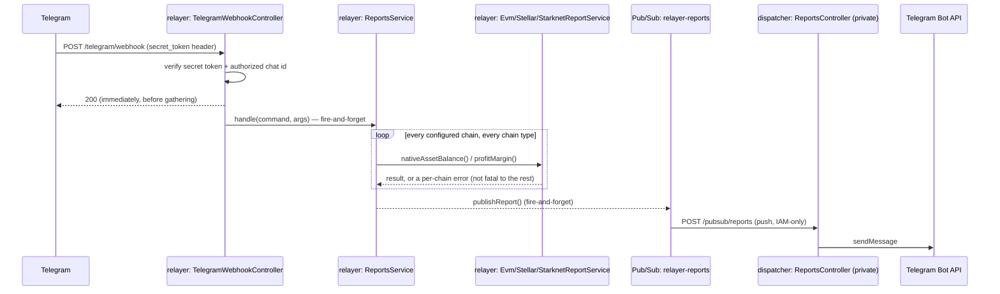

# Relayer Reports (Telegram Command Bot)

On-demand operator reports over Telegram: `/native_asset_balances` and `/current_profit_margins`
(aliased as `/profiterol` — see `telegram/telegram-update.schemas.ts`'s `COMMAND_ALIASES`, the
only place Telegram-facing trigger words are mapped to internal command names),
answered by the relayer's own (read-only) chain access and delivered back through
`alert-dispatcher`. The reverse direction of [alert-dispatcher.md](alert-dispatcher.md)'s alert
path — read that doc first for the pattern this one mirrors (Pub/Sub wire events, hand-mirrored
zod schemas, a shared drift-guard fixture).

## Overview

`alert-dispatcher` deliberately has no RPC access, no signer key, and no chain knowledge (see
alert-dispatcher.md, "What it is NOT") — that boundary is unchanged by this feature. Reports are
gathered entirely by the relayer (the only service with chain configuration and, for the EVM
profitability report, the only one that needs it); the dispatcher's role stays exactly what it
already was: format text, call Telegram's Bot API.

Telegram pings the relayer directly, not the dispatcher — the relayer is already a public Cloud
Run service (it serves quote/relay traffic), so this adds one route to it rather than opening any
new public ingress on the dispatcher, which stays fully private (`--no-allow-unauthenticated`,
unchanged).



## Package Layout

```
packages/relayer/relayer/src/
  telegram/telegram-webhook.controller.ts   POST /telegram/webhook (the only new PUBLIC route)
  telegram/telegram-config.service.ts       TELEGRAM_WEBHOOK_SECRET / TELEGRAM_AUTHORIZED_CHAT_ID
  telegram/telegram-update.schemas.ts       zTelegramUpdate, parseCommand
  telegram/telegram.module.ts
  report/report.interface.ts                IReportService, REPORT_SERVICE
  report/report.module.ts                   per-chain-type resolution (mirrors RELAY_SERVICE/QUOTE_SERVICE)
  report/reports.service.ts                 orchestrator — fans a command out across every chain
  report/evm/evm.report.service.ts
  report/stellar/stellar.report.service.ts
  report/starknet/starknet.report.service.ts   stubbed (NotImplementedException) — see "Chain Coverage"
  report/relayer-profitability.lib.ts        core dissection logic, shared with the CLI script
  report/report-publisher.ts                 publishReport / flushReports / ReportEvent
  scripts/relayer-profitability.ts           thin CLI wrapper around the lib above
packages/relayer/alert-fixtures/report-events.json   shared wire-format fixture
packages/relayer/alert-dispatcher/src/pubsub/reports.controller.ts   POST /pubsub/reports (private)
```

## Report Event Schema

The wire format is `ReportEvent` (relayer, `report-publisher.ts`), mirrored by hand as
`zReportEvent` in the dispatcher (`pubsub.schemas.ts`):

| Field | Type | Notes |
| --- | --- | --- |
| `command` | `"native_asset_balances"` \| `"current_profit_margins"` | |
| `status` | `"ok"` \| `"error"` | `error` still delivers — a partial failure must be visible, not silent |
| `text` | string | pre-formatted (not HTML-escaped — the dispatcher escapes once before sending), truncated to 3800 chars by the publisher |
| `requestId` | string, min 1 | generated per command invocation (`nanoid`), carried for traceability only — not used for dedup |
| `timestamp` | ISO 8601 string | stamped at publish time |

No `chatId` on the wire: the dispatcher always answers into its own statically configured
`TELEGRAM_CHAT_ID`, same chat the alert path already pages into.

**Drift guard.** Same mechanism as `AlertEvent`: `packages/relayer/alert-fixtures/report-events.json`,
checked by the relayer's `report-publisher.spec.ts` and the dispatcher's `pubsub.schemas.spec.ts`.

## Telegram Ingress (Relayer-Side)

`POST /telegram/webhook` on the relayer's existing public service. Two checks, both app-level
(not Cloud Run IAM — the relayer must stay public for its normal traffic):

1. `X-Telegram-Bot-Api-Secret-Token` header must equal `TELEGRAM_WEBHOOK_SECRET` (constant-time
   compare), set once via Telegram's `setWebhook` `secret_token` param.
2. The update's `message.chat.id` must equal `TELEGRAM_AUTHORIZED_CHAT_ID` — the same chat (not a
   per-user allowlist) already configured as the dispatcher's `TELEGRAM_CHAT_ID`; duplicated
   config, not a shared secret.

Both failures, an unrecognized command, and a missing `message.text` all return `200` with no
detail in the body — Telegram doesn't need an explanation, and neither does a prober.

**Never fails relayer boot.** Unlike `AlertDispatcherConfigService` (a dedicated service, so a
missing env var failing its boot is fine), `TelegramConfigService` treats missing/invalid config as
"webhook permanently disabled," logged once — this is the main relayer process, and an
unconfigured or partially-rolled-out optional feature must never take it down.

**Fire-and-forget.** The handler acks `200` before gathering anything; `ReportsService.handle(...)`
is kicked off with `void ... .catch(...)`, never awaited — `current_profit_margins` can take a
while (it scans historical blocks), and Telegram's webhook delivery must not be held open.

**Cooldown.** A 30s per-command, in-memory, per-instance cooldown in the controller — guards
against a fat-fingered repeat hammering RPC providers. Not cross-instance-correct like the alert
path's Firestore cooldown; acceptable for a read-only report, unlike paging.

**Arguments.** `parseCommand` already splits trailing tokens into `args: string[]`, and every
`IReportService` method accepts `ReportOptions { args? }` — but `ReportsService.handle` rejects any
non-empty `args` up front with an explicit "arguments aren't supported yet" report, rather than
silently ignoring them. The shape exists so wiring real argument support (chain filter, tx count)
later touches neither the webhook controller nor the wire schema again.

## Multichain Dispatch (`ReportsService`)

Every other relayer service (`EvmConfigService`, `EVMChainService`, `EvmRelayService`, ...) is
`Scope.REQUEST`, bound to one chain via `CHAIN_CONTEXT`, because every existing endpoint answers
for one chain at a time (`/relay/:chainType/:chainId/...`). A report command has no such single
chain — it must fan out across every configured chain of every type in one pass. `ReportsService`
is a deliberate exception to that convention, the same way §4b documents alerting as one.

`REPORT_SERVICE` mirrors `RELAY_SERVICE`/`QUOTE_SERVICE`'s per-chain-type factory exactly (switch on
`ChainType`, resolve lazily via `ModuleRef` so only the requested chain type is constructed). The
difference: `RELAY_SERVICE`'s factory recovers its contextId via
`ContextIdFactory.getByRequest(request)`, which only works because Nest's own router already
tagged the real inbound request with a hidden symbol before anything request-scoped resolves.
`ReportsService` has no such request — it synthesizes one per chain
(`report.module.ts`'s `FakeChainRequest`), so it carries its own `contextId` directly on the
payload instead of relying on that tagging:

```ts
const contextId = ContextIdFactory.create();
const fakeRequest: FakeChainRequest = { params: { chainType, chainId: String(chainId) }, contextId };
moduleRef.registerRequestByContextId(fakeRequest, contextId);
await moduleRef.resolve(REPORT_SERVICE, contextId, { strict: false });
```

`REPORT_SERVICE`'s factory then reads `request.contextId` (not `getByRequest`) to resolve the
concrete chain service under the exact same id — which is also the id `CHAIN_CONTEXT`'s factory
resolves under, since `CHAIN_CONTEXT` only ever reads `request.params.chainType`/`chainId`, a shape
`FakeChainRequest` satisfies without any change to `core/core.module.ts`. See
`report/context-threading.spec.ts` for a minimal, module-graph-independent proof of this mechanism.

Chains to fan out across are enumerated from `RelayerConfig.chain(chainType).allConfigs()` for each
`ChainType` that has a config at all — see "Chain Coverage" for why that currently excludes
Starknet entirely, not just its commands.

## Chain Coverage

| Command | EVM | Stellar | Starknet |
| --- | --- | --- | --- |
| `native_asset_balances` | read-only `getBalance`, no signer key | `SorobanRPCInteractor.getNativeBalance` (new SDK method, reads the account ledger entry's `balance` field directly — native XLM balance is intrinsic to `AccountEntry`, not a trustline) | **excluded from the fan-out entirely** |
| `current_profit_margins` | reuses `relayer-profitability.lib.ts` | `NotImplementedException` | `NotImplementedException` |

Starknet is excluded from `ReportsService`'s chain-type loop, not just unimplemented per-command:
`config/schemas.ts`'s `zChains` has no `starknet` key yet (commented out, alongside Solana), so
`RelayerConfig.chain(ChainType.STARKNET)` doesn't even type-check. `StarknetReportService` still
exists as scaffolding (both methods throw `NotImplementedException`) for once that config support
lands — mirrors the existing convention of chain/op combos stubbed elsewhere in the package (e.g.
`StellarRelayService.relayAndAnnounceSchema`).

Stellar and (once it has config) Starknet have no revenue/cost model at all for
`current_profit_margins` — different contracts and event shapes from EVM's
PrivacyPoolRelay/RelaySwaps/PoolVault, nothing to reuse. Designing one is new work, kept explicitly
out of scope rather than silently missing: an operator asking gets
"`current_profit_margins is not yet supported on Stellar`" per chain, not a wrong or empty answer.

## Profitability Script Reuse

`scripts/relayer-profitability.ts` was a standalone CLI (own argv parsing, own
`.relayer-prod-config.json` loading, own viem client cache). Its core — `dissect`, `kindOf`,
`usdValue`, `tokenInfo`, `nativeUsd`, `blockOfNonce`, and the per-chain aggregation loop — is
extracted into `report/relayer-profitability.lib.ts`, taking a chain-type-agnostic
`ProfitabilityChainConfig` as a plain argument instead of reading the JSON file. The script is now
a thin wrapper mapping its own file-based config into that shape and printing the result —
behavior for anyone running it manually is unchanged. `EvmReportService.profitMargin()` calls the
same lib functions with chain config sourced from the live `RelayerConfig`/`EvmConfigService`
instead, so production doesn't carry two drifting sources of chain config.

`profitMargin()` caps `count` at a fixed default (10) server-side regardless of what Telegram
sends (arguments aren't wired up yet in any case) — this now runs on demand instead of by a
trusted operator passing a CLI flag, and `blockOfNonce`'s binary search isn't free.

## Dispatcher-Side Changes

**`pubsub/reports.controller.ts`** — `POST /pubsub/reports`, byte-for-byte the same envelope
handling as `/pubsub/alerts` (decode base64 → `zReportEvent.safeParse` → 400 on malformed). No
cooldown store: reports aren't rate-limited the way pages are, and a duplicate Telegram message on
Pub/Sub redelivery is an acceptable, harmless annoyance — same tolerance the alerts path already
accepts for multi-channel redelivery. A `status: "error"` report is still delivered: the operator
must see that a gather partially or fully failed, not get silence.

**`channel/telegram.channel.ts`** — `TelegramChannel.send()`'s Bot API call was extracted into a
private `sendText(text)`; `send(alertEvent)` and the new `sendReport(reportEvent)` both call it.
`formatReport()` mirrors `formatAlert()`'s HTML-escape-and-truncate shape with its own prefix
(`📊 REPORT` / `⚠️ REPORT (partial failure)`) instead of a severity badge.

Dispatcher's deployment is otherwise completely untouched: no new ingress, no IAM change, no new
secret.

## Infra / Deploy Additions

| Item | Notes |
| --- | --- |
| Pub/Sub topic `relayer-reports` | new, parallel to `relayer-alerts` |
| Push subscription → dispatcher | targets `POST /pubsub/reports`; can reuse the existing alerts push service account |
| Relayer runtime service account | needs `roles/pubsub.publisher` on the new topic (same requirement as `relayer-alerts`, easy to miss) |
| Secret `TELEGRAM_WEBHOOK_SECRET` | new, mounted on the relayer, same Secret Manager pattern as the dispatcher's bot token |
| Env var `TELEGRAM_AUTHORIZED_CHAT_ID` | set on the relayer to the same value as the dispatcher's `TELEGRAM_CHAT_ID` |
| One-time `setWebhook` call | registers the relayer's `/telegram/webhook` URL with Telegram, passing the `secret_token` |

**`setWebhook` command** (run once per bot token / URL change — safe to re-run, it just replaces
the registration):

```sh
curl -s -X POST "https://api.telegram.org/bot${TELEGRAM_BOT_TOKEN}/setWebhook" \
  -H "content-type: application/json" \
  -d "{\"url\":\"https://<relayer-url>/telegram/webhook\",\"secret_token\":\"${TELEGRAM_WEBHOOK_SECRET}\"}"
```

Verify it registered (`url` should match, `last_error_message` should be empty until the first
real delivery):

```sh
curl -s "https://api.telegram.org/bot${TELEGRAM_BOT_TOKEN}/getWebhookInfo"
```

Rollback — stop Telegram from delivering to the relayer at all, independent of the
`TELEGRAM_WEBHOOK_SECRET`/`TELEGRAM_AUTHORIZED_CHAT_ID` kill switch below:

```sh
curl -s -X POST "https://api.telegram.org/bot${TELEGRAM_BOT_TOKEN}/deleteWebhook"
```

**Kill switches.** `RELAYER_REPORTS_DISABLED=true` (and `NODE_ENV=test`) makes `publishReport` a
no-op, mirroring `RELAYER_ALERTS_DISABLED`. Unsetting `TELEGRAM_WEBHOOK_SECRET` /
`TELEGRAM_AUTHORIZED_CHAT_ID` disables the webhook entirely without any other effect on the relayer.

## Status and Known Gaps

- Never deployed or verified live yet; all behaviour above is from code and unit tests (including
  `report/context-threading.spec.ts`'s proof of the contextId-threading mechanism).
- Command arguments are parsed but always rejected — no chain filter or tx-count override yet.
- Starknet is fully excluded (no chain-level config exists for it yet, independent of this feature).
- Stellar/Starknet have no profitability model.
- `SorobanRPCInteractor.getNativeBalance` is new SDK surface, unit-tested against a mocked RPC
  response but not yet exercised against a live Soroban RPC endpoint — worth a quick manual check
  against testnet before the first real deploy.
- No per-command argument rate limiting beyond the blanket 30s cooldown; a cooldown is per-instance,
  not cross-instance-correct (Cloud Run can run several instances).

---

**Version History**

| Version | Change |
| --- | --- |
| 1.0.1 | 2026-10-23 - Review fixes: native prices in `relayer-profitability.lib.ts` expire after 60 s (`NATIVE_PRICE_TTL_MS`), so a later `/current_profit_margins` sees the current feed; the command allowlist is a `Map`, so inherited keys such as `/constructor` are rejected; report text is truncated before HTML escaping (dispatcher `formatReport`); errors in relayer log lines are redacted; the EVM report client cache is keyed by chain and RPC URL. |
| 1.0.0 | 2026-10-22 - Initial design and implementation: Telegram webhook on the relayer, `IReportService`/`REPORT_SERVICE` multichain dispatch, `relayer-profitability.lib.ts` extraction, `SorobanRPCInteractor.getNativeBalance`, `relayer-reports` Pub/Sub topic, dispatcher `ReportsController`, shared wire-format fixture. |
