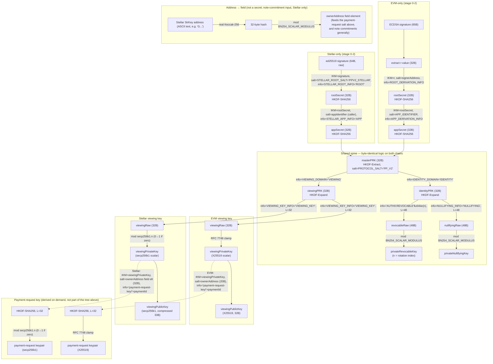

# StellarCryptoService — key derivation (superseded — see crypto-service.md)

> **Status: superseded — `StellarCryptoService` has landed.** It now lives at
> `packages/stellar-sdk/src/services/StellarCryptoService.ts`. The authoritative, up-to-date spec is
> [crypto-service.md](crypto-service.md) — read that first.
> This document is retained only for its historical derivation-tree diagram and is **not**
> maintained going forward.
>
> **⚠ Material correction (2026-09-08).** This document originally asserted (see the "Notes"
> section's third bullet, and the diagram's Stellar-only subgraph) that
> `AbstractCryptoService.deriveAppSecret` would **not** be reused for Stellar's appSecret stage —
> that `StellarCryptoService` would instead reimplement that stage inline with the upstream
> reference implementation's own `"APP"` info string (`STELLAR_APP_INFO`) to preserve byte-parity with the reference
> implementation. **The shipped implementation makes the opposite choice**: it reuses
> `AbstractCryptoService.deriveAppSecret` (and `deriveKeys`) as-is, including EVM's
> `APP_DERIVATION_INFO` info string — trading away byte-parity with the upstream reference implementation past the
> rootSecret stage for maximal code reuse (the two chains' rootSecret values are already
> cryptographically unrelated by that point, so this introduces no cross-chain collision risk).
> See [crypto-service.md](crypto-service.md) for the current, accurate derivation tree and
> rationale.
>
> **The "Verified byte-parity with the reference implementation" vectors below were computed against the
> not-shipped design** (separate `"APP"`-string appSecret stage) and **do not match the shipped
> implementation's output past rootSecret.** Do not use them as regression vectors; the diagram's
> `STELLAR["Stellar-only (stage 0-2)"]` subgraph and its `S2["appSecret..."]` node are similarly
> stale — appSecret for Stellar is produced by the shared spine, not a Stellar-only path.

`StellarCryptoService` will be the Stellar implementation of `ICryptoService`, extending the same
`AbstractCryptoService` base `CryptoService` (EVM) extends. It uses secp256k1 for ECDH and the
viewing-key curve — matching the upstream reference implementation's own note-encryption scheme, deliberately **not**
interoperable with EVM's X25519 viewing keys (see the upstream reference implementation's deviations notes, INTL-15) —
and derives protocol keys from a raw ed25519 wallet signature rather than an EIP-712 ECDSA one.

## Derivation tree

Everything from `masterPRK` down is byte-identical logic on both chains — same salts/info
strings (`PP_V2`, `IDENTITY`, `VIEWING`, `NULLIFYING`, `AUTH0:REVOCABLE`), same
48-byte-then-mod-BN254 reduction for the nullifying/revocable keys. Only the two input stages
(root secret, app secret) and the viewing-key curve diverge.

## Notes

- **Divergence points**: stage-0/1 use different salts *and* different info strings per chain
  (different signature schemes feed in), and the viewing key forks into X25519 (EVM) vs.
  secp256k1 (Stellar) at the last step.
- **`AbstractCryptoService.deriveAppSecret` is NOT reused for Stellar's app-secret stage.** That
  helper hardcodes EVM's `APP_DERIVATION_INFO` HKDF info string
  (`"Standardized-Secret-Derivation-v1-App"`), which does not match the upstream reference implementation's own `"APP"`
  (`STELLAR_APP_INFO`). Reusing it would silently diverge from the already-shipped, audited
  reference implementation's key derivation for every account. `StellarCryptoService` computes
  this stage inline instead. Every other shared helper (`deriveKeys`, `encrypt`/`decrypt`/
  `secretToKey`, `generateSecret`) IS reused as-is — verified byte-identical (see below).
- **`stellarAddressToField` is not part of the secret-derivation tree** — it's a one-way hash of
  the StrKey address text, used as an *input* elsewhere (the payment-request HKDF salt, note
  commitments), not something that produces a private key itself. EVM has no equivalent: an EVM
  address already fits as a field element (160 bits), so the EVM address-to-field converter is
  an identity function.
- **Payment-request keys are derived on demand** from the already-derived `viewingPrivateKey`,
  not from the signature directly — a second, independent HKDF call per payment request, keyed
  off the recipient's account/address.
- **No pool/chain identifier is hashed into this tree on either side.** The only
  domain-separation lever is the app-secret-stage salt (EVM: hardcoded `APP_IDENTIFIER`
  constant, same across every EVM deployment; Stellar: caller-supplied `appIdentifier`, default
  `""`). This means matching Stellar's app-secret info string to the upstream reference implementation's `"APP"` carries
  no cross-chain key-collision risk: the two chains' root secrets are already cryptographically
  unrelated by the time the app-secret stage is reached (different signature scheme, different
  salt, different info at stage 0).
- **No signer-binding check** (EVM's `addressHash == keccak256(signerAddress)` equivalent) exists
  for Stellar — the upstream reference implementation has none, and the fixed derivation
  message's exact wire format (the natural place to embed a signer identity to bind against) is
  still-undesigned wallet-signing UX, tracked separately in the milestone plan.

## Verified byte-parity with the reference implementation

Using `@noble/curves@2.0.1`/`@noble/hashes@2.0.1` (same versions pinned in this SDK's
`package.json`) against the reference implementation's own `deriveKeysFromSignature`, for `signature = 64 bytes
of 0x07`, `appIdentifier = "app"`, `revocableKeyIndex = 0`:

| Field | Value |
| --- | --- |
| `privateNullifyingKey` | `7536579660092257135034213251833273836079387931564933726599357768545001097120` |
| `privateRevocableKey` | `16926724275143366595928576529262191516543766964542499710533062131092942724830` |
| `viewingPrivateKey` | `0xba9dfa03920db02df2cc87cb39a39aa4bd709d102fbd134c05233a276bcfc763` |
| `viewingPublicKey` (compressed) | `0x0333666895dc3697b187b5c9dbbe52efc291b89c3a2d88f0a1a48816044b4d28f4` |

And `stellarAddressToField("GAAAAAAAAAAAAAAAAAAAAAAAAAAAAAAAAAAAAAAAAAAAAAAAAAAAWHF")`:
`2546882737937671087797865303492133949014456605657702609113996756825541318677`.

---

**Version History**

| Version | Change |
| --- | --- |
| 0.2.0 | 2026-09-08 — Superseded by the shipped `StellarCryptoService` implementation; authoritative spec moved to [crypto-service.md](crypto-service.md). Corrected this document's original claim that the appSecret stage would be reimplemented with the upstream reference implementation's own `"APP"` info string — the shipped code instead reuses `AbstractCryptoService.deriveAppSecret` as-is (EVM's `APP_DERIVATION_INFO`), which the "Verified byte-parity" vectors below do not reflect past the rootSecret stage. Doc-only; retained for historical diagram reference. |
| 0.1.0 | 2026-09-08 — Initial design reference: derivation tree, byte-parity requirement, and verification vectors, ahead of `StellarCryptoService` implementation. |
