# User Flows

## Version History
| Version | Date | Notes |
|---|---|---|
| 1.2.1 | 2026-10-01 | §1.9 chain note: the Stellar router pulls the fixed `max_underlying_in` and refunds the unused part, so the depositor must hold the full ceiling. |
| 1.2.0 | 2026-10-01 | §1.4: corrected `amountOut = 0` — a relayed transfer sets `amountOut = feeAmount` (the fee is the only public outflow, paid to the relayer as the pool's processor) on both EVM and Stellar; Stellar transfer commitment domain tag noted. §1.7: relayed registration is chain-neutral — Stellar signs a Soroban auth entry over `keystore.set_auth_policy` and the relayer submits `relay.register_and_relay` (atomic register-and-withdraw only). §1.9: chain note — the same flow runs on Stellar over Blend v2 (`yield-router` / `yield-token`, no zap). |
| 1.1.2 | 2026-09-24 | Doc-only correction: §1.3 and §3.3 said `prepareTransfer` silently downgrades to out-of-band delivery when the recipient has no registered viewing key. The code refuses with `RecipientViewingKeyUnregistered` unless the caller opts in with `allowOutOfBandFallback: true` (a silent downgrade could strand funds if the sender discarded the secrets); `prepareColdStartTransfer` remains the explicit out-of-band path. |
| 1.1.1 | 2026-09-24 | Doc-only: §1.1 notes that spending without a registered keystore fails fast with `KeystoreNotRegistered` (receiving needs no registration); §2.2 notes that `ragequit` also needs the note owner's keystore leaf and so also requires registration. |
| 1.1.0 | 2026-07-08 | v2.0 audit: added §1.7 Relayed (Gasless) Registration (#310), §1.8 Batch Withdrawal (#316), §1.9 Yield Deposit & Withdrawal (#315), §3.4 Stealth Address Discovery (#317). These four features shipped without a user-flows update; backfilled here. |
| 1.0.0 | — | Original core flows (registration, deposit, transfer, withdrawal, rotation, compliance, discovery, payment requests). |

This section details the interactions between the user, the contract, and the ASP.

# 1 Core User Flows

## **1.1. One-Time Key Registration**

These flows cover the standard experience for a typical user (Alice or Bob).

This is the one-time setup action a user performs to create their identity within the protocol. It is required for spending funds but not for receiving them.

The SDK enforces this up front: spending (withdraw, transfer, swap, reshield, etc.) without a registered keystore fails with `KeystoreNotRegistered` before any proof work begins, whereas receiving needs no registration.

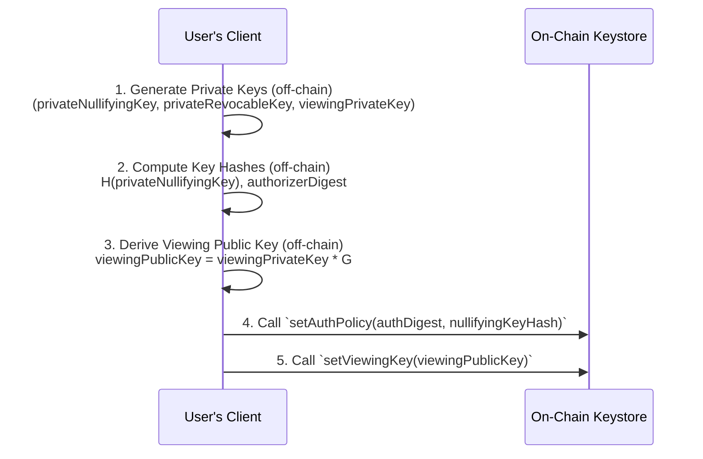

### **1.1.1 The Spending Key and Authorization Registry (`keyRegistry` Tree)**

The core authorization system uses an on-chain **`keyRegistry` tree** to establish cryptographic ownership and enable extensible authorization methods.

- **Key Registration:** A user performs a one-time action to register their `ownerAddress` and its associated authorization configuration. This creates a verifiable link: ownerAddress -> Authorization Data.
- **Proof of Ownership:** To spend a note, the appropriate authorization circuit proves ownership of the `ownerAddress` by verifying the reconstructed leaf exists in the `keyRegistry`.
- **Leaf Structure:** `leaf = Poseidon(addressHash, nullifyingKeyHash, authorizerDigest)`
    - **`addressHash`**: A hash of the user's `ownerAddress`, e.g., `Poseidon(ownerAddress)`.
    - **`nullifyingKeyHash`**: Hash of the `privateNullifyingKey`, an immutable key used exclusively for nullifier derivation. See Section 5.3 for details.
    - **`authorizerDigest`**: An updatable commitment that determines the authorization method and binds it to method-specific data. Each `authType` defines its own digest structure:
        - `authType = 0` (Direct Key): `Poseidon(0, revocableKeyHash)`. Circuit verifies hash preimage of `privateNullifyingKey`.
        - `authType = 1` (BabyJubJub): `Poseidon(1, bjjPublicKey)`. Circuit verifies EdDSA signature against the BJJ public key.
        - `authType = 2` (Intent-based): `Poseidon(2, revocableKeyHash, authorizerAddress)`. Circuit verifies intent from the stealth multisig.
        - **Extensibility:** The `authType` prefix ensures digests from different auth methods never collide.
    

<aside>
👁️‍🗨️

**Design Note: Per-Method Circuits**
Each authorization method has its own dedicated circuit. The circuit checks that `authType` matches the expected fixed value for that method, then performs method-specific verification (e.g., hash preimage for direct key, signature verification for BJJ). The contract routes to the appropriate circuit based on the user's registered authType.

</aside>

<aside>
💡

**Design Note: Opt-in Upgrades via authType**
Because authorization configuration lives in the keystore rather than individual note commitments, users can upgrade their auth method with a single keystore update. If a vulnerability is discovered in an auth circuit, a new version can be deployed (e.g., `authType = 3` for "Direct Key v2") and users opt in by updating their authType. All existing notes instantly become spendable under the new circuit. This is far more scalable than requiring per-note migration.

</aside>

<aside>
🤔

Design Rationale: The hash-based approach using Poseidon was chosen for ZK circuit efficiency. ECDSA signature verification is prohibitively expensive in circuits, while simple hashes provide equivalent ownership security with minimal constraints.

</aside>

### **1.1.2The Viewing Key Registry (`viewingKeys` Mapping)**

The `Keystore` contract also hosts an on-chain `viewingKeys` mapping to enable encrypted note discovery and communication between users without compromising transaction privacy.

- **Key Registration:** Users register their `viewingPublicKey` (derived from `viewingPrivateKey * G` using, for example, Curve25519 or similar curves) via `setViewingKey(viewingKey)`. This is a separate call from `setAuthPolicy` and can be updated at any time by `msg.sender`.
- **Encrypted Communication:** Senders use the recipient's registered `viewingPublicKey` to derive a shared secret for encrypting note details.
- **Storage Structure:** `mapping(address => bytes32) public viewingKeys`

<aside>
🔥

Design Choice. Mapping vs. Tree: Viewing keys use a simple mapping rather than a Merkle tree because they serve a fundamentally different purpose. Viewing keys are for off-chain encryption and don't require ZK circuit integration. The mapping provides O(1) lookup efficiency, while spending keys require the cryptographic guarantees of a Merkle tree for ZK ownership proofs.

</aside>

### **1.1.3 Authorization Management (Key Rotation & Authorizer Updates)**

The protocol supports updating the `authorizerDigest` without changing the immutable `nullifyingKeyHash`. This is an on-chain operation authenticated by the `ownerAddress` (`msg.sender`) that allows for both rotating a compromised `privateRevocableKey` and changing the designated `authorizerAddress`. The `Keystore` contract exposes `updateAuthPolicy(oldAuthDigest, updatedAuthDigest, siblingNodes)` to handle this: it reconstructs the old leaf from the caller's stored `nullifyingKeyHash`, verifies the provided Merkle proof, and replaces the leaf with the new digest.

### **1.1.4 The Nullifier Scheme**

To prevent double-spending, a unique nullifier is published for every spent note. The scheme ensures nullifiers are deterministic but unlinkable to the original commitment without knowledge of private keys.

`nullifierHash = Poseidon(privateNullifyingKey, commitment)`

**Key Properties:**

1. **Auth-Agnostic Derivation:** The nullifier is derived solely from `privateNullifyingKey` and `commitment`. It does not depend on the current `authType` or any other authorization configuration. This is critical: it ensures that changing auth methods (e.g., from Direct Key to BJJ) does not allow double-spending. The same key always produces the same nullifier for a given note.
2. **Arbitrary Secret:** The `privateNullifyingKey` is an arbitrary secret with no special constraints. It is used only for nullifier derivation—never as a signing key. When BJJ-based authorization is used, the signing key is separate (see Security Note in Section 3.5).
3. **Immutability:** Unlike the `authorizerDigest` (which can be updated), the `nullifyingKeyHash` in the keystore is immutable. This ensures nullifier consistency across the lifetime of an account.

## **1.2 Deposit (Fund Entry)**

This flow details how a user deposits funds into the pool. This creates the initial note but does **not** make it spendable yet; the user must subsequently perform **Label Registration** (Flow 7) to prove compliance and activate the funds.

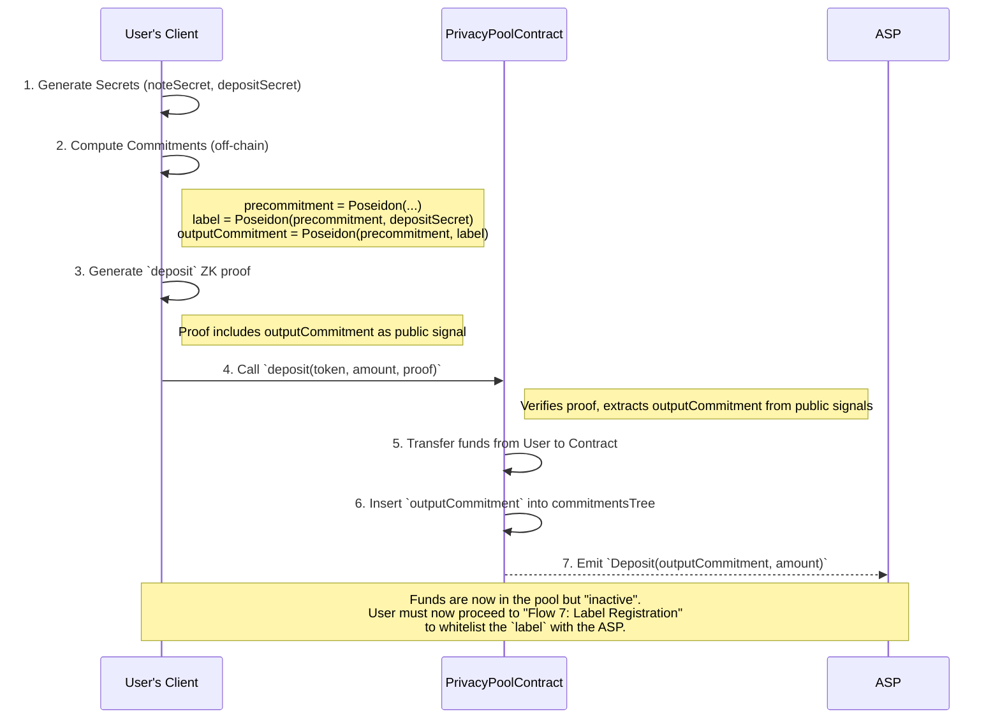

## **1.3 Receiving a First Private Transfer (Cold Start)**

This flow details how a user (Bob) can receive funds even if he has never interacted with the protocol before, using only his public `ownerAddress`. This solves the "cold start" onboarding problem. It assumes the note Alice is sending has a `label` that is already registered in the ASP's `associationSet`.

The SDK handles cold start in two ways, and in neither does it downgrade silently:

- **Opt-in fallback:** when Alice calls `prepareTransfer` (or `transfer`) with `recipientDiscoveryData: { evmAddress: bob }` and Bob has no registered viewing key, the SDK **refuses** with `RecipientViewingKeyUnregistered` by default. A sender who assumed a discoverable transfer would otherwise discard the only copy of the note secrets, and the funds would be unrecoverable. Alice opts in explicitly with `allowOutOfBandFallback: true`; the transfer then proceeds with out-of-band semantics — no encrypted recipient `noteData` is published, and the recipient note secrets come back in the result (`recipientNotes`) for Alice to deliver to Bob via a secure off-chain channel. From that point delivering them is Alice's responsibility.
- **Explicit:** Alice calls `prepareColdStartTransfer({ recipientEvmAddress: bob, ... })`. Same on-chain effect, but the call is out-of-band by definition (no flag needed) and the SDK skips the keystore lookup entirely (one less RPC round-trip).

In both cases, Bob receives the secrets out-of-band and proceeds as below.

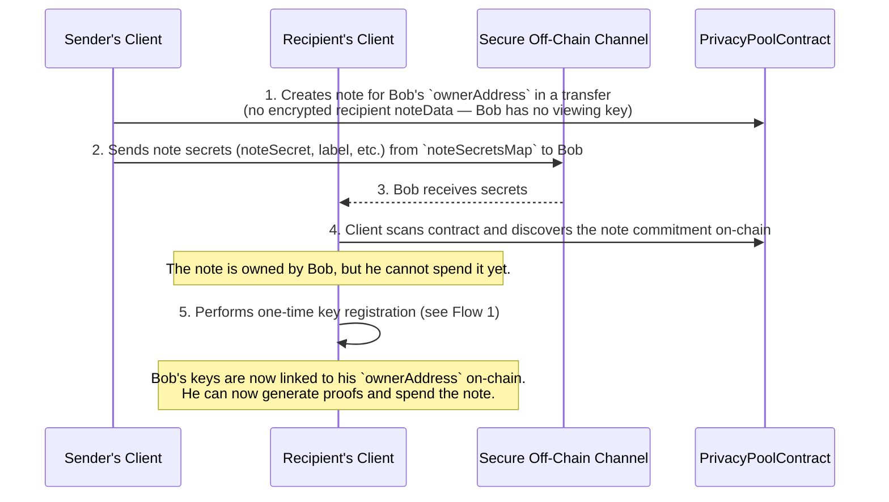

## **1.4 Private Transfer (via Relayer)**

This flow is for standard users (EOAs) who authorize transactions directly with their private keys. It uses the unified `transact` circuit with `amountOut = feeAmount`: the relayer fee is the only public outflow, paid by the pool to the relayer, which the proof binds as the `transact` processor (a fee-less self-submitted transfer has `amountOut = 0`). Nothing else leaves the pool.

**Chains.** On EVM the relayer calls `PoolVault.transact` itself (`processor = msg.sender`). On Stellar the relayer submits the pool's own `transact` with itself as the gated processor, accepts only `amountOut == feeAmount` exactly (anything more would be a withdrawal paid out in the clear) and `tokenIdOut` matching the committed asset, and signs its transfer fee commitment under the `"ppv2-stellar-transfer-v1"` domain tag (see [relayer/stellar-relayer.md](relayer/stellar-relayer.md)).

When the recipient has a registered viewing key (the `discoverable` path), the sender additionally publishes an encrypted recipient `noteData` payload alongside the proof so the recipient can find the note via catch-all or targeted discovery (see Section 3). When the recipient is unregistered or the sender chose the cold-start path (`blind` / `outOfBand`), no recipient `noteData` is published — secrets travel out-of-band. The change-note payload is always encrypted for self-discovery.

```mermaid
sequenceDiagram
    participant User as User's Client
    participant Relayer
    participant Contract as PrivacyPoolContract

    User->>User: 1. Select input notes to spend
    User->>User: 2. Resolve recipient (blind | outOfBand | discoverable)
    User->>User: 3. Construct output commitments (recipient + change)
    User->>User: 4. Generate `transact` ZK Proof
    note right of User: Public signals include:<br/>- amountOut = feeAmount (relayer fee)<br/>- processor = relayer (bound in context)<br/>- fee = MIN_FEE (or higher)
    User->>User: 5. Encrypt change payload always;<br/>encrypt recipient payload only when kind="discoverable"

    User->>Relayer: 6. Send proof + encrypted payloads
    Relayer->>Contract: 7. Call `transact(proof, transactParams, noteData[])`

    Contract->>Contract: 8. Verify proof
    Contract->>Contract: 9. Check fee >= MIN_FEE
    Contract->>Contract: 10. Record nullifiers as spent
    Contract->>Contract: 11. Insert output commitments
    Contract->>Relayer: 12. Transfer `amountOut` (= fee) to the processor (the relayer)

    Note over User, Contract: No public withdrawal beyond the fee (amountOut = feeAmount).<br/>Relayer compensated via fee.

```

**Per-Label Value Conservation Example:**

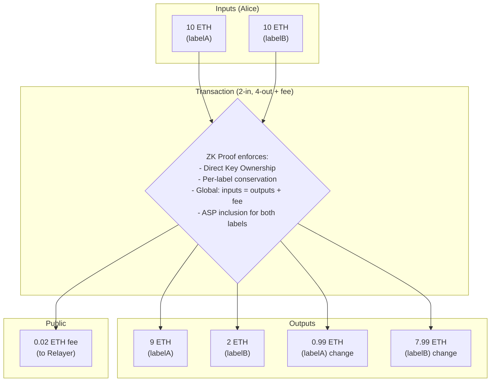

## **1.5 Withdrawal (via Relayer)**

This flow shows a user withdrawing funds publicly. It uses the same unified `transact` circuit but with `amountOut > 0`.

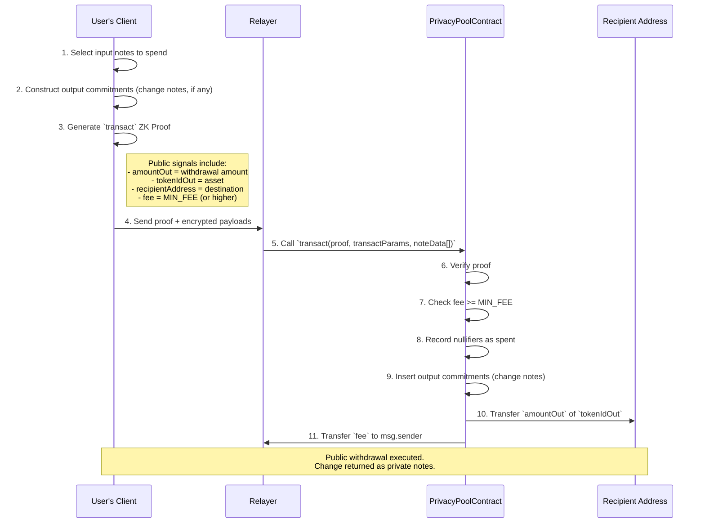

<aside>
👌

Note

Both pure transfers and withdrawals use the same transact function and circuit. The only difference is whether amountOut > 0.

</aside>

## **1.6. Key Rotation**

This flow illustrates how an owner can update their authorization settings, such as rotating a compromised `privateRevocableKey`. This is an on-chain operation authenticated by the user's ownerAddress (`msg.sender`).

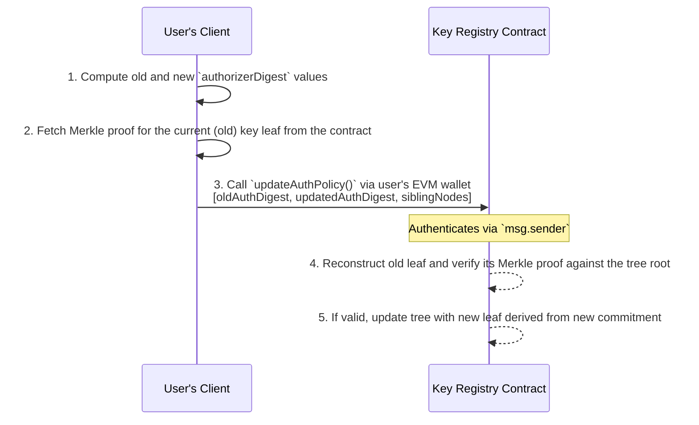

## **1.7 Relayed (Gasless) Registration**

This flow lets a recipient register their spending-key authorization **without holding gas**, by
signing an authorization that a relayer submits on their behalf — an EIP-712 message on EVM, a
Soroban authorization entry on Stellar (see the chain note below). It unblocks the cold-start case
(§1.3): a recipient who holds the delivered secrets can register and spend even from a fresh, unfunded
address. The registration leaf is identical to §1.1.1 — only the payer changes.

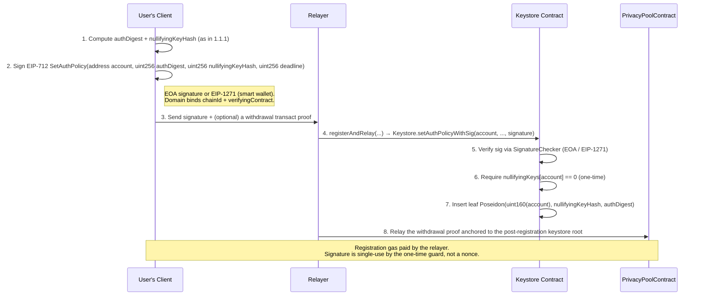

<aside>
👌

Note

The keystore is resolved live off the pool at relay time, so the registration always targets the exact
tree the subsequent `transact` reads. The one-time `nullifyingKeys[account] == 0` guard is the only
replay bound — there is no nonce or deadline (see the audit's cross-feature threat model S5).

</aside>

**Stellar.** The SDK flow is chain-neutral (`prepareRelayedRegistration` → `prepareRegisterAndWithdrawRelay`).
On Stellar the user signs an **auth entry** over the keystore's `set_auth_policy(account,
nullifyingKeyHash, authDigest)` — the nested call `relay.register_and_relay` makes — carrying its own
random nonce and an expiry ledger derived from the deadline (~5 s/ledger); the signed entry itself is
sent to the relayer. The relayer checks it (signer = account, this keystore, `set_auth_policy`, exact
args, not expired), attaches it to `relay.register_and_relay` (registration, then the withdrawal, in
one invocation) and simulates in enforcing mode before paying. Only this atomic register-and-withdraw
form is relayed on Stellar; standalone relayed registration is unsupported. The withdrawal proof is
built unsimulated (its keystore root exists only after the bundled registration lands).

## **1.8 Batch Withdrawal (via Relayer)**

This flow withdraws from **multiple notes to one recipient in a single transaction**, amortizing gas.
Each note keeps its own `transact` proof (there is no proof aggregation); the relayer submits up to
`MAX_BATCH` (10) of them and the contract distributes the aggregate once.

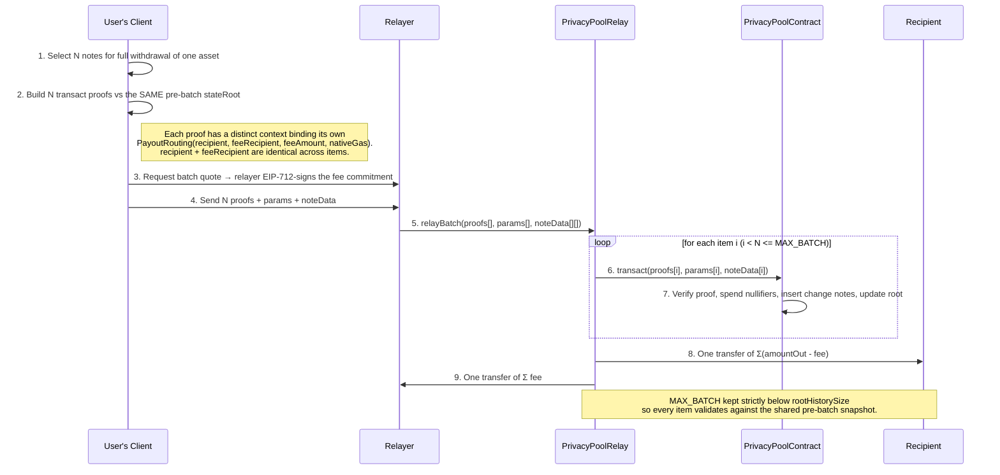

## **1.9 Yield Deposit & Withdrawal (ppUSDC)**

This flow lets a user hold a **yield-bearing** position privately. USDC is wrapped into a non-rebasing
ERC-4626 share (**ppUSDC**) that is registered as an ordinary pool asset; the share↔USDC rate rises as
Aave interest accrues. Deposit wraps-then-shields; withdrawal unwraps atomically via `PPRouter`, which
acts as the pool's `transact` **processor**.

```mermaid
sequenceDiagram
    participant User as User's Client
    participant Router as PPRouter / Zap
    participant Entry as Entrypoint
    participant Pool as PrivacyPoolContract
    participant Recipient

    rect rgb(240,248,255)
    note over User, Pool: Deposit
    User->>Router: 1. depositExactShares (USDC in)
    Router->>Router: 2. Zap.buyFixedYieldToken: supply USDC to Aave → mint ppUSDC shares
    Router->>Entry: 3. Entrypoint.deposit(depositProof) with ppUSDC as tokenId
    Entry->>Pool: 4. Insert ppUSDC note (share amount hidden in commitment)
    end

    rect rgb(245,255,245)
    note over User, Recipient: Withdrawal
    User->>User: 5. Build transact proof with processor = PPRouter, tokenIdOut = ppUSDC share
    User->>Router: 6. withdrawToUnderlying(proof, params, noteData, minUnderlyingOut)
    Router->>Pool: 7. transact(...) — pool pays the ppUSDC shares to the processor (this router)
    Router->>Router: 8. Zap.redeemToUnderlying: burn shares → USDC; enforce minUnderlyingOut
    Router->>Recipient: 9. USDC to recipient; fee (as USDC) to fee recipient
    end
    Note over User, Recipient: A note minted at rate r0 and redeemed at r1 > r0 yields more USDC<br/>for the same share count — the yield accrues while shielded.
```

<aside>
👌

Note

A yield withdrawal can never be a `relayBatch` item: `relayBatch` submits `transact` as itself, but
`PPRouter.withdrawToUnderlying` requires the processor to be the router (audit threat model S3). The
two withdrawal paths are mutually exclusive.

</aside>

**Chain note.** The SDK sessions for this flow are chain-agnostic (core-sdk). On **Stellar** the same
flow runs over **Blend v2**: the share token is `yield-token` (over a Blend reserve via
`yield-blend-adapter`), the router is `yield-router` (`deposit_exact_shares` / `withdraw_to_underlying`),
there is no zap and no factory, the underlying pull is authorized by the depositor's signature on the
router call (no approval transaction) — the router takes exactly `max_underlying_in` and refunds what the
mint did not use, so the depositor must hold the full ceiling — and the router's quotes are rebuilt client-side from the
token's `preview_mint` / `preview_redeem` and the pool's vetting fee. A relayed Stellar yield
withdrawal names the router as `processorAddress`; the relayer accepts only the router configured for
that share. See [stellar-sdk/yield-sessions.md](stellar-sdk/yield-sessions.md).

# **2 Compliance & Safety Flows**

These flows handle the interaction with the ASP and the ultimate failsafe mechanism.

## **2.1  Label Registration**

This flow details how a user registers a note's lineage identifier (`label`) after it has been created via a **deposit**. This one-time registration makes the label (and all future notes derived from it) compliant and spendable. Transfers simply propagate this already-registered label.

Label registration is a permissionless on-chain event emission — there is no dedicated ZK circuit for it. `ASPRegistry.registerLabel(bytes ciphertext)` simply emits `LabelRegistered(ciphertext)` with the user-supplied opaque payload. To save gas, `Entrypoint.deposit` accepts an optional `aspCiphertext` and forwards it to `ASPRegistry.registerLabel` inline when present, letting deposit + label registration happen in a single transaction.

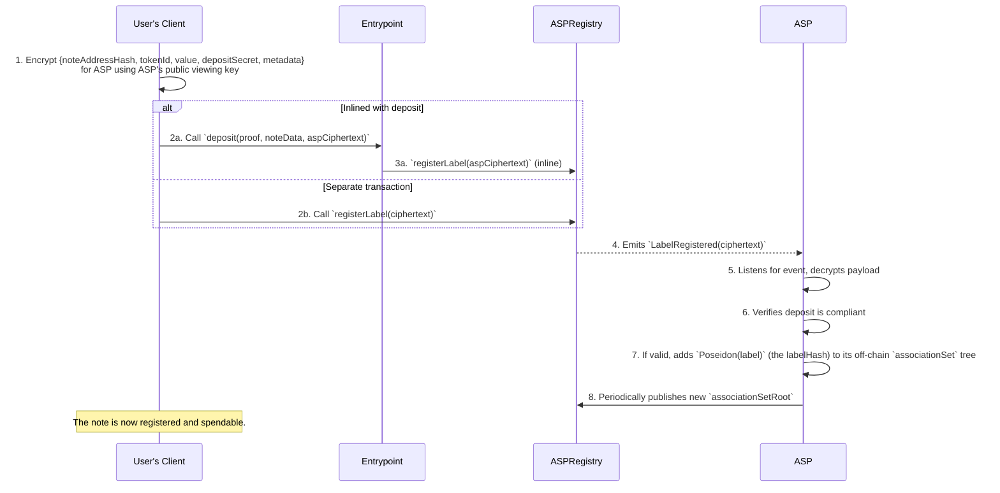

<aside>
👌

Security Note

The encrypted payload contains the precommitment inputs (`noteAddressHash`, `tokenId`, `value`, `metadata`) and the `depositSecret`. From these fields the ASP can reconstruct the `precommitment = Poseidon(noteAddressHash, tokenId, value, metadata)` and verify its relationship to the `label = Poseidon(precommitment, depositSecret)`. However, the payload is insufficient to spend funds. Spending requires the note/spending secrets that prove note ownership and the `ownerAddress`'s private keys to sign the transaction, neither of which are shared with the ASP.

</aside>

<aside>
🧹

Privacy Hygiene Note

When submitted as a standalone transaction, label registration should be sent via a Relayer or a fresh, unrelated EOA, not from the `ownerAddress` — otherwise the submitter becomes an on-chain metadata link to the specific label. The inline path (deposit + `aspCiphertext`) already shares an anonymity set with every other deposit in the same transaction shape, so the same hygiene concerns apply to whoever submits the deposit.

The `aspCiphertext` itself is prefixed with a **fresh ephemeral X25519 public key** generated per deposit — not the depositor's long-term registered viewing key. This prevents an observer from joining `ASPRegistry.LabelRegistered` events with on-chain `Keystore.setViewingKey` registrations to deanonymize depositors via exact-match on the ciphertext prefix.

</aside>

## **2.2 Late Discovery and `ragequit`**

This flow illustrates the ultimate failsafe for a user whose note's label is revoked.

Note that `ragequit` also builds the note owner's keystore leaf into its witness, so it likewise requires the owner to be registered; the SDK fails with `KeystoreNotRegistered` before proof work if the note owner has no on-chain keystore registration.

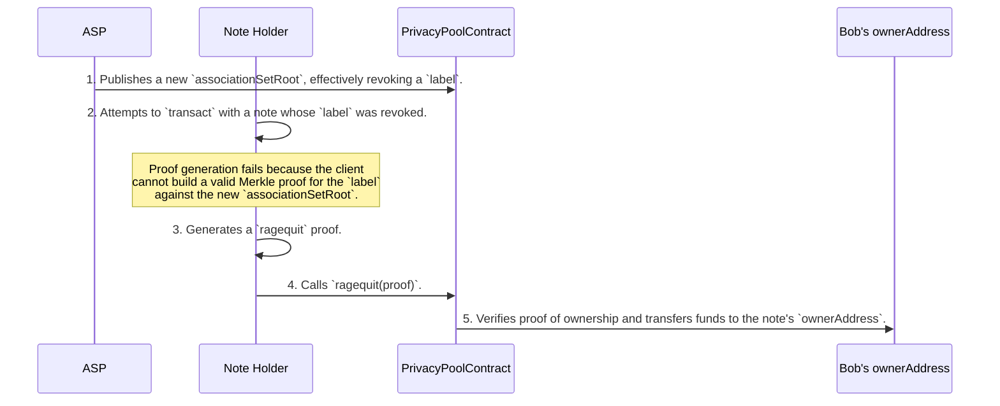

# 3. Note Discovery

For a transfer to be successful, the recipient must be able to discover the note and learn its essential secrets (`value`, `tokenId`, `noteSecret`, and `label`). The protocol facilitates this through a robust system of on-chain encrypted payloads, enabling two distinct discovery methods to balance efficiency and privacy.

The core `transact` and `deposit` functions emit events containing an `encryptedPayload`. This payload is encrypted using a shared secret derived via ECDH from two keys:

1. The sender's single-use **ephemeral private key**. The corresponding public key is included in the event.
2. The recipient's **public viewing key**, which is fetched from the on-chain `viewingKeys` mapping.

This ensures that only the intended recipient can decrypt the payload. Once a user has registered their viewing key, their client can employ one of two scanning strategies:

## 3.1 Targeted Discovery (for Known Contacts)

This is the highly efficient, primary discovery method for transfers between known parties (e.g., contacts in an address book). It relies on a predictable, indexed `tag` to avoid a full blockchain scan.

- **Mechanism:** The sender and recipient compute a **stable shared secret** (`ss = ECDH(sender.privateViewingKey, recipient.publicViewingKey)`). This secret is then used to generate a predictable, per-transaction `tag` (e.g., `tag = Poseidon(ss, index)`). The sender includes this indexed `tag` in the on-chain event.
- **Performance:** The recipient's client can perform a highly efficient, targeted query for just the indexed `tag`s it expects from its known contacts. This is an `O(k)` operation, where `k` is the number of contacts, ensuring wallet sync remains fast regardless of the protocol's total transaction volume.

## 3.2 Catch-All Discovery (for Anonymous Transfers)

This method provides a universal fallback for receiving transfers from anonymous senders or those not in a user's contact list. It is more computationally intensive but guarantees that any valid transfer can be discovered.

- **Mechanism:** The sender sets the `tag` to a null value (e.g., `bytes32(0)`). The recipient's client must then query for all events with this null tag that have occurred since its last sync. For **each** such event, it performs a cryptographic check:
    1. It takes the `ephemeralPubKey` from the event.
    2. It computes a potential shared secret using its own `privateViewingKey`: `ss_check = ECDH(recipient.privateViewingKey, event.ephemPubKey)`.
    3. It uses `ss_check` to attempt to decrypt the `encryptedPayload`. If the decryption is successful (i.e., it produces data with a valid structure), the note is discovered.
- **Performance:** This is a computationally intensive `O(N)` operation, where `N` is the number of anonymous transfers since the last sync. It requires significant bandwidth and CPU time, and is the fundamental trade-off required for universal, anonymous receivability.

## 3.3 The "Cold Start" Problem

For unregistered users who have not yet published a `publicViewingKey`, on-chain discovery is impossible. In this scenario, the sender **must** transmit the note secrets via a secure off-chain channel. This is the fundamental solution to the "cold start" onboarding problem.

The SDK detects this case but does not hide it: if the caller passes `recipientDiscoveryData: { evmAddress }` and the on-chain keystore returns no viewing key for that address, `prepareTransfer` throws `RecipientViewingKeyUnregistered`. A caller who accepts out-of-band delivery opts in with `allowOutOfBandFallback: true`; no recipient `noteData` is then published and the recipient note secrets are returned in the result (`recipientNotes`) for off-chain delivery. Callers who already know the recipient is unregistered can call `prepareColdStartTransfer`, which is out-of-band by definition and skips the keystore lookup entirely.

<aside>
⚠️

**Operational risk:** If that off-chain delivery fails, the recipient may never obtain the secrets needed to spend. The note is owned by the recipient's address, so the sender cannot `ragequit` on their behalf, and the recipient cannot spend without the secrets—see [Key Architectural Concepts — Section 3.4](key-architectural-concepts.md#34-recipient-privacy-via-obfuscated-addresses) for the full protocol-level picture.

</aside>

## 3.4 Stealth Address Discovery (ERC-5564)

This flow gives a recipient a **fresh, unlinkable on-chain address per payment** without any prior
interaction, using the ERC-5564 stealth-address standard. It is an SDK-side addressing primitive: the
sender derives a one-time stealth address the recipient can later control, and publishes an
announcement the recipient scans for. It composes with a withdrawal (§1.5) by using the derived stealth
address as the withdrawal `recipient`.

Two schemes are supported, dispatched by `schemeId`: **canonical EIP-5564** at `0x0001`
(secp256k1, compressed keys, viewing/spending key separation, point addition) and **FluidKey** at
`0xfffe`. (The as-shipped #317 module placed FluidKey at `0x0001`, colliding with the canonical
allocation; corrected before audit — see `docs/tech-design/evm-sdk/stealth.md`.)

```mermaid
sequenceDiagram
    participant Recipient
    participant Sender
    participant Announcer as Canonical ERC-5564 Announcer
    participant Chain

    Recipient->>Recipient: 1. Publish stealth meta-address (spend pubkey + view pubkey)
    Sender->>Sender: 2. Generate ephemeral keypair; ECDH with recipient view + spend keys
    Sender->>Sender: 3. Derive one-time stealthAddress + viewTag (1 byte)
    note right of Sender: Nothing is proven in-circuit;<br/>derivation is off-chain secp256k1.
    Sender->>Announcer: 4. announce(schemeId, stealthAddress, ephemeralPubKey, metadata=viewTag)
    Announcer->>Chain: 5. Emit ERC-5564 Announcement (single canonical instance = max anonymity set)

    Recipient->>Chain: 6. Scan Announcement events
    Recipient->>Recipient: 7. Cheap viewTag filter, then full ECDH check on candidates
    Recipient->>Recipient: 8. Derive stealth private key → controls the funds sent to stealthAddress
    Note over Sender, Recipient: Sender never learns the recipient's real address;<br/>observers cannot link stealthAddress to the meta-address.
```

<aside>
⚠️

**Composition note:** the stealth withdrawal bundle terminates at the SDK boundary — no relayer schema
accepts it. A stealth withdrawal is submitted as an ordinary relayed `transact` with
`recipient = stealthAddress`, so the relayer sees the stealth address in clear (though not the
recipient's identity). Correlating the relay tx with the announcement is the residual linkage risk
(audit threat model S11).

</aside>

# 4. Private Payment Requests

<aside>
💸

Privacy Pools v2 introduces a fundamentally new primitive: **payment requests** where neither sender nor recipient is exposed. In traditional systems, receiving a payment requires sharing your address. Privacy Pools flips this model, when Alice creates a payment request, she generates a `noteSecret` (her paymentID) and shares only `noteAddressHash = Poseidon(address, noteSecret)` a hash that commits to her address without revealing it. Bob receives this hash and builds a note directly to it; he pays Alice without ever learning her address. The result is a payment system where invoices are unlinkable, recipients are anonymous even to senders, and discovery is instant, all without requiring prior registration.

</aside>

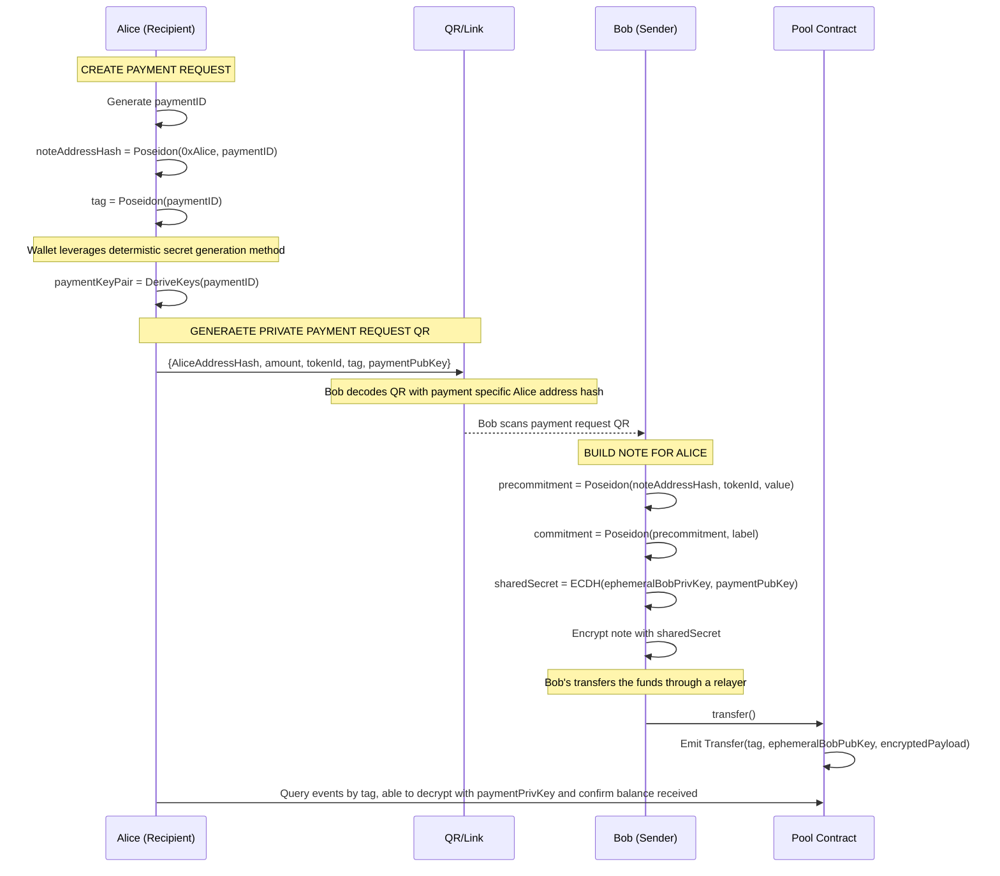